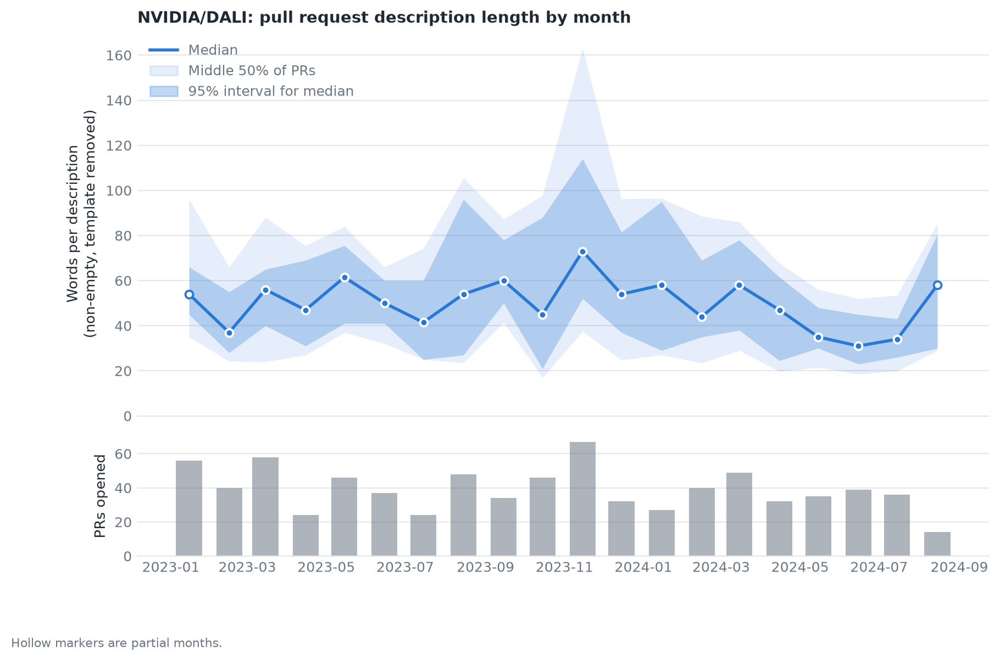
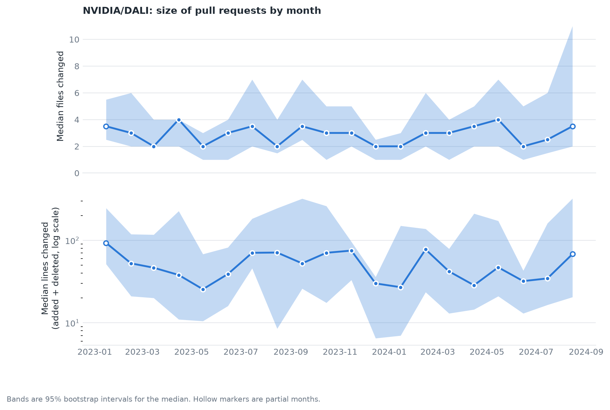
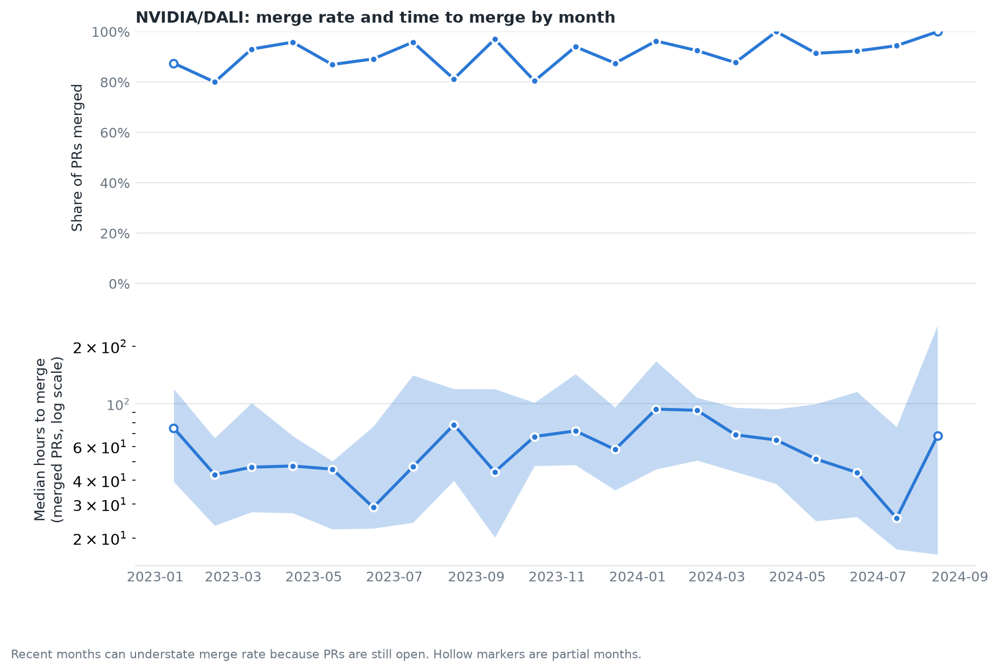
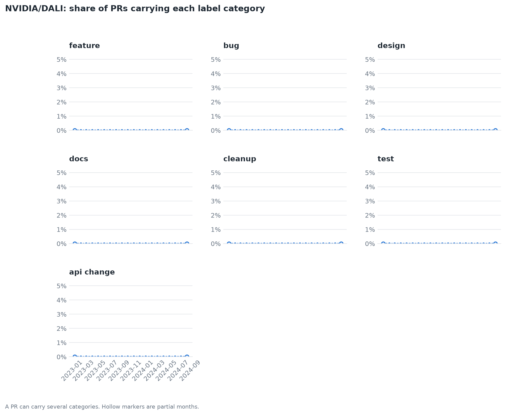
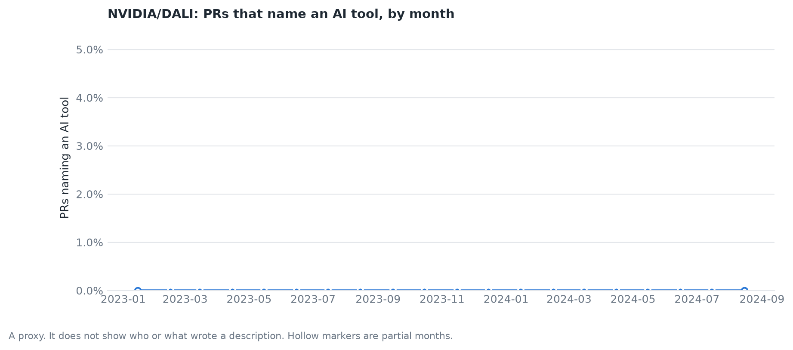

# Pull requests in NVIDIA/DALI: description length, size, speed and labels

Window 2023-01-09 to 2024-08-19 (UTC). Data fetched 2026-11-20. prwords 3.0.0, generated 2026-11-26. Method fixed in advance in `docs/ANALYSIS_PLAN.md`.

## 1. Data

- Repository primary language: C++
- Pull requests opened in the window: 784
- Removed as bot accounts: 0
- Analysed: 784 PRs from 26 authors
- Merged: 708 (90.3%). Closed without merging: 70 (8.9%). Still open: 6
- Follow-up: merge outcomes use a 30-day follow-up. PRs without enough follow-up: 0
- Empty descriptions after cleaning: 2.9%

## 2. Did the PR template change?

No template line appeared or disappeared with a share of 50% or more. Template text was detected monthly and removed before counting words.

Distinct template lines detected: 28.

## 3. First 28 days versus last 28 days

First window 2023-01-09 to 2023-02-05. Last window 2024-07-23 to 2024-08-19. Ratios are last median divided by first median. Bootstrap intervals, 2,000 resamples.

| Metric                                |   n first |   n last |   Median first |   Median last |   Ratio |   Ratio low |   Ratio high |     p |   Cliff's delta |
|:--------------------------------------|----------:|---------:|---------------:|--------------:|--------:|------------:|-------------:|------:|----------------:|
| Description words (non-empty)         |        64 |       25 |          53.5  |         51    |    0.95 |        0.56 |         1.49 | 0.52  |           -0.09 |
| Files changed                         |        67 |       25 |           3    |          3    |    1    |        0.4  |         2.33 | 0.92  |            0.01 |
| Lines added                           |        67 |       25 |          59    |         33    |    0.56 |        0.1  |         2.09 | 0.42  |           -0.11 |
| Lines deleted                         |        67 |       25 |          10    |          6    |    0.6  |        0.12 |         4.01 | 0.56  |           -0.08 |
| Net lines (added minus deleted)       |        67 |       25 |          36    |         26    |    0.72 |        0    |         2    | 0.11  |           -0.22 |
| Lines changed (added plus deleted)    |        67 |       25 |          90    |         45    |    0.5  |        0.14 |         2.47 | 0.61  |           -0.07 |
| Hours from open to merge (merged PRs) |        59 |       25 |          72.18 |         22.48 |    0.31 |        0.18 |         1.49 | 0.15  |           -0.2  |
| Commits                               |        67 |       25 |           2    |          1    |    0.5  |        0.33 |         1    | 0.096 |           -0.22 |
| Comments                              |        67 |       25 |           5    |          4    |    0.8  |        0.5  |         1.5  | 0.29  |           -0.14 |
| Reviews                               |        67 |       25 |           3    |          2    |    0.67 |        0.4  |         2.5  | 0.57  |           -0.07 |

| Measure                             |   n first |   n last | Share first   | Share last   |   Change (points) |      p |
|:------------------------------------|----------:|---------:|:--------------|:-------------|------------------:|-------:|
| Merged within follow-up period      |        67 |       25 | 80.6%         | 96.0%        |              15.4 | 0.1    |
| Closed without merging              |        67 |       25 | 11.9%         | 0.0%         |             -11.9 | 0.1    |
| Opened as draft                     |        67 |       25 | 11.9%         | 0.0%         |             -11.9 | 0.1    |
| From outside contributors           |        67 |       25 | 56.7%         | 24.0%        |             -32.7 | 0.0091 |
| Has a kind or type label            |        67 |       25 | 0.0%          | 0.0%         |               0   | 1      |
| Description text repeated elsewhere |        67 |       25 | 4.5%          | 0.0%         |              -4.5 | 0.56   |
| Names an AI tool (disclosure)       |        67 |       25 | 0.0%          | 0.0%         |               0   | 1      |
| Label category: feature             |        67 |       25 | 0.0%          | 0.0%         |               0   | 1      |
| Label category: bug                 |        67 |       25 | 0.0%          | 0.0%         |               0   | 1      |
| Label category: design              |        67 |       25 | 0.0%          | 0.0%         |               0   | 1      |
| Label category: docs                |        67 |       25 | 0.0%          | 0.0%         |               0   | 1      |
| Label category: cleanup             |        67 |       25 | 0.0%          | 0.0%         |               0   | 1      |
| Label category: test                |        67 |       25 | 0.0%          | 0.0%         |               0   | 1      |
| Label category: api_change          |        67 |       25 | 0.0%          | 0.0%         |               0   | 1      |

## 4. Monthly trends

Theil-Sen slope per month and Kendall tau over full months only.

| metric                     |   months |   slope_per_month |   slope_ci_low |   slope_ci_high |     tau |       p |
|:---------------------------|---------:|------------------:|---------------:|----------------:|--------:|--------:|
| median_words               |       18 |            -0.625 |         -1.833 |           0.667 |  -0.224 |   0.197 |
| median_files_changed       |       18 |            -0     |         -0.071 |           0.071 |   0.007 |   0.968 |
| median_additions           |       18 |            -0.591 |         -2.333 |           0.8   |  -0.21  |   0.225 |
| median_deletions           |       18 |             0.182 |         -0.083 |           0.5   |   0.244 |   0.168 |
| median_churn               |       18 |            -0.375 |         -2.35  |           1.083 |  -0.072 |   0.676 |
| median_hours_to_merge      |       18 |             0.63  |         -1.26  |           2.97  |   0.124 |   0.501 |
| merge_rate                 |       18 |             0.003 |         -0.003 |           0.01  |   0.197 |   0.255 |
| share_outside_contributors |       18 |            -0.031 |         -0.047 |          -0.016 |  -0.529 |   0.002 |
| share_ai_disclosed         |       18 |            -0     |         -0     |          -0     | nan     | nan     |
| median_comments            |       18 |             0.036 |         -0.062 |           0.167 |   0.147 |   0.416 |
| median_reviews             |       18 |            -0     |         -0.042 |           0.038 |  -0.015 |   0.935 |
| share_feature              |       18 |            -0     |         -0     |          -0     | nan     | nan     |
| share_bug                  |       18 |            -0     |         -0     |          -0     | nan     | nan     |
| share_design               |       18 |            -0     |         -0     |          -0     | nan     | nan     |
| share_docs                 |       18 |            -0     |         -0     |          -0     | nan     | nan     |
| share_cleanup              |       18 |            -0     |         -0     |          -0     | nan     | nan     |
| share_test                 |       18 |            -0     |         -0     |          -0     | nan     | nan     |
| share_api_change           |       18 |            -0     |         -0     |          -0     | nan     | nan     |

## 5. Labels

Share of PRs with a kind or type label: 0.0% overall. Label coverage by month is in `monthly_summary.csv` (`share_has_kind_label`).

| category            |   n_prs |   share |   median_words |   median_files |   median_churn |   merge_rate |   median_hours_to_merge |   share_ai_disclosed |
|:--------------------|--------:|--------:|---------------:|---------------:|---------------:|-------------:|------------------------:|---------------------:|
| feature             |       0 |       0 |            nan |            nan |          nan   |      nan     |                 nan     |                  nan |
| bug                 |       0 |       0 |            nan |            nan |          nan   |      nan     |                 nan     |                  nan |
| design              |       0 |       0 |            nan |            nan |          nan   |      nan     |                 nan     |                  nan |
| docs                |       0 |       0 |            nan |            nan |          nan   |      nan     |                 nan     |                  nan |
| cleanup             |       0 |       0 |            nan |            nan |          nan   |      nan     |                 nan     |                  nan |
| test                |       0 |       0 |            nan |            nan |          nan   |      nan     |                 nan     |                  nan |
| api_change          |       0 |       0 |            nan |            nan |          nan   |      nan     |                 nan     |                  nan |
| (no category label) |     784 |       1 |             49 |              3 |           46.5 |        0.903 |                  51.138 |                    0 |

## 6. Are PRs with signs of AI involvement smaller or larger?

Authorship is not observable. The proxy is `ai_disclosed`, defined in the analysis plan: 0 PRs (0.00%). 0 disclosed PRs are listed in `ai_disclosure_samples.csv` for manual audit.

### ai_disclosed

**Verdict: not testable.** Too few exposed PRs.

Pattern: lines changed: not estimated; files changed: not estimated; lines added: not estimated; lines deleted: not estimated; hours to merge: not estimated.

Not estimated: fewer than 30 exposed PRs (exposed PRs: 0).

### Robustness by tool (lines changed)

No tool named in any disclosure.

### File type check

Not run. Use `--file-check N` to sample N exposed PRs and matching unexposed PRs.

## 7. Other checks

- Outside contributors: 55.6% of PRs overall.
- Top 10 authors opened 96.7% of PRs.
- PRs whose description text is repeated elsewhere (10 or more words): 5.4%.

## 8. Limitations

- Word count and size describe PRs, not who wrote them. Proxies for AI involvement are noisy and omit undisclosed use.
- Added and deleted lines include generated or vendored files unless the project avoids committing them.
- Disclosure mostly captures tools that add attribution by default, so it is tool-skewed.
- Template removal is heuristic. Check `template_audit.csv`.
- One repository cannot support general claims. See the plan for replication.
- Months at the edges of the window are partial and are excluded from trend tests.

