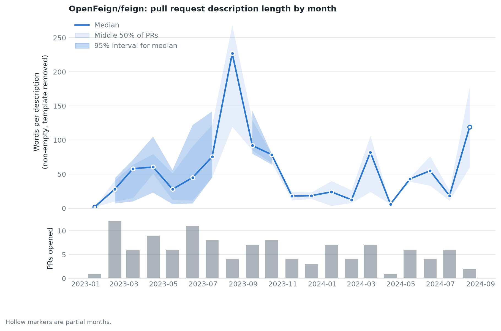
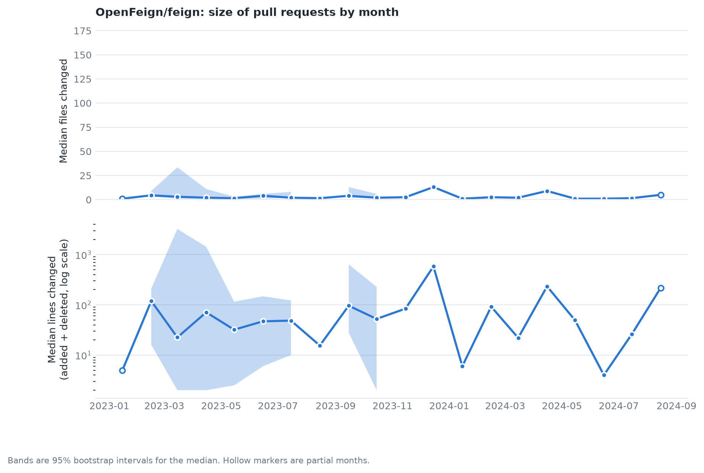
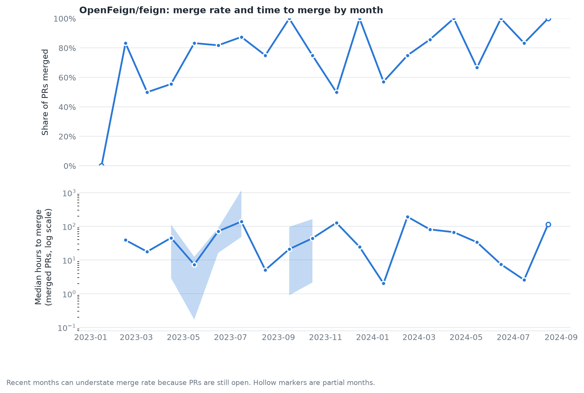
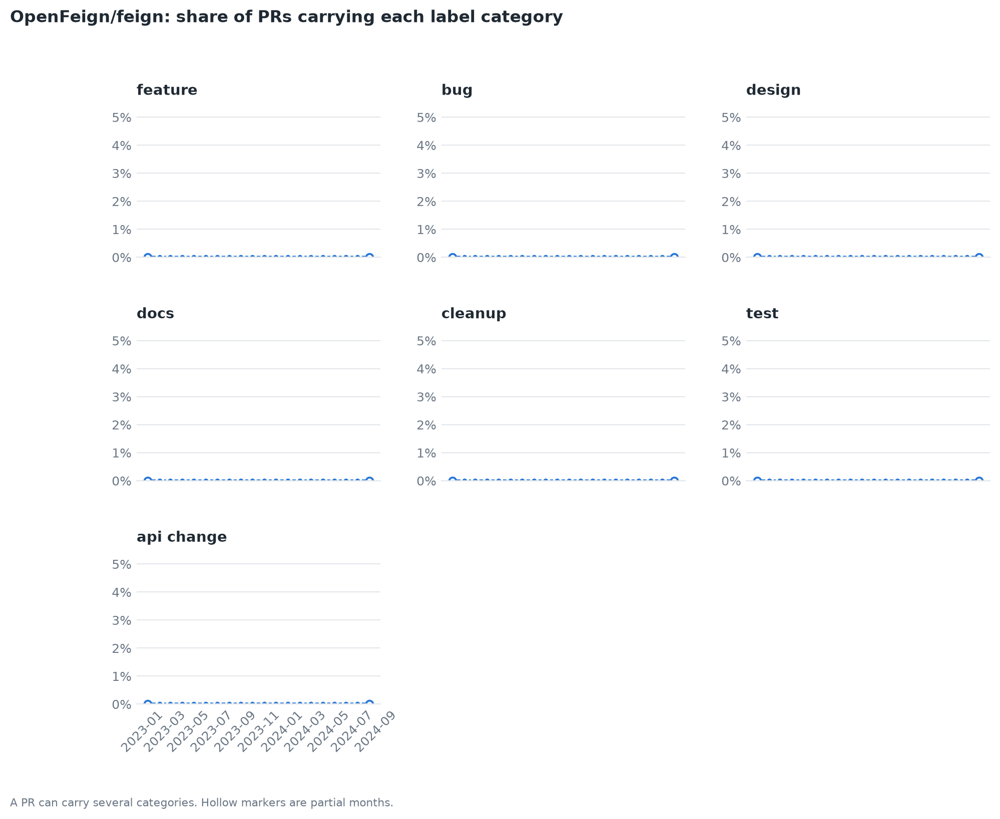
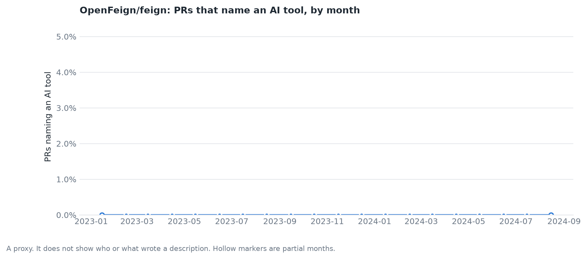

# Pull requests in OpenFeign/feign: description length, size, speed and labels

Window 2023-01-09 to 2024-08-19 (UTC). Data fetched 2026-11-20. prwords 3.0.0, generated 2026-11-26. Method fixed in advance in `docs/ANALYSIS_PLAN.md`.

## 1. Data

- Repository primary language: Java
- Pull requests opened in the window: 482
- Removed as bot accounts: 366
- Analysed: 116 PRs from 66 authors
- Merged: 89 (76.7%). Closed without merging: 27 (23.3%). Still open: 0
- Follow-up: merge outcomes use a 30-day follow-up. PRs without enough follow-up: 0
- Empty descriptions after cleaning: 9.5%

## 2. Did the PR template change?

No template line appeared or disappeared with a share of 50% or more. Template text was detected monthly and removed before counting words.

Distinct template lines detected: 0.

## 3. First 28 days versus last 28 days

First window 2023-01-09 to 2023-02-05. Last window 2024-07-23 to 2024-08-19. Ratios are last median divided by first median. Bootstrap intervals, 2,000 resamples.

| Metric                                |   n first |   n last |   Median first |   Median last |   Ratio |   Ratio low |   Ratio high | p   |   Cliff's delta |
|:--------------------------------------|----------:|---------:|---------------:|--------------:|--------:|------------:|-------------:|:----|----------------:|
| Description words (non-empty)         |         3 |        3 |            nan |           nan |     nan |         nan |          nan | n/a |             nan |
| Files changed                         |         3 |        4 |            nan |           nan |     nan |         nan |          nan | n/a |             nan |
| Lines added                           |         3 |        4 |            nan |           nan |     nan |         nan |          nan | n/a |             nan |
| Lines deleted                         |         3 |        4 |            nan |           nan |     nan |         nan |          nan | n/a |             nan |
| Net lines (added minus deleted)       |         3 |        4 |            nan |           nan |     nan |         nan |          nan | n/a |             nan |
| Lines changed (added plus deleted)    |         3 |        4 |            nan |           nan |     nan |         nan |          nan | n/a |             nan |
| Hours from open to merge (merged PRs) |         1 |        3 |            nan |           nan |     nan |         nan |          nan | n/a |             nan |
| Commits                               |         3 |        4 |            nan |           nan |     nan |         nan |          nan | n/a |             nan |
| Comments                              |         3 |        4 |            nan |           nan |     nan |         nan |          nan | n/a |             nan |
| Reviews                               |         3 |        4 |            nan |           nan |     nan |         nan |          nan | n/a |             nan |

| Measure                             |   n first |   n last | Share first   | Share last   |   Change (points) |    p |
|:------------------------------------|----------:|---------:|:--------------|:-------------|------------------:|-----:|
| Merged within follow-up period      |         3 |        4 | 33.3%         | 75.0%        |              41.7 | 0.49 |
| Closed without merging              |         3 |        4 | 66.7%         | 25.0%        |             -41.7 | 0.49 |
| Opened as draft                     |         3 |        4 | 0.0%          | 0.0%         |               0   | 1    |
| From outside contributors           |         3 |        4 | 100.0%        | 100.0%       |               0   | 1    |
| Has a kind or type label            |         3 |        4 | 0.0%          | 0.0%         |               0   | 1    |
| Description text repeated elsewhere |         3 |        4 | 0.0%          | 0.0%         |               0   | 1    |
| Names an AI tool (disclosure)       |         3 |        4 | 0.0%          | 0.0%         |               0   | 1    |
| Label category: feature             |         3 |        4 | 0.0%          | 0.0%         |               0   | 1    |
| Label category: bug                 |         3 |        4 | 0.0%          | 0.0%         |               0   | 1    |
| Label category: design              |         3 |        4 | 0.0%          | 0.0%         |               0   | 1    |
| Label category: docs                |         3 |        4 | 0.0%          | 0.0%         |               0   | 1    |
| Label category: cleanup             |         3 |        4 | 0.0%          | 0.0%         |               0   | 1    |
| Label category: test                |         3 |        4 | 0.0%          | 0.0%         |               0   | 1    |
| Label category: api_change          |         3 |        4 | 0.0%          | 0.0%         |               0   | 1    |

## 4. Monthly trends

Theil-Sen slope per month and Kendall tau over full months only.

| metric                     |   months |   slope_per_month |   slope_ci_low |   slope_ci_high |     tau |       p |
|:---------------------------|---------:|------------------:|---------------:|----------------:|--------:|--------:|
| median_words               |       18 |            -1.357 |         -4.389 |           1.955 |  -0.191 |   0.271 |
| median_files_changed       |       18 |            -0.071 |         -0.214 |           0.05  |  -0.254 |   0.156 |
| median_additions           |       18 |            -0.179 |         -2.567 |           5.556 |  -0.02  |   0.941 |
| median_deletions           |       18 |             0.033 |         -0.167 |           1     |   0.096 |   0.591 |
| median_churn               |       18 |            -1     |         -5.75  |           5.625 |  -0.072 |   0.709 |
| median_hours_to_merge      |       18 |            -0.414 |         -4.767 |           3.796 |  -0.059 |   0.765 |
| merge_rate                 |       18 |             0.009 |         -0.007 |           0.028 |   0.205 |   0.25  |
| share_outside_contributors |       18 |            -0     |         -0.042 |           0.012 |  -0.104 |   0.561 |
| share_ai_disclosed         |       18 |            -0     |         -0     |          -0     | nan     | nan     |
| median_comments            |       18 |            -0     |         -0.083 |          -0     |  -0.129 |   0.492 |
| median_reviews             |       18 |            -0     |         -0     |           0.1   |   0.1   |   0.598 |
| share_feature              |       18 |            -0     |         -0     |          -0     | nan     | nan     |
| share_bug                  |       18 |            -0     |         -0     |          -0     | nan     | nan     |
| share_design               |       18 |            -0     |         -0     |          -0     | nan     | nan     |
| share_docs                 |       18 |            -0     |         -0     |          -0     | nan     | nan     |
| share_cleanup              |       18 |            -0     |         -0     |          -0     | nan     | nan     |
| share_test                 |       18 |            -0     |         -0     |          -0     | nan     | nan     |
| share_api_change           |       18 |            -0     |         -0     |          -0     | nan     | nan     |

## 5. Labels

Share of PRs with a kind or type label: 0.0% overall. Label coverage by month is in `monthly_summary.csv` (`share_has_kind_label`).

| category            |   n_prs |   share |   median_words |   median_files |   median_churn |   merge_rate |   median_hours_to_merge |   share_ai_disclosed |
|:--------------------|--------:|--------:|---------------:|---------------:|---------------:|-------------:|------------------------:|---------------------:|
| feature             |       0 |       0 |            nan |            nan |            nan |      nan     |                   nan   |                  nan |
| bug                 |       0 |       0 |            nan |            nan |            nan |      nan     |                   nan   |                  nan |
| design              |       0 |       0 |            nan |            nan |            nan |      nan     |                   nan   |                  nan |
| docs                |       0 |       0 |            nan |            nan |            nan |      nan     |                   nan   |                  nan |
| cleanup             |       0 |       0 |            nan |            nan |            nan |      nan     |                   nan   |                  nan |
| test                |       0 |       0 |            nan |            nan |            nan |      nan     |                   nan   |                  nan |
| api_change          |       0 |       0 |            nan |            nan |            nan |      nan     |                   nan   |                  nan |
| (no category label) |     116 |       1 |             45 |              2 |             40 |        0.767 |                    42.1 |                    0 |

## 6. Are PRs with signs of AI involvement smaller or larger?

Authorship is not observable. The proxy is `ai_disclosed`, defined in the analysis plan: 0 PRs (0.00%). 0 disclosed PRs are listed in `ai_disclosure_samples.csv` for manual audit.

### ai_disclosed

**Verdict: not testable.** Too few exposed PRs.

Pattern: lines changed: not estimated; files changed: not estimated; lines added: not estimated; lines deleted: not estimated; hours to merge: not estimated.

Not estimated: fewer than 30 exposed PRs (exposed PRs: 0).

### Robustness by tool (lines changed)

No tool named in any disclosure.

### File type check

Not run. Use `--file-check N` to sample N exposed PRs and matching unexposed PRs.

## 7. Other checks

- Outside contributors: 76.7% of PRs overall.
- Top 10 authors opened 47.4% of PRs.
- PRs whose description text is repeated elsewhere (10 or more words): 5.2%.

## 8. Limitations

- Word count and size describe PRs, not who wrote them. Proxies for AI involvement are noisy and omit undisclosed use.
- Added and deleted lines include generated or vendored files unless the project avoids committing them.
- Disclosure mostly captures tools that add attribution by default, so it is tool-skewed.
- Template removal is heuristic. Check `template_audit.csv`.
- One repository cannot support general claims. See the plan for replication.
- Months at the edges of the window are partial and are excluded from trend tests.

