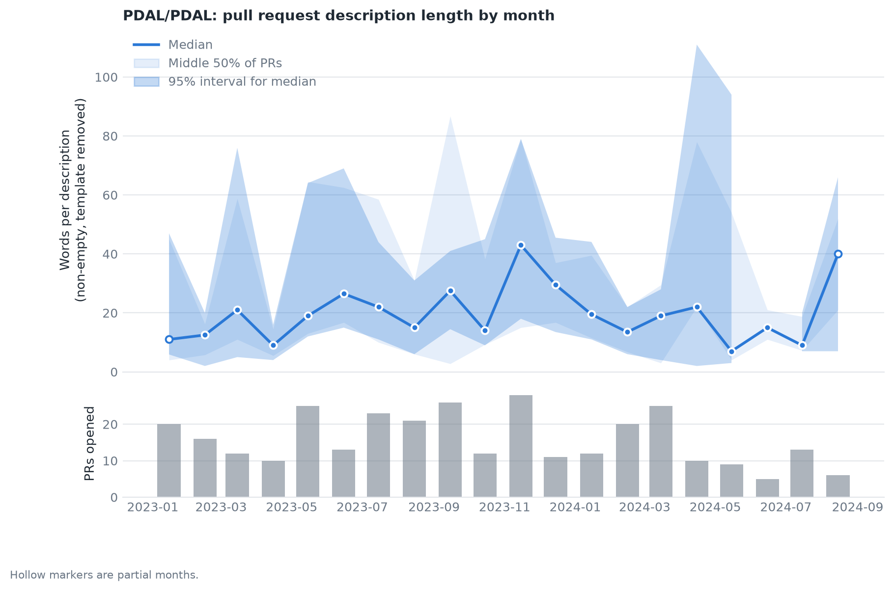
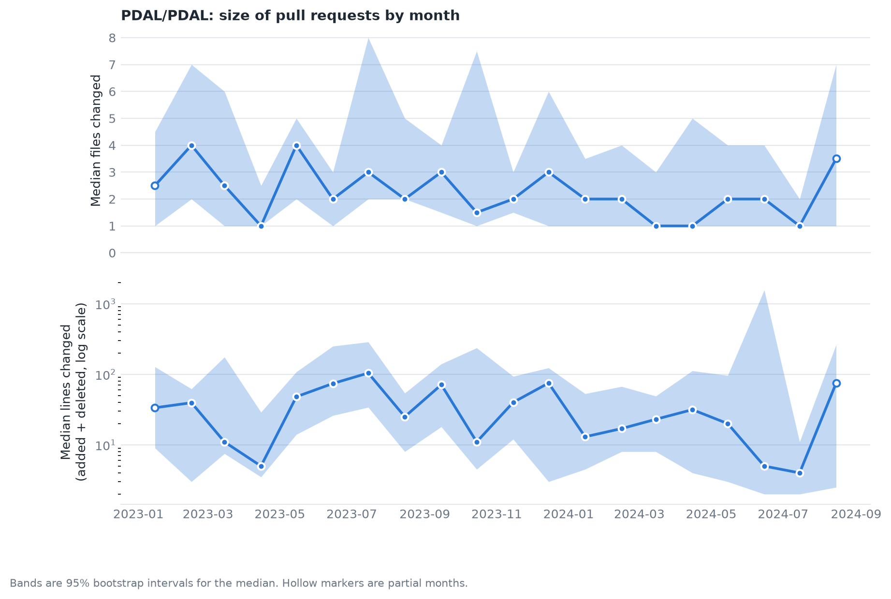
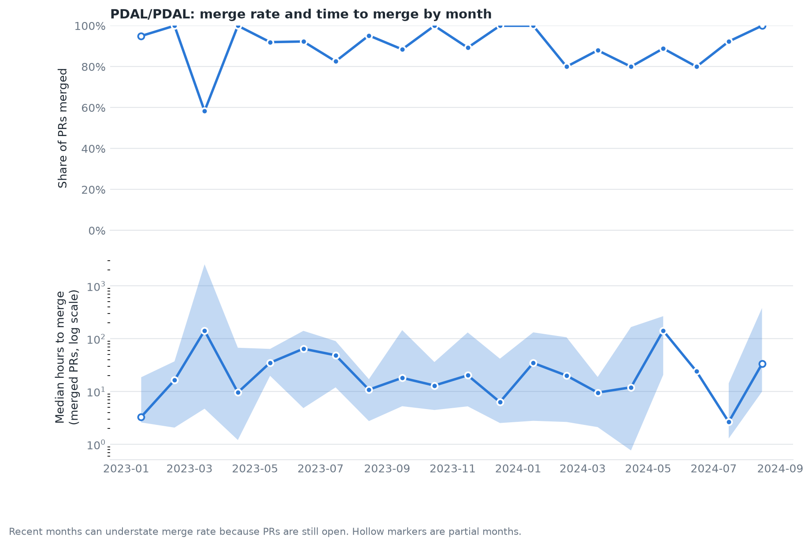
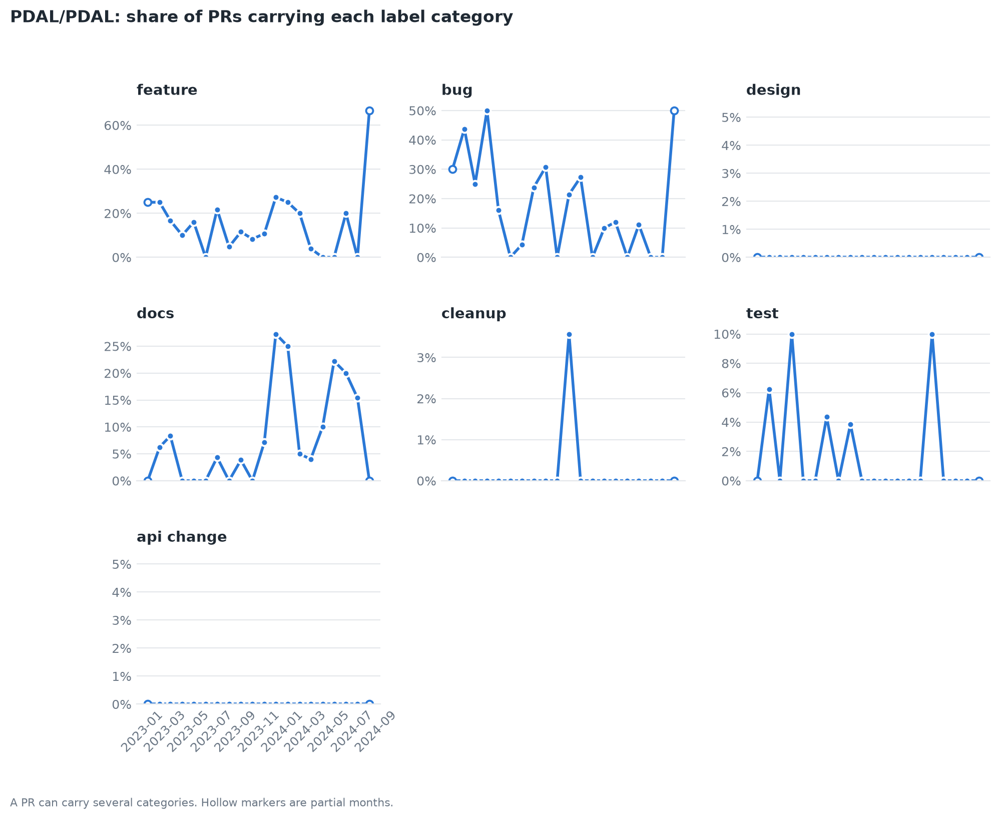
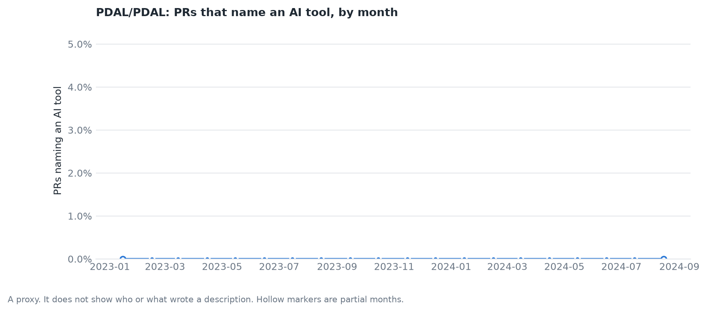

# Pull requests in PDAL/PDAL: description length, size, speed and labels

Window 2023-01-09 to 2024-08-19 (UTC). Data fetched 2026-11-20. prwords 3.0.0, generated 2026-11-26. Method fixed in advance in `docs/ANALYSIS_PLAN.md`.

## 1. Data

- Repository primary language: C++
- Pull requests opened in the window: 347
- Removed as bot accounts: 30
- Analysed: 317 PRs from 59 authors
- Merged: 285 (89.9%). Closed without merging: 30 (9.5%). Still open: 2
- Follow-up: merge outcomes use a 30-day follow-up. PRs without enough follow-up: 0
- Empty descriptions after cleaning: 25.6%

## 2. Did the PR template change?

No template line appeared or disappeared with a share of 50% or more. Template text was detected monthly and removed before counting words.

Distinct template lines detected: 0.

## 3. First 28 days versus last 28 days

First window 2023-01-09 to 2023-02-05. Last window 2024-07-23 to 2024-08-19. Ratios are last median divided by first median. Bootstrap intervals, 2,000 resamples.

| Metric                                |   n first |   n last |   Median first |   Median last |   Ratio |   Ratio low |   Ratio high |      p |   Cliff's delta |
|:--------------------------------------|----------:|---------:|---------------:|--------------:|--------:|------------:|-------------:|-------:|----------------:|
| Description words (non-empty)         |        17 |        7 |            9   |         35    |    3.89 |        0.3  |         9.46 | 0.37   |            0.24 |
| Files changed                         |        25 |        8 |            3   |          2    |    0.67 |        0.25 |         2.5  | 0.81   |           -0.06 |
| Lines added                           |        25 |        8 |           14   |         17.5  |    1.25 |        0.04 |        10.4  | 0.64   |           -0.12 |
| Lines deleted                         |        25 |        8 |            2   |          1    |    0.5  |        0    |        24    | 0.43   |           -0.19 |
| Net lines (added minus deleted)       |        25 |        8 |            4   |         17    |    4.25 |        0    |        29.1  | 0.61   |            0.12 |
| Lines changed (added plus deleted)    |        25 |        8 |           27   |         18    |    0.67 |        0.05 |        10.71 | 0.67   |           -0.1  |
| Hours from open to merge (merged PRs) |        24 |        8 |            3.3 |         15.18 |    4.61 |        0.67 |        54.07 | 0.14   |            0.36 |
| Commits                               |        25 |        8 |            1   |          1    |    1    |        0.5  |         7    | 0.87   |            0.04 |
| Comments                              |        25 |        8 |            1   |          0    |    0    |        0    |         1    | 0.23   |           -0.27 |
| Reviews                               |        25 |        8 |            0   |          0.5  |  nan    |      nan    |       nan    | 0.0077 |            0.43 |

| Measure                             |   n first |   n last | Share first   | Share last   |   Change (points) |    p |
|:------------------------------------|----------:|---------:|:--------------|:-------------|------------------:|-----:|
| Merged within follow-up period      |        25 |        8 | 96.0%         | 100.0%       |               4   | 1    |
| Closed without merging              |        25 |        8 | 4.0%          | 0.0%         |              -4   | 1    |
| Opened as draft                     |        25 |        8 | 0.0%          | 0.0%         |               0   | 1    |
| From outside contributors           |        25 |        8 | 40.0%         | 62.5%        |              22.5 | 0.42 |
| Has a kind or type label            |        25 |        8 | 0.0%          | 0.0%         |               0   | 1    |
| Description text repeated elsewhere |        25 |        8 | 0.0%          | 0.0%         |               0   | 1    |
| Names an AI tool (disclosure)       |        25 |        8 | 0.0%          | 0.0%         |               0   | 1    |
| Label category: feature             |        25 |        8 | 20.0%         | 50.0%        |              30   | 0.17 |
| Label category: bug                 |        25 |        8 | 40.0%         | 37.5%        |              -2.5 | 1    |
| Label category: design              |        25 |        8 | 0.0%          | 0.0%         |               0   | 1    |
| Label category: docs                |        25 |        8 | 4.0%          | 0.0%         |              -4   | 1    |
| Label category: cleanup             |        25 |        8 | 0.0%          | 0.0%         |               0   | 1    |
| Label category: test                |        25 |        8 | 0.0%          | 0.0%         |               0   | 1    |
| Label category: api_change          |        25 |        8 | 0.0%          | 0.0%         |               0   | 1    |

## 4. Monthly trends

Theil-Sen slope per month and Kendall tau over full months only.

| metric                     |   months |   slope_per_month |   slope_ci_low |   slope_ci_high |     tau |       p |
|:---------------------------|---------:|------------------:|---------------:|----------------:|--------:|--------:|
| median_words               |       18 |            -0.25  |         -1     |           0.636 |  -0.099 |   0.569 |
| median_files_changed       |       18 |            -0.1   |         -0.167 |          -0     |  -0.425 |   0.022 |
| median_additions           |       18 |            -0.833 |         -3.643 |           0.125 |  -0.302 |   0.081 |
| median_deletions           |       18 |            -0.25  |         -0.6   |           0.1   |  -0.248 |   0.158 |
| median_churn               |       18 |            -1.5   |         -5     |           0.889 |  -0.23  |   0.184 |
| median_hours_to_merge      |       18 |            -0.808 |         -3.83  |           1.01  |  -0.19  |   0.293 |
| merge_rate                 |       18 |            -0.003 |         -0.012 |           0.004 |  -0.185 |   0.299 |
| share_outside_contributors |       18 |             0.005 |         -0.015 |           0.023 |   0.093 |   0.594 |
| share_ai_disclosed         |       18 |            -0     |         -0     |          -0     | nan     | nan     |
| median_comments            |       18 |            -0     |         -0     |          -0     |   0.116 |   0.562 |
| median_reviews             |       18 |            -0     |         -0     |          -0     | nan     | nan     |
| share_feature              |       18 |            -0.007 |         -0.015 |           0.003 |  -0.248 |   0.158 |
| share_bug                  |       18 |            -0.017 |         -0.031 |          -0     |  -0.44  |   0.013 |
| share_design               |       18 |            -0     |         -0     |          -0     | nan     | nan     |
| share_docs                 |       18 |             0.009 |         -0     |           0.017 |   0.385 |   0.029 |
| share_cleanup              |       18 |            -0     |         -0     |          -0     |   0.02  |   0.923 |
| share_test                 |       18 |            -0     |         -0     |          -0     |  -0.282 |   0.147 |
| share_api_change           |       18 |            -0     |         -0     |          -0     | nan     | nan     |

## 5. Labels

Share of PRs with a kind or type label: 0.0% overall. Label coverage by month is in `monthly_summary.csv` (`share_has_kind_label`).

| category            |   n_prs |   share |   median_words |   median_files |   median_churn |   merge_rate |   median_hours_to_merge |   share_ai_disclosed |
|:--------------------|--------:|--------:|---------------:|---------------:|---------------:|-------------:|------------------------:|---------------------:|
| feature             |      45 |   0.142 |           27.5 |              5 |          122   |        1     |                  73.155 |                    0 |
| bug                 |      57 |   0.18  |           12   |              1 |           10   |        0.982 |                  12.689 |                    0 |
| design              |       0 |   0     |          nan   |            nan |          nan   |      nan     |                 nan     |                  nan |
| docs                |      20 |   0.063 |           11   |              1 |            3.5 |        1     |                   5.916 |                    0 |
| cleanup             |       1 |   0.003 |           83   |              7 |         2543   |        1     |               15437.9   |                    0 |
| test                |       5 |   0.016 |           42.5 |              4 |           12   |        1     |                  34.86  |                    0 |
| api_change          |       0 |   0     |          nan   |            nan |          nan   |      nan     |                 nan     |                  nan |
| (no category label) |     192 |   0.606 |           22   |              2 |           30   |        0.839 |                  17.562 |                    0 |

## 6. Are PRs with signs of AI involvement smaller or larger?

Authorship is not observable. The proxy is `ai_disclosed`, defined in the analysis plan: 0 PRs (0.00%). 0 disclosed PRs are listed in `ai_disclosure_samples.csv` for manual audit.

### ai_disclosed

**Verdict: not testable.** Too few exposed PRs.

Pattern: lines changed: not estimated; files changed: not estimated; lines added: not estimated; lines deleted: not estimated; hours to merge: not estimated.

Not estimated: fewer than 30 exposed PRs (exposed PRs: 0).

### Robustness by tool (lines changed)

No tool named in any disclosure.

### File type check

Not run. Use `--file-check N` to sample N exposed PRs and matching unexposed PRs.

## 7. Other checks

- Outside contributors: 51.7% of PRs overall.
- Top 10 authors opened 74.8% of PRs.
- PRs whose description text is repeated elsewhere (10 or more words): 1.3%.

## 8. Limitations

- Word count and size describe PRs, not who wrote them. Proxies for AI involvement are noisy and omit undisclosed use.
- Added and deleted lines include generated or vendored files unless the project avoids committing them.
- Disclosure mostly captures tools that add attribution by default, so it is tool-skewed.
- Template removal is heuristic. Check `template_audit.csv`.
- One repository cannot support general claims. See the plan for replication.
- Months at the edges of the window are partial and are excluded from trend tests.

