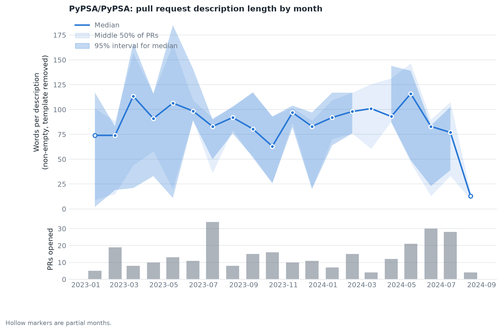
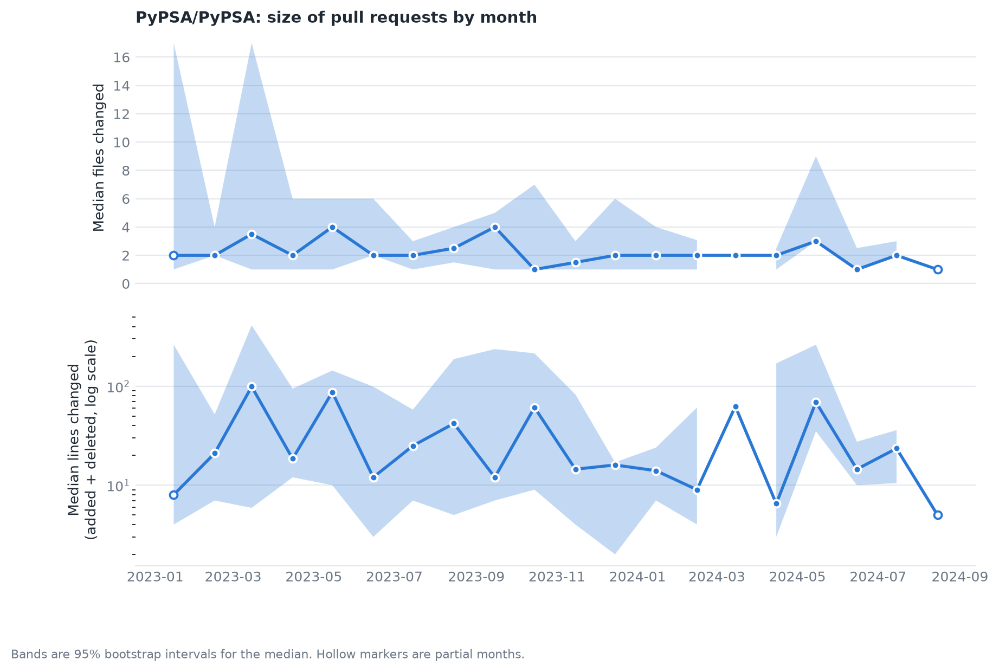
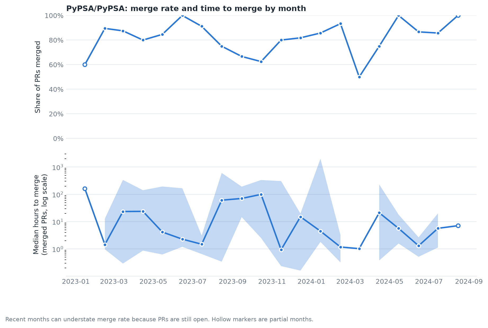
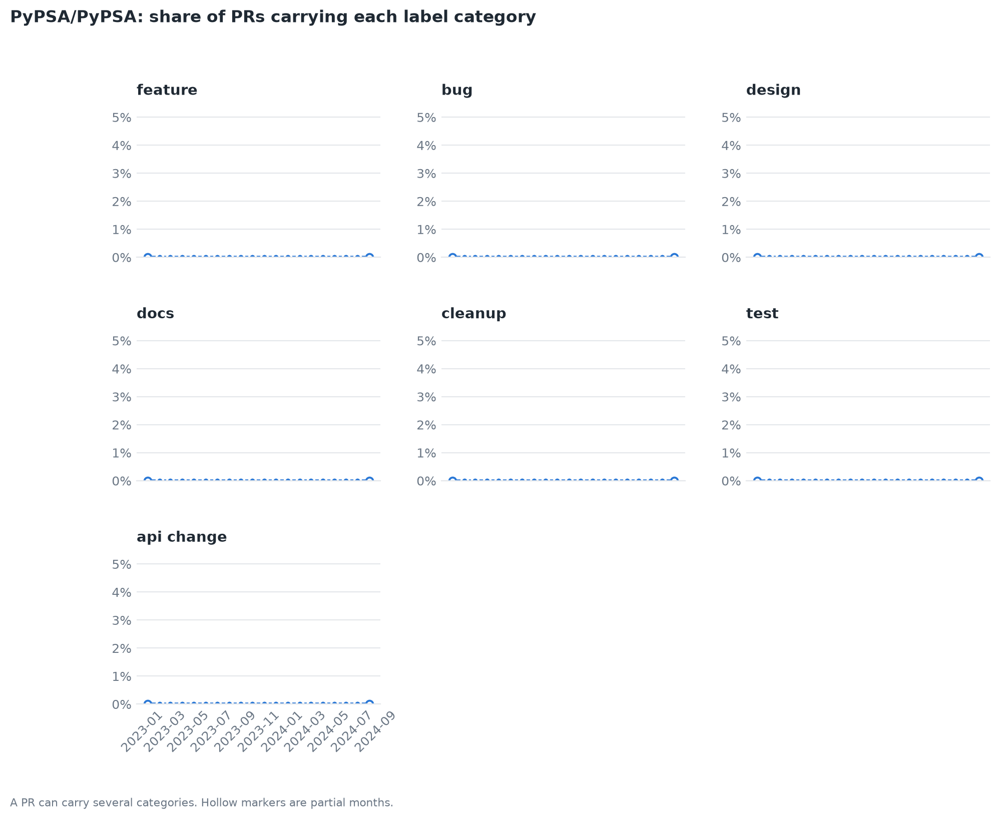
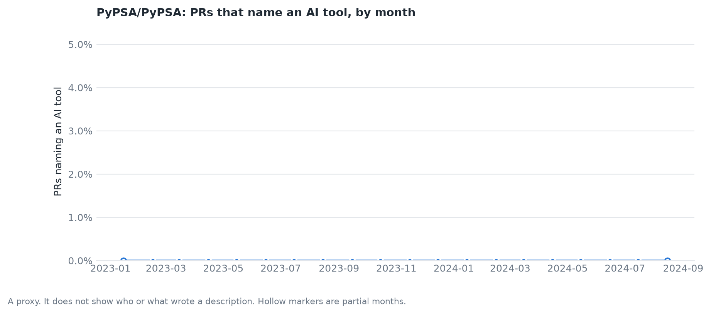

# Pull requests in PyPSA/PyPSA: description length, size, speed and labels

Window 2023-01-09 to 2024-08-19 (UTC). Data fetched 2026-11-20. prwords 3.0.0, generated 2026-11-26. Method fixed in advance in `docs/ANALYSIS_PLAN.md`.

## 1. Data

- Repository primary language: Python
- Pull requests opened in the window: 333
- Removed as bot accounts: 52
- Analysed: 281 PRs from 45 authors
- Merged: 237 (84.3%). Closed without merging: 41 (14.6%). Still open: 3
- Follow-up: merge outcomes use a 30-day follow-up. PRs without enough follow-up: 0
- Empty descriptions after cleaning: 16.0%

## 2. Did the PR template change?

No template line appeared or disappeared with a share of 50% or more. Template text was detected monthly and removed before counting words.

Distinct template lines detected: 0.

## 3. First 28 days versus last 28 days

First window 2023-01-09 to 2023-02-05. Last window 2024-07-23 to 2024-08-19. Ratios are last median divided by first median. Bootstrap intervals, 2,000 resamples.

| Metric                                |   n first |   n last |   Median first |   Median last |   Ratio |   Ratio low |   Ratio high |    p |   Cliff's delta |
|:--------------------------------------|----------:|---------:|---------------:|--------------:|--------:|------------:|-------------:|-----:|----------------:|
| Description words (non-empty)         |         9 |        6 |          74    |         50    |    0.68 |        0.05 |         4.01 | 1    |           -0.02 |
| Files changed                         |         9 |        9 |           2    |          2    |    1    |        0.2  |         1.5  | 0.44 |           -0.22 |
| Lines added                           |         9 |        9 |          21    |         20    |    0.95 |        0.06 |        10.05 | 0.86 |           -0.06 |
| Lines deleted                         |         9 |        9 |           4    |          3    |    0.75 |        0.08 |         3.33 | 0.45 |           -0.22 |
| Net lines (added minus deleted)       |         9 |        9 |           0    |          1    |  nan    |       -0.12 |         2.12 | 0.96 |           -0.02 |
| Lines changed (added plus deleted)    |         9 |        9 |          26    |         23    |    0.88 |        0.08 |         8.84 | 0.82 |           -0.07 |
| Hours from open to merge (merged PRs) |         7 |        8 |           5.11 |          7.12 |    1.39 |        0    |        21.6  | 0.4  |           -0.29 |
| Commits                               |         9 |        9 |           3    |          4    |    1.33 |        0.4  |         2    | 1    |            0.01 |
| Comments                              |         9 |        9 |           1    |          0    |    0    |        0    |         1    | 0.17 |           -0.37 |
| Reviews                               |         9 |        9 |           1    |          1    |    1    |        1    |         2    | 0.52 |            0.17 |

| Measure                             |   n first |   n last | Share first   | Share last   |   Change (points) |    p |
|:------------------------------------|----------:|---------:|:--------------|:-------------|------------------:|-----:|
| Merged within follow-up period      |         9 |        9 | 77.8%         | 88.9%        |              11.1 | 1    |
| Closed without merging              |         9 |        9 | 22.2%         | 11.1%        |             -11.1 | 1    |
| Opened as draft                     |         9 |        9 | 0.0%          | 0.0%         |               0   | 1    |
| From outside contributors           |         9 |        9 | 33.3%         | 11.1%        |             -22.2 | 0.58 |
| Has a kind or type label            |         9 |        9 | 0.0%          | 0.0%         |               0   | 1    |
| Description text repeated elsewhere |         9 |        9 | 33.3%         | 0.0%         |             -33.3 | 0.21 |
| Names an AI tool (disclosure)       |         9 |        9 | 0.0%          | 0.0%         |               0   | 1    |
| Label category: feature             |         9 |        9 | 0.0%          | 0.0%         |               0   | 1    |
| Label category: bug                 |         9 |        9 | 0.0%          | 0.0%         |               0   | 1    |
| Label category: design              |         9 |        9 | 0.0%          | 0.0%         |               0   | 1    |
| Label category: docs                |         9 |        9 | 0.0%          | 0.0%         |               0   | 1    |
| Label category: cleanup             |         9 |        9 | 0.0%          | 0.0%         |               0   | 1    |
| Label category: test                |         9 |        9 | 0.0%          | 0.0%         |               0   | 1    |
| Label category: api_change          |         9 |        9 | 0.0%          | 0.0%         |               0   | 1    |

## 4. Monthly trends

Theil-Sen slope per month and Kendall tau over full months only.

| metric                     |   months |   slope_per_month |   slope_ci_low |   slope_ci_high |     tau |       p |
|:---------------------------|---------:|------------------:|---------------:|----------------:|--------:|--------:|
| median_words               |       18 |            -0     |         -1.8   |           1.5   |  -0.007 |   0.97  |
| median_files_changed       |       18 |            -0     |         -0.094 |          -0     |  -0.204 |   0.276 |
| median_additions           |       18 |            -0.417 |         -2.5   |           0.6   |  -0.144 |   0.404 |
| median_deletions           |       18 |            -0.125 |         -0.429 |           0.333 |  -0.101 |   0.567 |
| median_churn               |       18 |            -0.636 |         -2.625 |           0.885 |  -0.178 |   0.306 |
| median_hours_to_merge      |       18 |            -0.082 |         -1.882 |           0.31  |  -0.098 |   0.601 |
| merge_rate                 |       18 |            -0.001 |         -0.016 |           0.01  |  -0.046 |   0.79  |
| share_outside_contributors |       18 |             0.005 |         -0.015 |           0.022 |   0.073 |   0.675 |
| share_ai_disclosed         |       18 |            -0     |         -0     |          -0     | nan     | nan     |
| median_comments            |       18 |            -0.083 |         -0.125 |          -0     |  -0.555 |   0.003 |
| median_reviews             |       18 |            -0     |         -0     |          -0     |   0.099 |   0.614 |
| share_feature              |       18 |            -0     |         -0     |          -0     | nan     | nan     |
| share_bug                  |       18 |            -0     |         -0     |          -0     | nan     | nan     |
| share_design               |       18 |            -0     |         -0     |          -0     | nan     | nan     |
| share_docs                 |       18 |            -0     |         -0     |          -0     | nan     | nan     |
| share_cleanup              |       18 |            -0     |         -0     |          -0     | nan     | nan     |
| share_test                 |       18 |            -0     |         -0     |          -0     | nan     | nan     |
| share_api_change           |       18 |            -0     |         -0     |          -0     | nan     | nan     |

## 5. Labels

Share of PRs with a kind or type label: 0.0% overall. Label coverage by month is in `monthly_summary.csv` (`share_has_kind_label`).

| category            |   n_prs |   share |   median_words |   median_files |   median_churn |   merge_rate |   median_hours_to_merge |   share_ai_disclosed |
|:--------------------|--------:|--------:|---------------:|---------------:|---------------:|-------------:|------------------------:|---------------------:|
| feature             |       0 |       0 |            nan |            nan |            nan |      nan     |                 nan     |                  nan |
| bug                 |       0 |       0 |            nan |            nan |            nan |      nan     |                 nan     |                  nan |
| design              |       0 |       0 |            nan |            nan |            nan |      nan     |                 nan     |                  nan |
| docs                |       0 |       0 |            nan |            nan |            nan |      nan     |                 nan     |                  nan |
| cleanup             |       0 |       0 |            nan |            nan |            nan |      nan     |                 nan     |                  nan |
| test                |       0 |       0 |            nan |            nan |            nan |      nan     |                 nan     |                  nan |
| api_change          |       0 |       0 |            nan |            nan |            nan |      nan     |                 nan     |                  nan |
| (no category label) |     281 |       1 |             83 |              2 |             20 |        0.843 |                   3.026 |                    0 |

## 6. Are PRs with signs of AI involvement smaller or larger?

Authorship is not observable. The proxy is `ai_disclosed`, defined in the analysis plan: 0 PRs (0.00%). 0 disclosed PRs are listed in `ai_disclosure_samples.csv` for manual audit.

### ai_disclosed

**Verdict: not testable.** Too few exposed PRs.

Pattern: lines changed: not estimated; files changed: not estimated; lines added: not estimated; lines deleted: not estimated; hours to merge: not estimated.

Not estimated: fewer than 30 exposed PRs (exposed PRs: 0).

### Robustness by tool (lines changed)

No tool named in any disclosure.

### File type check

Not run. Use `--file-check N` to sample N exposed PRs and matching unexposed PRs.

## 7. Other checks

- Outside contributors: 40.2% of PRs overall.
- Top 10 authors opened 80.8% of PRs.
- PRs whose description text is repeated elsewhere (10 or more words): 6.4%.

## 8. Limitations

- Word count and size describe PRs, not who wrote them. Proxies for AI involvement are noisy and omit undisclosed use.
- Added and deleted lines include generated or vendored files unless the project avoids committing them.
- Disclosure mostly captures tools that add attribution by default, so it is tool-skewed.
- Template removal is heuristic. Check `template_audit.csv`.
- One repository cannot support general claims. See the plan for replication.
- Months at the edges of the window are partial and are excluded from trend tests.

