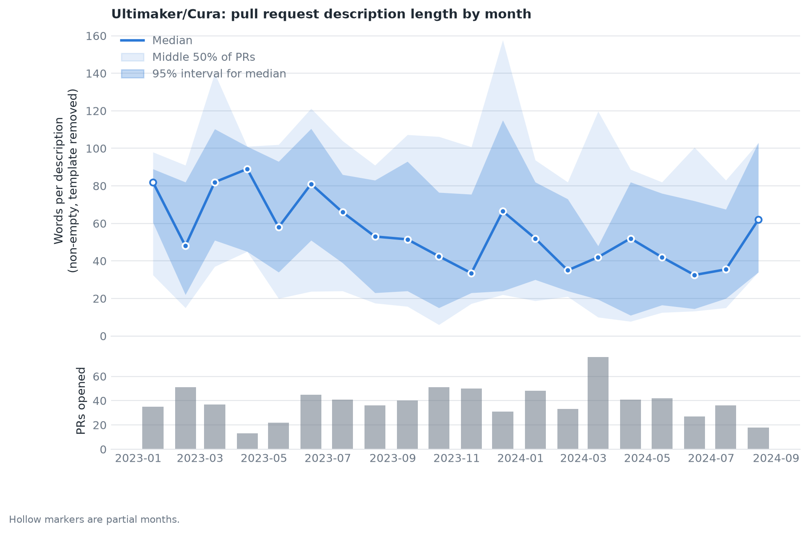
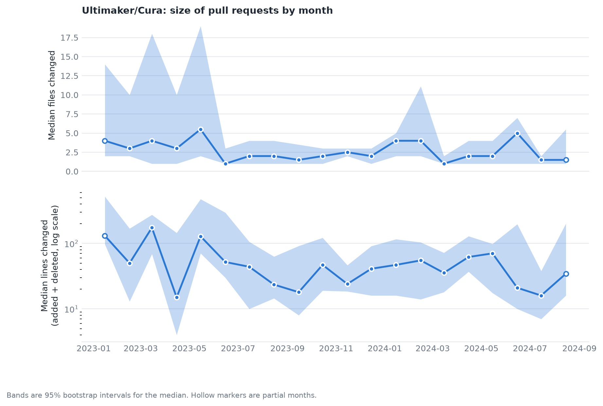
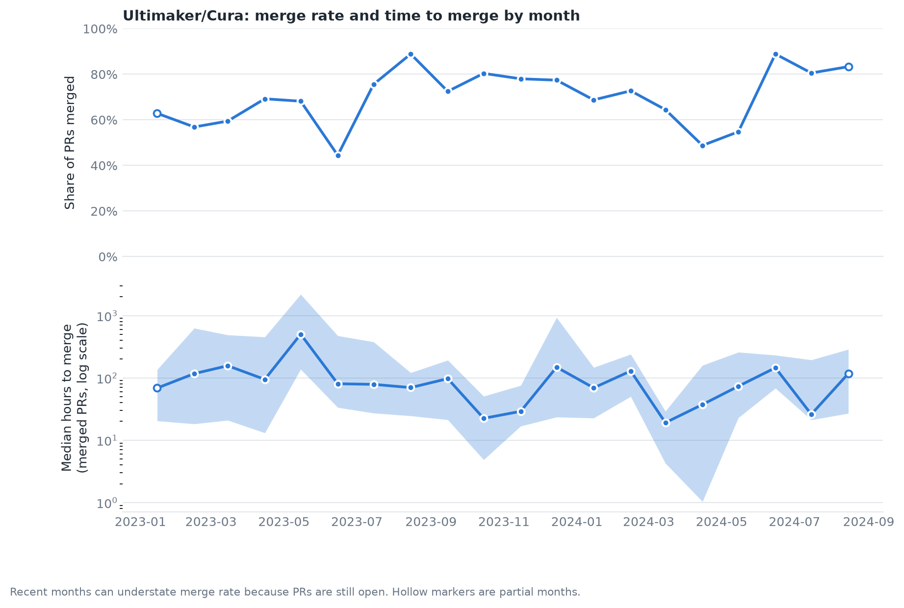
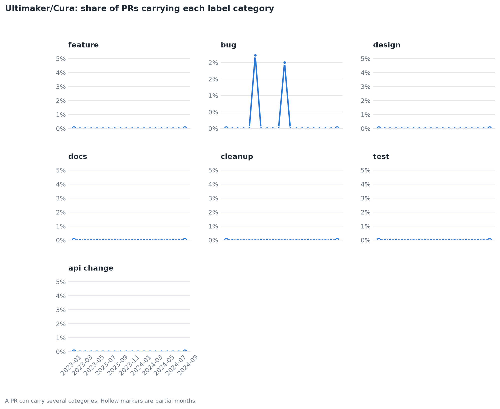
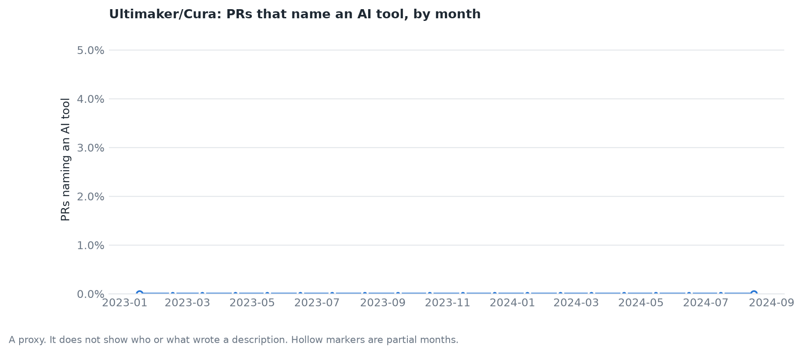

# Pull requests in Ultimaker/Cura: description length, size, speed and labels

Window 2023-01-09 to 2024-08-19 (UTC). Data fetched 2026-11-20. prwords 3.0.0, generated 2026-11-26. Method fixed in advance in `docs/ANALYSIS_PLAN.md`.

## 1. Data

- Repository primary language: Python
- Pull requests opened in the window: 797
- Removed as bot accounts: 24
- Analysed: 773 PRs from 153 authors
- Merged: 530 (68.6%). Closed without merging: 188 (24.3%). Still open: 55
- Follow-up: merge outcomes use a 30-day follow-up. PRs without enough follow-up: 0
- Empty descriptions after cleaning: 4.1%

## 2. Did the PR template change?

No template line appeared or disappeared with a share of 50% or more. Template text was detected monthly and removed before counting words.

Distinct template lines detected: 1.

## 3. First 28 days versus last 28 days

First window 2023-01-09 to 2023-02-05. Last window 2024-07-23 to 2024-08-19. Ratios are last median divided by first median. Bootstrap intervals, 2,000 resamples.

| Metric                                |   n first |   n last |   Median first |   Median last |   Ratio |   Ratio low |   Ratio high |     p |   Cliff's delta |
|:--------------------------------------|----------:|---------:|---------------:|--------------:|--------:|------------:|-------------:|------:|----------------:|
| Description words (non-empty)         |        44 |       21 |          82    |         68    |    0.83 |        0.46 |         1.74 | 0.94  |           -0.01 |
| Files changed                         |        44 |       24 |           3    |          2    |    0.67 |        0.11 |         1.5  | 0.3   |           -0.15 |
| Lines added                           |        44 |       24 |          87.5  |         23    |    0.26 |        0.11 |         0.94 | 0.16  |           -0.21 |
| Lines deleted                         |        44 |       24 |           3.5  |          6    |    1.71 |        0.25 |        10.81 | 0.64  |            0.07 |
| Net lines (added minus deleted)       |        44 |       24 |          34.5  |          7.5  |    0.22 |        0.03 |         1.5  | 0.1   |           -0.24 |
| Lines changed (added plus deleted)    |        44 |       24 |         124    |         45.5  |    0.37 |        0.1  |         1.27 | 0.29  |           -0.16 |
| Hours from open to merge (merged PRs) |        25 |       20 |          68.91 |        116.65 |    1.69 |        0.23 |         9.76 | 0.42  |            0.14 |
| Commits                               |        44 |       24 |           2.5  |          3    |    1.2  |        0.5  |         2.75 | 0.51  |            0.1  |
| Comments                              |        44 |       24 |           0    |          1    |  nan    |        0    |         2    | 0.56  |            0.08 |
| Reviews                               |        44 |       24 |           1    |          1    |    1    |        1    |         3    | 0.045 |            0.28 |

| Measure                             |   n first |   n last | Share first   | Share last   |   Change (points) |     p |
|:------------------------------------|----------:|---------:|:--------------|:-------------|------------------:|------:|
| Merged within follow-up period      |        44 |       24 | 50.0%         | 66.7%        |              16.7 | 0.21  |
| Closed without merging              |        44 |       24 | 40.9%         | 16.7%        |             -24.2 | 0.058 |
| Opened as draft                     |        44 |       24 | 2.3%          | 0.0%         |              -2.3 | 1     |
| From outside contributors           |        44 |       24 | 81.8%         | 83.3%        |               1.5 | 1     |
| Has a kind or type label            |        44 |       24 | 0.0%          | 0.0%         |               0   | 1     |
| Description text repeated elsewhere |        44 |       24 | 11.4%         | 4.2%         |              -7.2 | 0.41  |
| Names an AI tool (disclosure)       |        44 |       24 | 0.0%          | 0.0%         |               0   | 1     |
| Label category: feature             |        44 |       24 | 0.0%          | 0.0%         |               0   | 1     |
| Label category: bug                 |        44 |       24 | 0.0%          | 0.0%         |               0   | 1     |
| Label category: design              |        44 |       24 | 0.0%          | 0.0%         |               0   | 1     |
| Label category: docs                |        44 |       24 | 0.0%          | 0.0%         |               0   | 1     |
| Label category: cleanup             |        44 |       24 | 0.0%          | 0.0%         |               0   | 1     |
| Label category: test                |        44 |       24 | 0.0%          | 0.0%         |               0   | 1     |
| Label category: api_change          |        44 |       24 | 0.0%          | 0.0%         |               0   | 1     |

## 4. Monthly trends

Theil-Sen slope per month and Kendall tau over full months only.

| metric                     |   months |   slope_per_month |   slope_ci_low |   slope_ci_high |     tau |       p |
|:---------------------------|---------:|------------------:|---------------:|----------------:|--------:|--------:|
| median_words               |       18 |            -2.4   |         -3.9   |          -0.778 |  -0.533 |   0.002 |
| median_files_changed       |       18 |            -0     |         -0.154 |           0.091 |  -0.127 |   0.484 |
| median_additions           |       18 |            -0.1   |         -3.227 |           1.5   |  -0.039 |   0.82  |
| median_deletions           |       18 |            -0     |         -0.4   |           0.154 |  -0.118 |   0.512 |
| median_churn               |       18 |            -0.9   |         -4.875 |           1.714 |  -0.118 |   0.495 |
| median_hours_to_merge      |       18 |            -4.391 |         -9.18  |           0.4   |  -0.32  |   0.068 |
| merge_rate                 |       18 |             0.006 |         -0.011 |           0.019 |   0.17  |   0.324 |
| share_outside_contributors |       18 |             0.008 |          0.001 |           0.017 |   0.388 |   0.025 |
| share_ai_disclosed         |       18 |            -0     |         -0     |          -0     | nan     | nan     |
| median_comments            |       18 |            -0     |         -0     |          -0     |  -0.294 |   0.148 |
| median_reviews             |       18 |            -0     |         -0     |          -0     |   0.176 |   0.386 |
| share_feature              |       18 |            -0     |         -0     |          -0     | nan     | nan     |
| share_bug                  |       18 |            -0     |         -0     |          -0     |  -0.127 |   0.528 |
| share_design               |       18 |            -0     |         -0     |          -0     | nan     | nan     |
| share_docs                 |       18 |            -0     |         -0     |          -0     | nan     | nan     |
| share_cleanup              |       18 |            -0     |         -0     |          -0     | nan     | nan     |
| share_test                 |       18 |            -0     |         -0     |          -0     | nan     | nan     |
| share_api_change           |       18 |            -0     |         -0     |          -0     | nan     | nan     |

## 5. Labels

Share of PRs with a kind or type label: 0.3% overall. Label coverage by month is in `monthly_summary.csv` (`share_has_kind_label`).

| category            |   n_prs |   share |   median_words |   median_files |   median_churn |   merge_rate |   median_hours_to_merge |   share_ai_disclosed |
|:--------------------|--------:|--------:|---------------:|---------------:|---------------:|-------------:|------------------------:|---------------------:|
| feature             |       0 |   0     |          nan   |            nan |            nan |      nan     |                 nan     |                  nan |
| bug                 |       2 |   0.003 |           96.5 |              3 |              8 |        0     |                 nan     |                    0 |
| design              |       0 |   0     |          nan   |            nan |            nan |      nan     |                 nan     |                  nan |
| docs                |       0 |   0     |          nan   |            nan |            nan |      nan     |                 nan     |                  nan |
| cleanup             |       0 |   0     |          nan   |            nan |            nan |      nan     |                 nan     |                  nan |
| test                |       0 |   0     |          nan   |            nan |            nan |      nan     |                 nan     |                  nan |
| api_change          |       0 |   0     |          nan   |            nan |            nan |      nan     |                 nan     |                  nan |
| (no category label) |     771 |   0.997 |           51   |              2 |             45 |        0.687 |                  69.051 |                    0 |

## 6. Are PRs with signs of AI involvement smaller or larger?

Authorship is not observable. The proxy is `ai_disclosed`, defined in the analysis plan: 0 PRs (0.00%). 0 disclosed PRs are listed in `ai_disclosure_samples.csv` for manual audit.

### ai_disclosed

**Verdict: not testable.** Too few exposed PRs.

Pattern: lines changed: not estimated; files changed: not estimated; lines added: not estimated; lines deleted: not estimated; hours to merge: not estimated.

Not estimated: fewer than 30 exposed PRs (exposed PRs: 0).

### Robustness by tool (lines changed)

No tool named in any disclosure.

### File type check

Not run. Use `--file-check N` to sample N exposed PRs and matching unexposed PRs.

## 7. Other checks

- Outside contributors: 81.4% of PRs overall.
- Top 10 authors opened 65.1% of PRs.
- PRs whose description text is repeated elsewhere (10 or more words): 5.3%.

## 8. Limitations

- Word count and size describe PRs, not who wrote them. Proxies for AI involvement are noisy and omit undisclosed use.
- Added and deleted lines include generated or vendored files unless the project avoids committing them.
- Disclosure mostly captures tools that add attribution by default, so it is tool-skewed.
- Template removal is heuristic. Check `template_audit.csv`.
- One repository cannot support general claims. See the plan for replication.
- Months at the edges of the window are partial and are excluded from trend tests.

