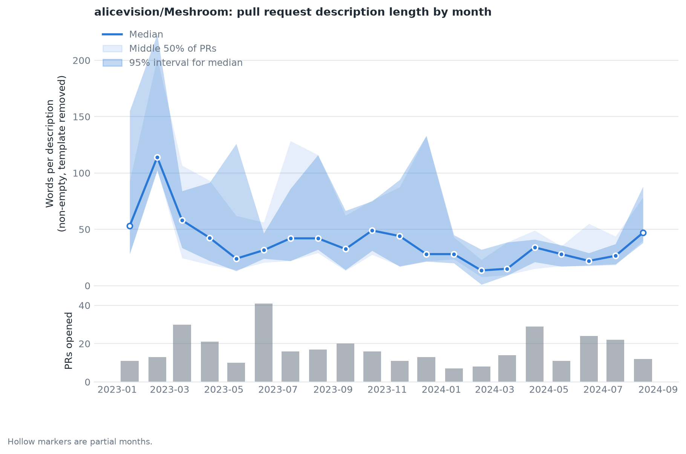
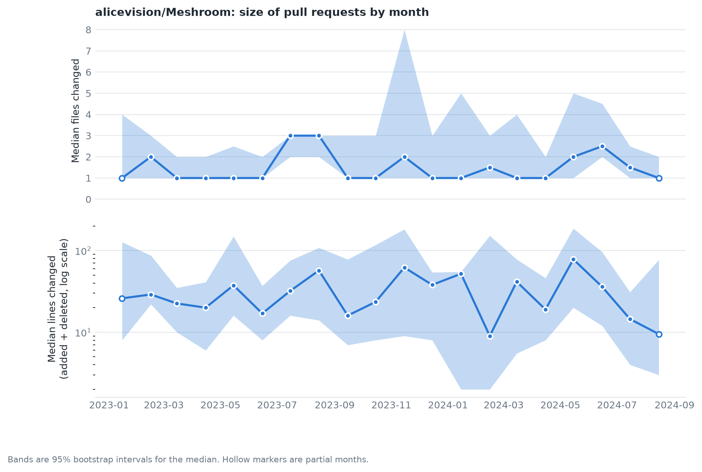
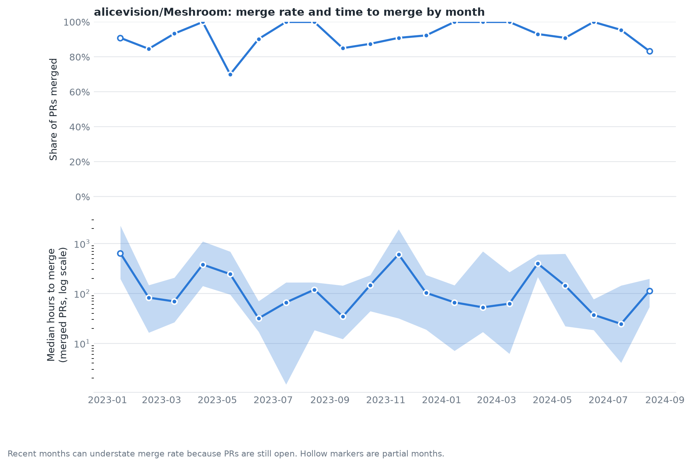
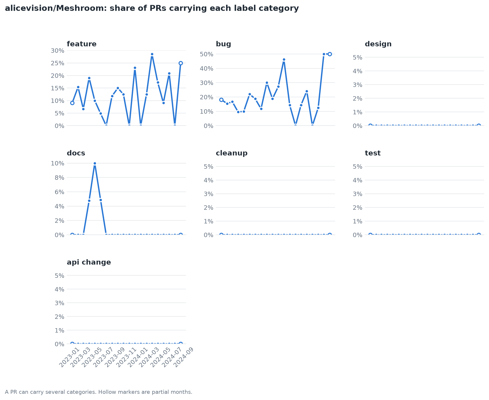
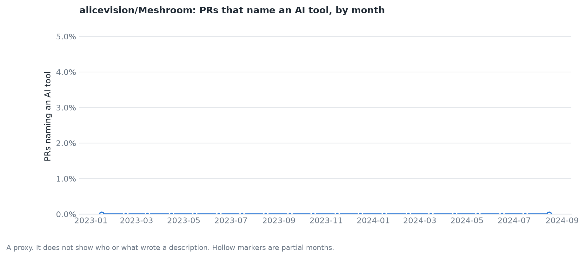

# Pull requests in alicevision/Meshroom: description length, size, speed and labels

Window 2023-01-09 to 2024-08-19 (UTC). Data fetched 2026-11-20. prwords 3.0.0, generated 2026-11-26. Method fixed in advance in `docs/ANALYSIS_PLAN.md`.

## 1. Data

- Repository primary language: Python
- Pull requests opened in the window: 348
- Removed as bot accounts: 2
- Analysed: 346 PRs from 15 authors
- Merged: 321 (92.8%). Closed without merging: 14 (4.0%). Still open: 11
- Follow-up: merge outcomes use a 30-day follow-up. PRs without enough follow-up: 0
- Empty descriptions after cleaning: 3.8%

## 2. Did the PR template change?

No template line appeared or disappeared with a share of 50% or more. Template text was detected monthly and removed before counting words.

Distinct template lines detected: 1.

## 3. First 28 days versus last 28 days

First window 2023-01-09 to 2023-02-05. Last window 2024-07-23 to 2024-08-19. Ratios are last median divided by first median. Bootstrap intervals, 2,000 resamples.

| Metric                                |   n first |   n last |   Median first |   Median last |   Ratio |   Ratio low |   Ratio high |     p |   Cliff's delta |
|:--------------------------------------|----------:|---------:|---------------:|--------------:|--------:|------------:|-------------:|------:|----------------:|
| Description words (non-empty)         |        12 |       18 |          76.5  |         44    |    0.58 |        0.31 |         1.64 | 0.27  |           -0.25 |
| Files changed                         |        14 |       18 |           1.5  |          1    |    0.67 |        0.29 |         2    | 0.33  |           -0.19 |
| Lines added                           |        14 |       18 |          12.5  |          3    |    0.24 |        0.03 |         2.92 | 0.062 |           -0.39 |
| Lines deleted                         |        14 |       18 |           4.5  |          2    |    0.44 |        0.1  |         2    | 0.32  |           -0.21 |
| Net lines (added minus deleted)       |        14 |       18 |           8.5  |          1.5  |    0.18 |        0    |         4    | 0.27  |           -0.23 |
| Lines changed (added plus deleted)    |        14 |       18 |          20.5  |          4    |    0.2  |        0.04 |         2.56 | 0.068 |           -0.38 |
| Hours from open to merge (merged PRs) |        13 |       16 |         314.56 |         91.41 |    0.29 |        0.03 |         1.18 | 0.051 |           -0.43 |
| Commits                               |        14 |       18 |           2.5  |          1    |    0.4  |        0.17 |         1    | 0.048 |           -0.38 |
| Comments                              |        14 |       18 |           0    |          0    |  nan    |      nan    |       nan    | 0.36  |           -0.14 |
| Reviews                               |        14 |       18 |           1.5  |          1    |    0.67 |        0.39 |         1    | 0.25  |           -0.23 |

| Measure                             |   n first |   n last | Share first   | Share last   |   Change (points) |     p |
|:------------------------------------|----------:|---------:|:--------------|:-------------|------------------:|------:|
| Merged within follow-up period      |        14 |       18 | 64.3%         | 83.3%        |              19   | 0.25  |
| Closed without merging              |        14 |       18 | 7.1%          | 11.1%        |               4   | 1     |
| Opened as draft                     |        14 |       18 | 0.0%          | 11.1%        |              11.1 | 0.49  |
| From outside contributors           |        14 |       18 | 78.6%         | 94.4%        |              15.9 | 0.3   |
| Has a kind or type label            |        14 |       18 | 0.0%          | 0.0%         |               0   | 1     |
| Description text repeated elsewhere |        14 |       18 | 0.0%          | 0.0%         |               0   | 1     |
| Names an AI tool (disclosure)       |        14 |       18 | 0.0%          | 0.0%         |               0   | 1     |
| Label category: feature             |        14 |       18 | 7.1%          | 16.7%        |               9.5 | 0.61  |
| Label category: bug                 |        14 |       18 | 14.3%         | 55.6%        |              41.3 | 0.028 |
| Label category: design              |        14 |       18 | 0.0%          | 0.0%         |               0   | 1     |
| Label category: docs                |        14 |       18 | 0.0%          | 0.0%         |               0   | 1     |
| Label category: cleanup             |        14 |       18 | 0.0%          | 0.0%         |               0   | 1     |
| Label category: test                |        14 |       18 | 0.0%          | 0.0%         |               0   | 1     |
| Label category: api_change          |        14 |       18 | 0.0%          | 0.0%         |               0   | 1     |

## 4. Monthly trends

Theil-Sen slope per month and Kendall tau over full months only.

| metric                     |   months |   slope_per_month |   slope_ci_low |   slope_ci_high |     tau |       p |
|:---------------------------|---------:|------------------:|---------------:|----------------:|--------:|--------:|
| median_words               |       18 |            -1.818 |         -3.375 |          -0.562 |  -0.483 |   0.006 |
| median_files_changed       |       18 |            -0     |         -0     |           0.05  |   0.119 |   0.528 |
| median_additions           |       18 |             0     |         -1     |           1.583 |   0.007 |   0.97  |
| median_deletions           |       18 |            -0.071 |         -0.5   |           0.5   |  -0.066 |   0.704 |
| median_churn               |       18 |             0.4   |         -1.444 |           2.667 |   0.059 |   0.765 |
| median_hours_to_merge      |       18 |            -2.474 |        -12.837 |           4.671 |  -0.176 |   0.33  |
| merge_rate                 |       18 |             0.004 |         -0     |           0.013 |   0.275 |   0.127 |
| share_outside_contributors |       18 |             0.001 |         -0.01  |           0.012 |   0.066 |   0.704 |
| share_ai_disclosed         |       18 |            -0     |         -0     |          -0     | nan     | nan     |
| median_comments            |       18 |            -0     |         -0     |          -0     | nan     | nan     |
| median_reviews             |       18 |            -0     |         -0     |          -0     |  -0.255 |   0.21  |
| share_feature              |       18 |             0.001 |         -0.007 |           0.01  |   0.054 |   0.76  |
| share_bug                  |       18 |             0.004 |         -0.008 |           0.017 |   0.092 |   0.595 |
| share_design               |       18 |            -0     |         -0     |          -0     | nan     | nan     |
| share_docs                 |       18 |            -0     |         -0     |          -0     |  -0.373 |   0.06  |
| share_cleanup              |       18 |            -0     |         -0     |          -0     | nan     | nan     |
| share_test                 |       18 |            -0     |         -0     |          -0     | nan     | nan     |
| share_api_change           |       18 |            -0     |         -0     |          -0     | nan     | nan     |

## 5. Labels

Share of PRs with a kind or type label: 1.4% overall. Label coverage by month is in `monthly_summary.csv` (`share_has_kind_label`).

| category            |   n_prs |   share |   median_words |   median_files |   median_churn |   merge_rate |   median_hours_to_merge |   share_ai_disclosed |
|:--------------------|--------:|--------:|---------------:|---------------:|---------------:|-------------:|------------------------:|---------------------:|
| feature             |      41 |   0.118 |           36.5 |              2 |             74 |        0.951 |                 213.643 |                    0 |
| bug                 |      74 |   0.214 |           48   |              1 |              9 |        0.959 |                  25.645 |                    0 |
| design              |       0 |   0     |          nan   |            nan |            nan |      nan     |                 nan     |                  nan |
| docs                |       4 |   0.012 |           69   |              1 |              5 |        1     |                 144.852 |                    0 |
| cleanup             |       0 |   0     |          nan   |            nan |            nan |      nan     |                 nan     |                  nan |
| test                |       0 |   0     |          nan   |            nan |            nan |      nan     |                 nan     |                  nan |
| api_change          |       0 |   0     |          nan   |            nan |            nan |      nan     |                 nan     |                  nan |
| (no category label) |     227 |   0.656 |           31   |              2 |             29 |        0.912 |                 103.645 |                    0 |

## 6. Are PRs with signs of AI involvement smaller or larger?

Authorship is not observable. The proxy is `ai_disclosed`, defined in the analysis plan: 0 PRs (0.00%). 0 disclosed PRs are listed in `ai_disclosure_samples.csv` for manual audit.

### ai_disclosed

**Verdict: not testable.** Too few exposed PRs.

Pattern: lines changed: not estimated; files changed: not estimated; lines added: not estimated; lines deleted: not estimated; hours to merge: not estimated.

Not estimated: fewer than 30 exposed PRs (exposed PRs: 0).

### Robustness by tool (lines changed)

No tool named in any disclosure.

### File type check

Not run. Use `--file-check N` to sample N exposed PRs and matching unexposed PRs.

## 7. Other checks

- Outside contributors: 87.0% of PRs overall.
- Top 10 authors opened 97.4% of PRs.
- PRs whose description text is repeated elsewhere (10 or more words): 0.6%.

## 8. Limitations

- Word count and size describe PRs, not who wrote them. Proxies for AI involvement are noisy and omit undisclosed use.
- Added and deleted lines include generated or vendored files unless the project avoids committing them.
- Disclosure mostly captures tools that add attribution by default, so it is tool-skewed.
- Template removal is heuristic. Check `template_audit.csv`.
- One repository cannot support general claims. See the plan for replication.
- Months at the edges of the window are partial and are excluded from trend tests.

