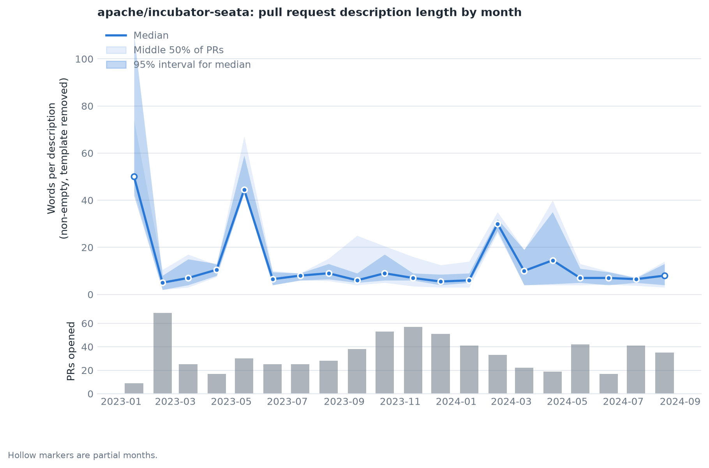
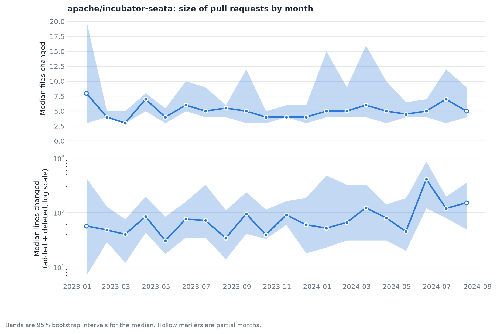
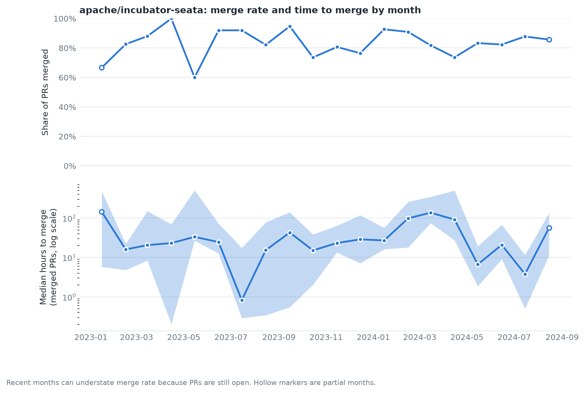
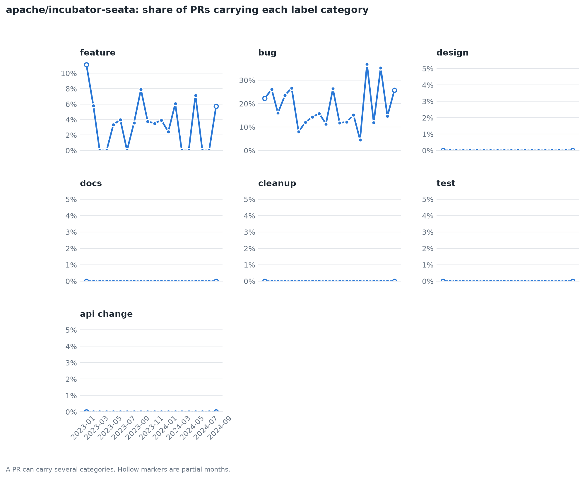
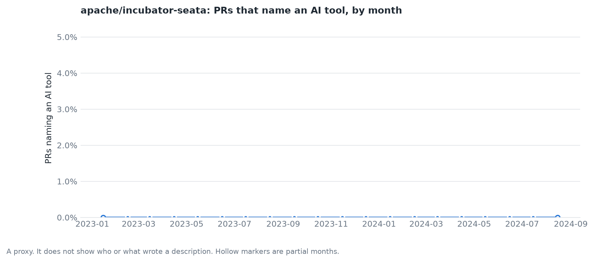

# Pull requests in apache/incubator-seata: description length, size, speed and labels

Window 2023-01-09 to 2024-08-19 (UTC). Data fetched 2026-11-20. prwords 3.0.0, generated 2026-11-26. Method fixed in advance in `docs/ANALYSIS_PLAN.md`.

## 1. Data

- Repository primary language: Java
- Pull requests opened in the window: 693
- Removed as bot accounts: 16
- Analysed: 677 PRs from 95 authors
- Merged: 564 (83.3%). Closed without merging: 93 (13.7%). Still open: 20
- Follow-up: merge outcomes use a 30-day follow-up. PRs without enough follow-up: 0
- Empty descriptions after cleaning: 9.6%

## 2. Did the PR template change?

No template line appeared or disappeared with a share of 50% or more. Template text was detected monthly and removed before counting words.

Distinct template lines detected: 6.

## 3. First 28 days versus last 28 days

First window 2023-01-09 to 2023-02-05. Last window 2024-07-23 to 2024-08-19. Ratios are last median divided by first median. Bootstrap intervals, 2,000 resamples.

| Metric                                |   n first |   n last |   Median first |   Median last |   Ratio |   Ratio low |   Ratio high |      p |   Cliff's delta |
|:--------------------------------------|----------:|---------:|---------------:|--------------:|--------:|------------:|-------------:|-------:|----------------:|
| Description words (non-empty)         |        24 |       38 |          31    |          6.5  |    0.21 |        0.1  |         0.83 | 0.0086 |           -0.4  |
| Files changed                         |        24 |       44 |           4    |          5    |    1.25 |        0.67 |         2    | 0.95   |           -0.01 |
| Lines added                           |        24 |       44 |          29    |         79    |    2.72 |        0.19 |        10.14 | 0.46   |            0.11 |
| Lines deleted                         |        24 |       44 |           7    |         13    |    1.86 |        0.43 |         7.76 | 0.37   |            0.13 |
| Net lines (added minus deleted)       |        24 |       44 |          27    |         31.5  |    1.17 |        0.19 |         9.69 | 0.73   |            0.05 |
| Lines changed (added plus deleted)    |        24 |       44 |          44.5  |         91.5  |    2.06 |        0.26 |         8.67 | 0.22   |            0.18 |
| Hours from open to merge (merged PRs) |        18 |       38 |          21.13 |         28.14 |    1.33 |        0.32 |         3.99 | 0.79   |            0.05 |
| Commits                               |        24 |       44 |           5    |          5    |    1    |        0.57 |         1.75 | 0.69   |            0.06 |
| Comments                              |        24 |       44 |           1    |          1    |    1    |        0.5  |         1    | 0.11   |           -0.21 |
| Reviews                               |        24 |       44 |           2    |          2    |    1    |        0.5  |         2    | 0.87   |            0.02 |

| Measure                             |   n first |   n last | Share first   | Share last   |   Change (points) |    p |
|:------------------------------------|----------:|---------:|:--------------|:-------------|------------------:|-----:|
| Merged within follow-up period      |        24 |       44 | 75.0%         | 84.1%        |               9.1 | 0.52 |
| Closed without merging              |        24 |       44 | 12.5%         | 11.4%        |              -1.1 | 1    |
| Opened as draft                     |        24 |       44 | 4.2%          | 0.0%         |              -4.2 | 0.35 |
| From outside contributors           |        24 |       44 | 83.3%         | 65.9%        |             -17.4 | 0.16 |
| Has a kind or type label            |        24 |       44 | 70.8%         | 61.4%        |              -9.5 | 0.6  |
| Description text repeated elsewhere |        24 |       44 | 12.5%         | 29.5%        |              17   | 0.14 |
| Names an AI tool (disclosure)       |        24 |       44 | 0.0%          | 0.0%         |               0   | 1    |
| Label category: feature             |        24 |       44 | 8.3%          | 4.5%         |              -3.8 | 0.61 |
| Label category: bug                 |        24 |       44 | 41.7%         | 22.7%        |             -18.9 | 0.16 |
| Label category: design              |        24 |       44 | 0.0%          | 0.0%         |               0   | 1    |
| Label category: docs                |        24 |       44 | 0.0%          | 0.0%         |               0   | 1    |
| Label category: cleanup             |        24 |       44 | 0.0%          | 0.0%         |               0   | 1    |
| Label category: test                |        24 |       44 | 0.0%          | 0.0%         |               0   | 1    |
| Label category: api_change          |        24 |       44 | 0.0%          | 0.0%         |               0   | 1    |

## 4. Monthly trends

Theil-Sen slope per month and Kendall tau over full months only.

| metric                     |   months |   slope_per_month |   slope_ci_low |   slope_ci_high |     tau |       p |
|:---------------------------|---------:|------------------:|---------------:|----------------:|--------:|--------:|
| median_words               |       18 |            -0     |         -0.25  |           0.25  |   0.013 |   0.939 |
| median_files_changed       |       18 |             0.033 |         -0     |           0.154 |   0.202 |   0.272 |
| median_additions           |       18 |             2.417 |          0.3   |           4.889 |   0.388 |   0.025 |
| median_deletions           |       18 |             0.118 |         -0.375 |           0.722 |   0.119 |   0.494 |
| median_churn               |       18 |             3.308 |         -0.2   |           6.75  |   0.32  |   0.068 |
| median_hours_to_merge      |       18 |             0.587 |         -1.052 |           4.784 |   0.111 |   0.55  |
| merge_rate                 |       18 |            -0.002 |         -0.011 |           0.009 |  -0.105 |   0.544 |
| share_outside_contributors |       18 |            -0.002 |         -0.019 |           0.017 |  -0.02  |   0.941 |
| share_ai_disclosed         |       18 |            -0     |         -0     |          -0     | nan     | nan     |
| median_comments            |       18 |            -0     |         -0     |          -0     |   0.057 |   0.779 |
| median_reviews             |       18 |            -0     |         -0     |           0.111 |   0.138 |   0.467 |
| share_feature              |       18 |            -0     |         -0.003 |           0.002 |  -0.084 |   0.639 |
| share_bug                  |       18 |            -0.001 |         -0.009 |           0.007 |  -0.059 |   0.765 |
| share_design               |       18 |            -0     |         -0     |          -0     | nan     | nan     |
| share_docs                 |       18 |            -0     |         -0     |          -0     | nan     | nan     |
| share_cleanup              |       18 |            -0     |         -0     |          -0     | nan     | nan     |
| share_test                 |       18 |            -0     |         -0     |          -0     | nan     | nan     |
| share_api_change           |       18 |            -0     |         -0     |          -0     | nan     | nan     |

## 5. Labels

Share of PRs with a kind or type label: 41.9% overall. Label coverage by month is in `monthly_summary.csv` (`share_has_kind_label`).

| category            |   n_prs |   share |   median_words |   median_files |   median_churn |   merge_rate |   median_hours_to_merge |   share_ai_disclosed |
|:--------------------|--------:|--------:|---------------:|---------------:|---------------:|-------------:|------------------------:|---------------------:|
| feature             |      25 |   0.037 |             36 |             32 |         1139   |        0.8   |                 848.716 |                    0 |
| bug                 |     122 |   0.18  |             10 |              4 |           32   |        0.951 |                  27.466 |                    0 |
| design              |       0 |   0     |            nan |            nan |          nan   |      nan     |                 nan     |                  nan |
| docs                |       0 |   0     |            nan |            nan |          nan   |      nan     |                 nan     |                  nan |
| cleanup             |       0 |   0     |            nan |            nan |          nan   |      nan     |                 nan     |                  nan |
| test                |       0 |   0     |            nan |            nan |          nan   |      nan     |                 nan     |                  nan |
| api_change          |       0 |   0     |            nan |            nan |          nan   |      nan     |                 nan     |                  nan |
| (no category label) |     530 |   0.783 |              8 |              5 |           84.5 |        0.808 |                  17.566 |                    0 |

## 6. Are PRs with signs of AI involvement smaller or larger?

Authorship is not observable. The proxy is `ai_disclosed`, defined in the analysis plan: 0 PRs (0.00%). 0 disclosed PRs are listed in `ai_disclosure_samples.csv` for manual audit.

### ai_disclosed

**Verdict: not testable.** Too few exposed PRs.

Pattern: lines changed: not estimated; files changed: not estimated; lines added: not estimated; lines deleted: not estimated; hours to merge: not estimated.

Not estimated: fewer than 30 exposed PRs (exposed PRs: 0).

### Robustness by tool (lines changed)

No tool named in any disclosure.

### File type check

Not run. Use `--file-check N` to sample N exposed PRs and matching unexposed PRs.

## 7. Other checks

- Outside contributors: 59.4% of PRs overall.
- Top 10 authors opened 65.9% of PRs.
- PRs whose description text is repeated elsewhere (10 or more words): 24.7%.

## 8. Limitations

- Word count and size describe PRs, not who wrote them. Proxies for AI involvement are noisy and omit undisclosed use.
- Added and deleted lines include generated or vendored files unless the project avoids committing them.
- Disclosure mostly captures tools that add attribution by default, so it is tool-skewed.
- Template removal is heuristic. Check `template_audit.csv`.
- One repository cannot support general claims. See the plan for replication.
- Months at the edges of the window are partial and are excluded from trend tests.

