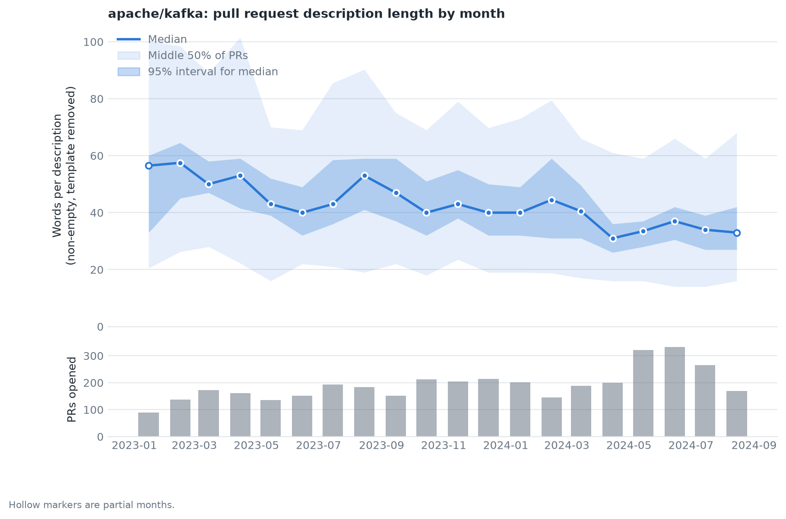
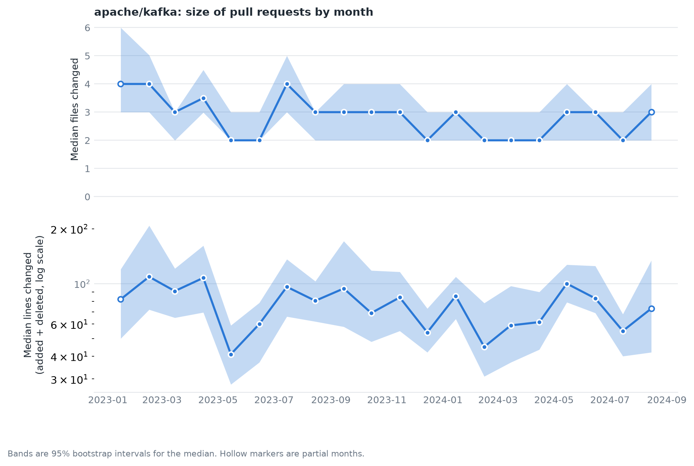
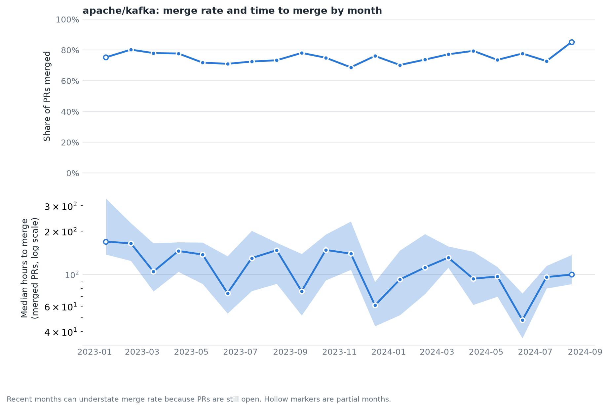
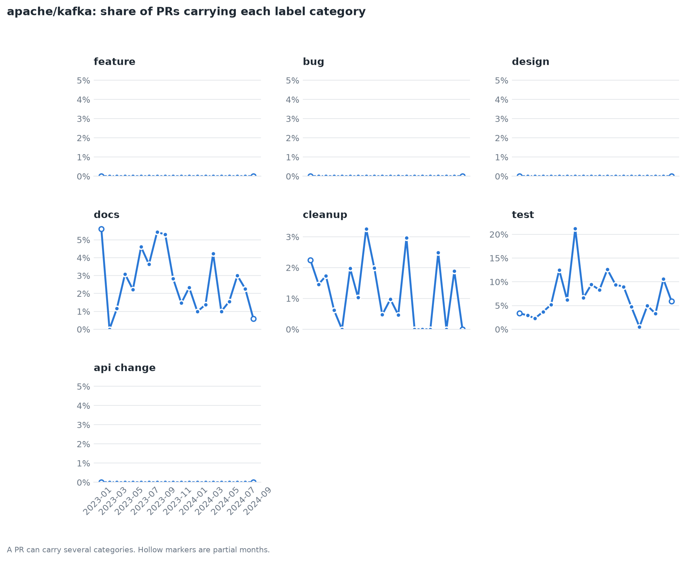
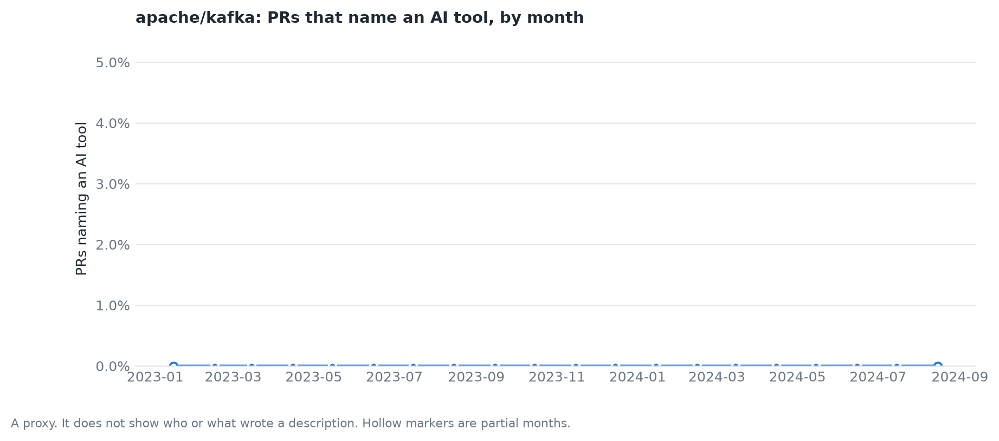

# Pull requests in apache/kafka: description length, size, speed and labels

Window 2023-01-09 to 2024-08-19 (UTC). Data fetched 2026-11-19. prwords 3.0.0, generated 2026-11-26. Method fixed in advance in `docs/ANALYSIS_PLAN.md`.

## 1. Data

- Repository primary language: Java
- Pull requests opened in the window: 3,834
- Removed as bot accounts: 2
- Analysed: 3,832 PRs from 464 authors
- Merged: 2,886 (75.3%). Closed without merging: 944 (24.6%). Still open: 2
- Follow-up: merge outcomes use a 30-day follow-up. PRs without enough follow-up: 0
- Empty descriptions after cleaning: 4.6%

## 2. Did the PR template change?

No template line appeared or disappeared with a share of 50% or more. Template text was detected monthly and removed before counting words.

Distinct template lines detected: 4.

## 3. First 28 days versus last 28 days

First window 2023-01-09 to 2023-02-05. Last window 2024-07-23 to 2024-08-19. Ratios are last median divided by first median. Bootstrap intervals, 2,000 resamples.

| Metric                                |   n first |   n last |   Median first |   Median last |   Ratio |   Ratio low |   Ratio high |       p |   Cliff's delta |
|:--------------------------------------|----------:|---------:|---------------:|--------------:|--------:|------------:|-------------:|--------:|----------------:|
| Description words (non-empty)         |       101 |      262 |          59    |          32   |    0.54 |        0.45 |         0.72 | 0.00015 |           -0.26 |
| Files changed                         |       107 |      271 |           4    |           3   |    0.75 |        0.33 |         1    | 0.016   |           -0.16 |
| Lines added                           |       107 |      271 |          62    |          35   |    0.56 |        0.31 |         0.98 | 0.058   |           -0.13 |
| Lines deleted                         |       107 |      271 |          17    |          14   |    0.82 |        0.44 |         1.78 | 0.58    |           -0.04 |
| Net lines (added minus deleted)       |       107 |      271 |          29    |           7   |    0.24 |        0.09 |         1    | 0.036   |           -0.14 |
| Lines changed (added plus deleted)    |       107 |      271 |          93    |          65   |    0.7  |        0.43 |         1.31 | 0.28    |           -0.07 |
| Hours from open to merge (merged PRs) |        83 |      220 |         240.63 |         109.1 |    0.45 |        0.29 |         0.76 | 0.0052  |           -0.21 |
| Commits                               |       107 |      271 |           2    |           2   |    1    |        0.5  |         1.5  | 0.41    |           -0.05 |
| Comments                              |       107 |      271 |           2    |           2   |    1    |        1    |         2    | 0.64    |            0.03 |
| Reviews                               |       107 |      271 |           4    |           3   |    0.75 |        0.33 |         1    | 0.02    |           -0.15 |

| Measure                             |   n first |   n last | Share first   | Share last   |   Change (points) |     p |
|:------------------------------------|----------:|---------:|:--------------|:-------------|------------------:|------:|
| Merged within follow-up period      |       107 |      271 | 61.7%         | 73.4%        |              11.7 | 0.034 |
| Closed without merging              |       107 |      271 | 22.4%         | 18.5%        |              -4   | 0.39  |
| Opened as draft                     |       107 |      271 | 1.9%          | 3.0%         |               1.1 | 0.73  |
| From outside contributors           |       107 |      271 | 69.2%         | 66.8%        |              -2.4 | 0.72  |
| Has a kind or type label            |       107 |      271 | 0.0%          | 0.0%         |               0   | 1     |
| Description text repeated elsewhere |       107 |      271 | 9.3%          | 9.2%         |              -0.1 | 1     |
| Names an AI tool (disclosure)       |       107 |      271 | 0.0%          | 0.0%         |               0   | 1     |
| Label category: feature             |       107 |      271 | 0.0%          | 0.0%         |               0   | 1     |
| Label category: bug                 |       107 |      271 | 0.0%          | 0.0%         |               0   | 1     |
| Label category: design              |       107 |      271 | 0.0%          | 0.0%         |               0   | 1     |
| Label category: docs                |       107 |      271 | 4.7%          | 1.5%         |              -3.2 | 0.13  |
| Label category: cleanup             |       107 |      271 | 1.9%          | 0.0%         |              -1.9 | 0.08  |
| Label category: test                |       107 |      271 | 3.7%          | 9.2%         |               5.5 | 0.086 |
| Label category: api_change          |       107 |      271 | 0.0%          | 0.0%         |               0   | 1     |

## 4. Monthly trends

Theil-Sen slope per month and Kendall tau over full months only.

| metric                     |   months |   slope_per_month |   slope_ci_low |   slope_ci_high |     tau |       p |
|:---------------------------|---------:|------------------:|---------------:|----------------:|--------:|--------:|
| median_words               |       18 |            -1.091 |         -1.591 |          -0.545 |  -0.602 |   0.001 |
| median_files_changed       |       18 |            -0     |         -0.125 |          -0     |  -0.374 |   0.052 |
| median_additions           |       18 |            -1.8   |         -3.3   |          -0.5   |  -0.375 |   0.031 |
| median_deletions           |       18 |             0.083 |         -0.286 |           0.45  |   0.074 |   0.675 |
| median_churn               |       18 |            -1.75  |         -3.833 |           0.643 |  -0.255 |   0.152 |
| median_hours_to_merge      |       18 |            -3.311 |         -5.938 |           0.31  |  -0.32  |   0.068 |
| merge_rate                 |       18 |            -0     |         -0.004 |           0.004 |  -0.052 |   0.762 |
| share_outside_contributors |       18 |            -0.001 |         -0.005 |           0.003 |  -0.105 |   0.544 |
| share_ai_disclosed         |       18 |            -0     |         -0     |          -0     | nan     | nan     |
| median_comments            |       18 |            -0     |         -0     |          -0     |   0.127 |   0.528 |
| median_reviews             |       18 |            -0     |         -0.077 |          -0     |  -0.191 |   0.331 |
| share_feature              |       18 |            -0     |         -0     |          -0     | nan     | nan     |
| share_bug                  |       18 |            -0     |         -0     |          -0     | nan     | nan     |
| share_design               |       18 |            -0     |         -0     |          -0     | nan     | nan     |
| share_docs                 |       18 |            -0     |         -0.002 |           0.001 |  -0.033 |   0.881 |
| share_cleanup              |       18 |            -0.001 |         -0.001 |           0.001 |  -0.169 |   0.338 |
| share_test                 |       18 |             0.001 |         -0.004 |           0.005 |   0.098 |   0.601 |
| share_api_change           |       18 |            -0     |         -0     |          -0     | nan     | nan     |

## 5. Labels

Share of PRs with a kind or type label: 0.0% overall. Label coverage by month is in `monthly_summary.csv` (`share_has_kind_label`).

| category            |   n_prs |   share |   median_words |   median_files |   median_churn |   merge_rate |   median_hours_to_merge |   share_ai_disclosed |
|:--------------------|--------:|--------:|---------------:|---------------:|---------------:|-------------:|------------------------:|---------------------:|
| feature             |       0 |   0     |            nan |            nan |            nan |      nan     |                 nan     |                  nan |
| bug                 |       0 |   0     |            nan |            nan |            nan |      nan     |                 nan     |                  nan |
| design              |       0 |   0     |            nan |            nan |            nan |      nan     |                 nan     |                  nan |
| docs                |      97 |   0.025 |             28 |              1 |             13 |        0.866 |                  91.652 |                    0 |
| cleanup             |      45 |   0.012 |             67 |              4 |            104 |        1     |                  73.314 |                    0 |
| test                |     275 |   0.072 |             49 |              2 |             69 |        0.8   |                 134.803 |                    0 |
| api_change          |       0 |   0     |            nan |            nan |            nan |      nan     |                 nan     |                  nan |
| (no category label) |    3416 |   0.891 |             40 |              3 |             78 |        0.743 |                  98.565 |                    0 |

## 6. Are PRs with signs of AI involvement smaller or larger?

Authorship is not observable. The proxy is `ai_disclosed`, defined in the analysis plan: 0 PRs (0.00%). 0 disclosed PRs are listed in `ai_disclosure_samples.csv` for manual audit.

### ai_disclosed

**Verdict: not testable.** Too few exposed PRs.

Pattern: lines changed: not estimated; files changed: not estimated; lines added: not estimated; lines deleted: not estimated; hours to merge: not estimated.

Not estimated: fewer than 30 exposed PRs (exposed PRs: 0).

### Robustness by tool (lines changed)

No tool named in any disclosure.

### File type check

Not run. Use `--file-check N` to sample N exposed PRs and matching unexposed PRs.

## 7. Other checks

- Outside contributors: 68.2% of PRs overall.
- Top 10 authors opened 24.0% of PRs.
- PRs whose description text is repeated elsewhere (10 or more words): 9.7%.

## 8. Limitations

- Word count and size describe PRs, not who wrote them. Proxies for AI involvement are noisy and omit undisclosed use.
- Added and deleted lines include generated or vendored files unless the project avoids committing them.
- Disclosure mostly captures tools that add attribution by default, so it is tool-skewed.
- Template removal is heuristic. Check `template_audit.csv`.
- One repository cannot support general claims. See the plan for replication.
- Months at the edges of the window are partial and are excluded from trend tests.

