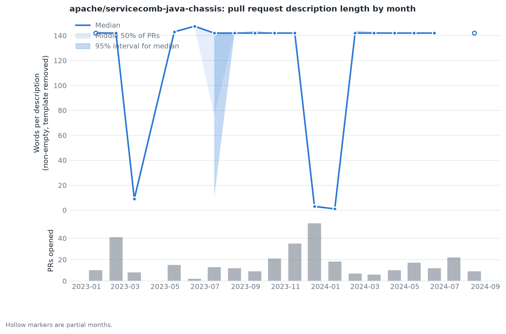
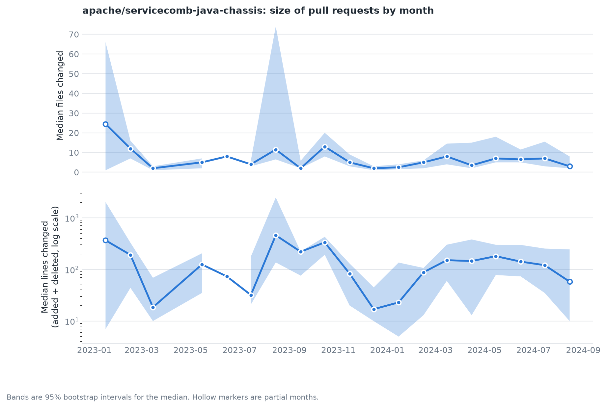
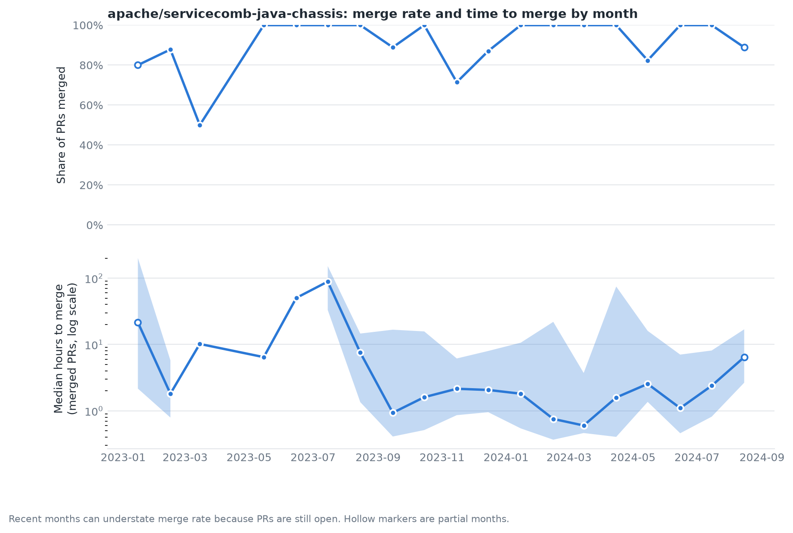
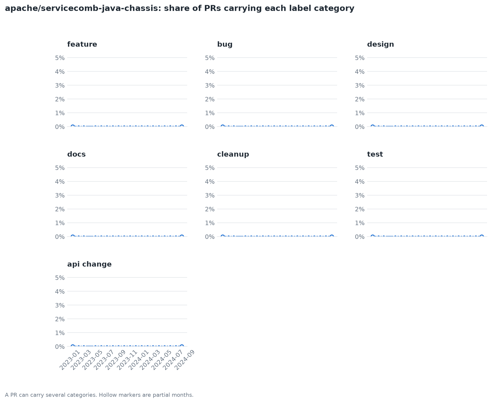
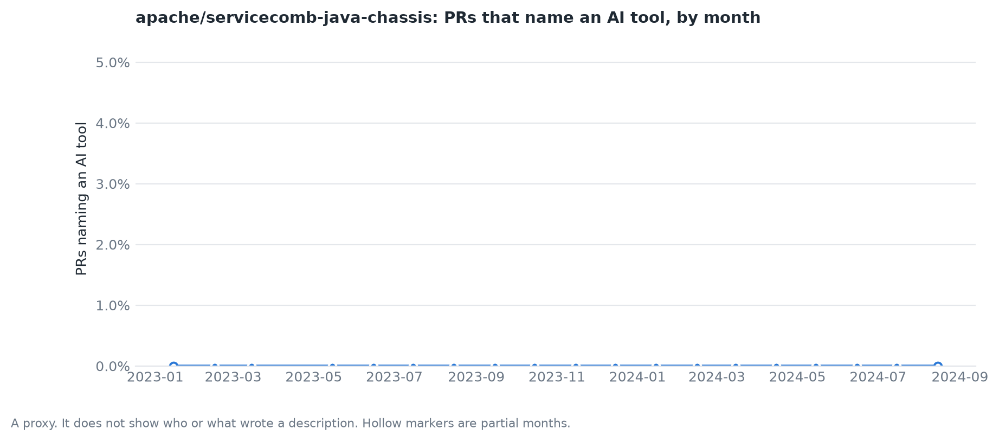

# Pull requests in apache/servicecomb-java-chassis: description length, size, speed and labels

Window 2023-01-09 to 2024-08-19 (UTC). Data fetched 2026-11-20. prwords 3.0.0, generated 2026-11-26. Method fixed in advance in `docs/ANALYSIS_PLAN.md`.

## 1. Data

- Repository primary language: Java
- Pull requests opened in the window: 711
- Removed as bot accounts: 390
- Analysed: 321 PRs from 14 authors
- Merged: 288 (89.7%). Closed without merging: 33 (10.3%). Still open: 0
- Follow-up: merge outcomes use a 30-day follow-up. PRs without enough follow-up: 0
- Empty descriptions after cleaning: 39.9%

## 2. Did the PR template change?

No template line appeared or disappeared with a share of 50% or more. Template text was detected monthly and removed before counting words.

Distinct template lines detected: 8.

## 3. First 28 days versus last 28 days

First window 2023-01-09 to 2023-02-05. Last window 2024-07-23 to 2024-08-19. Ratios are last median divided by first median. Bootstrap intervals, 2,000 resamples.

| Metric                                |   n first |   n last |   Median first |   Median last |   Ratio |   Ratio low |   Ratio high |      p |   Cliff's delta |
|:--------------------------------------|----------:|---------:|---------------:|--------------:|--------:|------------:|-------------:|-------:|----------------:|
| Description words (non-empty)         |        16 |        9 |         142    |        142    |    1    |        0.04 |         1    | 0.0046 |           -0.58 |
| Files changed                         |        16 |       22 |          37.5  |          3    |    0.08 |        0.05 |         0.54 | 0.0047 |           -0.54 |
| Lines added                           |        16 |       22 |         111    |         38.5  |    0.35 |        0.1  |         4.76 | 0.48   |           -0.14 |
| Lines deleted                         |        16 |       22 |         332.5  |          4    |    0.01 |        0    |         0.07 | 0.0029 |           -0.57 |
| Net lines (added minus deleted)       |        16 |       22 |         -42.5  |         29.5  |  nan    |        0.74 |        13.4  | 0.0038 |            0.56 |
| Lines changed (added plus deleted)    |        16 |       22 |         723    |         51.5  |    0.07 |        0.02 |         0.4  | 0.0047 |           -0.55 |
| Hours from open to merge (merged PRs) |        13 |       21 |          15.78 |          2.75 |    0.17 |        0.04 |         2.51 | 0.043  |           -0.42 |
| Commits                               |        16 |       22 |           1.5  |          1    |    0.67 |        0.33 |         2    | 0.33   |           -0.17 |
| Comments                              |        16 |       22 |           1    |          0    |    0    |        0    |         0    | 7e-08  |           -0.88 |
| Reviews                               |        16 |       22 |           0    |          0    |  nan    |      nan    |       nan    | 1      |            0    |

| Measure                             |   n first |   n last | Share first   | Share last   |   Change (points) |    p |
|:------------------------------------|----------:|---------:|:--------------|:-------------|------------------:|-----:|
| Merged within follow-up period      |        16 |       22 | 81.2%         | 95.5%        |              14.2 | 0.29 |
| Closed without merging              |        16 |       22 | 18.8%         | 4.5%         |             -14.2 | 0.29 |
| Opened as draft                     |        16 |       22 | 0.0%          | 0.0%         |               0   | 1    |
| From outside contributors           |        16 |       22 | 100.0%        | 81.8%        |             -18.2 | 0.12 |
| Has a kind or type label            |        16 |       22 | 0.0%          | 0.0%         |               0   | 1    |
| Description text repeated elsewhere |        16 |       22 | 75.0%         | 72.7%        |              -2.3 | 1    |
| Names an AI tool (disclosure)       |        16 |       22 | 0.0%          | 0.0%         |               0   | 1    |
| Label category: feature             |        16 |       22 | 0.0%          | 0.0%         |               0   | 1    |
| Label category: bug                 |        16 |       22 | 0.0%          | 0.0%         |               0   | 1    |
| Label category: design              |        16 |       22 | 0.0%          | 0.0%         |               0   | 1    |
| Label category: docs                |        16 |       22 | 0.0%          | 0.0%         |               0   | 1    |
| Label category: cleanup             |        16 |       22 | 0.0%          | 0.0%         |               0   | 1    |
| Label category: test                |        16 |       22 | 0.0%          | 0.0%         |               0   | 1    |
| Label category: api_change          |        16 |       22 | 0.0%          | 0.0%         |               0   | 1    |

## 4. Monthly trends

Theil-Sen slope per month and Kendall tau over full months only.

| metric                     |   months |   slope_per_month |   slope_ci_low |   slope_ci_high |     tau |       p |
|:---------------------------|---------:|------------------:|---------------:|----------------:|--------:|--------:|
| median_words               |       16 |            -0     |         -0     |          -0     |  -0.17  |   0.408 |
| median_files_changed       |       17 |            -0     |         -0.45  |           0.375 |   0.03  |   0.868 |
| median_additions           |       17 |             1.875 |         -6.75  |           5.615 |   0.133 |   0.458 |
| median_deletions           |       17 |             0.05  |         -2.286 |           1.333 |   0.007 |   0.967 |
| median_churn               |       17 |             1.74  |        -10     |          12.091 |   0.044 |   0.839 |
| median_hours_to_merge      |       17 |            -0.228 |         -0.745 |           0.028 |  -0.338 |   0.063 |
| merge_rate                 |       17 |            -0     |         -0     |           0.008 |   0.181 |   0.356 |
| share_outside_contributors |       17 |            -0     |         -0     |          -0     |   0.36  |   0.074 |
| share_ai_disclosed         |       17 |            -0     |         -0     |          -0     | nan     | nan     |
| median_comments            |       17 |            -0     |         -0.083 |          -0     |  -0.403 |   0.047 |
| median_reviews             |       17 |            -0     |         -0     |          -0     | nan     | nan     |
| share_feature              |       17 |            -0     |         -0     |          -0     | nan     | nan     |
| share_bug                  |       17 |            -0     |         -0     |          -0     | nan     | nan     |
| share_design               |       17 |            -0     |         -0     |          -0     | nan     | nan     |
| share_docs                 |       17 |            -0     |         -0     |          -0     | nan     | nan     |
| share_cleanup              |       17 |            -0     |         -0     |          -0     | nan     | nan     |
| share_test                 |       17 |            -0     |         -0     |          -0     | nan     | nan     |
| share_api_change           |       17 |            -0     |         -0     |          -0     | nan     | nan     |

## 5. Labels

Share of PRs with a kind or type label: 0.0% overall. Label coverage by month is in `monthly_summary.csv` (`share_has_kind_label`).

| category            |   n_prs |   share |   median_words |   median_files |   median_churn |   merge_rate |   median_hours_to_merge |   share_ai_disclosed |
|:--------------------|--------:|--------:|---------------:|---------------:|---------------:|-------------:|------------------------:|---------------------:|
| feature             |       0 |       0 |            nan |            nan |            nan |      nan     |                 nan     |                  nan |
| bug                 |       0 |       0 |            nan |            nan |            nan |      nan     |                 nan     |                  nan |
| design              |       0 |       0 |            nan |            nan |            nan |      nan     |                 nan     |                  nan |
| docs                |       0 |       0 |            nan |            nan |            nan |      nan     |                 nan     |                  nan |
| cleanup             |       0 |       0 |            nan |            nan |            nan |      nan     |                 nan     |                  nan |
| test                |       0 |       0 |            nan |            nan |            nan |      nan     |                 nan     |                  nan |
| api_change          |       0 |       0 |            nan |            nan |            nan |      nan     |                 nan     |                  nan |
| (no category label) |     321 |       1 |            142 |              5 |             90 |        0.897 |                   2.393 |                    0 |

## 6. Are PRs with signs of AI involvement smaller or larger?

Authorship is not observable. The proxy is `ai_disclosed`, defined in the analysis plan: 0 PRs (0.00%). 0 disclosed PRs are listed in `ai_disclosure_samples.csv` for manual audit.

### ai_disclosed

**Verdict: not testable.** Too few exposed PRs.

Pattern: lines changed: not estimated; files changed: not estimated; lines added: not estimated; lines deleted: not estimated; hours to merge: not estimated.

Not estimated: fewer than 30 exposed PRs (exposed PRs: 0).

### Robustness by tool (lines changed)

No tool named in any disclosure.

### File type check

Not run. Use `--file-check N` to sample N exposed PRs and matching unexposed PRs.

## 7. Other checks

- Outside contributors: 92.5% of PRs overall.
- Top 10 authors opened 98.4% of PRs.
- PRs whose description text is repeated elsewhere (10 or more words): 67.9%.

## 8. Limitations

- Word count and size describe PRs, not who wrote them. Proxies for AI involvement are noisy and omit undisclosed use.
- Added and deleted lines include generated or vendored files unless the project avoids committing them.
- Disclosure mostly captures tools that add attribution by default, so it is tool-skewed.
- Template removal is heuristic. Check `template_audit.csv`.
- One repository cannot support general claims. See the plan for replication.
- Months at the edges of the window are partial and are excluded from trend tests.

