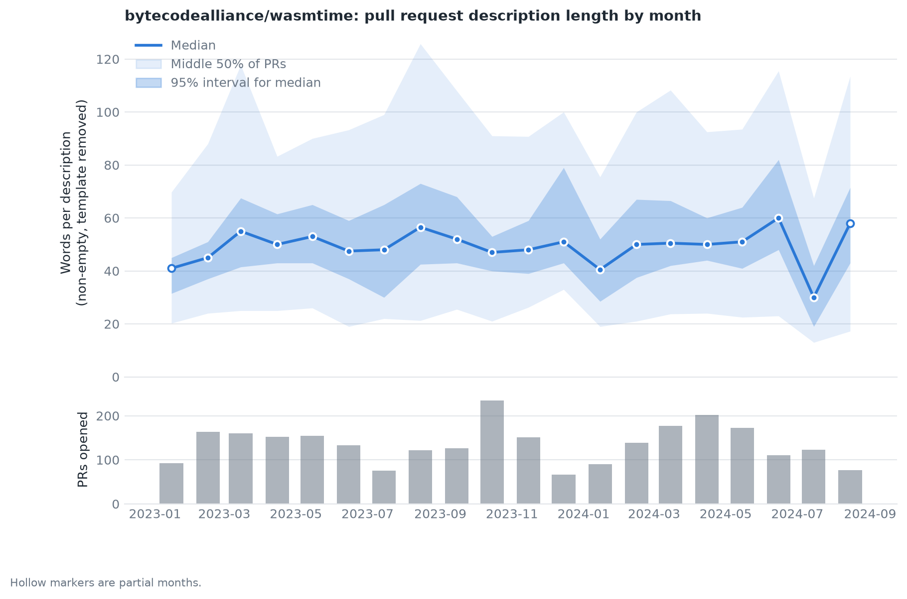
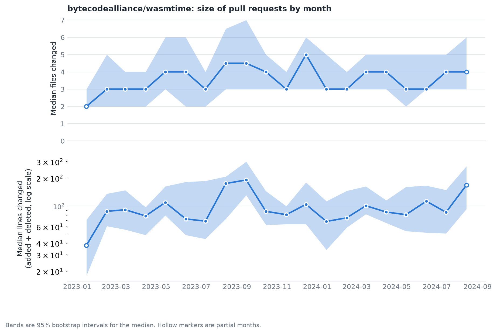
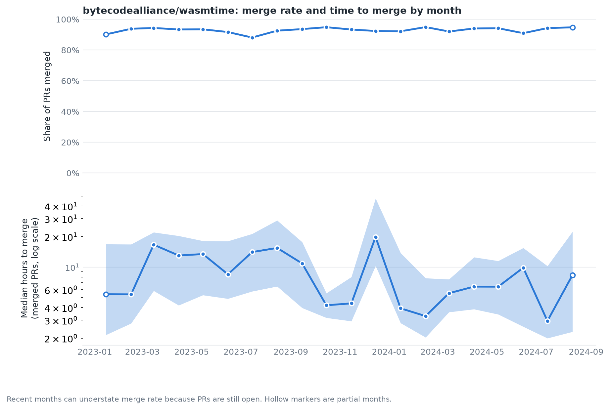
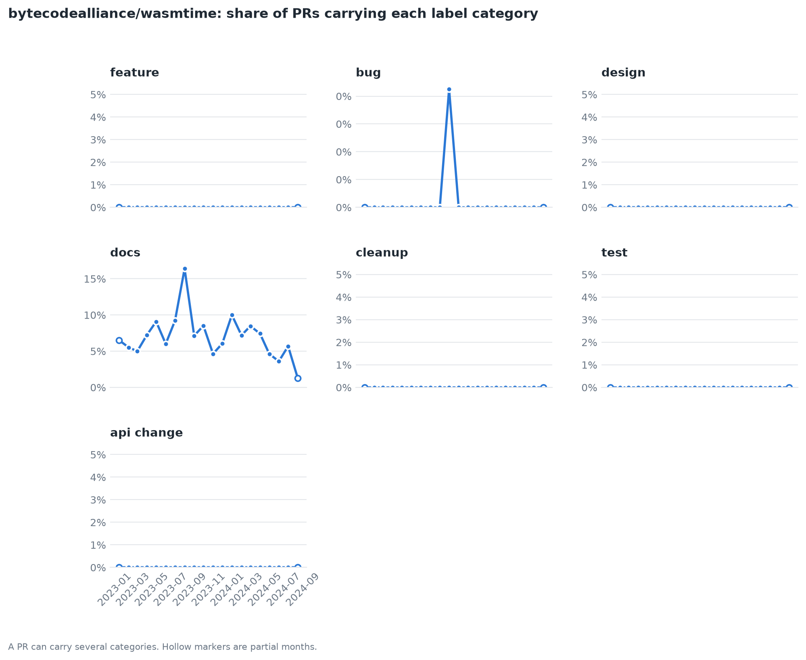
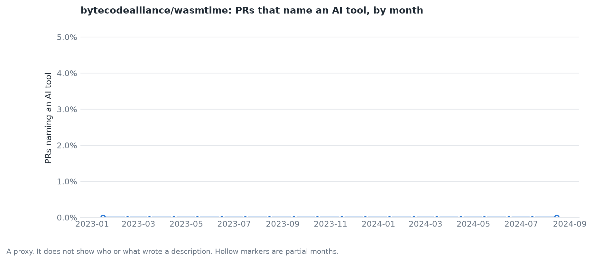

# Pull requests in bytecodealliance/wasmtime: description length, size, speed and labels

Window 2023-01-09 to 2024-08-19 (UTC). Data fetched 2026-11-20. prwords 3.0.0, generated 2026-11-26. Method fixed in advance in `docs/ANALYSIS_PLAN.md`.

## 1. Data

- Repository primary language: Rust
- Pull requests opened in the window: 2,723
- Removed as bot accounts: 1
- Analysed: 2,722 PRs from 240 authors
- Merged: 2,539 (93.3%). Closed without merging: 159 (5.8%). Still open: 24
- Follow-up: merge outcomes use a 30-day follow-up. PRs without enough follow-up: 0
- Empty descriptions after cleaning: 4.2%

## 2. Did the PR template change?

No template line appeared or disappeared with a share of 50% or more. Template text was detected monthly and removed before counting words.

Distinct template lines detected: 0.

## 3. First 28 days versus last 28 days

First window 2023-01-09 to 2023-02-05. Last window 2024-07-23 to 2024-08-19. Ratios are last median divided by first median. Bootstrap intervals, 2,000 resamples.

| Metric                                |   n first |   n last |   Median first |   Median last |   Ratio |   Ratio low |   Ratio high |       p |   Cliff's delta |
|:--------------------------------------|----------:|---------:|---------------:|--------------:|--------:|------------:|-------------:|--------:|----------------:|
| Description words (non-empty)         |       115 |      114 |          41    |         48    |    1.17 |        0.84 |         1.72 | 0.21    |            0.1  |
| Files changed                         |       117 |      123 |           3    |          5    |    1.67 |        1.33 |         3    | 0.00015 |            0.28 |
| Lines added                           |       117 |      123 |          41    |         85    |    2.07 |        1.1  |         5.04 | 0.0012  |            0.24 |
| Lines deleted                         |       117 |      123 |           6    |         22    |    3.67 |        1.44 |         8    | 0.0088  |            0.2  |
| Net lines (added minus deleted)       |       117 |      123 |          12    |         23    |    1.92 |        0.53 |         7.22 | 0.11    |            0.12 |
| Lines changed (added plus deleted)    |       117 |      123 |          57    |        131    |    2.3  |        1.27 |         6.11 | 0.0012  |            0.24 |
| Hours from open to merge (merged PRs) |       105 |      116 |           4.51 |          6.05 |    1.34 |        0.17 |         3.53 | 0.42    |           -0.06 |
| Commits                               |       117 |      123 |           1    |          1    |    1    |        1    |         2    | 0.16    |            0.09 |
| Comments                              |       117 |      123 |           1    |          0    |    0    |        0    |         1    | 0.097   |           -0.12 |
| Reviews                               |       117 |      123 |           1    |          1    |    1    |        1    |         1    | 0.49    |           -0.04 |

| Measure                             |   n first |   n last | Share first   | Share last   |   Change (points) |     p |
|:------------------------------------|----------:|---------:|:--------------|:-------------|------------------:|------:|
| Merged within follow-up period      |       117 |      123 | 89.7%         | 93.5%        |               3.8 | 0.35  |
| Closed without merging              |       117 |      123 | 10.3%         | 3.3%         |              -7   | 0.038 |
| Opened as draft                     |       117 |      123 | 4.3%          | 0.8%         |              -3.5 | 0.11  |
| From outside contributors           |       117 |      123 | 35.9%         | 48.8%        |              12.9 | 0.05  |
| Has a kind or type label            |       117 |      123 | 0.0%          | 0.0%         |               0   | 1     |
| Description text repeated elsewhere |       117 |      123 | 0.0%          | 1.6%         |               1.6 | 0.5   |
| Names an AI tool (disclosure)       |       117 |      123 | 0.0%          | 0.0%         |               0   | 1     |
| Label category: feature             |       117 |      123 | 0.0%          | 0.0%         |               0   | 1     |
| Label category: bug                 |       117 |      123 | 0.0%          | 0.0%         |               0   | 1     |
| Label category: design              |       117 |      123 | 0.0%          | 0.0%         |               0   | 1     |
| Label category: docs                |       117 |      123 | 6.0%          | 3.3%         |              -2.7 | 0.37  |
| Label category: cleanup             |       117 |      123 | 0.0%          | 0.0%         |               0   | 1     |
| Label category: test                |       117 |      123 | 0.0%          | 0.0%         |               0   | 1     |
| Label category: api_change          |       117 |      123 | 0.0%          | 0.0%         |               0   | 1     |

## 4. Monthly trends

Theil-Sen slope per month and Kendall tau over full months only.

| metric                     |   months |   slope_per_month |   slope_ci_low |   slope_ci_high |     tau |       p |
|:---------------------------|---------:|------------------:|---------------:|----------------:|--------:|--------:|
| median_words               |       18 |            -0     |         -0.5   |           0.4   |  -0.013 |   0.939 |
| median_files_changed       |       18 |            -0     |         -0     |           0.067 |   0.072 |   0.708 |
| median_additions           |       18 |             0.417 |         -0.857 |           1.25  |   0.124 |   0.501 |
| median_deletions           |       18 |             0.083 |         -0.5   |           0.667 |   0.073 |   0.675 |
| median_churn               |       18 |            -0.083 |         -2.3   |           1.944 |  -0.02  |   0.909 |
| median_hours_to_merge      |       18 |            -0.429 |         -0.889 |           0.074 |  -0.307 |   0.081 |
| merge_rate                 |       18 |            -0     |         -0.001 |           0.001 |  -0.007 |   1     |
| share_outside_contributors |       18 |            -0.003 |         -0.01  |           0.005 |  -0.15  |   0.41  |
| share_ai_disclosed         |       18 |            -0     |         -0     |          -0     | nan     | nan     |
| median_comments            |       18 |            -0     |         -0     |          -0     |  -0.451 |   0.027 |
| median_reviews             |       18 |            -0     |         -0     |          -0     | nan     | nan     |
| share_feature              |       18 |            -0     |         -0     |          -0     | nan     | nan     |
| share_bug                  |       18 |            -0     |         -0     |          -0     |  -0.02  |   0.923 |
| share_design               |       18 |            -0     |         -0     |          -0     | nan     | nan     |
| share_docs                 |       18 |            -0.001 |         -0.003 |           0.001 |  -0.124 |   0.501 |
| share_cleanup              |       18 |            -0     |         -0     |          -0     | nan     | nan     |
| share_test                 |       18 |            -0     |         -0     |          -0     | nan     | nan     |
| share_api_change           |       18 |            -0     |         -0     |          -0     | nan     | nan     |

## 5. Labels

Share of PRs with a kind or type label: 0.0% overall. Label coverage by month is in `monthly_summary.csv` (`share_has_kind_label`).

| category            |   n_prs |   share |   median_words |   median_files |   median_churn |   merge_rate |   median_hours_to_merge |   share_ai_disclosed |
|:--------------------|--------:|--------:|---------------:|---------------:|---------------:|-------------:|------------------------:|---------------------:|
| feature             |       0 |   0     |            nan |            nan |          nan   |      nan     |                 nan     |                  nan |
| bug                 |       1 |   0     |            108 |              3 |           32   |        1     |                  29.225 |                    0 |
| design              |       0 |   0     |            nan |            nan |          nan   |      nan     |                 nan     |                  nan |
| docs                |     192 |   0.071 |             49 |              1 |           46.5 |        0.964 |                  15.358 |                    0 |
| cleanup             |       0 |   0     |            nan |            nan |          nan   |      nan     |                 nan     |                  nan |
| test                |       0 |   0     |            nan |            nan |          nan   |      nan     |                 nan     |                  nan |
| api_change          |       0 |   0     |            nan |            nan |          nan   |      nan     |                 nan     |                  nan |
| (no category label) |    2529 |   0.929 |             49 |              4 |           96   |        0.93  |                   5.58  |                    0 |

## 6. Are PRs with signs of AI involvement smaller or larger?

Authorship is not observable. The proxy is `ai_disclosed`, defined in the analysis plan: 0 PRs (0.00%). 0 disclosed PRs are listed in `ai_disclosure_samples.csv` for manual audit.

### ai_disclosed

**Verdict: not testable.** Too few exposed PRs.

Pattern: lines changed: not estimated; files changed: not estimated; lines added: not estimated; lines deleted: not estimated; hours to merge: not estimated.

Not estimated: fewer than 30 exposed PRs (exposed PRs: 0).

### Robustness by tool (lines changed)

No tool named in any disclosure.

### File type check

Not run. Use `--file-check N` to sample N exposed PRs and matching unexposed PRs.

## 7. Other checks

- Outside contributors: 38.5% of PRs overall.
- Top 10 authors opened 73.1% of PRs.
- PRs whose description text is repeated elsewhere (10 or more words): 0.7%.

## 8. Limitations

- Word count and size describe PRs, not who wrote them. Proxies for AI involvement are noisy and omit undisclosed use.
- Added and deleted lines include generated or vendored files unless the project avoids committing them.
- Disclosure mostly captures tools that add attribution by default, so it is tool-skewed.
- Template removal is heuristic. Check `template_audit.csv`.
- One repository cannot support general claims. See the plan for replication.
- Months at the edges of the window are partial and are excluded from trend tests.

