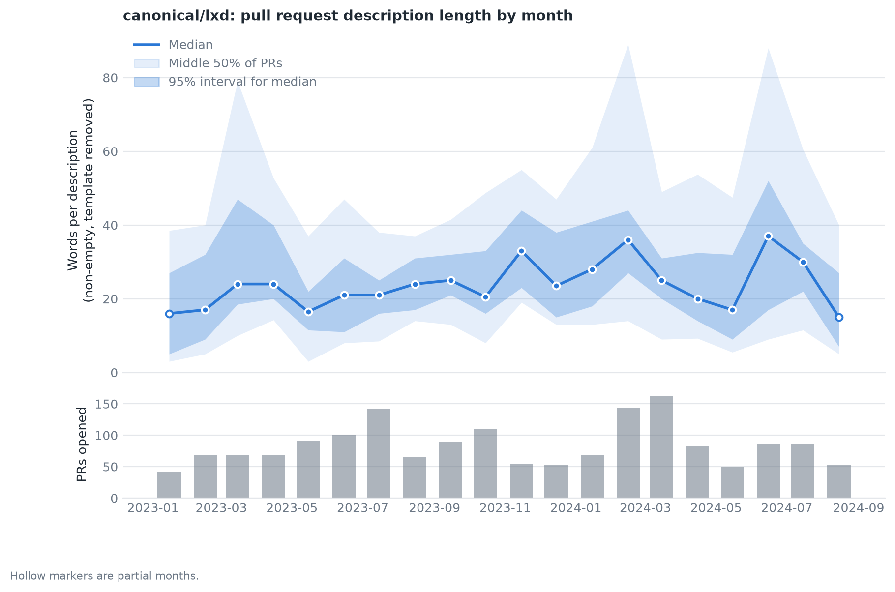
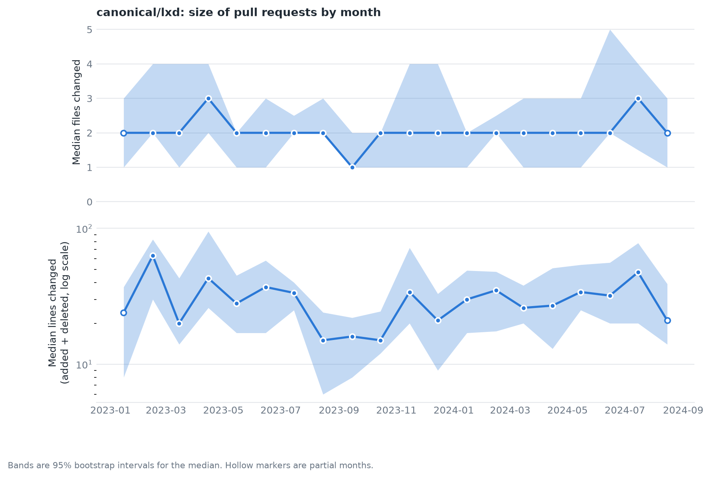
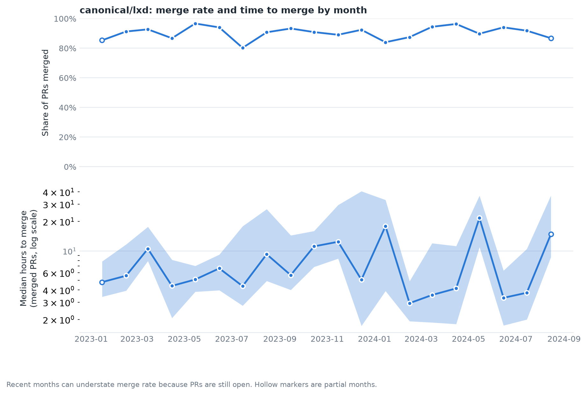
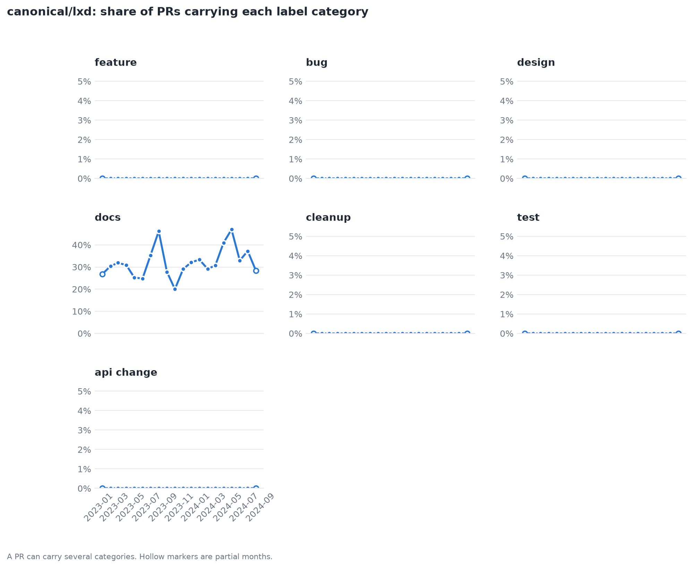
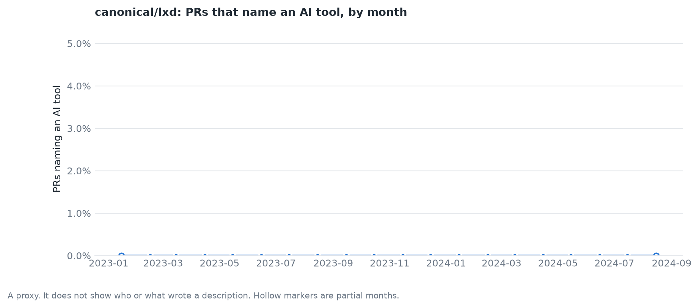

# Pull requests in canonical/lxd: description length, size, speed and labels

Window 2023-01-09 to 2024-08-19 (UTC). Data fetched 2026-11-20. prwords 3.0.0, generated 2026-11-26. Method fixed in advance in `docs/ANALYSIS_PLAN.md`.

## 1. Data

- Repository primary language: Go
- Pull requests opened in the window: 1,939
- Removed as bot accounts: 253
- Analysed: 1,686 PRs from 87 authors
- Merged: 1,526 (90.5%). Closed without merging: 160 (9.5%). Still open: 0
- Follow-up: merge outcomes use a 30-day follow-up. PRs without enough follow-up: 0
- Empty descriptions after cleaning: 21.9%

## 2. Did the PR template change?

No template line appeared or disappeared with a share of 50% or more. Template text was detected monthly and removed before counting words.

Distinct template lines detected: 0.

## 3. First 28 days versus last 28 days

First window 2023-01-09 to 2023-02-05. Last window 2024-07-23 to 2024-08-19. Ratios are last median divided by first median. Bootstrap intervals, 2,000 resamples.

| Metric                                |   n first |   n last |   Median first |   Median last |   Ratio |   Ratio low |   Ratio high |       p |   Cliff's delta |
|:--------------------------------------|----------:|---------:|---------------:|--------------:|--------:|------------:|-------------:|--------:|----------------:|
| Description words (non-empty)         |        45 |       72 |           23   |         21.5  |    0.93 |        0.5  |         2.85 | 0.41    |            0.09 |
| Files changed                         |        49 |       78 |            2   |          2    |    1    |        0.33 |         2    | 0.69    |           -0.04 |
| Lines added                           |        49 |       78 |           17   |         16.5  |    0.97 |        0.31 |         2.83 | 0.97    |           -0    |
| Lines deleted                         |        49 |       78 |            5   |          4.5  |    0.9  |        0.21 |         2.5  | 0.51    |           -0.07 |
| Net lines (added minus deleted)       |        49 |       78 |            6   |          6.5  |    1.08 |        0.28 |         4.33 | 0.81    |            0.03 |
| Lines changed (added plus deleted)    |        49 |       78 |           29   |         21.5  |    0.74 |        0.38 |         2.13 | 0.74    |           -0.04 |
| Hours from open to merge (merged PRs) |        40 |       67 |            4.8 |         14.42 |    3    |        1.13 |         6.31 | 0.021   |            0.27 |
| Commits                               |        49 |       78 |            1   |          2    |    2    |        0.5  |         2    | 0.64    |            0.05 |
| Comments                              |        49 |       78 |            1   |          1    |    1    |        0.5  |         1    | 0.44    |           -0.08 |
| Reviews                               |        49 |       78 |            1   |          1    |    1    |        1    |         2    | 0.00028 |            0.37 |

| Measure                             |   n first |   n last | Share first   | Share last   |   Change (points) |     p |
|:------------------------------------|----------:|---------:|:--------------|:-------------|------------------:|------:|
| Merged within follow-up period      |        49 |       78 | 81.6%         | 83.3%        |               1.7 | 0.81  |
| Closed without merging              |        49 |       78 | 18.4%         | 14.1%        |              -4.3 | 0.62  |
| Opened as draft                     |        49 |       78 | 14.3%         | 5.1%         |              -9.2 | 0.1   |
| From outside contributors           |        49 |       78 | 51.0%         | 66.7%        |              15.6 | 0.095 |
| Has a kind or type label            |        49 |       78 | 0.0%          | 0.0%         |               0   | 1     |
| Description text repeated elsewhere |        49 |       78 | 0.0%          | 2.6%         |               2.6 | 0.52  |
| Names an AI tool (disclosure)       |        49 |       78 | 0.0%          | 0.0%         |               0   | 1     |
| Label category: feature             |        49 |       78 | 0.0%          | 0.0%         |               0   | 1     |
| Label category: bug                 |        49 |       78 | 0.0%          | 0.0%         |               0   | 1     |
| Label category: design              |        49 |       78 | 0.0%          | 0.0%         |               0   | 1     |
| Label category: docs                |        49 |       78 | 26.5%         | 29.5%        |               3   | 0.84  |
| Label category: cleanup             |        49 |       78 | 0.0%          | 0.0%         |               0   | 1     |
| Label category: test                |        49 |       78 | 0.0%          | 0.0%         |               0   | 1     |
| Label category: api_change          |        49 |       78 | 0.0%          | 0.0%         |               0   | 1     |

## 4. Monthly trends

Theil-Sen slope per month and Kendall tau over full months only.

| metric                     |   months |   slope_per_month |   slope_ci_low |   slope_ci_high |     tau |       p |
|:---------------------------|---------:|------------------:|---------------:|----------------:|--------:|--------:|
| median_words               |       18 |             0.5   |         -0     |           1.125 |   0.313 |   0.074 |
| median_files_changed       |       18 |            -0     |         -0     |          -0     |   0.083 |   0.68  |
| median_additions           |       18 |             0.417 |         -0.471 |           1.333 |   0.172 |   0.324 |
| median_deletions           |       18 |            -0     |         -0.4   |           0.25  |  -0.068 |   0.702 |
| median_churn               |       18 |             0.111 |         -1     |           1.571 |   0.033 |   0.85  |
| median_hours_to_merge      |       18 |            -0.088 |         -0.261 |           0.621 |  -0.137 |   0.454 |
| merge_rate                 |       18 |             0.001 |         -0.003 |           0.005 |   0.059 |   0.765 |
| share_outside_contributors |       18 |            -0.004 |         -0.015 |           0.005 |  -0.19  |   0.293 |
| share_ai_disclosed         |       18 |            -0     |         -0     |          -0     | nan     | nan     |
| median_comments            |       18 |            -0     |         -0     |          -0     |   0.021 |   0.916 |
| median_reviews             |       18 |            -0     |         -0     |           0.083 |   0.425 |   0.033 |
| share_feature              |       18 |            -0     |         -0     |          -0     | nan     | nan     |
| share_bug                  |       18 |            -0     |         -0     |          -0     | nan     | nan     |
| share_design               |       18 |            -0     |         -0     |          -0     | nan     | nan     |
| share_docs                 |       18 |             0.006 |         -0.001 |           0.011 |   0.32  |   0.068 |
| share_cleanup              |       18 |            -0     |         -0     |          -0     | nan     | nan     |
| share_test                 |       18 |            -0     |         -0     |          -0     | nan     | nan     |
| share_api_change           |       18 |            -0     |         -0     |          -0     | nan     | nan     |

## 5. Labels

Share of PRs with a kind or type label: 0.0% overall. Label coverage by month is in `monthly_summary.csv` (`share_has_kind_label`).

| category            |   n_prs |   share |   median_words |   median_files |   median_churn |   merge_rate |   median_hours_to_merge |   share_ai_disclosed |
|:--------------------|--------:|--------:|---------------:|---------------:|---------------:|-------------:|------------------------:|---------------------:|
| feature             |       0 |   0     |            nan |            nan |            nan |      nan     |                 nan     |                  nan |
| bug                 |       0 |   0     |            nan |            nan |            nan |      nan     |                 nan     |                  nan |
| design              |       0 |   0     |            nan |            nan |            nan |      nan     |                 nan     |                  nan |
| docs                |     530 |   0.314 |             16 |              4 |             44 |        0.926 |                  10.775 |                    0 |
| cleanup             |       0 |   0     |            nan |            nan |            nan |      nan     |                 nan     |                  nan |
| test                |       0 |   0     |            nan |            nan |            nan |      nan     |                 nan     |                  nan |
| api_change          |       0 |   0     |            nan |            nan |            nan |      nan     |                 nan     |                  nan |
| (no category label) |    1156 |   0.686 |             28 |              2 |             24 |        0.895 |                   5.426 |                    0 |

## 6. Are PRs with signs of AI involvement smaller or larger?

Authorship is not observable. The proxy is `ai_disclosed`, defined in the analysis plan: 0 PRs (0.00%). 0 disclosed PRs are listed in `ai_disclosure_samples.csv` for manual audit.

### ai_disclosed

**Verdict: not testable.** Too few exposed PRs.

Pattern: lines changed: not estimated; files changed: not estimated; lines added: not estimated; lines deleted: not estimated; hours to merge: not estimated.

Not estimated: fewer than 30 exposed PRs (exposed PRs: 0).

### Robustness by tool (lines changed)

No tool named in any disclosure.

### File type check

Not run. Use `--file-check N` to sample N exposed PRs and matching unexposed PRs.

## 7. Other checks

- Outside contributors: 60.2% of PRs overall.
- Top 10 authors opened 86.7% of PRs.
- PRs whose description text is repeated elsewhere (10 or more words): 1.3%.

## 8. Limitations

- Word count and size describe PRs, not who wrote them. Proxies for AI involvement are noisy and omit undisclosed use.
- Added and deleted lines include generated or vendored files unless the project avoids committing them.
- Disclosure mostly captures tools that add attribution by default, so it is tool-skewed.
- Template removal is heuristic. Check `template_audit.csv`.
- One repository cannot support general claims. See the plan for replication.
- Months at the edges of the window are partial and are excluded from trend tests.

