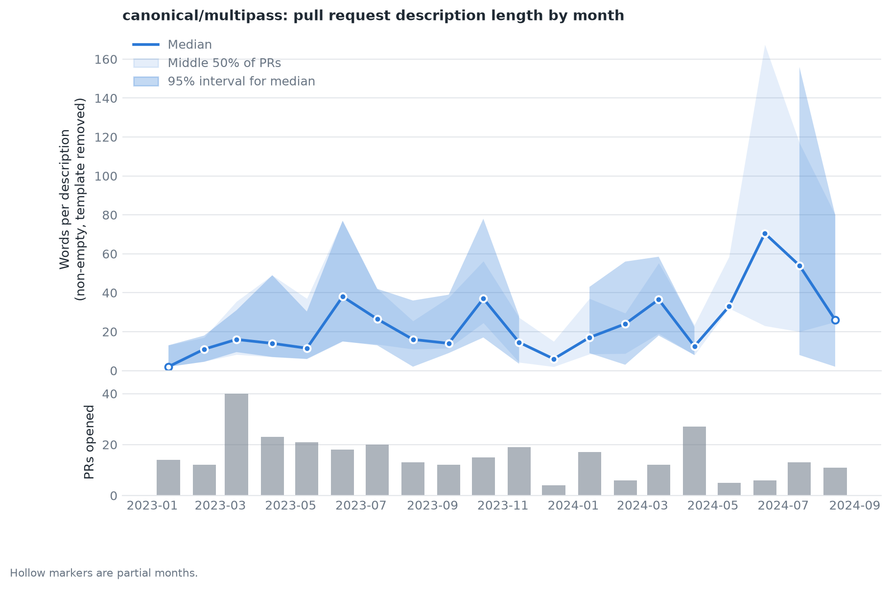
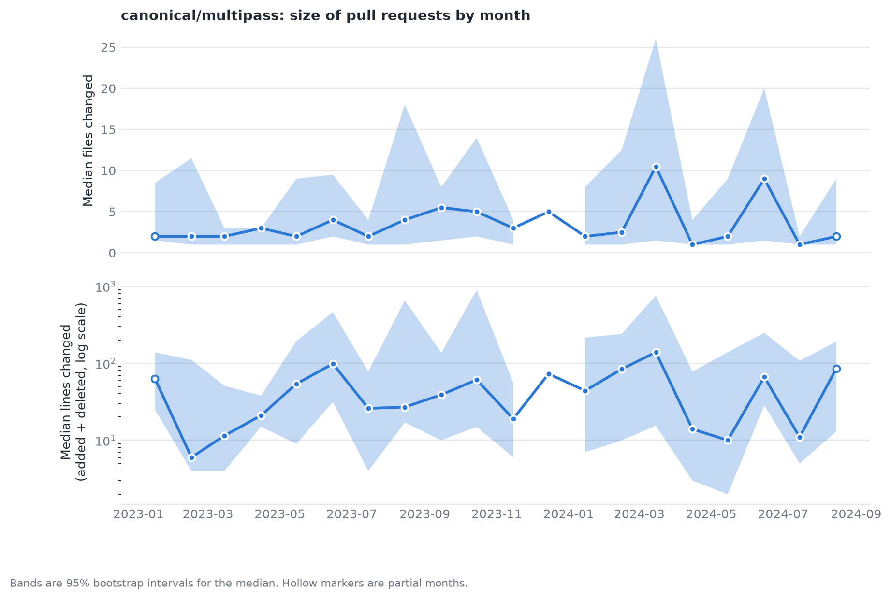
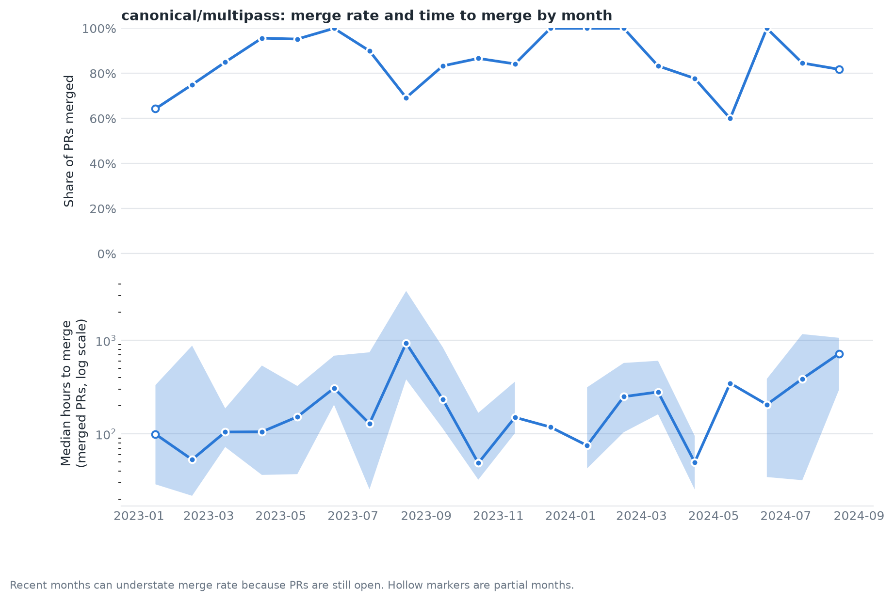
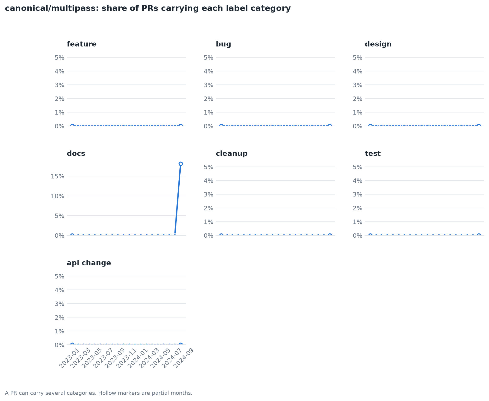
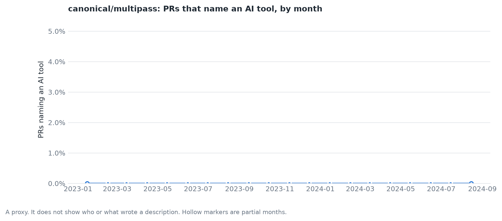

# Pull requests in canonical/multipass: description length, size, speed and labels

Window 2023-01-09 to 2024-08-19 (UTC). Data fetched 2026-11-20. prwords 3.0.0, generated 2026-11-26. Method fixed in advance in `docs/ANALYSIS_PLAN.md`.

## 1. Data

- Repository primary language: C++
- Pull requests opened in the window: 328
- Removed as bot accounts: 20
- Analysed: 308 PRs from 19 authors
- Merged: 265 (86.0%). Closed without merging: 43 (14.0%). Still open: 0
- Follow-up: merge outcomes use a 30-day follow-up. PRs without enough follow-up: 0
- Empty descriptions after cleaning: 26.0%

## 2. Did the PR template change?

No template line appeared or disappeared with a share of 50% or more. Template text was detected monthly and removed before counting words.

Distinct template lines detected: 0.

## 3. First 28 days versus last 28 days

First window 2023-01-09 to 2023-02-05. Last window 2024-07-23 to 2024-08-19. Ratios are last median divided by first median. Bootstrap intervals, 2,000 resamples.

| Metric                                |   n first |   n last |   Median first |   Median last |   Ratio |   Ratio low |   Ratio high |      p |   Cliff's delta |
|:--------------------------------------|----------:|---------:|---------------:|--------------:|--------:|------------:|-------------:|-------:|----------------:|
| Description words (non-empty)         |        14 |       10 |           3    |         28    |    9.33 |        1.93 |        40    | 0.0074 |            0.64 |
| Files changed                         |        15 |       14 |           2    |          1    |    0.5  |        0.12 |         2.75 | 0.31   |           -0.21 |
| Lines added                           |        15 |       14 |          22    |         25    |    1.14 |        0.15 |         3.95 | 0.6    |           -0.12 |
| Lines deleted                         |        15 |       14 |          33    |          7    |    0.21 |        0.04 |         8.29 | 0.83   |           -0.05 |
| Net lines (added minus deleted)       |        15 |       14 |           8    |          9    |    1.12 |        0.12 |        11    | 0.95   |            0.02 |
| Lines changed (added plus deleted)    |        15 |       14 |          63    |         44    |    0.7  |        0.12 |         4.79 | 0.69   |           -0.09 |
| Hours from open to merge (merged PRs) |        10 |       12 |          65.38 |        614.13 |    9.39 |        1.47 |        32.88 | 0.0092 |            0.67 |
| Commits                               |        15 |       14 |           1    |          2.5  |    2.5  |        0.62 |         7    | 0.16   |            0.29 |
| Comments                              |        15 |       14 |           3    |          2    |    0.67 |        0.2  |         1.5  | 0.3    |           -0.23 |
| Reviews                               |        15 |       14 |           1    |          3    |    3    |        1.25 |         5    | 0.017  |            0.51 |

| Measure                             |   n first |   n last | Share first   | Share last   |   Change (points) |     p |
|:------------------------------------|----------:|---------:|:--------------|:-------------|------------------:|------:|
| Merged within follow-up period      |        15 |       14 | 66.7%         | 42.9%        |             -23.8 | 0.27  |
| Closed without merging              |        15 |       14 | 33.3%         | 14.3%        |             -19   | 0.39  |
| Opened as draft                     |        15 |       14 | 33.3%         | 0.0%         |             -33.3 | 0.042 |
| From outside contributors           |        15 |       14 | 66.7%         | 85.7%        |              19   | 0.39  |
| Has a kind or type label            |        15 |       14 | 0.0%          | 0.0%         |               0   | 1     |
| Description text repeated elsewhere |        15 |       14 | 0.0%          | 14.3%        |              14.3 | 0.22  |
| Names an AI tool (disclosure)       |        15 |       14 | 0.0%          | 0.0%         |               0   | 1     |
| Label category: feature             |        15 |       14 | 0.0%          | 0.0%         |               0   | 1     |
| Label category: bug                 |        15 |       14 | 0.0%          | 0.0%         |               0   | 1     |
| Label category: design              |        15 |       14 | 0.0%          | 0.0%         |               0   | 1     |
| Label category: docs                |        15 |       14 | 0.0%          | 14.3%        |              14.3 | 0.22  |
| Label category: cleanup             |        15 |       14 | 0.0%          | 0.0%         |               0   | 1     |
| Label category: test                |        15 |       14 | 0.0%          | 0.0%         |               0   | 1     |
| Label category: api_change          |        15 |       14 | 0.0%          | 0.0%         |               0   | 1     |

## 4. Monthly trends

Theil-Sen slope per month and Kendall tau over full months only.

| metric                     |   months |   slope_per_month |   slope_ci_low |   slope_ci_high |     tau |       p |
|:---------------------------|---------:|------------------:|---------------:|----------------:|--------:|--------:|
| median_words               |       18 |             1.333 |         -0     |           3.083 |   0.349 |   0.044 |
| median_files_changed       |       18 |            -0     |         -0.167 |           0.417 |   0.056 |   0.756 |
| median_additions           |       18 |             0.393 |         -0.812 |           4.5   |   0.086 |   0.621 |
| median_deletions           |       18 |             0.062 |         -0.571 |           1.375 |   0.033 |   0.849 |
| median_churn               |       18 |             1.444 |         -1.5   |           5.5   |   0.15  |   0.41  |
| median_hours_to_merge      |       18 |             8.789 |         -3.067 |          19.937 |   0.268 |   0.131 |
| merge_rate                 |       18 |            -0     |         -0.013 |           0.011 |  -0.014 |   0.939 |
| share_outside_contributors |       18 |             0.012 |         -0.014 |           0.033 |   0.161 |   0.36  |
| share_ai_disclosed         |       18 |            -0     |         -0     |          -0     | nan     | nan     |
| median_comments            |       18 |            -0.125 |         -0.188 |          -0     |  -0.586 |   0.001 |
| median_reviews             |       18 |            -0     |         -0     |           0.1   |   0.396 |   0.037 |
| share_feature              |       18 |            -0     |         -0     |          -0     | nan     | nan     |
| share_bug                  |       18 |            -0     |         -0     |          -0     | nan     | nan     |
| share_design               |       18 |            -0     |         -0     |          -0     | nan     | nan     |
| share_docs                 |       18 |            -0     |         -0     |          -0     | nan     | nan     |
| share_cleanup              |       18 |            -0     |         -0     |          -0     | nan     | nan     |
| share_test                 |       18 |            -0     |         -0     |          -0     | nan     | nan     |
| share_api_change           |       18 |            -0     |         -0     |          -0     | nan     | nan     |

## 5. Labels

Share of PRs with a kind or type label: 0.0% overall. Label coverage by month is in `monthly_summary.csv` (`share_has_kind_label`).

| category            |   n_prs |   share |   median_words |   median_files |   median_churn |   merge_rate |   median_hours_to_merge |   share_ai_disclosed |
|:--------------------|--------:|--------:|---------------:|---------------:|---------------:|-------------:|------------------------:|---------------------:|
| feature             |       0 |   0     |            nan |            nan |          nan   |      nan     |                 nan     |                  nan |
| bug                 |       0 |   0     |            nan |            nan |          nan   |      nan     |                 nan     |                  nan |
| design              |       0 |   0     |            nan |            nan |          nan   |      nan     |                 nan     |                  nan |
| docs                |       2 |   0.006 |             26 |              1 |          156.5 |        0.5   |                 295.52  |                    0 |
| cleanup             |       0 |   0     |            nan |            nan |          nan   |      nan     |                 nan     |                  nan |
| test                |       0 |   0     |            nan |            nan |          nan   |      nan     |                 nan     |                  nan |
| api_change          |       0 |   0     |            nan |            nan |          nan   |      nan     |                 nan     |                  nan |
| (no category label) |     306 |   0.994 |             19 |              2 |           31   |        0.863 |                 160.549 |                    0 |

## 6. Are PRs with signs of AI involvement smaller or larger?

Authorship is not observable. The proxy is `ai_disclosed`, defined in the analysis plan: 0 PRs (0.00%). 0 disclosed PRs are listed in `ai_disclosure_samples.csv` for manual audit.

### ai_disclosed

**Verdict: not testable.** Too few exposed PRs.

Pattern: lines changed: not estimated; files changed: not estimated; lines added: not estimated; lines deleted: not estimated; hours to merge: not estimated.

Not estimated: fewer than 30 exposed PRs (exposed PRs: 0).

### Robustness by tool (lines changed)

No tool named in any disclosure.

### File type check

Not run. Use `--file-check N` to sample N exposed PRs and matching unexposed PRs.

## 7. Other checks

- Outside contributors: 50.6% of PRs overall.
- Top 10 authors opened 96.4% of PRs.
- PRs whose description text is repeated elsewhere (10 or more words): 0.6%.

## 8. Limitations

- Word count and size describe PRs, not who wrote them. Proxies for AI involvement are noisy and omit undisclosed use.
- Added and deleted lines include generated or vendored files unless the project avoids committing them.
- Disclosure mostly captures tools that add attribution by default, so it is tool-skewed.
- Template removal is heuristic. Check `template_audit.csv`.
- One repository cannot support general claims. See the plan for replication.
- Months at the edges of the window are partial and are excluded from trend tests.

