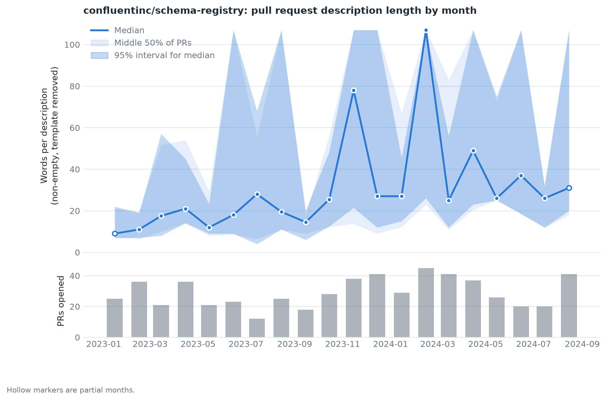
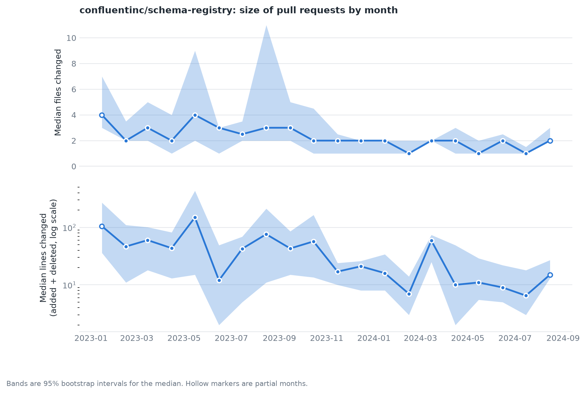
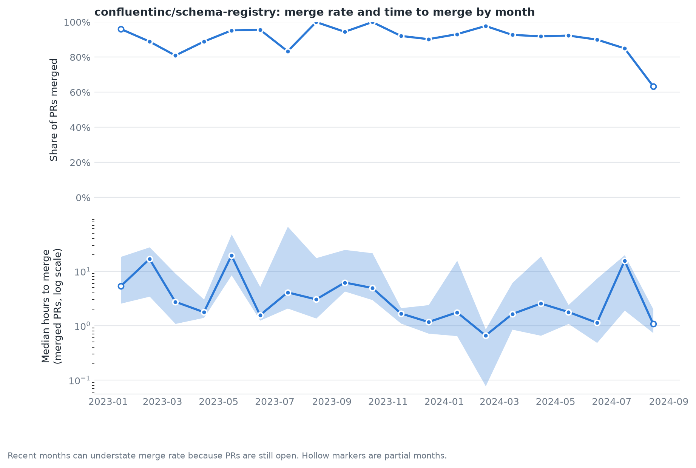
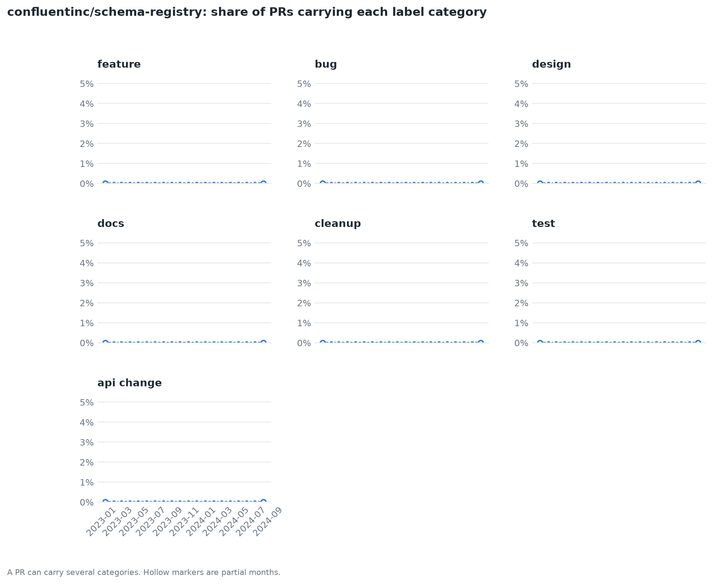
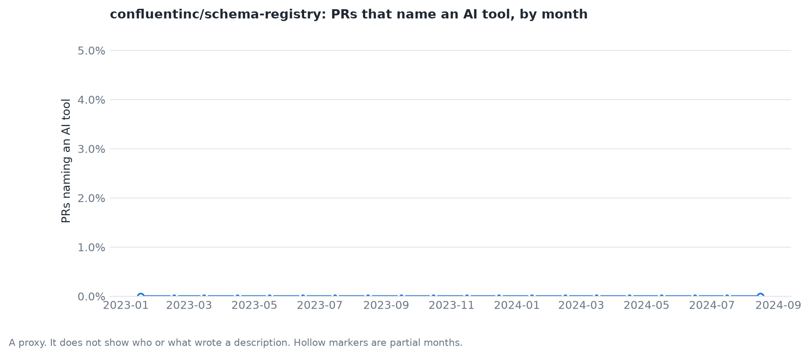

# Pull requests in confluentinc/schema-registry: description length, size, speed and labels

Window 2023-01-09 to 2024-08-19 (UTC). Data fetched 2026-11-20. prwords 3.0.0, generated 2026-11-26. Method fixed in advance in `docs/ANALYSIS_PLAN.md`.

## 1. Data

- Repository primary language: Java
- Pull requests opened in the window: 583
- Removed as bot accounts: 0
- Analysed: 583 PRs from 52 authors
- Merged: 527 (90.4%). Closed without merging: 49 (8.4%). Still open: 7
- Follow-up: merge outcomes use a 30-day follow-up. PRs without enough follow-up: 0
- Empty descriptions after cleaning: 36.0%

## 2. Did the PR template change?

No template line appeared or disappeared with a share of 50% or more. Template text was detected monthly and removed before counting words.

Distinct template lines detected: 0.

## 3. First 28 days versus last 28 days

First window 2023-01-09 to 2023-02-05. Last window 2024-07-23 to 2024-08-19. Ratios are last median divided by first median. Bootstrap intervals, 2,000 resamples.

| Metric                                |   n first |   n last |   Median first |   Median last |   Ratio |   Ratio low |   Ratio high |       p |   Cliff's delta |
|:--------------------------------------|----------:|---------:|---------------:|--------------:|--------:|------------:|-------------:|--------:|----------------:|
| Description words (non-empty)         |        12 |       33 |          10    |         28    |    2.8  |        1.16 |        13.38 | 0.0034  |            0.57 |
| Files changed                         |        28 |       45 |           4    |          2    |    0.5  |        0.25 |         0.57 | 1.6e-05 |           -0.6  |
| Lines added                           |        28 |       45 |          92.5  |         15    |    0.16 |        0.06 |         0.48 | 4.6e-05 |           -0.57 |
| Lines deleted                         |        28 |       45 |          12.5  |          2    |    0.16 |        0    |         0.67 | 0.0027  |           -0.41 |
| Net lines (added minus deleted)       |        28 |       45 |          50    |         15    |    0.3  |        0.06 |         0.53 | 0.00076 |           -0.47 |
| Lines changed (added plus deleted)    |        28 |       45 |         107.5  |         15    |    0.14 |        0.06 |         0.42 | 3.8e-05 |           -0.58 |
| Hours from open to merge (merged PRs) |        27 |       29 |           9.59 |          1.11 |    0.12 |        0.04 |         0.64 | 0.0091  |           -0.41 |
| Commits                               |        28 |       45 |           3    |          1    |    0.33 |        0.29 |         1    | 0.017   |           -0.31 |
| Comments                              |        28 |       45 |           0    |          0    |  nan    |      nan    |       nan    | 0.0044  |            0.28 |
| Reviews                               |        28 |       45 |           1    |          1    |    1    |        1    |         1    | 0.057   |           -0.23 |

| Measure                             |   n first |   n last | Share first   | Share last   |   Change (points) |       p |
|:------------------------------------|----------:|---------:|:--------------|:-------------|------------------:|--------:|
| Merged within follow-up period      |        28 |       45 | 96.4%         | 64.4%        |             -32   | 0.0014  |
| Closed without merging              |        28 |       45 | 3.6%          | 35.6%        |              32   | 0.0014  |
| Opened as draft                     |        28 |       45 | 0.0%          | 0.0%         |               0   | 1       |
| From outside contributors           |        28 |       45 | 14.3%         | 53.3%        |              39   | 0.0011  |
| Has a kind or type label            |        28 |       45 | 0.0%          | 0.0%         |               0   | 1       |
| Description text repeated elsewhere |        28 |       45 | 0.0%          | 35.6%        |              35.6 | 0.00023 |
| Names an AI tool (disclosure)       |        28 |       45 | 0.0%          | 0.0%         |               0   | 1       |
| Label category: feature             |        28 |       45 | 0.0%          | 0.0%         |               0   | 1       |
| Label category: bug                 |        28 |       45 | 0.0%          | 0.0%         |               0   | 1       |
| Label category: design              |        28 |       45 | 0.0%          | 0.0%         |               0   | 1       |
| Label category: docs                |        28 |       45 | 0.0%          | 0.0%         |               0   | 1       |
| Label category: cleanup             |        28 |       45 | 0.0%          | 0.0%         |               0   | 1       |
| Label category: test                |        28 |       45 | 0.0%          | 0.0%         |               0   | 1       |
| Label category: api_change          |        28 |       45 | 0.0%          | 0.0%         |               0   | 1       |

## 4. Monthly trends

Theil-Sen slope per month and Kendall tau over full months only.

| metric                     |   months |   slope_per_month |   slope_ci_low |   slope_ci_high |     tau |       p |
|:---------------------------|---------:|------------------:|---------------:|----------------:|--------:|--------:|
| median_words               |       18 |             1.143 |          0.5   |           2.333 |   0.48  |   0.006 |
| median_files_changed       |       18 |            -0.1   |         -0.154 |          -0     |  -0.56  |   0.003 |
| median_additions           |       18 |            -2.556 |         -4.143 |          -0.833 |  -0.551 |   0.001 |
| median_deletions           |       18 |            -0.273 |         -0.5   |          -0     |  -0.415 |   0.019 |
| median_churn               |       18 |            -2.792 |         -4.818 |          -1.143 |  -0.542 |   0.001 |
| median_hours_to_merge      |       18 |            -0.113 |         -0.509 |           0.023 |  -0.268 |   0.131 |
| merge_rate                 |       18 |            -0     |         -0.005 |           0.005 |  -0.02  |   0.909 |
| share_outside_contributors |       18 |             0.01  |         -0.003 |           0.021 |   0.275 |   0.111 |
| share_ai_disclosed         |       18 |            -0     |         -0     |          -0     | nan     | nan     |
| median_comments            |       18 |            -0     |         -0     |          -0     |   0.267 |   0.183 |
| median_reviews             |       18 |            -0     |         -0     |          -0     | nan     | nan     |
| share_feature              |       18 |            -0     |         -0     |          -0     | nan     | nan     |
| share_bug                  |       18 |            -0     |         -0     |          -0     | nan     | nan     |
| share_design               |       18 |            -0     |         -0     |          -0     | nan     | nan     |
| share_docs                 |       18 |            -0     |         -0     |          -0     | nan     | nan     |
| share_cleanup              |       18 |            -0     |         -0     |          -0     | nan     | nan     |
| share_test                 |       18 |            -0     |         -0     |          -0     | nan     | nan     |
| share_api_change           |       18 |            -0     |         -0     |          -0     | nan     | nan     |

## 5. Labels

Share of PRs with a kind or type label: 0.0% overall. Label coverage by month is in `monthly_summary.csv` (`share_has_kind_label`).

| category            |   n_prs |   share |   median_words |   median_files |   median_churn |   merge_rate |   median_hours_to_merge |   share_ai_disclosed |
|:--------------------|--------:|--------:|---------------:|---------------:|---------------:|-------------:|------------------------:|---------------------:|
| feature             |       0 |       0 |            nan |            nan |            nan |      nan     |                 nan     |                  nan |
| bug                 |       0 |       0 |            nan |            nan |            nan |      nan     |                 nan     |                  nan |
| design              |       0 |       0 |            nan |            nan |            nan |      nan     |                 nan     |                  nan |
| docs                |       0 |       0 |            nan |            nan |            nan |      nan     |                 nan     |                  nan |
| cleanup             |       0 |       0 |            nan |            nan |            nan |      nan     |                 nan     |                  nan |
| test                |       0 |       0 |            nan |            nan |            nan |      nan     |                 nan     |                  nan |
| api_change          |       0 |       0 |            nan |            nan |            nan |      nan     |                 nan     |                  nan |
| (no category label) |     583 |       1 |             25 |              2 |             22 |        0.904 |                   2.207 |                    0 |

## 6. Are PRs with signs of AI involvement smaller or larger?

Authorship is not observable. The proxy is `ai_disclosed`, defined in the analysis plan: 0 PRs (0.00%). 0 disclosed PRs are listed in `ai_disclosure_samples.csv` for manual audit.

### ai_disclosed

**Verdict: not testable.** Too few exposed PRs.

Pattern: lines changed: not estimated; files changed: not estimated; lines added: not estimated; lines deleted: not estimated; hours to merge: not estimated.

Not estimated: fewer than 30 exposed PRs (exposed PRs: 0).

### Robustness by tool (lines changed)

No tool named in any disclosure.

### File type check

Not run. Use `--file-check N` to sample N exposed PRs and matching unexposed PRs.

## 7. Other checks

- Outside contributors: 34.8% of PRs overall.
- Top 10 authors opened 86.6% of PRs.
- PRs whose description text is repeated elsewhere (10 or more words): 20.9%.

## 8. Limitations

- Word count and size describe PRs, not who wrote them. Proxies for AI involvement are noisy and omit undisclosed use.
- Added and deleted lines include generated or vendored files unless the project avoids committing them.
- Disclosure mostly captures tools that add attribution by default, so it is tool-skewed.
- Template removal is heuristic. Check `template_audit.csv`.
- One repository cannot support general claims. See the plan for replication.
- Months at the edges of the window are partial and are excluded from trend tests.

