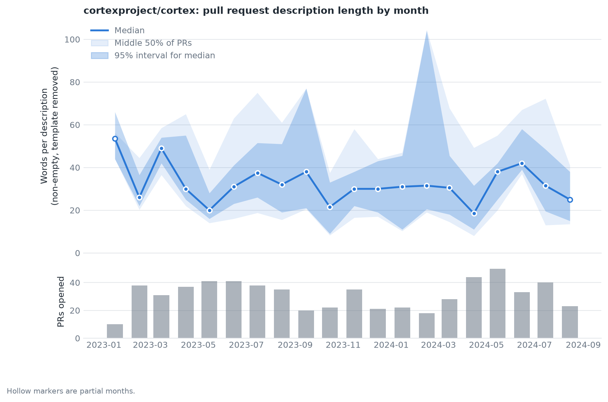
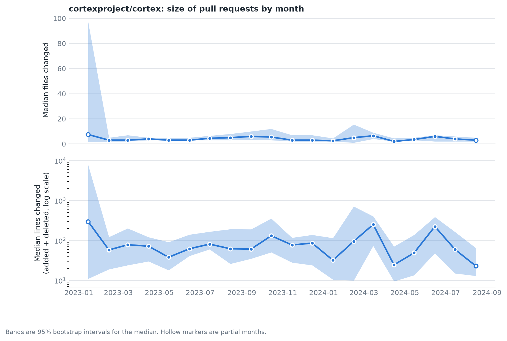
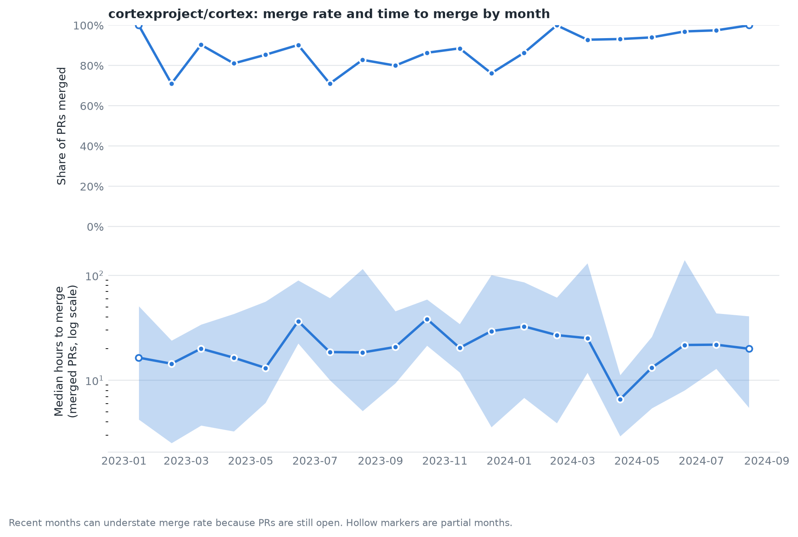
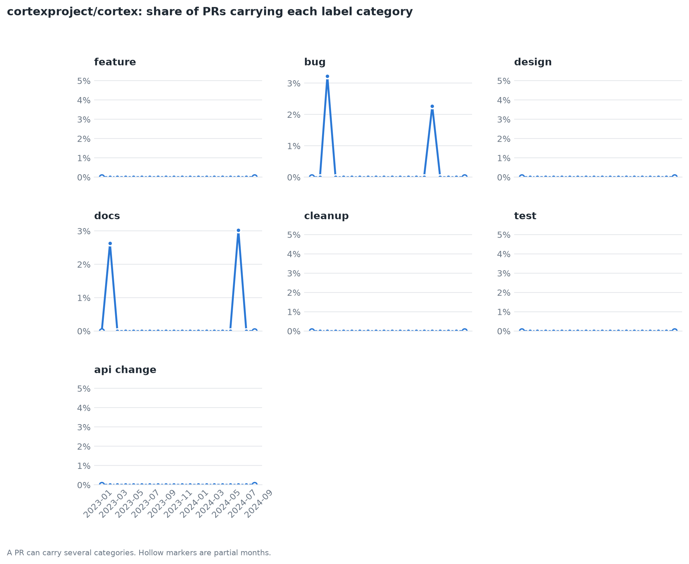
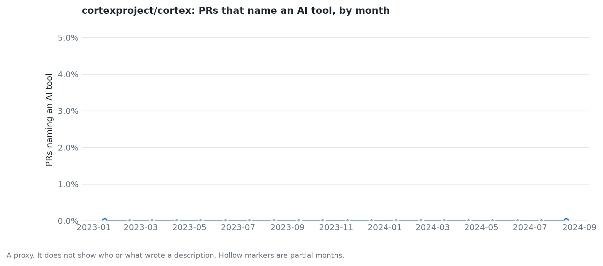

# Pull requests in cortexproject/cortex: description length, size, speed and labels

Window 2023-01-09 to 2024-08-19 (UTC). Data fetched 2026-11-20. prwords 3.0.0, generated 2026-11-26. Method fixed in advance in `docs/ANALYSIS_PLAN.md`.

## 1. Data

- Repository primary language: Go
- Pull requests opened in the window: 852
- Removed as bot accounts: 225
- Analysed: 627 PRs from 65 authors
- Merged: 550 (87.7%). Closed without merging: 77 (12.3%). Still open: 0
- Follow-up: merge outcomes use a 30-day follow-up. PRs without enough follow-up: 0
- Empty descriptions after cleaning: 0.6%

## 2. Did the PR template change?

Lines that appeared or disappeared across the window (full list in `template_audit.csv`):

| line                             | first_month   | last_month   |   months |   peak_share | change_event   |
|:---------------------------------|:--------------|:-------------|---------:|-------------:|:---------------|
| *which issue(s) this pr fixes**: | 2023-06       | 2024-08      |       13 |         0.97 | added          |
| fixes #                          | 2023-09       | 2024-08      |        4 |         0.74 | added          |

Distinct template lines detected: 7.

## 3. First 28 days versus last 28 days

First window 2023-01-09 to 2023-02-05. Last window 2024-07-23 to 2024-08-19. Ratios are last median divided by first median. Bootstrap intervals, 2,000 resamples.

| Metric                                |   n first |   n last |   Median first |   Median last |   Ratio |   Ratio low |   Ratio high |     p |   Cliff's delta |
|:--------------------------------------|----------:|---------:|---------------:|--------------:|--------:|------------:|-------------:|------:|----------------:|
| Description words (non-empty)         |        17 |       34 |          53    |         30    |    0.57 |        0.32 |         0.86 | 0.018 |           -0.41 |
| Files changed                         |        17 |       34 |           2    |          4    |    2    |        0.36 |         4    | 0.82  |            0.04 |
| Lines added                           |        17 |       34 |          27    |         19    |    0.7  |        0.05 |         4.75 | 0.37  |           -0.16 |
| Lines deleted                         |        17 |       34 |          11    |         12.5  |    1.14 |        0.11 |         7.33 | 0.7   |           -0.07 |
| Net lines (added minus deleted)       |        17 |       34 |          25    |          3    |    0.12 |        0.01 |         3.1  | 0.1   |           -0.29 |
| Lines changed (added plus deleted)    |        17 |       34 |          56    |         29.5  |    0.53 |        0.06 |         4.52 | 0.44  |           -0.13 |
| Hours from open to merge (merged PRs) |        15 |       34 |          16.07 |         21.52 |    1.34 |        0.69 |        11.14 | 0.13  |            0.28 |
| Commits                               |        17 |       34 |           2    |          2    |    1    |        0.5  |         2.01 | 0.87  |            0.03 |
| Comments                              |        17 |       34 |           0    |          0    |  nan    |        0    |         0.45 | 0.81  |           -0.04 |
| Reviews                               |        17 |       34 |           2    |          2    |    1    |        0.5  |         2.5  | 0.55  |            0.1  |

| Measure                             |   n first |   n last | Share first   | Share last   |   Change (points) |    p |
|:------------------------------------|----------:|---------:|:--------------|:-------------|------------------:|-----:|
| Merged within follow-up period      |        17 |       34 | 88.2%         | 97.1%        |               8.8 | 0.25 |
| Closed without merging              |        17 |       34 | 11.8%         | 0.0%         |             -11.8 | 0.11 |
| Opened as draft                     |        17 |       34 | 0.0%          | 0.0%         |               0   | 1    |
| From outside contributors           |        17 |       34 | 76.5%         | 76.5%        |               0   | 1    |
| Has a kind or type label            |        17 |       34 | 0.0%          | 0.0%         |               0   | 1    |
| Description text repeated elsewhere |        17 |       34 | 0.0%          | 0.0%         |               0   | 1    |
| Names an AI tool (disclosure)       |        17 |       34 | 0.0%          | 0.0%         |               0   | 1    |
| Label category: feature             |        17 |       34 | 0.0%          | 0.0%         |               0   | 1    |
| Label category: bug                 |        17 |       34 | 0.0%          | 0.0%         |               0   | 1    |
| Label category: design              |        17 |       34 | 0.0%          | 0.0%         |               0   | 1    |
| Label category: docs                |        17 |       34 | 0.0%          | 0.0%         |               0   | 1    |
| Label category: cleanup             |        17 |       34 | 0.0%          | 0.0%         |               0   | 1    |
| Label category: test                |        17 |       34 | 0.0%          | 0.0%         |               0   | 1    |
| Label category: api_change          |        17 |       34 | 0.0%          | 0.0%         |               0   | 1    |

## 4. Monthly trends

Theil-Sen slope per month and Kendall tau over full months only.

| metric                     |   months |   slope_per_month |   slope_ci_low |   slope_ci_high |     tau |       p |
|:---------------------------|---------:|------------------:|---------------:|----------------:|--------:|--------:|
| median_words               |       18 |             0.125 |         -0.5   |           0.8   |   0.14  |   0.424 |
| median_files_changed       |       18 |             0.045 |         -0.062 |           0.25  |   0.174 |   0.333 |
| median_additions           |       18 |            -0.75  |         -3     |           4.571 |  -0.079 |   0.649 |
| median_deletions           |       18 |             0.333 |         -0.273 |           1.25  |   0.199 |   0.254 |
| median_churn               |       18 |             0.917 |         -2.188 |           6.5   |   0.092 |   0.596 |
| median_hours_to_merge      |       18 |             0.283 |         -0.841 |           0.971 |   0.15  |   0.41  |
| merge_rate                 |       18 |             0.011 |          0.005 |           0.018 |   0.533 |   0.002 |
| share_outside_contributors |       18 |            -0.008 |         -0.015 |           0.008 |  -0.224 |   0.197 |
| share_ai_disclosed         |       18 |            -0     |         -0     |          -0     | nan     | nan     |
| median_comments            |       18 |            -0     |         -0     |          -0     |  -0.221 |   0.264 |
| median_reviews             |       18 |            -0     |         -0.062 |          -0     |  -0.207 |   0.29  |
| share_feature              |       18 |            -0     |         -0     |          -0     | nan     | nan     |
| share_bug                  |       18 |            -0     |         -0     |          -0     |  -0.07  |   0.726 |
| share_design               |       18 |            -0     |         -0     |          -0     | nan     | nan     |
| share_docs                 |       18 |            -0     |         -0     |          -0     |  -0.014 |   0.944 |
| share_cleanup              |       18 |            -0     |         -0     |          -0     | nan     | nan     |
| share_test                 |       18 |            -0     |         -0     |          -0     | nan     | nan     |
| share_api_change           |       18 |            -0     |         -0     |          -0     | nan     | nan     |

## 5. Labels

Share of PRs with a kind or type label: 0.3% overall. Label coverage by month is in `monthly_summary.csv` (`share_has_kind_label`).

| category            |   n_prs |   share |   median_words |   median_files |   median_churn |   merge_rate |   median_hours_to_merge |   share_ai_disclosed |
|:--------------------|--------:|--------:|---------------:|---------------:|---------------:|-------------:|------------------------:|---------------------:|
| feature             |       0 |   0     |            nan |          nan   |            nan |      nan     |                 nan     |                  nan |
| bug                 |       2 |   0.003 |             35 |            2   |             73 |        1     |                  15.995 |                    0 |
| design              |       0 |   0     |            nan |          nan   |            nan |      nan     |                 nan     |                  nan |
| docs                |       2 |   0.003 |             46 |            5.5 |            113 |        1     |                  17.668 |                    0 |
| cleanup             |       0 |   0     |            nan |          nan   |            nan |      nan     |                 nan     |                  nan |
| test                |       0 |   0     |            nan |          nan   |            nan |      nan     |                 nan     |                  nan |
| api_change          |       0 |   0     |            nan |          nan   |            nan |      nan     |                 nan     |                  nan |
| (no category label) |     623 |   0.994 |             33 |            4   |             66 |        0.876 |                  19.166 |                    0 |

Cross-check against the repository's own size labels (coverage 98.9%, Spearman rho between size label and lines changed 0.85):

| size_label   |   n_prs |   median_churn |   p10_churn |   p90_churn |
|:-------------|--------:|---------------:|------------:|------------:|
| XS           |     138 |              4 |           1 |          53 |
| S            |     123 |             17 |          11 |         108 |
| M            |     144 |             62 |          34 |         692 |
| L            |     157 |            224 |         117 |        1959 |
| XL           |      33 |            767 |         525 |        3377 |
| XXL          |      25 |           2905 |        1193 |       25479 |

## 6. Are PRs with signs of AI involvement smaller or larger?

Authorship is not observable. The proxy is `ai_disclosed`, defined in the analysis plan: 0 PRs (0.00%). 0 disclosed PRs are listed in `ai_disclosure_samples.csv` for manual audit.

### ai_disclosed

**Verdict: not testable.** Too few exposed PRs.

Pattern: lines changed: not estimated; files changed: not estimated; lines added: not estimated; lines deleted: not estimated; hours to merge: not estimated.

Not estimated: fewer than 30 exposed PRs (exposed PRs: 0).

### Robustness by tool (lines changed)

No tool named in any disclosure.

### File type check

Not run. Use `--file-check N` to sample N exposed PRs and matching unexposed PRs.

## 7. Other checks

- Outside contributors: 78.1% of PRs overall.
- Top 10 authors opened 77.0% of PRs.
- PRs whose description text is repeated elsewhere (10 or more words): 4.1%.

## 8. Limitations

- Word count and size describe PRs, not who wrote them. Proxies for AI involvement are noisy and omit undisclosed use.
- Added and deleted lines include generated or vendored files unless the project avoids committing them.
- Disclosure mostly captures tools that add attribution by default, so it is tool-skewed.
- Template removal is heuristic. Check `template_audit.csv`.
- One repository cannot support general claims. See the plan for replication.
- Months at the edges of the window are partial and are excluded from trend tests.

