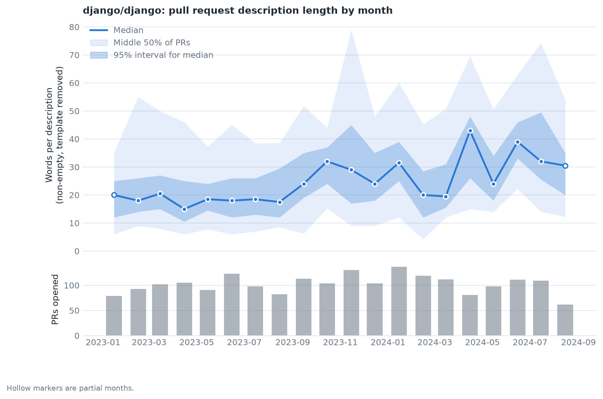
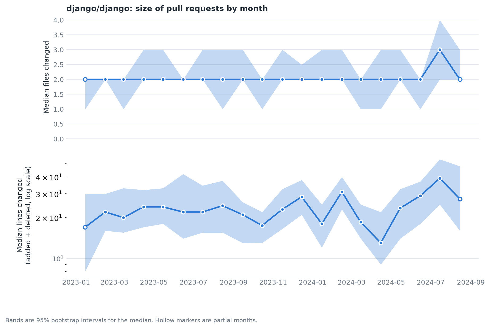
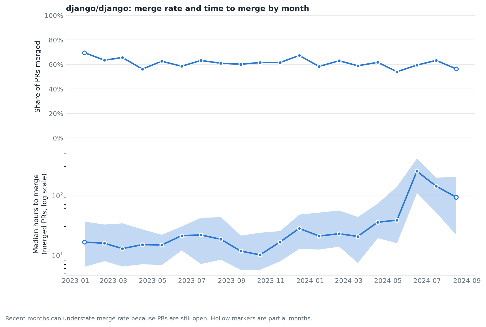
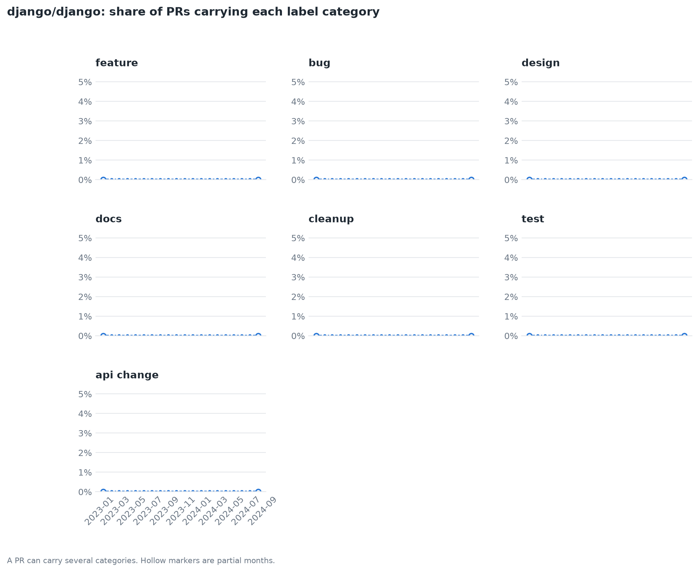
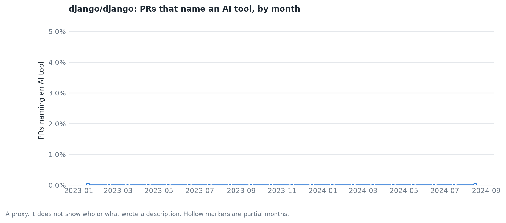

# Pull requests in django/django: description length, size, speed and labels

Window 2023-01-09 to 2024-08-19 (UTC). Data fetched 2026-11-19. prwords 3.0.0, generated 2026-11-26. Method fixed in advance in `docs/ANALYSIS_PLAN.md`.

## 1. Data

- Repository primary language: Python
- Pull requests opened in the window: 2,053
- Removed as bot accounts: 0
- Analysed: 2,053 PRs from 757 authors
- Merged: 1,257 (61.2%). Closed without merging: 727 (35.4%). Still open: 69
- Follow-up: merge outcomes use a 30-day follow-up. PRs without enough follow-up: 0
- Empty descriptions after cleaning: 17.1%

## 2. Did the PR template change?

Lines that appeared or disappeared across the window (full list in `template_audit.csv`):

| line                                                                              | first_month   | last_month   |   months |   peak_share | change_event   |
|:----------------------------------------------------------------------------------|:--------------|:-------------|---------:|-------------:|:---------------|
| i have added or updated relevant **docs**, including release notes if applicable. | 2024-03       | 2024-04      |        2 |         0.52 | removed        |
| i have added or updated relevant **tests**.                                       | 2024-03       | 2024-04      |        2 |         0.52 | removed        |
| i have checked the "has patch" **ticket flag** in the trac system.                | 2024-03       | 2024-04      |        2 |         0.51 | removed        |
| i have checked the "has patch" ticket flag in the trac system.                    | 2024-05       | 2024-08      |        4 |         0.71 | added          |
| i have added or updated relevant tests.                                           | 2024-05       | 2024-08      |        4 |         0.7  | added          |
| i have added or updated relevant docs, including release notes if applicable.     | 2024-05       | 2024-08      |        4 |         0.68 | added          |
| i have attached screenshots in both light and dark modes for any ui changes.      | 2024-05       | 2024-08      |        4 |         0.65 | added          |

Distinct template lines detected: 13.

## 3. First 28 days versus last 28 days

First window 2023-01-09 to 2023-02-05. Last window 2024-07-23 to 2024-08-19. Ratios are last median divided by first median. Bootstrap intervals, 2,000 resamples.

| Metric                                |   n first |   n last |   Median first |   Median last |   Ratio |   Ratio low |   Ratio high |       p |   Cliff's delta |
|:--------------------------------------|----------:|---------:|---------------:|--------------:|--------:|------------:|-------------:|--------:|----------------:|
| Description words (non-empty)         |        75 |       92 |           20   |         29    |    1.45 |        1.08 |         2.65 | 0.0014  |            0.29 |
| Files changed                         |        90 |       98 |            2   |          3    |    1.5  |        1    |         3    | 0.11    |            0.13 |
| Lines added                           |        90 |       98 |           12   |         27.5  |    2.29 |        0.93 |         4.82 | 0.017   |            0.2  |
| Lines deleted                         |        90 |       98 |            3   |          4    |    1.33 |        0.75 |         3.5  | 0.3     |            0.09 |
| Net lines (added minus deleted)       |        90 |       98 |            4   |         20.5  |    5.12 |        1.26 |        13.52 | 0.0039  |            0.24 |
| Lines changed (added plus deleted)    |        90 |       98 |           18   |         38.5  |    2.14 |        1.04 |         4    | 0.02    |            0.2  |
| Hours from open to merge (merged PRs) |        62 |       60 |           17.2 |         93.04 |    5.41 |        1.81 |        13.17 | 0.00048 |            0.37 |
| Commits                               |        90 |       98 |            1   |          1    |    1    |        1    |         1    | 0.048   |            0.12 |
| Comments                              |        90 |       98 |            1   |          1.5  |    1.5  |        1    |         2    | 0.87    |            0.01 |
| Reviews                               |        90 |       98 |            1   |          2    |    2    |        1    |         4    | 0.00083 |            0.28 |

| Measure                             |   n first |   n last | Share first   | Share last   |   Change (points) |     p |
|:------------------------------------|----------:|---------:|:--------------|:-------------|------------------:|------:|
| Merged within follow-up period      |        90 |       98 | 67.8%         | 54.1%        |             -13.7 | 0.073 |
| Closed without merging              |        90 |       98 | 31.1%         | 29.6%        |              -1.5 | 0.87  |
| Opened as draft                     |        90 |       98 | 1.1%          | 4.1%         |               3   | 0.37  |
| From outside contributors           |        90 |       98 | 61.1%         | 73.5%        |              12.4 | 0.087 |
| Has a kind or type label            |        90 |       98 | 0.0%          | 0.0%         |               0   | 1     |
| Description text repeated elsewhere |        90 |       98 | 0.0%          | 1.0%         |               1   | 1     |
| Names an AI tool (disclosure)       |        90 |       98 | 0.0%          | 0.0%         |               0   | 1     |
| Label category: feature             |        90 |       98 | 0.0%          | 0.0%         |               0   | 1     |
| Label category: bug                 |        90 |       98 | 0.0%          | 0.0%         |               0   | 1     |
| Label category: design              |        90 |       98 | 0.0%          | 0.0%         |               0   | 1     |
| Label category: docs                |        90 |       98 | 0.0%          | 0.0%         |               0   | 1     |
| Label category: cleanup             |        90 |       98 | 0.0%          | 0.0%         |               0   | 1     |
| Label category: test                |        90 |       98 | 0.0%          | 0.0%         |               0   | 1     |
| Label category: api_change          |        90 |       98 | 0.0%          | 0.0%         |               0   | 1     |

## 4. Monthly trends

Theil-Sen slope per month and Kendall tau over full months only.

| metric                     |   months |   slope_per_month |   slope_ci_low |   slope_ci_high |     tau |       p |
|:---------------------------|---------:|------------------:|---------------:|----------------:|--------:|--------:|
| median_words               |       18 |             1     |          0.214 |           1.714 |   0.513 |   0.003 |
| median_files_changed       |       18 |            -0     |         -0     |          -0     |   0.333 |   0.101 |
| median_additions           |       18 |             0.067 |         -0.5   |           0.545 |   0.081 |   0.645 |
| median_deletions           |       18 |            -0     |         -0     |           0.083 |   0.159 |   0.409 |
| median_churn               |       18 |             0.167 |         -0.389 |           0.857 |   0.152 |   0.382 |
| median_hours_to_merge      |       18 |             1.699 |          0.647 |           3.321 |   0.556 |   0.001 |
| merge_rate                 |       18 |            -0.001 |         -0.005 |           0.002 |  -0.118 |   0.495 |
| share_outside_contributors |       18 |             0.006 |         -0.005 |           0.014 |   0.268 |   0.131 |
| share_ai_disclosed         |       18 |            -0     |         -0     |          -0     | nan     | nan     |
| median_comments            |       18 |            -0     |         -0     |          -0     |  -0.495 |   0.013 |
| median_reviews             |       18 |            -0     |         -0     |          -0     |   0.231 |   0.257 |
| share_feature              |       18 |            -0     |         -0     |          -0     | nan     | nan     |
| share_bug                  |       18 |            -0     |         -0     |          -0     | nan     | nan     |
| share_design               |       18 |            -0     |         -0     |          -0     | nan     | nan     |
| share_docs                 |       18 |            -0     |         -0     |          -0     | nan     | nan     |
| share_cleanup              |       18 |            -0     |         -0     |          -0     | nan     | nan     |
| share_test                 |       18 |            -0     |         -0     |          -0     | nan     | nan     |
| share_api_change           |       18 |            -0     |         -0     |          -0     | nan     | nan     |

## 5. Labels

Share of PRs with a kind or type label: 0.0% overall. Label coverage by month is in `monthly_summary.csv` (`share_has_kind_label`).

| category            |   n_prs |   share |   median_words |   median_files |   median_churn |   merge_rate |   median_hours_to_merge |   share_ai_disclosed |
|:--------------------|--------:|--------:|---------------:|---------------:|---------------:|-------------:|------------------------:|---------------------:|
| feature             |       0 |       0 |            nan |            nan |            nan |      nan     |                 nan     |                  nan |
| bug                 |       0 |       0 |            nan |            nan |            nan |      nan     |                 nan     |                  nan |
| design              |       0 |       0 |            nan |            nan |            nan |      nan     |                 nan     |                  nan |
| docs                |       0 |       0 |            nan |            nan |            nan |      nan     |                 nan     |                  nan |
| cleanup             |       0 |       0 |            nan |            nan |            nan |      nan     |                 nan     |                  nan |
| test                |       0 |       0 |            nan |            nan |            nan |      nan     |                 nan     |                  nan |
| api_change          |       0 |       0 |            nan |            nan |            nan |      nan     |                 nan     |                  nan |
| (no category label) |    2053 |       1 |             24 |              2 |             23 |        0.612 |                  22.397 |                    0 |

## 6. Are PRs with signs of AI involvement smaller or larger?

Authorship is not observable. The proxy is `ai_disclosed`, defined in the analysis plan: 0 PRs (0.00%). 0 disclosed PRs are listed in `ai_disclosure_samples.csv` for manual audit.

### ai_disclosed

**Verdict: not testable.** Too few exposed PRs.

Pattern: lines changed: not estimated; files changed: not estimated; lines added: not estimated; lines deleted: not estimated; hours to merge: not estimated.

Not estimated: fewer than 30 exposed PRs (exposed PRs: 0).

### Robustness by tool (lines changed)

No tool named in any disclosure.

### File type check

Not run. Use `--file-check N` to sample N exposed PRs and matching unexposed PRs.

## 7. Other checks

- Outside contributors: 65.3% of PRs overall.
- Top 10 authors opened 36.8% of PRs.
- PRs whose description text is repeated elsewhere (10 or more words): 2.8%.

## 8. Limitations

- Word count and size describe PRs, not who wrote them. Proxies for AI involvement are noisy and omit undisclosed use.
- Added and deleted lines include generated or vendored files unless the project avoids committing them.
- Disclosure mostly captures tools that add attribution by default, so it is tool-skewed.
- Template removal is heuristic. Check `template_audit.csv`.
- One repository cannot support general claims. See the plan for replication.
- Months at the edges of the window are partial and are excluded from trend tests.

