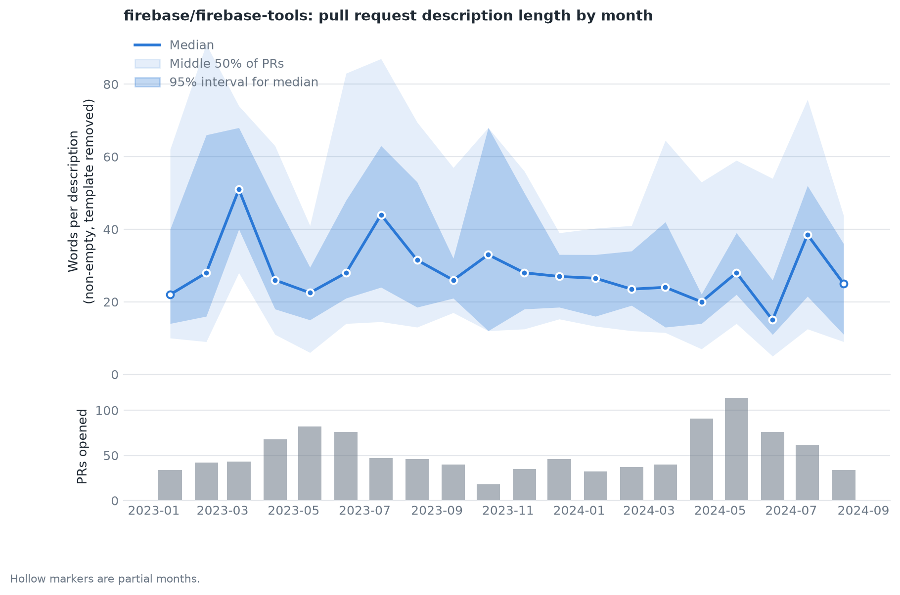
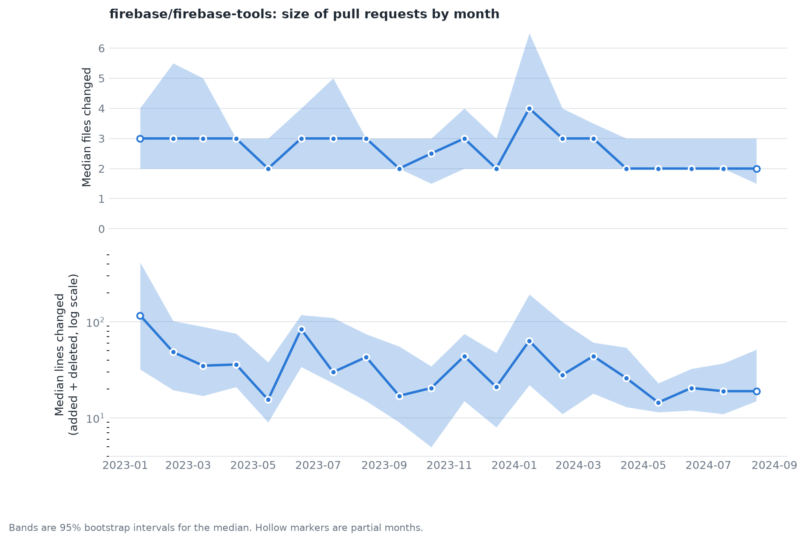
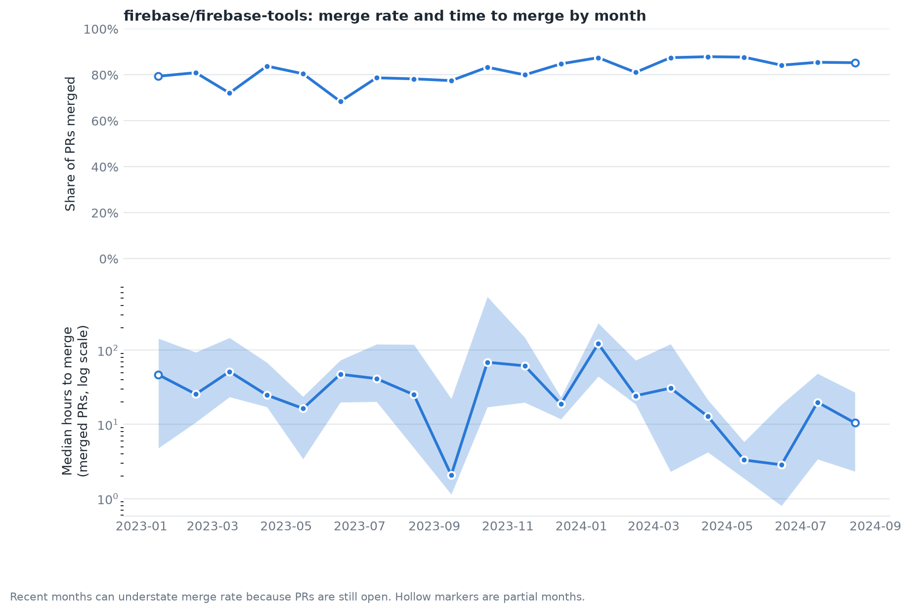
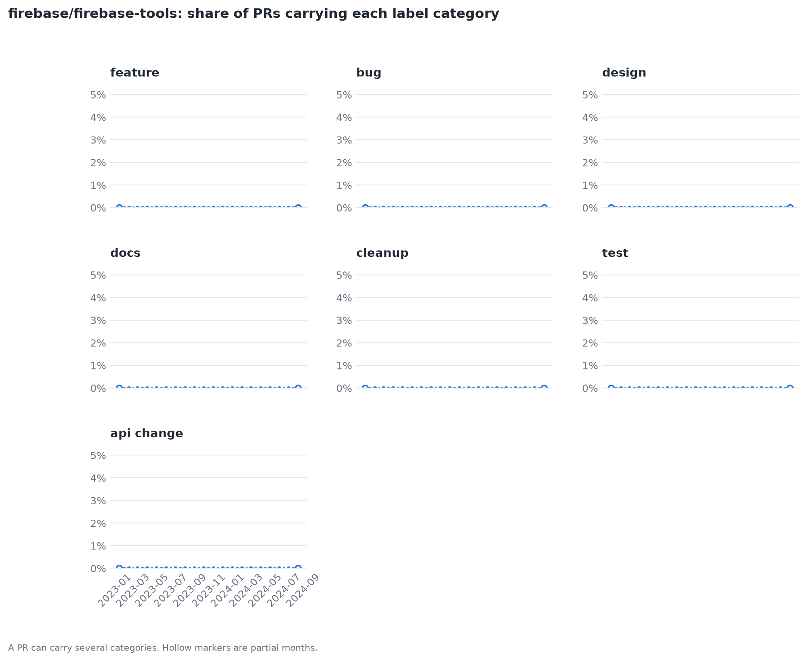
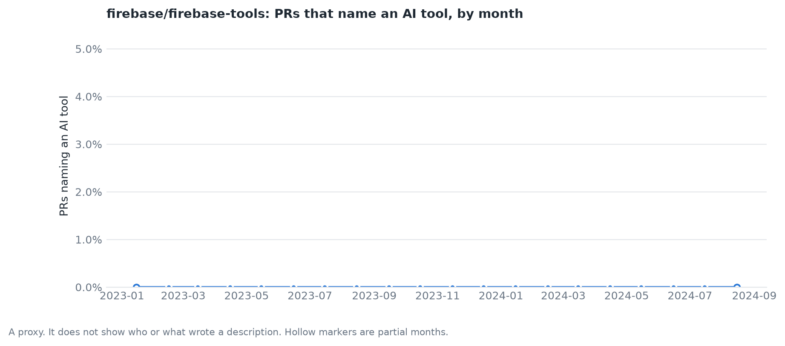

# Pull requests in firebase/firebase-tools: description length, size, speed and labels

Window 2023-01-09 to 2024-08-19 (UTC). Data fetched 2026-11-20. prwords 3.0.0, generated 2026-11-26. Method fixed in advance in `docs/ANALYSIS_PLAN.md`.

## 1. Data

- Repository primary language: TypeScript
- Pull requests opened in the window: 1,210
- Removed as bot accounts: 147
- Analysed: 1,063 PRs from 147 authors
- Merged: 872 (82.0%). Closed without merging: 132 (12.4%). Still open: 59
- Follow-up: merge outcomes use a 30-day follow-up. PRs without enough follow-up: 0
- Empty descriptions after cleaning: 11.2%

## 2. Did the PR template change?

Lines that appeared or disappeared across the window (full list in `template_audit.csv`):

| line                 | first_month   | last_month   |   months |   peak_share | change_event   |
|:---------------------|:--------------|:-------------|---------:|-------------:|:---------------|
| ### scenarios tested | 2023-05       | 2024-07      |        5 |         0.56 | added          |

Distinct template lines detected: 3.

## 3. First 28 days versus last 28 days

First window 2023-01-09 to 2023-02-05. Last window 2024-07-23 to 2024-08-19. Ratios are last median divided by first median. Bootstrap intervals, 2,000 resamples.

| Metric                                |   n first |   n last |   Median first |   Median last |   Ratio |   Ratio low |   Ratio high |       p |   Cliff's delta |
|:--------------------------------------|----------:|---------:|---------------:|--------------:|--------:|------------:|-------------:|--------:|----------------:|
| Description words (non-empty)         |        38 |       48 |          25.5  |          25   |    0.98 |        0.4  |         1.92 | 0.47    |           -0.09 |
| Files changed                         |        39 |       56 |           3    |           2   |    0.67 |        0.4  |         1    | 0.034   |           -0.25 |
| Lines added                           |        39 |       56 |          76    |          10   |    0.13 |        0.05 |         0.71 | 0.012   |           -0.31 |
| Lines deleted                         |        39 |       56 |          10    |           5   |    0.5  |        0.08 |         2.5  | 0.13    |           -0.18 |
| Net lines (added minus deleted)       |        39 |       56 |          21    |           2.5 |    0.12 |        0.03 |         1    | 0.076   |           -0.21 |
| Lines changed (added plus deleted)    |        39 |       56 |         110    |          19   |    0.17 |        0.04 |         0.67 | 0.0059  |           -0.33 |
| Hours from open to merge (merged PRs) |        32 |       51 |          55.41 |          15.2 |    0.27 |        0.04 |         0.92 | 0.052   |           -0.25 |
| Commits                               |        39 |       56 |           4    |           3.5 |    0.88 |        0.6  |         1.33 | 0.96    |           -0.01 |
| Comments                              |        39 |       56 |           1    |           0   |    0    |        0    |         0    | 1.8e-07 |           -0.56 |
| Reviews                               |        39 |       56 |           1    |           1   |    1    |        1    |         1.5  | 0.28    |            0.12 |

| Measure                             |   n first |   n last | Share first   | Share last   |   Change (points) |       p |
|:------------------------------------|----------:|---------:|:--------------|:-------------|------------------:|--------:|
| Merged within follow-up period      |        39 |       56 | 82.1%         | 85.7%        |               3.7 | 0.78    |
| Closed without merging              |        39 |       56 | 15.4%         | 8.9%         |              -6.5 | 0.35    |
| Opened as draft                     |        39 |       56 | 10.3%         | 3.6%         |              -6.7 | 0.22    |
| From outside contributors           |        39 |       56 | 87.2%         | 30.4%        |             -56.8 | 2.8e-08 |
| Has a kind or type label            |        39 |       56 | 0.0%          | 0.0%         |               0   | 1       |
| Description text repeated elsewhere |        39 |       56 | 0.0%          | 0.0%         |               0   | 1       |
| Names an AI tool (disclosure)       |        39 |       56 | 0.0%          | 0.0%         |               0   | 1       |
| Label category: feature             |        39 |       56 | 0.0%          | 0.0%         |               0   | 1       |
| Label category: bug                 |        39 |       56 | 0.0%          | 0.0%         |               0   | 1       |
| Label category: design              |        39 |       56 | 0.0%          | 0.0%         |               0   | 1       |
| Label category: docs                |        39 |       56 | 0.0%          | 0.0%         |               0   | 1       |
| Label category: cleanup             |        39 |       56 | 0.0%          | 0.0%         |               0   | 1       |
| Label category: test                |        39 |       56 | 0.0%          | 0.0%         |               0   | 1       |
| Label category: api_change          |        39 |       56 | 0.0%          | 0.0%         |               0   | 1       |

## 4. Monthly trends

Theil-Sen slope per month and Kendall tau over full months only.

| metric                     |   months |   slope_per_month |   slope_ci_low |   slope_ci_high |     tau |       p |
|:---------------------------|---------:|------------------:|---------------:|----------------:|--------:|--------:|
| median_words               |       18 |            -0.5   |         -1.6   |           0.125 |  -0.268 |   0.127 |
| median_files_changed       |       18 |            -0     |         -0.077 |          -0     |  -0.347 |   0.076 |
| median_additions           |       18 |            -0.5   |         -1.583 |           0.364 |  -0.223 |   0.197 |
| median_deletions           |       18 |             0     |         -0.3   |           0.286 |   0.054 |   0.76  |
| median_churn               |       18 |            -1     |         -2.5   |           0.375 |  -0.257 |   0.139 |
| median_hours_to_merge      |       18 |            -1.419 |         -3.434 |           0.403 |  -0.255 |   0.152 |
| merge_rate                 |       18 |             0.006 |          0.002 |           0.011 |   0.498 |   0.004 |
| share_outside_contributors |       18 |            -0.022 |         -0.038 |          -0.005 |  -0.399 |   0.021 |
| share_ai_disclosed         |       18 |            -0     |         -0     |          -0     | nan     | nan     |
| median_comments            |       18 |            -0     |         -0     |          -0     |  -0.605 |   0.003 |
| median_reviews             |       18 |            -0     |         -0     |          -0     | nan     | nan     |
| share_feature              |       18 |            -0     |         -0     |          -0     | nan     | nan     |
| share_bug                  |       18 |            -0     |         -0     |          -0     | nan     | nan     |
| share_design               |       18 |            -0     |         -0     |          -0     | nan     | nan     |
| share_docs                 |       18 |            -0     |         -0     |          -0     | nan     | nan     |
| share_cleanup              |       18 |            -0     |         -0     |          -0     | nan     | nan     |
| share_test                 |       18 |            -0     |         -0     |          -0     | nan     | nan     |
| share_api_change           |       18 |            -0     |         -0     |          -0     | nan     | nan     |

## 5. Labels

Share of PRs with a kind or type label: 0.0% overall. Label coverage by month is in `monthly_summary.csv` (`share_has_kind_label`).

| category            |   n_prs |   share |   median_words |   median_files |   median_churn |   merge_rate |   median_hours_to_merge |   share_ai_disclosed |
|:--------------------|--------:|--------:|---------------:|---------------:|---------------:|-------------:|------------------------:|---------------------:|
| feature             |       0 |       0 |            nan |            nan |            nan |       nan    |                 nan     |                  nan |
| bug                 |       0 |       0 |            nan |            nan |            nan |       nan    |                 nan     |                  nan |
| design              |       0 |       0 |            nan |            nan |            nan |       nan    |                 nan     |                  nan |
| docs                |       0 |       0 |            nan |            nan |            nan |       nan    |                 nan     |                  nan |
| cleanup             |       0 |       0 |            nan |            nan |            nan |       nan    |                 nan     |                  nan |
| test                |       0 |       0 |            nan |            nan |            nan |       nan    |                 nan     |                  nan |
| api_change          |       0 |       0 |            nan |            nan |            nan |       nan    |                 nan     |                  nan |
| (no category label) |    1063 |       1 |             27 |              2 |             27 |         0.82 |                  19.895 |                    0 |

## 6. Are PRs with signs of AI involvement smaller or larger?

Authorship is not observable. The proxy is `ai_disclosed`, defined in the analysis plan: 0 PRs (0.00%). 0 disclosed PRs are listed in `ai_disclosure_samples.csv` for manual audit.

### ai_disclosed

**Verdict: not testable.** Too few exposed PRs.

Pattern: lines changed: not estimated; files changed: not estimated; lines added: not estimated; lines deleted: not estimated; hours to merge: not estimated.

Not estimated: fewer than 30 exposed PRs (exposed PRs: 0).

### Robustness by tool (lines changed)

No tool named in any disclosure.

### File type check

Not run. Use `--file-check N` to sample N exposed PRs and matching unexposed PRs.

## 7. Other checks

- Outside contributors: 61.2% of PRs overall.
- Top 10 authors opened 56.8% of PRs.
- PRs whose description text is repeated elsewhere (10 or more words): 0.6%.

## 8. Limitations

- Word count and size describe PRs, not who wrote them. Proxies for AI involvement are noisy and omit undisclosed use.
- Added and deleted lines include generated or vendored files unless the project avoids committing them.
- Disclosure mostly captures tools that add attribution by default, so it is tool-skewed.
- Template removal is heuristic. Check `template_audit.csv`.
- One repository cannot support general claims. See the plan for replication.
- Months at the edges of the window are partial and are excluded from trend tests.

