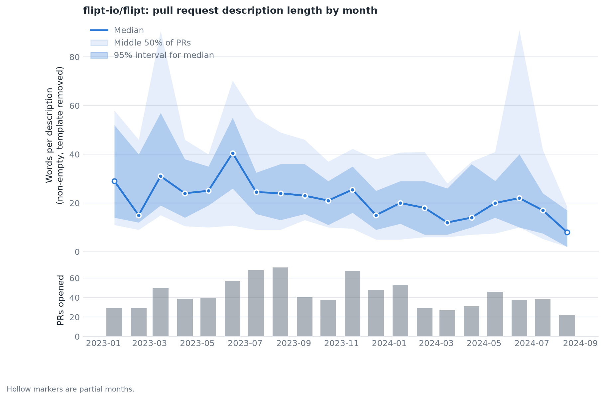
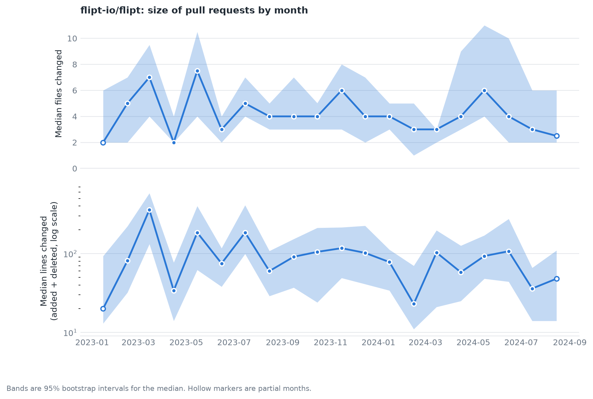
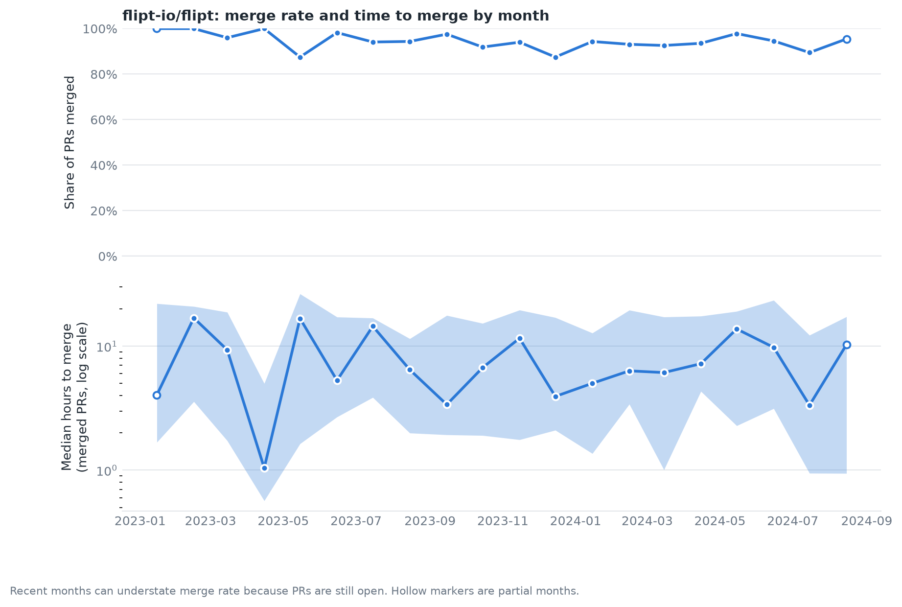
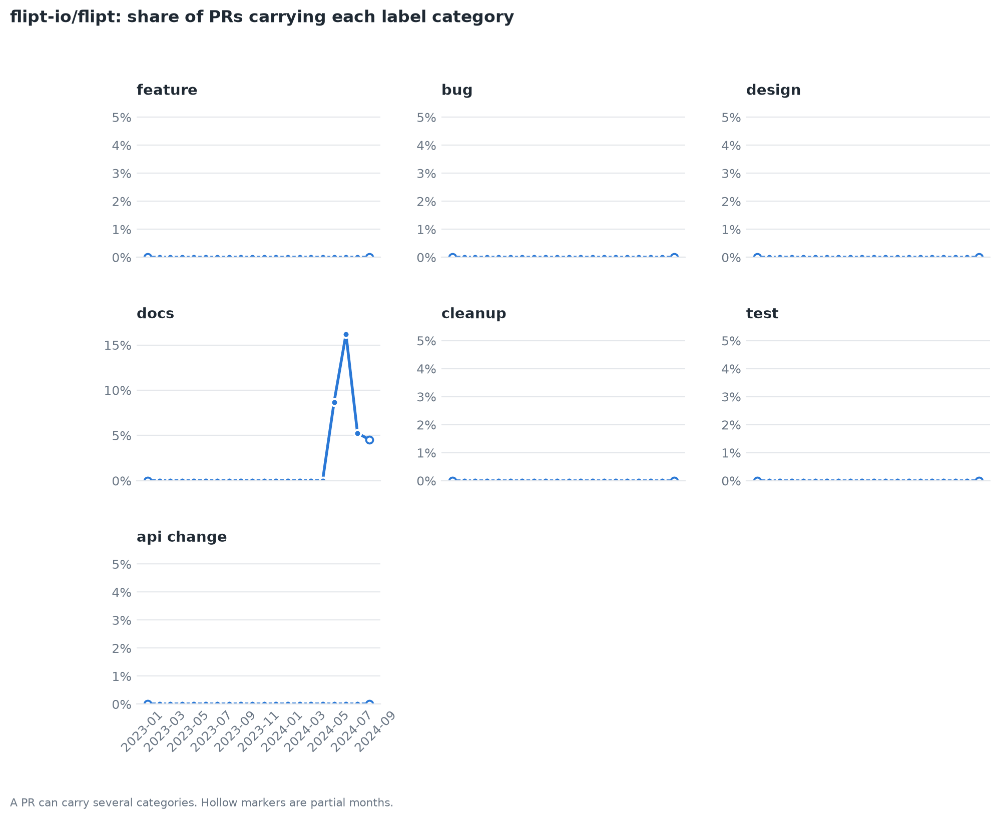
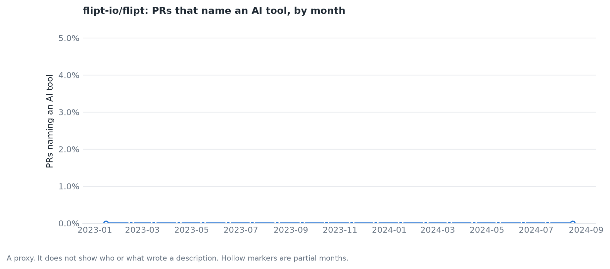

# Pull requests in flipt-io/flipt: description length, size, speed and labels

Window 2023-01-09 to 2024-08-19 (UTC). Data fetched 2026-11-20. prwords 3.0.0, generated 2026-11-26. Method fixed in advance in `docs/ANALYSIS_PLAN.md`.

## 1. Data

- Repository primary language: Go
- Pull requests opened in the window: 1,895
- Removed as bot accounts: 1,036
- Analysed: 859 PRs from 40 authors
- Merged: 812 (94.5%). Closed without merging: 47 (5.5%). Still open: 0
- Follow-up: merge outcomes use a 30-day follow-up. PRs without enough follow-up: 0
- Empty descriptions after cleaning: 6.4%

## 2. Did the PR template change?

No template line appeared or disappeared with a share of 50% or more. Template text was detected monthly and removed before counting words.

Distinct template lines detected: 0.

## 3. First 28 days versus last 28 days

First window 2023-01-09 to 2023-02-05. Last window 2024-07-23 to 2024-08-19. Ratios are last median divided by first median. Bootstrap intervals, 2,000 resamples.

| Metric                                |   n first |   n last |   Median first |   Median last |   Ratio |   Ratio low |   Ratio high |       p |   Cliff's delta |
|:--------------------------------------|----------:|---------:|---------------:|--------------:|--------:|------------:|-------------:|--------:|----------------:|
| Description words (non-empty)         |        36 |       29 |          17    |         12    |    0.71 |        0.12 |         1.43 | 0.033   |           -0.31 |
| Files changed                         |        36 |       36 |           2    |          3    |    1.5  |        0.5  |         2.25 | 0.71    |            0.05 |
| Lines added                           |        36 |       36 |          19    |         23.5  |    1.24 |        0.45 |         4.15 | 0.6     |            0.07 |
| Lines deleted                         |        36 |       36 |           4    |          4.5  |    1.12 |        0.33 |         6.34 | 0.56    |            0.08 |
| Net lines (added minus deleted)       |        36 |       36 |           7.5  |         21    |    2.8  |        0.32 |         6.88 | 0.57    |            0.08 |
| Lines changed (added plus deleted)    |        36 |       36 |          28    |         36.5  |    1.3  |        0.5  |         4.43 | 0.46    |            0.1  |
| Hours from open to merge (merged PRs) |        36 |       32 |          13.48 |          5.14 |    0.38 |        0.1  |         5.41 | 0.75    |           -0.05 |
| Commits                               |        36 |       36 |           2    |          2    |    1    |        0.33 |         1.67 | 0.44    |           -0.1  |
| Comments                              |        36 |       36 |           1    |          1    |    1    |        1    |         3    | 0.00014 |            0.49 |
| Reviews                               |        36 |       36 |           1    |          1    |    1    |        1    |         1    | 0.1     |            0.19 |

| Measure                             |   n first |   n last | Share first   | Share last   |   Change (points) |       p |
|:------------------------------------|----------:|---------:|:--------------|:-------------|------------------:|--------:|
| Merged within follow-up period      |        36 |       36 | 100.0%        | 88.9%        |             -11.1 | 0.11    |
| Closed without merging              |        36 |       36 | 0.0%          | 11.1%        |              11.1 | 0.11    |
| Opened as draft                     |        36 |       36 | 0.0%          | 5.6%         |               5.6 | 0.49    |
| From outside contributors           |        36 |       36 | 0.0%          | 44.4%        |              44.4 | 3.6e-06 |
| Has a kind or type label            |        36 |       36 | 0.0%          | 0.0%         |               0   | 1       |
| Description text repeated elsewhere |        36 |       36 | 0.0%          | 0.0%         |               0   | 1       |
| Names an AI tool (disclosure)       |        36 |       36 | 0.0%          | 0.0%         |               0   | 1       |
| Label category: feature             |        36 |       36 | 0.0%          | 0.0%         |               0   | 1       |
| Label category: bug                 |        36 |       36 | 0.0%          | 0.0%         |               0   | 1       |
| Label category: design              |        36 |       36 | 0.0%          | 0.0%         |               0   | 1       |
| Label category: docs                |        36 |       36 | 0.0%          | 8.3%         |               8.3 | 0.24    |
| Label category: cleanup             |        36 |       36 | 0.0%          | 0.0%         |               0   | 1       |
| Label category: test                |        36 |       36 | 0.0%          | 0.0%         |               0   | 1       |
| Label category: api_change          |        36 |       36 | 0.0%          | 0.0%         |               0   | 1       |

## 4. Monthly trends

Theil-Sen slope per month and Kendall tau over full months only.

| metric                     |   months |   slope_per_month |   slope_ci_low |   slope_ci_high |     tau |       p |
|:---------------------------|---------:|------------------:|---------------:|----------------:|--------:|--------:|
| median_words               |       18 |            -0.625 |         -1.167 |          -0.2   |  -0.436 |   0.012 |
| median_files_changed       |       18 |            -0.062 |         -0.2   |          -0     |  -0.218 |   0.236 |
| median_additions           |       18 |            -2.571 |         -8.25  |           0.4   |  -0.302 |   0.081 |
| median_deletions           |       18 |            -0.286 |         -1.25  |           0.714 |  -0.142 |   0.423 |
| median_churn               |       18 |            -2.647 |        -10.188 |           1.778 |  -0.17  |   0.324 |
| median_hours_to_merge      |       18 |            -0.151 |         -0.638 |           0.384 |  -0.124 |   0.501 |
| merge_rate                 |       18 |            -0.003 |         -0.006 |           0     |  -0.296 |   0.088 |
| share_outside_contributors |       18 |             0.015 |          0.004 |           0.031 |   0.399 |   0.021 |
| share_ai_disclosed         |       18 |            -0     |         -0     |          -0     | nan     | nan     |
| median_comments            |       18 |            -0     |         -0     |          -0     |  -0.225 |   0.252 |
| median_reviews             |       18 |            -0     |         -0     |          -0     |  -0.267 |   0.183 |
| share_feature              |       18 |            -0     |         -0     |          -0     | nan     | nan     |
| share_bug                  |       18 |            -0     |         -0     |          -0     | nan     | nan     |
| share_design               |       18 |            -0     |         -0     |          -0     | nan     | nan     |
| share_docs                 |       18 |            -0     |         -0     |          -0     |   0.513 |   0.01  |
| share_cleanup              |       18 |            -0     |         -0     |          -0     | nan     | nan     |
| share_test                 |       18 |            -0     |         -0     |          -0     | nan     | nan     |
| share_api_change           |       18 |            -0     |         -0     |          -0     | nan     | nan     |

## 5. Labels

Share of PRs with a kind or type label: 0.0% overall. Label coverage by month is in `monthly_summary.csv` (`share_has_kind_label`).

| category            |   n_prs |   share |   median_words |   median_files |   median_churn |   merge_rate |   median_hours_to_merge |   share_ai_disclosed |
|:--------------------|--------:|--------:|---------------:|---------------:|---------------:|-------------:|------------------------:|---------------------:|
| feature             |       0 |   0     |            nan |            nan |            nan |      nan     |                 nan     |                  nan |
| bug                 |       0 |   0     |            nan |            nan |            nan |      nan     |                 nan     |                  nan |
| design              |       0 |   0     |            nan |            nan |            nan |      nan     |                 nan     |                  nan |
| docs                |      13 |   0.015 |             61 |             18 |            506 |        0.923 |                  43.355 |                    0 |
| cleanup             |       0 |   0     |            nan |            nan |            nan |      nan     |                 nan     |                  nan |
| test                |       0 |   0     |            nan |            nan |            nan |      nan     |                 nan     |                  nan |
| api_change          |       0 |   0     |            nan |            nan |            nan |      nan     |                 nan     |                  nan |
| (no category label) |     846 |   0.985 |             21 |              4 |             83 |        0.946 |                   5.831 |                    0 |

## 6. Are PRs with signs of AI involvement smaller or larger?

Authorship is not observable. The proxy is `ai_disclosed`, defined in the analysis plan: 0 PRs (0.00%). 0 disclosed PRs are listed in `ai_disclosure_samples.csv` for manual audit.

### ai_disclosed

**Verdict: not testable.** Too few exposed PRs.

Pattern: lines changed: not estimated; files changed: not estimated; lines added: not estimated; lines deleted: not estimated; hours to merge: not estimated.

Not estimated: fewer than 30 exposed PRs (exposed PRs: 0).

### Robustness by tool (lines changed)

No tool named in any disclosure.

### File type check

Not run. Use `--file-check N` to sample N exposed PRs and matching unexposed PRs.

## 7. Other checks

- Outside contributors: 28.8% of PRs overall.
- Top 10 authors opened 96.0% of PRs.
- PRs whose description text is repeated elsewhere (10 or more words): 0.0%.

## 8. Limitations

- Word count and size describe PRs, not who wrote them. Proxies for AI involvement are noisy and omit undisclosed use.
- Added and deleted lines include generated or vendored files unless the project avoids committing them.
- Disclosure mostly captures tools that add attribution by default, so it is tool-skewed.
- Template removal is heuristic. Check `template_audit.csv`.
- One repository cannot support general claims. See the plan for replication.
- Months at the edges of the window are partial and are excluded from trend tests.

