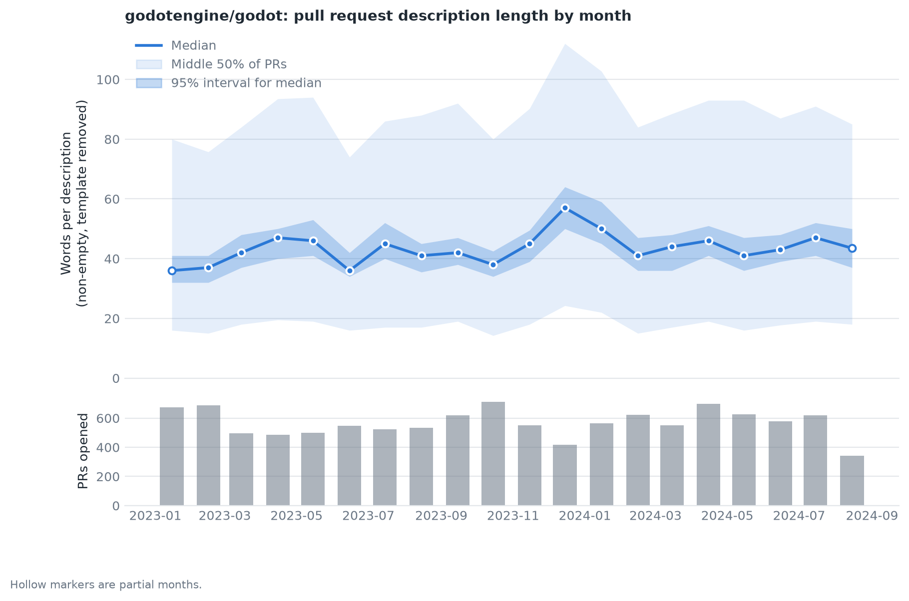
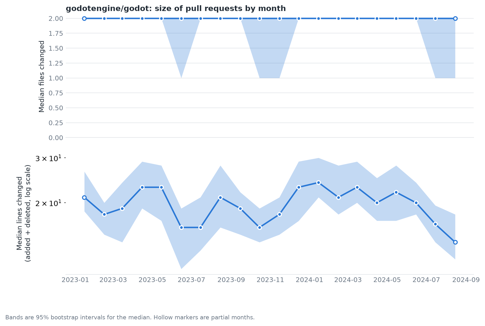
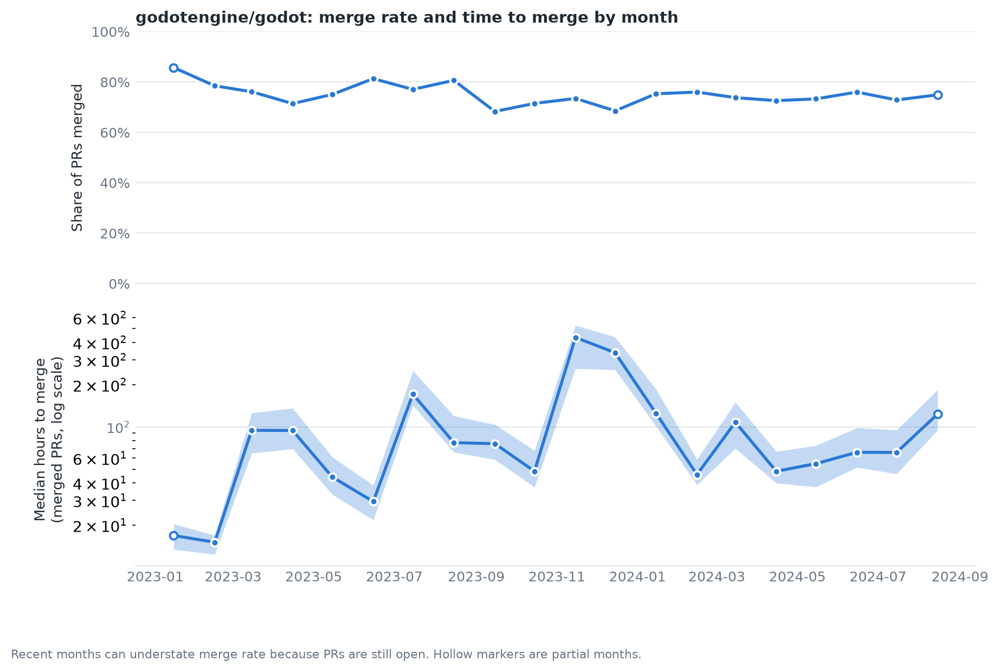
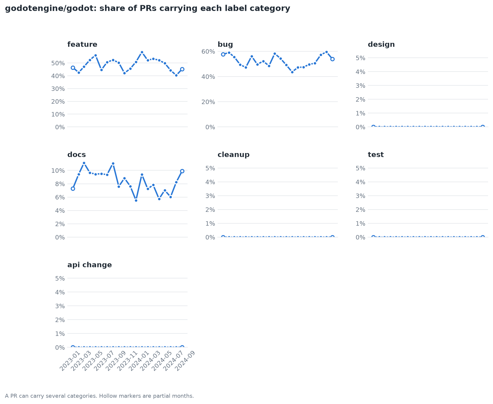
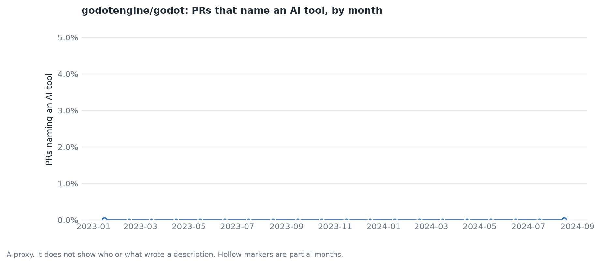

# Pull requests in godotengine/godot: description length, size, speed and labels

Window 2023-01-09 to 2024-08-19 (UTC). Data fetched 2026-11-19. prwords 3.0.0, generated 2026-11-26. Method fixed in advance in `docs/ANALYSIS_PLAN.md`.

## 1. Data

- Repository primary language: C++
- Pull requests opened in the window: 11,351
- Removed as bot accounts: 1
- Analysed: 11,350 PRs from 1,532 authors
- Merged: 8,541 (75.3%). Closed without merging: 1,773 (15.6%). Still open: 1,036
- Follow-up: merge outcomes use a 30-day follow-up. PRs without enough follow-up: 0
- Empty descriptions after cleaning: 2.3%

## 2. Did the PR template change?

No template line appeared or disappeared with a share of 50% or more. Template text was detected monthly and removed before counting words.

Distinct template lines detected: 0.

## 3. First 28 days versus last 28 days

First window 2023-01-09 to 2023-02-05. Last window 2024-07-23 to 2024-08-19. Ratios are last median divided by first median. Bootstrap intervals, 2,000 resamples.

| Metric                                |   n first |   n last |   Median first |   Median last |   Ratio |   Ratio low |   Ratio high |       p |   Cliff's delta |
|:--------------------------------------|----------:|---------:|---------------:|--------------:|--------:|------------:|-------------:|--------:|----------------:|
| Description words (non-empty)         |       788 |      510 |          37    |         44.5  |    1.2  |        1    |         1.42 | 0.11    |            0.05 |
| Files changed                         |       801 |      521 |           2    |          2    |    1    |        0.5  |         1    | 0.00018 |           -0.12 |
| Lines added                           |       801 |      521 |          14    |          9    |    0.64 |        0.5  |         0.83 | 0.0028  |           -0.1  |
| Lines deleted                         |       801 |      521 |           4    |          3    |    0.75 |        0.4  |         1    | 0.0027  |           -0.1  |
| Net lines (added minus deleted)       |       801 |      521 |           5    |          4    |    0.8  |        0.4  |         1    | 0.11    |           -0.05 |
| Lines changed (added plus deleted)    |       801 |      521 |          21    |         15    |    0.71 |        0.54 |         0.89 | 0.0031  |           -0.1  |
| Hours from open to merge (merged PRs) |       674 |      388 |          16.98 |        115.74 |    6.82 |        4.9  |        10.29 | 1e-26   |            0.39 |
| Commits                               |       801 |      521 |           1    |          1    |    1    |        1    |         1    | 0.14    |            0.02 |
| Comments                              |       801 |      521 |           2    |          2    |    1    |        1    |         2    | 0.073   |            0.06 |
| Reviews                               |       801 |      521 |           1    |          1    |    1    |        1    |         2    | 0.01    |            0.08 |

| Measure                             |   n first |   n last | Share first   | Share last   |   Change (points) |       p |
|:------------------------------------|----------:|---------:|:--------------|:-------------|------------------:|--------:|
| Merged within follow-up period      |       801 |      521 | 76.5%         | 58.2%        |             -18.4 | 2.7e-12 |
| Closed without merging              |       801 |      521 | 11.5%         | 12.1%        |               0.6 | 0.79    |
| Opened as draft                     |       801 |      521 | 2.9%          | 3.6%         |               0.8 | 0.43    |
| From outside contributors           |       801 |      521 | 43.9%         | 56.2%        |              12.3 | 1.4e-05 |
| Has a kind or type label            |       801 |      521 | 0.0%          | 0.0%         |               0   | 1       |
| Description text repeated elsewhere |       801 |      521 | 0.2%          | 0.6%         |               0.3 | 0.39    |
| Names an AI tool (disclosure)       |       801 |      521 | 0.0%          | 0.0%         |               0   | 1       |
| Label category: feature             |       801 |      521 | 47.2%         | 43.0%        |              -4.2 | 0.14    |
| Label category: bug                 |       801 |      521 | 56.4%         | 55.9%        |              -0.6 | 0.86    |
| Label category: design              |       801 |      521 | 0.0%          | 0.0%         |               0   | 1       |
| Label category: docs                |       801 |      521 | 7.6%          | 8.3%         |               0.6 | 0.68    |
| Label category: cleanup             |       801 |      521 | 0.0%          | 0.0%         |               0   | 1       |
| Label category: test                |       801 |      521 | 0.0%          | 0.0%         |               0   | 1       |
| Label category: api_change          |       801 |      521 | 0.0%          | 0.0%         |               0   | 1       |

## 4. Monthly trends

Theil-Sen slope per month and Kendall tau over full months only.

| metric                     |   months |   slope_per_month |   slope_ci_low |   slope_ci_high |     tau |       p |
|:---------------------------|---------:|------------------:|---------------:|----------------:|--------:|--------:|
| median_words               |       18 |             0.25  |         -0.2   |           0.667 |   0.174 |   0.322 |
| median_files_changed       |       18 |            -0     |         -0     |          -0     | nan     | nan     |
| median_additions           |       18 |             0.083 |         -0.25  |           0.333 |   0.108 |   0.542 |
| median_deletions           |       18 |            -0     |         -0     |           0.1   |   0.33  |   0.091 |
| median_churn               |       18 |             0.038 |         -0.231 |           0.4   |   0.096 |   0.592 |
| median_hours_to_merge      |       18 |             0.895 |         -3.823 |           4.728 |   0.046 |   0.823 |
| merge_rate                 |       18 |            -0.002 |         -0.005 |           0.001 |  -0.203 |   0.26  |
| share_outside_contributors |       18 |             0.002 |         -0.002 |           0.006 |   0.124 |   0.501 |
| share_ai_disclosed         |       18 |            -0     |         -0     |          -0     | nan     | nan     |
| median_comments            |       18 |            -0     |         -0.071 |          -0     |  -0.343 |   0.091 |
| median_reviews             |       18 |            -0     |         -0     |          -0     |   0.12  |   0.556 |
| share_feature              |       18 |            -0     |         -0.006 |           0.005 |  -0.046 |   0.823 |
| share_bug                  |       18 |            -0     |         -0.007 |           0.004 |  -0.02  |   0.941 |
| share_design               |       18 |            -0     |         -0     |          -0     | nan     | nan     |
| share_docs                 |       18 |            -0.002 |         -0.003 |          -0.001 |  -0.542 |   0.001 |
| share_cleanup              |       18 |            -0     |         -0     |          -0     | nan     | nan     |
| share_test                 |       18 |            -0     |         -0     |          -0     | nan     | nan     |
| share_api_change           |       18 |            -0     |         -0     |          -0     | nan     | nan     |

## 5. Labels

Share of PRs with a kind or type label: 0.0% overall. Label coverage by month is in `monthly_summary.csv` (`share_has_kind_label`).

| category            |   n_prs |   share |   median_words |   median_files |   median_churn |   merge_rate |   median_hours_to_merge |   share_ai_disclosed |
|:--------------------|--------:|--------:|---------------:|---------------:|---------------:|-------------:|------------------------:|---------------------:|
| feature             |    5520 |   0.486 |             49 |              3 |           43   |        0.686 |                 138.638 |                    0 |
| bug                 |    5960 |   0.525 |             39 |              1 |           12   |        0.85  |                  44.092 |                    0 |
| design              |       0 |   0     |            nan |            nan |          nan   |      nan     |                 nan     |                  nan |
| docs                |     943 |   0.083 |             27 |              1 |            6   |        0.879 |                  42.46  |                    0 |
| cleanup             |       0 |   0     |            nan |            nan |          nan   |      nan     |                 nan     |                  nan |
| test                |       0 |   0     |            nan |            nan |          nan   |      nan     |                 nan     |                  nan |
| api_change          |       0 |   0     |            nan |            nan |          nan   |      nan     |                 nan     |                  nan |
| (no category label) |     224 |   0.02  |             25 |              1 |           11.5 |        0.036 |                  51.469 |                    0 |

## 6. Are PRs with signs of AI involvement smaller or larger?

Authorship is not observable. The proxy is `ai_disclosed`, defined in the analysis plan: 0 PRs (0.00%). 0 disclosed PRs are listed in `ai_disclosure_samples.csv` for manual audit.

### ai_disclosed

**Verdict: not testable.** Too few exposed PRs.

Pattern: lines changed: not estimated; files changed: not estimated; lines added: not estimated; lines deleted: not estimated; hours to merge: not estimated.

Not estimated: fewer than 30 exposed PRs (exposed PRs: 0).

### Robustness by tool (lines changed)

No tool named in any disclosure.

### File type check

Not run. Use `--file-check N` to sample N exposed PRs and matching unexposed PRs.

## 7. Other checks

- Outside contributors: 54.8% of PRs overall.
- Top 10 authors opened 30.5% of PRs.
- PRs whose description text is repeated elsewhere (10 or more words): 0.3%.

## 8. Limitations

- Word count and size describe PRs, not who wrote them. Proxies for AI involvement are noisy and omit undisclosed use.
- Added and deleted lines include generated or vendored files unless the project avoids committing them.
- Disclosure mostly captures tools that add attribution by default, so it is tool-skewed.
- Template removal is heuristic. Check `template_audit.csv`.
- One repository cannot support general claims. See the plan for replication.
- Months at the edges of the window are partial and are excluded from trend tests.

