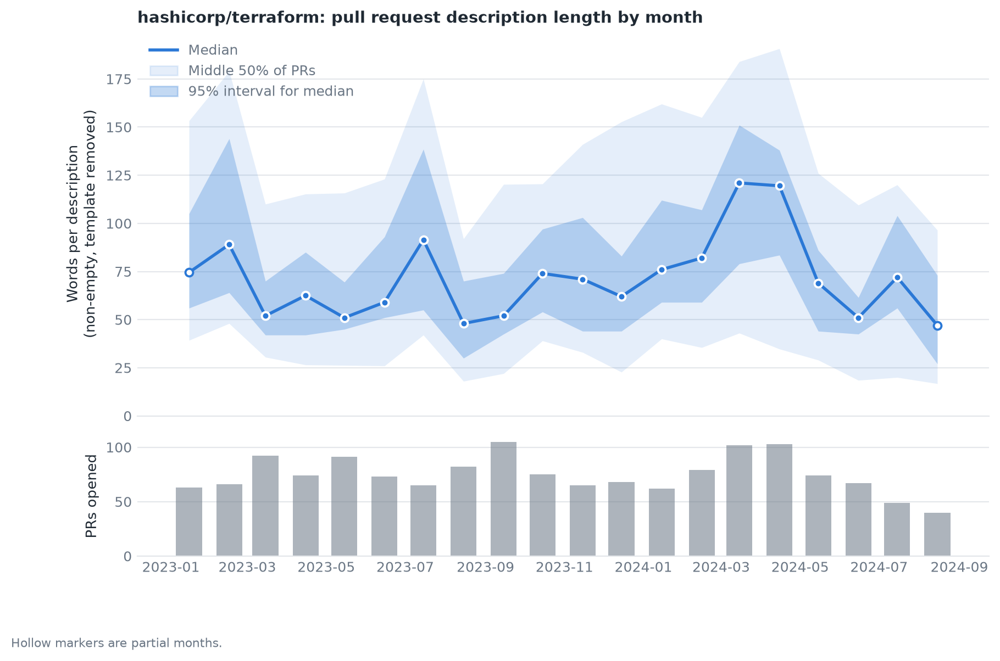
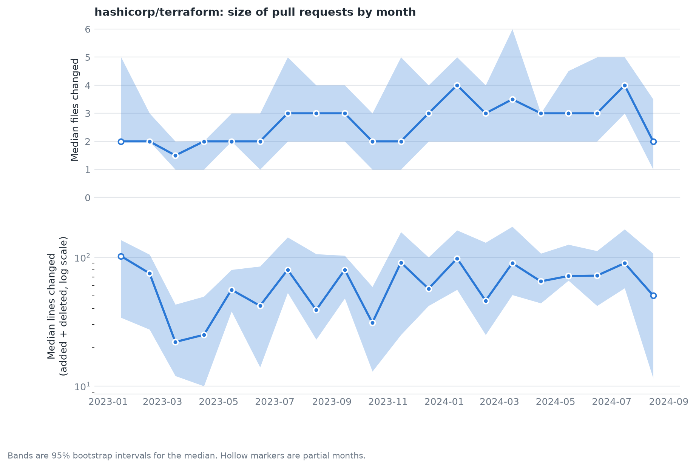
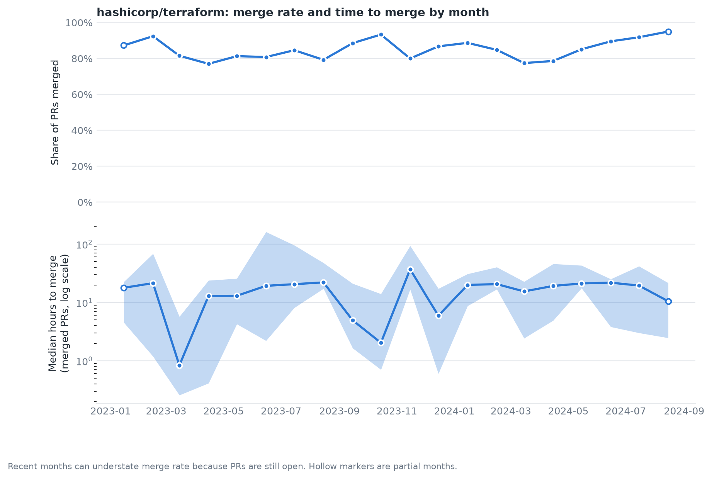
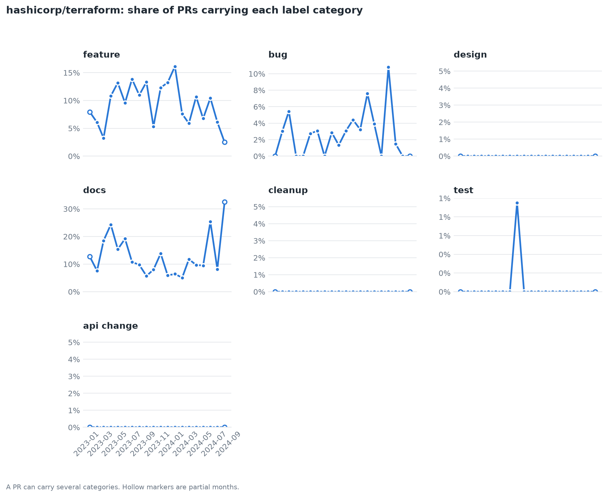
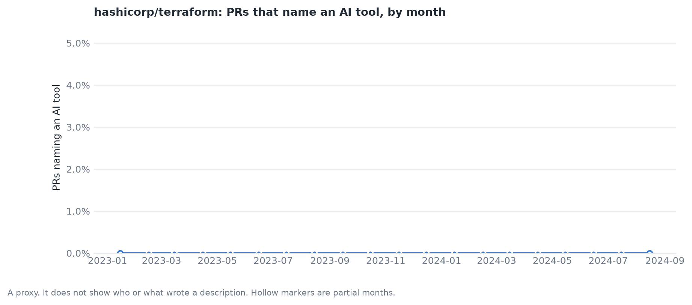

# Pull requests in hashicorp/terraform: description length, size, speed and labels

Window 2023-01-09 to 2024-08-19 (UTC). Data fetched 2026-11-19. prwords 3.0.0, generated 2026-11-26. Method fixed in advance in `docs/ANALYSIS_PLAN.md`.

## 1. Data

- Repository primary language: Go
- Pull requests opened in the window: 1,552
- Removed as bot accounts: 57
- Analysed: 1,495 PRs from 261 authors
- Merged: 1,263 (84.5%). Closed without merging: 202 (13.5%). Still open: 30
- Follow-up: merge outcomes use a 30-day follow-up. PRs without enough follow-up: 0
- Empty descriptions after cleaning: 2.0%

## 2. Did the PR template change?

Lines that appeared or disappeared across the window (full list in `template_audit.csv`):

| line                     | first_month   | last_month   |   months |   peak_share | change_event   |
|:-------------------------|:--------------|:-------------|---------:|-------------:|:---------------|
| ## draft changelog entry | 2023-03       | 2024-04      |        5 |         0.57 | added          |

Distinct template lines detected: 6.

## 3. First 28 days versus last 28 days

First window 2023-01-09 to 2023-02-05. Last window 2024-07-23 to 2024-08-19. Ratios are last median divided by first median. Bootstrap intervals, 2,000 resamples.

| Metric                                |   n first |   n last |   Median first |   Median last |   Ratio |   Ratio low |   Ratio high |      p |   Cliff's delta |
|:--------------------------------------|----------:|---------:|---------------:|--------------:|--------:|------------:|-------------:|-------:|----------------:|
| Description words (non-empty)         |        67 |       55 |          74    |         59    |    0.8  |        0.5  |         1.47 | 0.27   |           -0.12 |
| Files changed                         |        68 |       55 |           2    |          3    |    1.5  |        0.5  |         2    | 0.79   |           -0.03 |
| Lines added                           |        68 |       55 |          73    |         40    |    0.55 |        0.22 |         2.36 | 0.87   |           -0.02 |
| Lines deleted                         |        68 |       55 |          12    |         11    |    0.92 |        0.12 |         3.67 | 0.46   |           -0.08 |
| Net lines (added minus deleted)       |        68 |       55 |          25    |         21    |    0.84 |        0.19 |         5.25 | 0.74   |            0.03 |
| Lines changed (added plus deleted)    |        68 |       55 |         103.5  |         59    |    0.57 |        0.27 |         1.76 | 0.59   |           -0.06 |
| Hours from open to merge (merged PRs) |        59 |       53 |          18.55 |         15.66 |    0.84 |        0.13 |         3.69 | 0.27   |           -0.12 |
| Commits                               |        68 |       55 |           1    |          1    |    1    |        0.5  |         2    | 0.22   |           -0.12 |
| Comments                              |        68 |       55 |           2    |          2    |    1    |        0.8  |         1    | 0.0013 |           -0.27 |
| Reviews                               |        68 |       55 |           1    |          1    |    1    |        1    |         1    | 0.48   |            0.07 |

| Measure                             |   n first |   n last | Share first   | Share last   |   Change (points) |     p |
|:------------------------------------|----------:|---------:|:--------------|:-------------|------------------:|------:|
| Merged within follow-up period      |        68 |       55 | 77.9%         | 94.5%        |              16.6 | 0.01  |
| Closed without merging              |        68 |       55 | 11.8%         | 1.8%         |              -9.9 | 0.041 |
| Opened as draft                     |        68 |       55 | 4.4%          | 0.0%         |              -4.4 | 0.25  |
| From outside contributors           |        68 |       55 | 82.4%         | 80.0%        |              -2.4 | 0.82  |
| Has a kind or type label            |        68 |       55 | 0.0%          | 0.0%         |               0   | 1     |
| Description text repeated elsewhere |        68 |       55 | 2.9%          | 3.6%         |               0.7 | 1     |
| Names an AI tool (disclosure)       |        68 |       55 | 0.0%          | 0.0%         |               0   | 1     |
| Label category: feature             |        68 |       55 | 8.8%          | 1.8%         |              -7   | 0.13  |
| Label category: bug                 |        68 |       55 | 0.0%          | 0.0%         |               0   | 1     |
| Label category: design              |        68 |       55 | 0.0%          | 0.0%         |               0   | 1     |
| Label category: docs                |        68 |       55 | 13.2%         | 25.5%        |              12.2 | 0.11  |
| Label category: cleanup             |        68 |       55 | 0.0%          | 0.0%         |               0   | 1     |
| Label category: test                |        68 |       55 | 0.0%          | 0.0%         |               0   | 1     |
| Label category: api_change          |        68 |       55 | 0.0%          | 0.0%         |               0   | 1     |

## 4. Monthly trends

Theil-Sen slope per month and Kendall tau over full months only.

| metric                     |   months |   slope_per_month |   slope_ci_low |   slope_ci_high |     tau |       p |
|:---------------------------|---------:|------------------:|---------------:|----------------:|--------:|--------:|
| median_words               |       18 |             1.25  |         -0.8   |           3.125 |   0.191 |   0.271 |
| median_files_changed       |       18 |             0.091 |         -0     |           0.15  |   0.612 |   0.001 |
| median_additions           |       18 |             1.833 |         -0.8   |           3.933 |   0.264 |   0.129 |
| median_deletions           |       18 |             0.5   |          0.2   |           0.75  |   0.602 |   0.001 |
| median_churn               |       18 |             2.5   |          0.143 |           4.5   |   0.362 |   0.037 |
| median_hours_to_merge      |       18 |             0.299 |         -0.116 |           1.414 |   0.229 |   0.201 |
| merge_rate                 |       18 |             0.003 |         -0.003 |           0.008 |   0.15  |   0.41  |
| share_outside_contributors |       18 |            -0.002 |         -0.006 |           0.006 |  -0.085 |   0.654 |
| share_ai_disclosed         |       18 |            -0     |         -0     |          -0     | nan     | nan     |
| median_comments            |       18 |            -0     |         -0     |          -0     | nan     | nan     |
| median_reviews             |       18 |            -0     |         -0     |          -0     | nan     | nan     |
| share_feature              |       18 |            -0     |         -0.004 |           0.004 |  -0.033 |   0.881 |
| share_bug                  |       18 |             0     |         -0.002 |           0.004 |   0.136 |   0.443 |
| share_design               |       18 |            -0     |         -0     |          -0     | nan     | nan     |
| share_docs                 |       18 |            -0.005 |         -0.009 |           0.002 |  -0.203 |   0.26  |
| share_cleanup              |       18 |            -0     |         -0     |          -0     | nan     | nan     |
| share_test                 |       18 |            -0     |         -0     |          -0     |  -0.059 |   0.772 |
| share_api_change           |       18 |            -0     |         -0     |          -0     | nan     | nan     |

## 5. Labels

Share of PRs with a kind or type label: 0.0% overall. Label coverage by month is in `monthly_summary.csv` (`share_has_kind_label`).

| category            |   n_prs |   share |   median_words |   median_files |   median_churn |   merge_rate |   median_hours_to_merge |   share_ai_disclosed |
|:--------------------|--------:|--------:|---------------:|---------------:|---------------:|-------------:|------------------------:|---------------------:|
| feature             |     141 |   0.094 |             94 |              3 |             96 |        0.61  |                  66.791 |                    0 |
| bug                 |      41 |   0.027 |             94 |              2 |             41 |        0.707 |                  17.228 |                    0 |
| design              |       0 |   0     |            nan |            nan |            nan |      nan     |                 nan     |                  nan |
| docs                |     187 |   0.125 |             26 |              1 |              4 |        0.861 |                  55.597 |                    0 |
| cleanup             |       0 |   0     |            nan |            nan |            nan |      nan     |                 nan     |                  nan |
| test                |       1 |   0.001 |             37 |              6 |            613 |        1     |                  24.428 |                    0 |
| api_change          |       0 |   0     |            nan |            nan |            nan |      nan     |                 nan     |                  nan |
| (no category label) |    1131 |   0.757 |             75 |              3 |             80 |        0.877 |                   7.806 |                    0 |

## 6. Are PRs with signs of AI involvement smaller or larger?

Authorship is not observable. The proxy is `ai_disclosed`, defined in the analysis plan: 0 PRs (0.00%). 0 disclosed PRs are listed in `ai_disclosure_samples.csv` for manual audit.

### ai_disclosed

**Verdict: not testable.** Too few exposed PRs.

Pattern: lines changed: not estimated; files changed: not estimated; lines added: not estimated; lines deleted: not estimated; hours to merge: not estimated.

Not estimated: fewer than 30 exposed PRs (exposed PRs: 0).

### Robustness by tool (lines changed)

No tool named in any disclosure.

### File type check

Not run. Use `--file-check N` to sample N exposed PRs and matching unexposed PRs.

## 7. Other checks

- Outside contributors: 85.3% of PRs overall.
- Top 10 authors opened 70.4% of PRs.
- PRs whose description text is repeated elsewhere (10 or more words): 3.1%.

## 8. Limitations

- Word count and size describe PRs, not who wrote them. Proxies for AI involvement are noisy and omit undisclosed use.
- Added and deleted lines include generated or vendored files unless the project avoids committing them.
- Disclosure mostly captures tools that add attribution by default, so it is tool-skewed.
- Template removal is heuristic. Check `template_audit.csv`.
- One repository cannot support general claims. See the plan for replication.
- Months at the edges of the window are partial and are excluded from trend tests.

