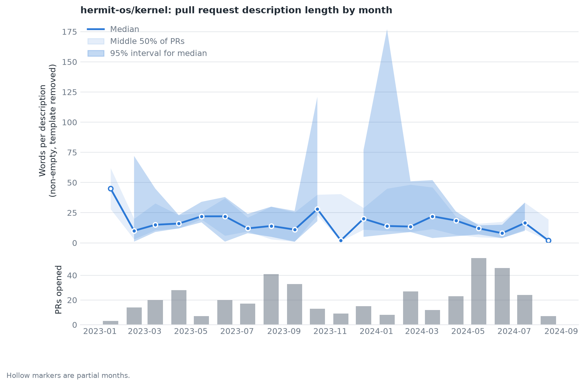
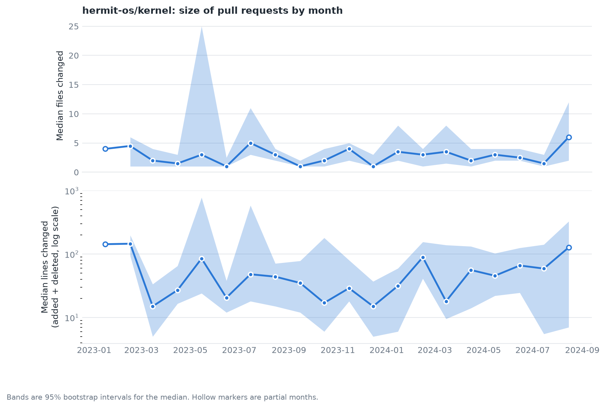
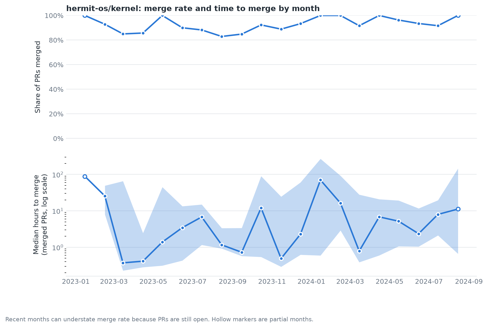
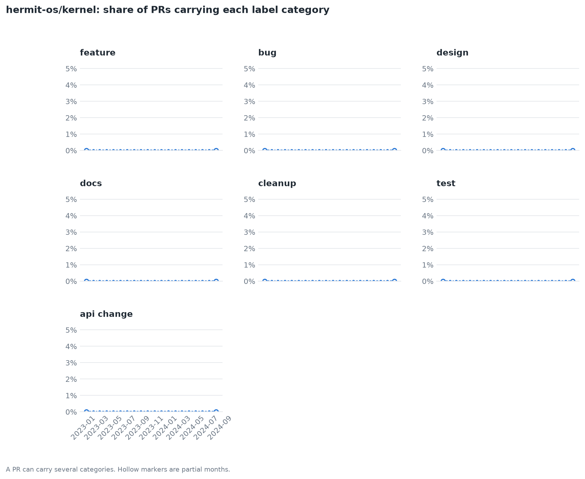
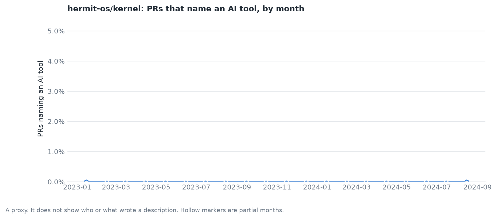

# Pull requests in hermit-os/kernel: description length, size, speed and labels

Window 2023-01-09 to 2024-08-19 (UTC). Data fetched 2026-11-20. prwords 3.0.0, generated 2026-11-26. Method fixed in advance in `docs/ANALYSIS_PLAN.md`.

## 1. Data

- Repository primary language: Rust
- Pull requests opened in the window: 653
- Removed as bot accounts: 232
- Analysed: 421 PRs from 22 authors
- Merged: 386 (91.7%). Closed without merging: 32 (7.6%). Still open: 3
- Follow-up: merge outcomes use a 30-day follow-up. PRs without enough follow-up: 0
- Empty descriptions after cleaning: 53.4%

## 2. Did the PR template change?

No template line appeared or disappeared with a share of 50% or more. Template text was detected monthly and removed before counting words.

Distinct template lines detected: 0.

## 3. First 28 days versus last 28 days

First window 2023-01-09 to 2023-02-05. Last window 2024-07-23 to 2024-08-19. Ratios are last median divided by first median. Bootstrap intervals, 2,000 resamples.

| Metric                                |   n first |   n last |   Median first |   Median last |   Ratio |   Ratio low |   Ratio high | p       |   Cliff's delta |
|:--------------------------------------|----------:|---------:|---------------:|--------------:|--------:|------------:|-------------:|:--------|----------------:|
| Description words (non-empty)         |         2 |        7 |         nan    |        nan    |  nan    |      nan    |       nan    | n/a     |          nan    |
| Files changed                         |         5 |       15 |           1    |          3    |    3    |        0.33 |         6    | 0.37    |            0.28 |
| Lines added                           |         5 |       15 |          24    |         19    |    0.79 |        0.05 |         9.5  | 0.97    |           -0.03 |
| Lines deleted                         |         5 |       15 |          67    |         39    |    0.58 |        0.03 |         6.5  | 0.57    |           -0.19 |
| Net lines (added minus deleted)       |         5 |       15 |          -4    |          1    |  nan    |      nan    |       nan    | 0.29    |            0.33 |
| Lines changed (added plus deleted)    |         5 |       15 |         143    |        105    |    0.73 |        0.07 |        10    | 0.87    |           -0.07 |
| Hours from open to merge (merged PRs) |         5 |       15 |          49.24 |          4.31 |    0.09 |        0.02 |        31.93 | 0.55    |           -0.2  |
| Commits                               |         5 |       15 |           2    |          1    |    0.5  |        0.17 |         1    | 0.31    |           -0.28 |
| Comments                              |         5 |       15 |           2    |          0    |    0    |        0    |         0    | 2.1e-05 |           -1    |
| Reviews                               |         5 |       15 |           1    |          1    |    1    |        0    |         1    | 0.84    |           -0.07 |

| Measure                             |   n first |   n last | Share first   | Share last   |   Change (points) |   p |
|:------------------------------------|----------:|---------:|:--------------|:-------------|------------------:|----:|
| Merged within follow-up period      |         5 |       15 | 100.0%        | 100.0%       |               0   |   1 |
| Closed without merging              |         5 |       15 | 0.0%          | 0.0%         |               0   |   1 |
| Opened as draft                     |         5 |       15 | 0.0%          | 0.0%         |               0   |   1 |
| From outside contributors           |         5 |       15 | 40.0%         | 46.7%        |               6.7 |   1 |
| Has a kind or type label            |         5 |       15 | 0.0%          | 0.0%         |               0   |   1 |
| Description text repeated elsewhere |         5 |       15 | 0.0%          | 0.0%         |               0   |   1 |
| Names an AI tool (disclosure)       |         5 |       15 | 0.0%          | 0.0%         |               0   |   1 |
| Label category: feature             |         5 |       15 | 0.0%          | 0.0%         |               0   |   1 |
| Label category: bug                 |         5 |       15 | 0.0%          | 0.0%         |               0   |   1 |
| Label category: design              |         5 |       15 | 0.0%          | 0.0%         |               0   |   1 |
| Label category: docs                |         5 |       15 | 0.0%          | 0.0%         |               0   |   1 |
| Label category: cleanup             |         5 |       15 | 0.0%          | 0.0%         |               0   |   1 |
| Label category: test                |         5 |       15 | 0.0%          | 0.0%         |               0   |   1 |
| Label category: api_change          |         5 |       15 | 0.0%          | 0.0%         |               0   |   1 |

## 4. Monthly trends

Theil-Sen slope per month and Kendall tau over full months only.

| metric                     |   months |   slope_per_month |   slope_ci_low |   slope_ci_high |     tau |       p |
|:---------------------------|---------:|------------------:|---------------:|----------------:|--------:|--------:|
| median_words               |       18 |            -0.1   |         -0.6   |           0.55  |  -0.053 |   0.761 |
| median_files_changed       |       18 |            -0     |         -0.179 |           0.1   |  -0.075 |   0.673 |
| median_additions           |       18 |             0.273 |         -1.75  |           1.143 |   0.053 |   0.761 |
| median_deletions           |       18 |             0.094 |         -1     |           0.875 |   0.026 |   0.879 |
| median_churn               |       18 |             0.917 |         -3     |           3.154 |   0.118 |   0.495 |
| median_hours_to_merge      |       18 |             0.158 |         -0.196 |           0.62  |   0.229 |   0.201 |
| merge_rate                 |       18 |             0.005 |         -0     |           0.01  |   0.308 |   0.079 |
| share_outside_contributors |       18 |            -0.019 |         -0.042 |           0.006 |  -0.223 |   0.197 |
| share_ai_disclosed         |       18 |            -0     |         -0     |          -0     | nan     | nan     |
| median_comments            |       18 |            -0     |         -0     |          -0     |  -0.507 |   0.011 |
| median_reviews             |       18 |            -0     |         -0     |          -0     |   0.24  |   0.225 |
| share_feature              |       18 |            -0     |         -0     |          -0     | nan     | nan     |
| share_bug                  |       18 |            -0     |         -0     |          -0     | nan     | nan     |
| share_design               |       18 |            -0     |         -0     |          -0     | nan     | nan     |
| share_docs                 |       18 |            -0     |         -0     |          -0     | nan     | nan     |
| share_cleanup              |       18 |            -0     |         -0     |          -0     | nan     | nan     |
| share_test                 |       18 |            -0     |         -0     |          -0     | nan     | nan     |
| share_api_change           |       18 |            -0     |         -0     |          -0     | nan     | nan     |

## 5. Labels

Share of PRs with a kind or type label: 0.0% overall. Label coverage by month is in `monthly_summary.csv` (`share_has_kind_label`).

| category            |   n_prs |   share |   median_words |   median_files |   median_churn |   merge_rate |   median_hours_to_merge |   share_ai_disclosed |
|:--------------------|--------:|--------:|---------------:|---------------:|---------------:|-------------:|------------------------:|---------------------:|
| feature             |       0 |       0 |            nan |            nan |            nan |      nan     |                 nan     |                  nan |
| bug                 |       0 |       0 |            nan |            nan |            nan |      nan     |                 nan     |                  nan |
| design              |       0 |       0 |            nan |            nan |            nan |      nan     |                 nan     |                  nan |
| docs                |       0 |       0 |            nan |            nan |            nan |      nan     |                 nan     |                  nan |
| cleanup             |       0 |       0 |            nan |            nan |            nan |      nan     |                 nan     |                  nan |
| test                |       0 |       0 |            nan |            nan |            nan |      nan     |                 nan     |                  nan |
| api_change          |       0 |       0 |            nan |            nan |            nan |      nan     |                 nan     |                  nan |
| (no category label) |     421 |       1 |             14 |              2 |             42 |        0.917 |                   2.467 |                    0 |

## 6. Are PRs with signs of AI involvement smaller or larger?

Authorship is not observable. The proxy is `ai_disclosed`, defined in the analysis plan: 0 PRs (0.00%). 0 disclosed PRs are listed in `ai_disclosure_samples.csv` for manual audit.

### ai_disclosed

**Verdict: not testable.** Too few exposed PRs.

Pattern: lines changed: not estimated; files changed: not estimated; lines added: not estimated; lines deleted: not estimated; hours to merge: not estimated.

Not estimated: fewer than 30 exposed PRs (exposed PRs: 0).

### Robustness by tool (lines changed)

No tool named in any disclosure.

### File type check

Not run. Use `--file-check N` to sample N exposed PRs and matching unexposed PRs.

## 7. Other checks

- Outside contributors: 46.1% of PRs overall.
- Top 10 authors opened 96.9% of PRs.
- PRs whose description text is repeated elsewhere (10 or more words): 0.0%.

## 8. Limitations

- Word count and size describe PRs, not who wrote them. Proxies for AI involvement are noisy and omit undisclosed use.
- Added and deleted lines include generated or vendored files unless the project avoids committing them.
- Disclosure mostly captures tools that add attribution by default, so it is tool-skewed.
- Template removal is heuristic. Check `template_audit.csv`.
- One repository cannot support general claims. See the plan for replication.
- Months at the edges of the window are partial and are excluded from trend tests.

