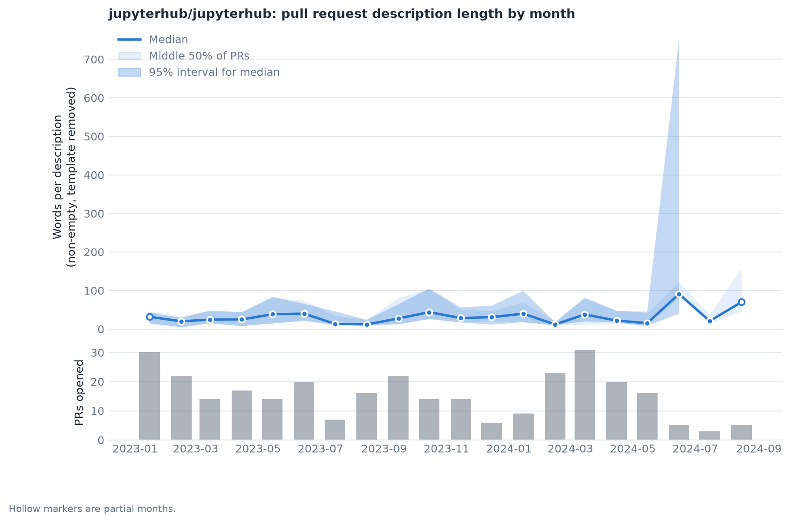
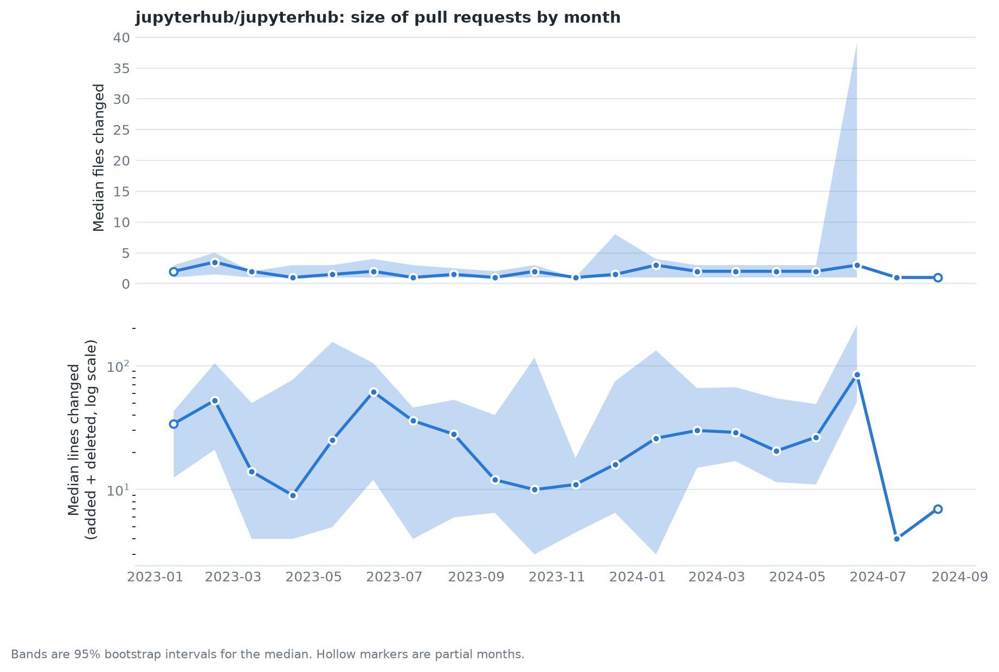
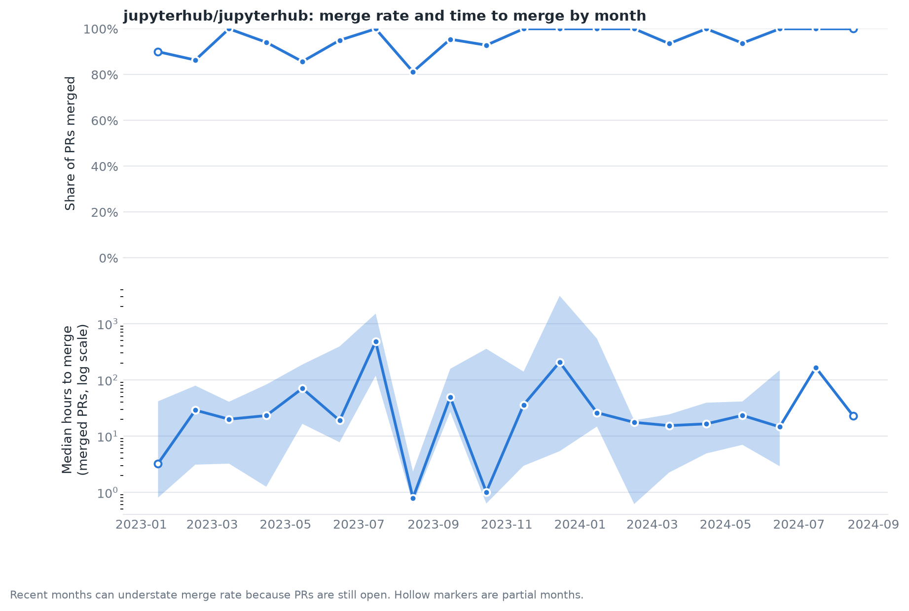
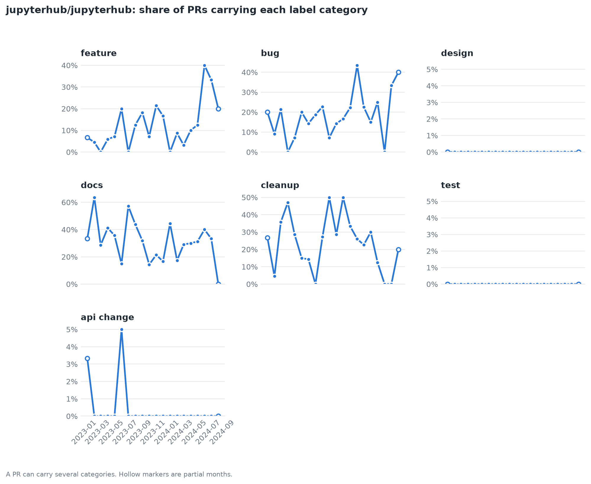
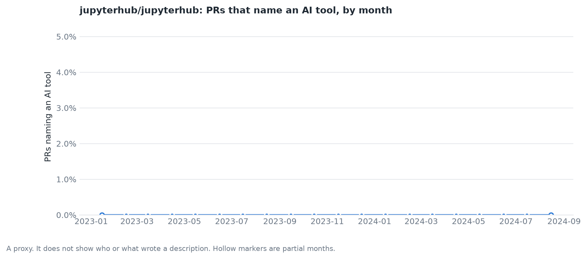

# Pull requests in jupyterhub/jupyterhub: description length, size, speed and labels

Window 2023-01-09 to 2024-08-19 (UTC). Data fetched 2026-11-20. prwords 3.0.0, generated 2026-11-26. Method fixed in advance in `docs/ANALYSIS_PLAN.md`.

## 1. Data

- Repository primary language: Python
- Pull requests opened in the window: 357
- Removed as bot accounts: 49
- Analysed: 308 PRs from 60 authors
- Merged: 290 (94.2%). Closed without merging: 17 (5.5%). Still open: 1
- Follow-up: merge outcomes use a 30-day follow-up. PRs without enough follow-up: 0
- Empty descriptions after cleaning: 6.8%

## 2. Did the PR template change?

No template line appeared or disappeared with a share of 50% or more. Template text was detected monthly and removed before counting words.

Distinct template lines detected: 0.

## 3. First 28 days versus last 28 days

First window 2023-01-09 to 2023-02-05. Last window 2024-07-23 to 2024-08-19. Ratios are last median divided by first median. Bootstrap intervals, 2,000 resamples.

| Metric                                |   n first |   n last |   Median first |   Median last |   Ratio |   Ratio low |   Ratio high |     p |   Cliff's delta |
|:--------------------------------------|----------:|---------:|---------------:|--------------:|--------:|------------:|-------------:|------:|----------------:|
| Description words (non-empty)         |        31 |        7 |          32    |         54    |    1.69 |        0.31 |         8.83 | 0.11  |            0.39 |
| Files changed                         |        32 |        7 |           2    |          1    |    0.5  |        0.33 |         1.33 | 0.15  |           -0.33 |
| Lines added                           |        32 |        7 |          18.5  |          2    |    0.11 |        0.04 |         1.27 | 0.17  |           -0.34 |
| Lines deleted                         |        32 |        7 |           5    |          2    |    0.4  |        0.14 |         2.01 | 0.54  |           -0.15 |
| Net lines (added minus deleted)       |        32 |        7 |           6    |          0    |    0    |       -0.2  |         3.25 | 0.3   |           -0.25 |
| Lines changed (added plus deleted)    |        32 |        7 |          34    |          5    |    0.15 |        0.08 |         1.07 | 0.15  |           -0.36 |
| Hours from open to merge (merged PRs) |        29 |        7 |           3.08 |         32.35 |   10.51 |        0.69 |       105.79 | 0.086 |            0.43 |
| Commits                               |        32 |        7 |           1    |          1    |    1    |        0.4  |         2    | 0.31  |           -0.22 |
| Comments                              |        32 |        7 |           1    |          1    |    1    |        0    |         2    | 0.39  |           -0.21 |
| Reviews                               |        32 |        7 |           1    |          0    |    0    |        0    |         2    | 0.18  |           -0.31 |

| Measure                             |   n first |   n last | Share first   | Share last   |   Change (points) |     p |
|:------------------------------------|----------:|---------:|:--------------|:-------------|------------------:|------:|
| Merged within follow-up period      |        32 |        7 | 90.6%         | 100.0%       |               9.4 | 1     |
| Closed without merging              |        32 |        7 | 6.2%          | 0.0%         |              -6.2 | 1     |
| Opened as draft                     |        32 |        7 | 3.1%          | 0.0%         |              -3.1 | 1     |
| From outside contributors           |        32 |        7 | 50.0%         | 57.1%        |               7.1 | 1     |
| Has a kind or type label            |        32 |        7 | 0.0%          | 0.0%         |               0   | 1     |
| Description text repeated elsewhere |        32 |        7 | 0.0%          | 0.0%         |               0   | 1     |
| Names an AI tool (disclosure)       |        32 |        7 | 0.0%          | 0.0%         |               0   | 1     |
| Label category: feature             |        32 |        7 | 6.2%          | 28.6%        |              22.3 | 0.14  |
| Label category: bug                 |        32 |        7 | 18.8%         | 42.9%        |              24.1 | 0.32  |
| Label category: design              |        32 |        7 | 0.0%          | 0.0%         |               0   | 1     |
| Label category: docs                |        32 |        7 | 37.5%         | 0.0%         |             -37.5 | 0.077 |
| Label category: cleanup             |        32 |        7 | 25.0%         | 14.3%        |             -10.7 | 1     |
| Label category: test                |        32 |        7 | 0.0%          | 0.0%         |               0   | 1     |
| Label category: api_change          |        32 |        7 | 3.1%          | 0.0%         |              -3.1 | 1     |

## 4. Monthly trends

Theil-Sen slope per month and Kendall tau over full months only.

| metric                     |   months |   slope_per_month |   slope_ci_low |   slope_ci_high |     tau |       p |
|:---------------------------|---------:|------------------:|---------------:|----------------:|--------:|--------:|
| median_words               |       18 |             0.5   |         -1.2   |           1.8   |   0.086 |   0.622 |
| median_files_changed       |       18 |            -0     |         -0.031 |           0.1   |   0.104 |   0.577 |
| median_additions           |       18 |             0.3   |         -1.417 |           1.167 |   0.066 |   0.704 |
| median_deletions           |       18 |            -0     |         -0.2   |           0.333 |  -0.021 |   0.908 |
| median_churn               |       18 |             0.125 |         -1.808 |           1.812 |   0.007 |   1     |
| median_hours_to_merge      |       18 |            -0.372 |         -3.685 |           2.504 |  -0.124 |   0.501 |
| merge_rate                 |       18 |             0.002 |         -0     |           0.008 |   0.321 |   0.08  |
| share_outside_contributors |       18 |            -0.015 |         -0.029 |           0.004 |  -0.309 |   0.075 |
| share_ai_disclosed         |       18 |            -0     |         -0     |          -0     | nan     | nan     |
| median_comments            |       18 |            -0     |         -0.125 |          -0     |  -0.394 |   0.039 |
| median_reviews             |       18 |            -0     |         -0     |           0.05  |   0.171 |   0.375 |
| share_feature              |       18 |             0.01  |         -0     |           0.022 |   0.359 |   0.04  |
| share_bug                  |       18 |             0.01  |         -0     |           0.019 |   0.317 |   0.068 |
| share_design               |       18 |            -0     |         -0     |          -0     | nan     | nan     |
| share_docs                 |       18 |            -0.004 |         -0.02  |           0.011 |  -0.085 |   0.654 |
| share_cleanup              |       18 |            -0.008 |         -0.03  |           0.006 |  -0.213 |   0.224 |
| share_test                 |       18 |            -0     |         -0     |          -0     | nan     | nan     |
| share_api_change           |       18 |            -0     |         -0     |          -0     |  -0.176 |   0.386 |

## 5. Labels

Share of PRs with a kind or type label: 0.0% overall. Label coverage by month is in `monthly_summary.csv` (`share_has_kind_label`).

| category            |   n_prs |   share |   median_words |   median_files |   median_churn |   merge_rate |   median_hours_to_merge |   share_ai_disclosed |
|:--------------------|--------:|--------:|---------------:|---------------:|---------------:|-------------:|------------------------:|---------------------:|
| feature             |      31 |   0.101 |           36   |            1   |           25   |        1     |                  32.353 |                    0 |
| bug                 |      58 |   0.188 |           25   |            2   |           33.5 |        1     |                  18.154 |                    0 |
| design              |       0 |   0     |          nan   |          nan   |          nan   |      nan     |                 nan     |                  nan |
| docs                |      98 |   0.318 |           19.5 |            1   |           13.5 |        1     |                  21.785 |                    0 |
| cleanup             |      75 |   0.244 |           21   |            2   |           17   |        0.987 |                   4.028 |                    0 |
| test                |       0 |   0     |          nan   |          nan   |          nan   |      nan     |                 nan     |                  nan |
| api_change          |       2 |   0.006 |           59   |            4.5 |           37   |        1     |                 148.989 |                    0 |
| (no category label) |      45 |   0.146 |           61   |            4   |          101   |        0.622 |                 156.672 |                    0 |

## 6. Are PRs with signs of AI involvement smaller or larger?

Authorship is not observable. The proxy is `ai_disclosed`, defined in the analysis plan: 0 PRs (0.00%). 0 disclosed PRs are listed in `ai_disclosure_samples.csv` for manual audit.

### ai_disclosed

**Verdict: not testable.** Too few exposed PRs.

Pattern: lines changed: not estimated; files changed: not estimated; lines added: not estimated; lines deleted: not estimated; hours to merge: not estimated.

Not estimated: fewer than 30 exposed PRs (exposed PRs: 0).

### Robustness by tool (lines changed)

No tool named in any disclosure.

### File type check

Not run. Use `--file-check N` to sample N exposed PRs and matching unexposed PRs.

## 7. Other checks

- Outside contributors: 39.6% of PRs overall.
- Top 10 authors opened 80.2% of PRs.
- PRs whose description text is repeated elsewhere (10 or more words): 0.0%.

## 8. Limitations

- Word count and size describe PRs, not who wrote them. Proxies for AI involvement are noisy and omit undisclosed use.
- Added and deleted lines include generated or vendored files unless the project avoids committing them.
- Disclosure mostly captures tools that add attribution by default, so it is tool-skewed.
- Template removal is heuristic. Check `template_audit.csv`.
- One repository cannot support general claims. See the plan for replication.
- Months at the edges of the window are partial and are excluded from trend tests.

