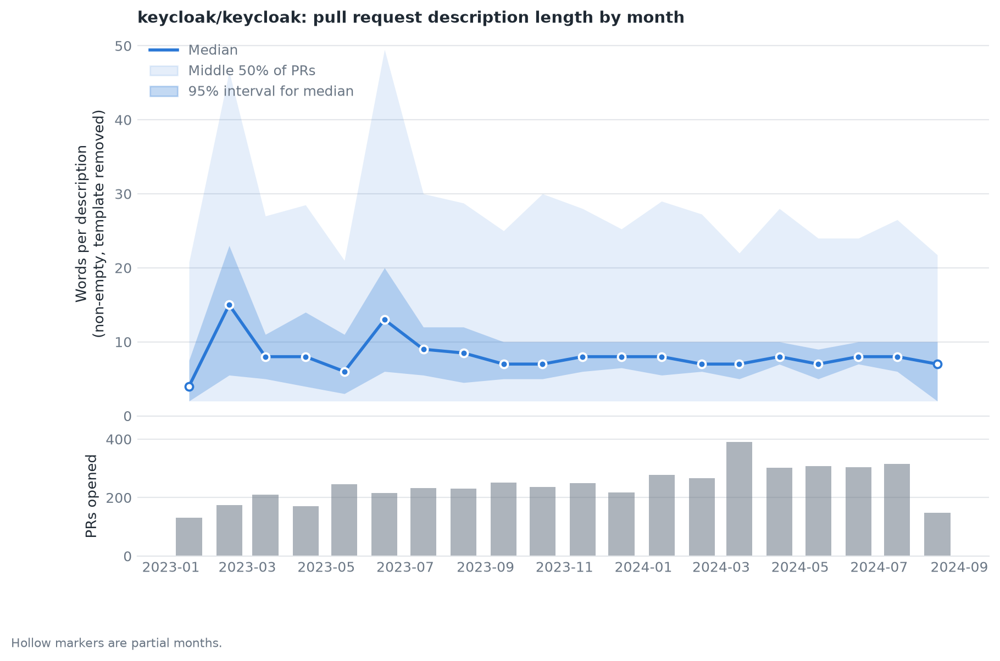
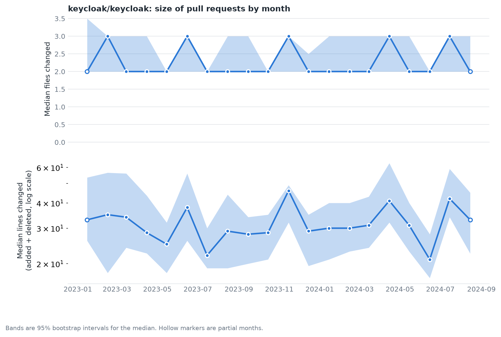
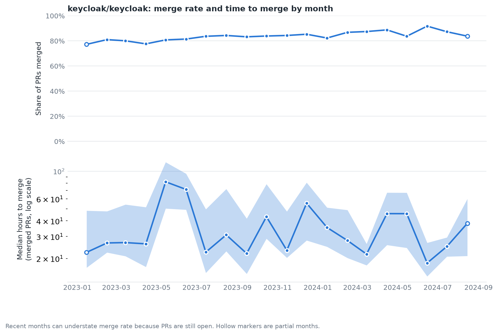
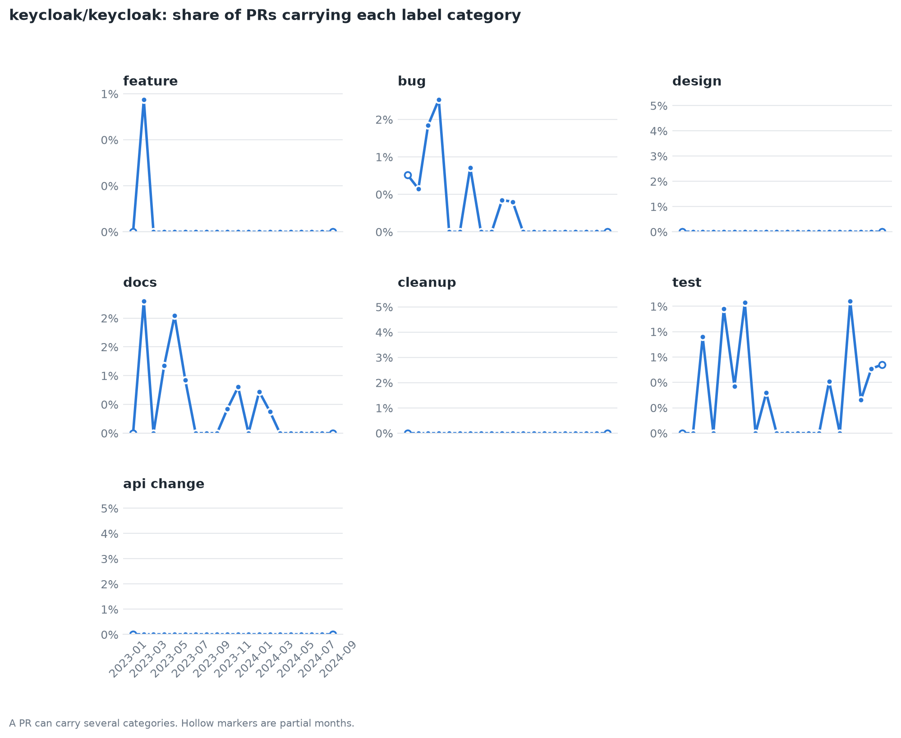
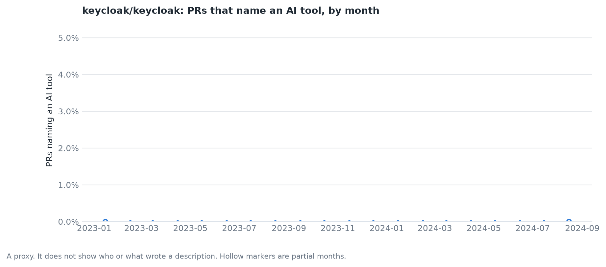

# Pull requests in keycloak/keycloak: description length, size, speed and labels

Window 2023-01-09 to 2024-08-19 (UTC). Data fetched 2026-11-19. prwords 3.0.0, generated 2026-11-26. Method fixed in advance in `docs/ANALYSIS_PLAN.md`.

## 1. Data

- Repository primary language: Java
- Pull requests opened in the window: 6,111
- Removed as bot accounts: 1,235
- Analysed: 4,876 PRs from 554 authors
- Merged: 4,115 (84.4%). Closed without merging: 755 (15.5%). Still open: 6
- Follow-up: merge outcomes use a 30-day follow-up. PRs without enough follow-up: 0
- Empty descriptions after cleaning: 5.8%

## 2. Did the PR template change?

No template line appeared or disappeared with a share of 50% or more. Template text was detected monthly and removed before counting words.

Distinct template lines detected: 0.

## 3. First 28 days versus last 28 days

First window 2023-01-09 to 2023-02-05. Last window 2024-07-23 to 2024-08-19. Ratios are last median divided by first median. Bootstrap intervals, 2,000 resamples.

| Metric                                |   n first |   n last |   Median first |   Median last |   Ratio |   Ratio low |   Ratio high |      p |   Cliff's delta |
|:--------------------------------------|----------:|---------:|---------------:|--------------:|--------:|------------:|-------------:|-------:|----------------:|
| Description words (non-empty)         |       137 |      262 |           4    |          7    |    1.75 |        0.6  |         3.5  | 0.78   |            0.02 |
| Files changed                         |       162 |      270 |           2    |          3    |    1.5  |        0.67 |         1.5  | 0.43   |            0.04 |
| Lines added                           |       162 |      270 |          21    |         26    |    1.24 |        0.69 |         2.03 | 0.27   |            0.06 |
| Lines deleted                         |       162 |      270 |           3.5  |          7    |    2    |        1    |         3.5  | 0.017  |            0.14 |
| Net lines (added minus deleted)       |       162 |      270 |           8    |         13    |    1.62 |        0.61 |         2.75 | 0.48   |            0.04 |
| Lines changed (added plus deleted)    |       162 |      270 |          30.5  |         36    |    1.18 |        0.7  |         1.87 | 0.24   |            0.07 |
| Hours from open to merge (merged PRs) |       126 |      229 |          22.38 |         27.28 |    1.22 |        0.66 |         1.99 | 0.63   |            0.03 |
| Commits                               |       162 |      270 |           1    |          1    |    1    |        1    |         1    | 0.023  |            0.09 |
| Comments                              |       162 |      270 |           1    |          1    |    1    |        1    |         1    | 0.83   |            0.01 |
| Reviews                               |       162 |      270 |           1    |          2    |    2    |        1    |         2    | 0.0027 |            0.17 |

| Measure                             |   n first |   n last | Share first   | Share last   |   Change (points) |      p |
|:------------------------------------|----------:|---------:|:--------------|:-------------|------------------:|-------:|
| Merged within follow-up period      |       162 |      270 | 71.0%         | 83.3%        |              12.3 | 0.0034 |
| Closed without merging              |       162 |      270 | 21.6%         | 14.8%        |              -6.8 | 0.088  |
| Opened as draft                     |       162 |      270 | 3.7%          | 3.3%         |              -0.4 | 1      |
| From outside contributors           |       162 |      270 | 84.6%         | 81.5%        |              -3.1 | 0.43   |
| Has a kind or type label            |       162 |      270 | 0.6%          | 0.0%         |              -0.6 | 0.38   |
| Description text repeated elsewhere |       162 |      270 | 0.0%          | 5.6%         |               5.6 | 0.0016 |
| Names an AI tool (disclosure)       |       162 |      270 | 0.0%          | 0.0%         |               0   | 1      |
| Label category: feature             |       162 |      270 | 0.0%          | 0.0%         |               0   | 1      |
| Label category: bug                 |       162 |      270 | 0.6%          | 0.0%         |              -0.6 | 0.38   |
| Label category: design              |       162 |      270 | 0.0%          | 0.0%         |               0   | 1      |
| Label category: docs                |       162 |      270 | 0.0%          | 0.0%         |               0   | 1      |
| Label category: cleanup             |       162 |      270 | 0.0%          | 0.0%         |               0   | 1      |
| Label category: test                |       162 |      270 | 0.0%          | 0.4%         |               0.4 | 1      |
| Label category: api_change          |       162 |      270 | 0.0%          | 0.0%         |               0   | 1      |

## 4. Monthly trends

Theil-Sen slope per month and Kendall tau over full months only.

| metric                     |   months |   slope_per_month |   slope_ci_low |   slope_ci_high |     tau |       p |
|:---------------------------|---------:|------------------:|---------------:|----------------:|--------:|--------:|
| median_words               |       18 |            -0     |         -0.2   |          -0     |  -0.264 |   0.158 |
| median_files_changed       |       18 |            -0     |         -0     |          -0     |   0.03  |   0.882 |
| median_additions           |       18 |            -0.077 |         -0.5   |           0.562 |  -0.04  |   0.82  |
| median_deletions           |       18 |            -0     |         -0.167 |           0.125 |  -0.063 |   0.728 |
| median_churn               |       18 |             0.25  |         -0.455 |           0.6   |   0.166 |   0.342 |
| median_hours_to_merge      |       18 |            -0.376 |         -1.945 |           0.859 |  -0.124 |   0.501 |
| merge_rate                 |       18 |             0.006 |          0.004 |           0.007 |   0.686 |   0     |
| share_outside_contributors |       18 |            -0     |         -0.003 |           0.002 |  -0.007 |   1     |
| share_ai_disclosed         |       18 |            -0     |         -0     |          -0     | nan     | nan     |
| median_comments            |       18 |            -0     |         -0     |          -0     |  -0.095 |   0.627 |
| median_reviews             |       18 |            -0     |         -0     |          -0     |   0.049 |   0.807 |
| share_feature              |       18 |            -0     |         -0     |          -0     |  -0.333 |   0.101 |
| share_bug                  |       18 |            -0     |         -0.001 |          -0     |  -0.511 |   0.007 |
| share_design               |       18 |            -0     |         -0     |          -0     | nan     | nan     |
| share_docs                 |       18 |            -0.001 |         -0.001 |          -0     |  -0.467 |   0.012 |
| share_cleanup              |       18 |            -0     |         -0     |          -0     | nan     | nan     |
| share_test                 |       18 |            -0     |         -0     |           0     |   0.037 |   0.839 |
| share_api_change           |       18 |            -0     |         -0     |          -0     | nan     | nan     |

## 5. Labels

Share of PRs with a kind or type label: 2.7% overall. Label coverage by month is in `monthly_summary.csv` (`share_has_kind_label`).

| category            |   n_prs |   share |   median_words |   median_files |   median_churn |   merge_rate |   median_hours_to_merge |   share_ai_disclosed |
|:--------------------|--------:|--------:|---------------:|---------------:|---------------:|-------------:|------------------------:|---------------------:|
| feature             |       1 |   0     |              2 |             11 |         1260   |        1     |                 163.886 |                    0 |
| bug                 |      12 |   0.002 |             18 |              1 |           11.5 |        0.833 |                   1.06  |                    0 |
| design              |       0 |   0     |            nan |            nan |          nan   |      nan     |                 nan     |                  nan |
| docs                |      19 |   0.004 |             22 |              3 |           40   |        0.895 |                 185.124 |                    0 |
| cleanup             |       0 |   0     |            nan |            nan |          nan   |      nan     |                 nan     |                  nan |
| test                |      20 |   0.004 |              4 |              3 |           66.5 |        0.6   |                  21.324 |                    0 |
| api_change          |       0 |   0     |            nan |            nan |          nan   |      nan     |                 nan     |                  nan |
| (no category label) |    4825 |   0.99  |              7 |              2 |           31   |        0.845 |                  29.465 |                    0 |

## 6. Are PRs with signs of AI involvement smaller or larger?

Authorship is not observable. The proxy is `ai_disclosed`, defined in the analysis plan: 0 PRs (0.00%). 0 disclosed PRs are listed in `ai_disclosure_samples.csv` for manual audit.

### ai_disclosed

**Verdict: not testable.** Too few exposed PRs.

Pattern: lines changed: not estimated; files changed: not estimated; lines added: not estimated; lines deleted: not estimated; hours to merge: not estimated.

Not estimated: fewer than 30 exposed PRs (exposed PRs: 0).

### Robustness by tool (lines changed)

No tool named in any disclosure.

### File type check

Not run. Use `--file-check N` to sample N exposed PRs and matching unexposed PRs.

## 7. Other checks

- Outside contributors: 86.6% of PRs overall.
- Top 10 authors opened 53.1% of PRs.
- PRs whose description text is repeated elsewhere (10 or more words): 2.5%.

## 8. Limitations

- Word count and size describe PRs, not who wrote them. Proxies for AI involvement are noisy and omit undisclosed use.
- Added and deleted lines include generated or vendored files unless the project avoids committing them.
- Disclosure mostly captures tools that add attribution by default, so it is tool-skewed.
- Template removal is heuristic. Check `template_audit.csv`.
- One repository cannot support general claims. See the plan for replication.
- Months at the edges of the window are partial and are excluded from trend tests.

