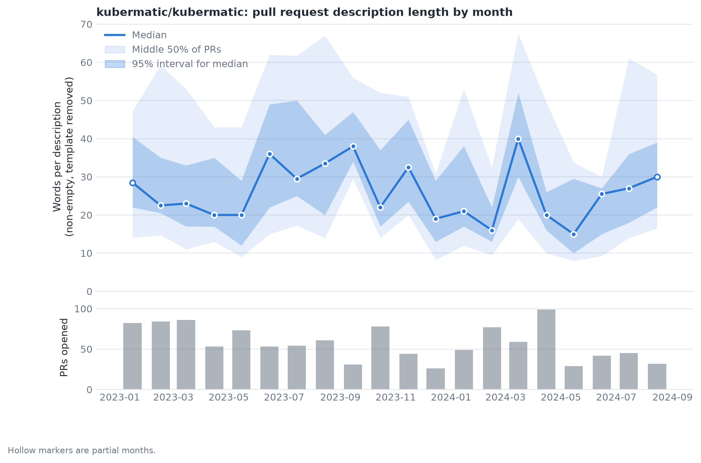
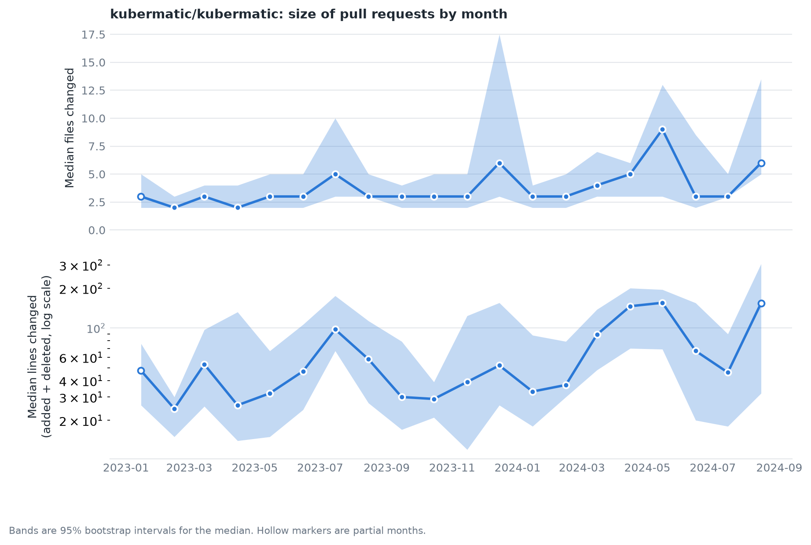
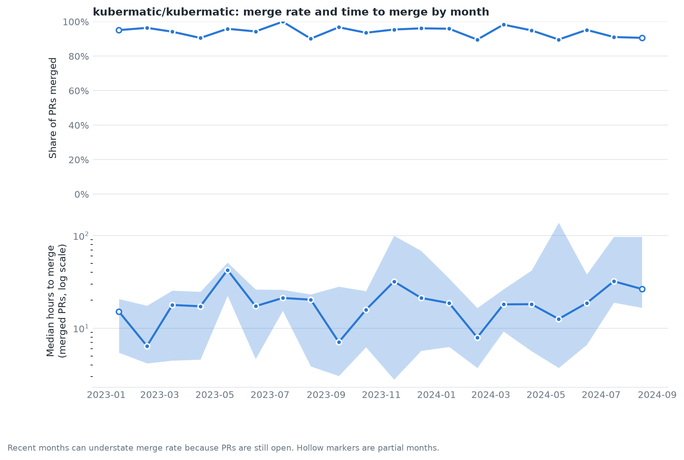
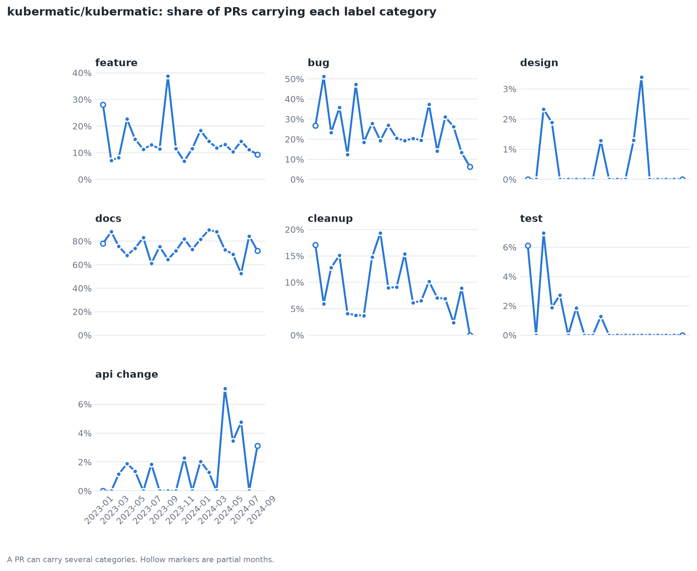
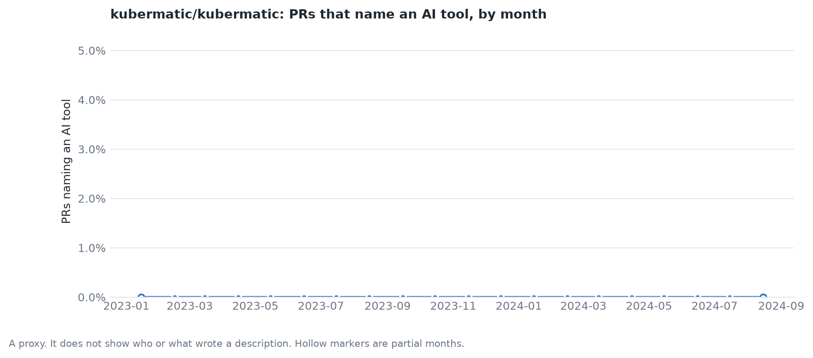

# Pull requests in kubermatic/kubermatic: description length, size, speed and labels

Window 2023-01-09 to 2024-08-19 (UTC). Data fetched 2026-11-20. prwords 3.0.0, generated 2026-11-26. Method fixed in advance in `docs/ANALYSIS_PLAN.md`.

## 1. Data

- Repository primary language: Go
- Pull requests opened in the window: 1,468
- Removed as bot accounts: 311
- Analysed: 1,157 PRs from 43 authors
- Merged: 1,091 (94.3%). Closed without merging: 66 (5.7%). Still open: 0
- Follow-up: merge outcomes use a 30-day follow-up. PRs without enough follow-up: 0
- Empty descriptions after cleaning: 1.9%

## 2. Did the PR template change?

Lines that appeared or disappeared across the window (full list in `template_audit.csv`):

| line                                | first_month   | last_month   |   months |   peak_share | change_event   |
|:------------------------------------|:--------------|:-------------|---------:|-------------:|:---------------|
| *special notes for your reviewer**: | 2023-01       | 2024-05      |       13 |         0.87 | removed        |
| *which issue(s) this pr fixes**:    | 2023-01       | 2024-05      |       12 |         0.85 | removed        |
| fixes #                             | 2023-01       | 2024-05      |        7 |         0.62 | removed        |
| /kind bug                           | 2023-02       | 2023-02      |        1 |         0.5  | added          |

Distinct template lines detected: 9.

## 3. First 28 days versus last 28 days

First window 2023-01-09 to 2023-02-05. Last window 2024-07-23 to 2024-08-19. Ratios are last median divided by first median. Bootstrap intervals, 2,000 resamples.

| Metric                                |   n first |   n last |   Median first |   Median last |   Ratio |   Ratio low |   Ratio high |       p |   Cliff's delta |
|:--------------------------------------|----------:|---------:|---------------:|--------------:|--------:|------------:|-------------:|--------:|----------------:|
| Description words (non-empty)         |        88 |       43 |          28    |         30    |    1.07 |        0.53 |         1.45 | 0.73    |           -0.04 |
| Files changed                         |        90 |       43 |           3    |          5    |    1.67 |        1.11 |         4.35 | 0.00084 |            0.35 |
| Lines added                           |        90 |       43 |          28    |         56    |    2    |        0.61 |         4.56 | 0.078   |            0.19 |
| Lines deleted                         |        90 |       43 |           3    |         23    |    7.67 |        1.82 |        33    | 0.0081  |            0.28 |
| Net lines (added minus deleted)       |        90 |       43 |          11.5  |          3    |    0.26 |        0    |         2.14 | 0.66    |           -0.05 |
| Lines changed (added plus deleted)    |        90 |       43 |          42    |         90    |    2.14 |        0.6  |         5.9  | 0.058   |            0.2  |
| Hours from open to merge (merged PRs) |        85 |       39 |          14.92 |         26.33 |    1.77 |        0.91 |         6.62 | 0.048   |            0.22 |
| Commits                               |        90 |       43 |           1.5  |          1    |    0.67 |        0.5  |         2    | 0.44    |           -0.08 |
| Comments                              |        90 |       43 |           5    |          5    |    1    |        0.67 |         1.6  | 0.48    |            0.07 |
| Reviews                               |        90 |       43 |           1    |          1    |    1    |        1    |         1    | 1       |           -0    |

| Measure                             |   n first |   n last | Share first   | Share last   |   Change (points) |      p |
|:------------------------------------|----------:|---------:|:--------------|:-------------|------------------:|-------:|
| Merged within follow-up period      |        90 |       43 | 94.4%         | 86.0%        |              -8.4 | 0.17   |
| Closed without merging              |        90 |       43 | 5.6%          | 9.3%         |               3.7 | 0.47   |
| Opened as draft                     |        90 |       43 | 0.0%          | 2.3%         |               2.3 | 0.32   |
| From outside contributors           |        90 |       43 | 94.4%         | 79.1%        |             -15.4 | 0.013  |
| Has a kind or type label            |        90 |       43 | 86.7%         | 60.5%        |             -26.2 | 0.0013 |
| Description text repeated elsewhere |        90 |       43 | 6.7%          | 27.9%        |              21.2 | 0.0019 |
| Names an AI tool (disclosure)       |        90 |       43 | 0.0%          | 0.0%         |               0   | 1      |
| Label category: feature             |        90 |       43 | 25.6%         | 9.3%         |             -16.3 | 0.037  |
| Label category: bug                 |        90 |       43 | 25.6%         | 7.0%         |             -18.6 | 0.011  |
| Label category: design              |        90 |       43 | 0.0%          | 0.0%         |               0   | 1      |
| Label category: docs                |        90 |       43 | 80.0%         | 69.8%        |             -10.2 | 0.2    |
| Label category: cleanup             |        90 |       43 | 16.7%         | 2.3%         |             -14.3 | 0.021  |
| Label category: test                |        90 |       43 | 5.6%          | 0.0%         |              -5.6 | 0.17   |
| Label category: api_change          |        90 |       43 | 0.0%          | 2.3%         |               2.3 | 0.32   |

## 4. Monthly trends

Theil-Sen slope per month and Kendall tau over full months only.

| metric                     |   months |   slope_per_month |   slope_ci_low |   slope_ci_high |     tau |       p |
|:---------------------------|---------:|------------------:|---------------:|----------------:|--------:|--------:|
| median_words               |       18 |            -0.179 |         -0.833 |           0.556 |  -0.092 |   0.595 |
| median_files_changed       |       18 |            -0     |         -0     |           0.167 |   0.429 |   0.024 |
| median_additions           |       18 |             1.429 |         -0     |           3.5   |   0.327 |   0.062 |
| median_deletions           |       18 |             0.2   |         -0.182 |           0.583 |   0.187 |   0.286 |
| median_churn               |       18 |             1.889 |          0.556 |           5.75  |   0.373 |   0.032 |
| median_hours_to_merge      |       18 |             0.083 |         -0.423 |           0.892 |   0.137 |   0.454 |
| merge_rate                 |       18 |            -0.001 |         -0.004 |           0.002 |  -0.124 |   0.501 |
| share_outside_contributors |       18 |            -0.007 |         -0.014 |          -0     |  -0.386 |   0.026 |
| share_ai_disclosed         |       18 |            -0     |         -0     |          -0     | nan     | nan     |
| median_comments            |       18 |            -0     |         -0.083 |          -0     |  -0.112 |   0.555 |
| median_reviews             |       18 |            -0     |         -0     |          -0     | nan     | nan     |
| share_feature              |       18 |             0     |         -0.004 |           0.004 |   0.059 |   0.733 |
| share_bug                  |       18 |            -0.007 |         -0.017 |           0.003 |  -0.216 |   0.229 |
| share_design               |       18 |            -0     |         -0     |          -0     |  -0.121 |   0.53  |
| share_docs                 |       18 |            -0.001 |         -0.011 |           0.012 |  -0.02  |   0.941 |
| share_cleanup              |       18 |            -0.001 |         -0.007 |           0.003 |  -0.072 |   0.709 |
| share_test                 |       18 |            -0     |         -0.002 |          -0     |  -0.513 |   0.008 |
| share_api_change           |       18 |             0     |         -0     |           0.003 |   0.224 |   0.217 |

## 5. Labels

Share of PRs with a kind or type label: 82.5% overall. Label coverage by month is in `monthly_summary.csv` (`share_has_kind_label`).

| category            |   n_prs |   share |   median_words |   median_files |   median_churn |   merge_rate |   median_hours_to_merge |   share_ai_disclosed |
|:--------------------|--------:|--------:|---------------:|---------------:|---------------:|-------------:|------------------------:|---------------------:|
| feature             |     163 |   0.141 |           37   |              6 |           81   |        0.945 |                  23.14  |                    0 |
| bug                 |     295 |   0.255 |           38   |              2 |           29   |        0.966 |                  12.861 |                    0 |
| design              |       7 |   0.006 |           15   |              4 |          466   |        0.857 |                  61.59  |                    0 |
| docs                |     883 |   0.763 |           32   |              3 |           49   |        0.933 |                  20.006 |                    0 |
| cleanup             |     103 |   0.089 |           40   |              4 |           79   |        0.942 |                  13.3   |                    0 |
| test                |      16 |   0.014 |           30.5 |              2 |           28.5 |        1     |                   2.965 |                    0 |
| api_change          |      18 |   0.016 |           57   |             13 |          358.5 |        0.778 |                 114.321 |                    0 |
| (no category label) |     159 |   0.137 |           10.5 |              3 |           53   |        0.962 |                  17.99  |                    0 |

Cross-check against the repository's own size labels (coverage 99.9%, Spearman rho between size label and lines changed 0.98):

| size_label   |   n_prs |   median_churn |   p10_churn |   p90_churn |
|:-------------|--------:|---------------:|------------:|------------:|
| XS           |     256 |              4 |           2 |           8 |
| S            |     223 |             17 |          11 |          27 |
| M            |     225 |             51 |          33 |          82 |
| L            |     300 |            186 |         116 |         366 |
| XL           |      51 |            685 |         518 |         874 |
| XXL          |     101 |           2562 |        1106 |       47669 |

## 6. Are PRs with signs of AI involvement smaller or larger?

Authorship is not observable. The proxy is `ai_disclosed`, defined in the analysis plan: 0 PRs (0.00%). 0 disclosed PRs are listed in `ai_disclosure_samples.csv` for manual audit.

### ai_disclosed

**Verdict: not testable.** Too few exposed PRs.

Pattern: lines changed: not estimated; files changed: not estimated; lines added: not estimated; lines deleted: not estimated; hours to merge: not estimated.

Not estimated: fewer than 30 exposed PRs (exposed PRs: 0).

### Robustness by tool (lines changed)

No tool named in any disclosure.

### File type check

Not run. Use `--file-check N` to sample N exposed PRs and matching unexposed PRs.

## 7. Other checks

- Outside contributors: 90.2% of PRs overall.
- Top 10 authors opened 81.2% of PRs.
- PRs whose description text is repeated elsewhere (10 or more words): 14.8%.

## 8. Limitations

- Word count and size describe PRs, not who wrote them. Proxies for AI involvement are noisy and omit undisclosed use.
- Added and deleted lines include generated or vendored files unless the project avoids committing them.
- Disclosure mostly captures tools that add attribution by default, so it is tool-skewed.
- Template removal is heuristic. Check `template_audit.csv`.
- One repository cannot support general claims. See the plan for replication.
- Months at the edges of the window are partial and are excluded from trend tests.

