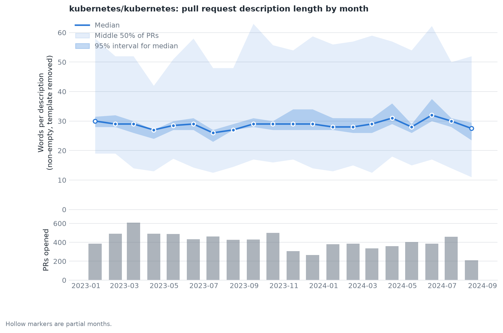
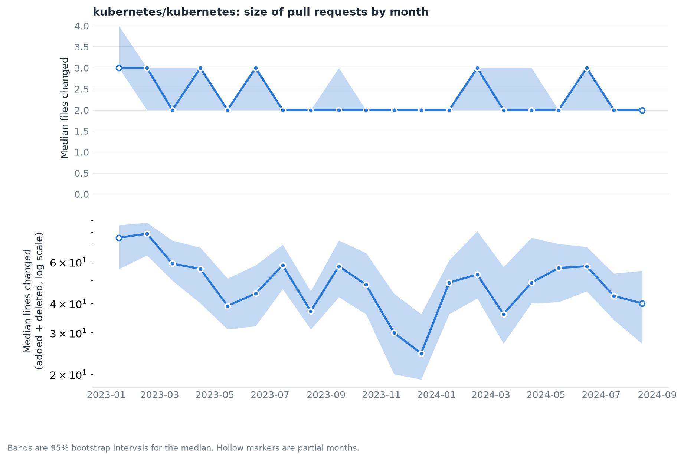
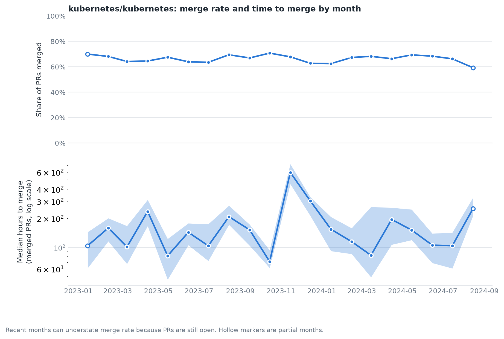
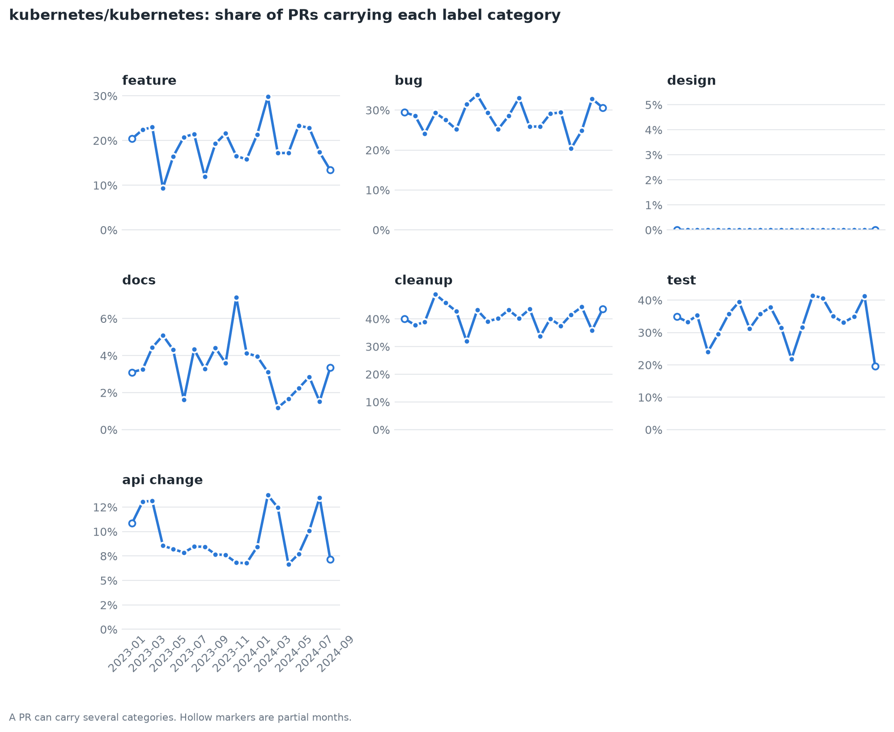
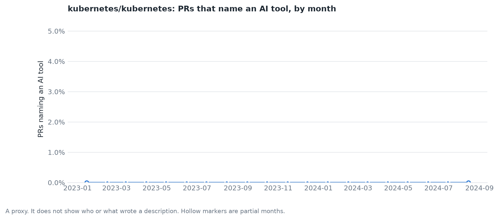

# Pull requests in kubernetes/kubernetes: description length, size, speed and labels

Window 2023-01-09 to 2024-08-19 (UTC). Data fetched 2026-11-19. prwords 3.0.0, generated 2026-11-26. Method fixed in advance in `docs/ANALYSIS_PLAN.md`.

## 1. Data

- Repository primary language: Go
- Pull requests opened in the window: 8,207
- Removed as bot accounts: 0
- Analysed: 8,207 PRs from 1,215 authors
- Merged: 5,464 (66.6%). Closed without merging: 2,734 (33.3%). Still open: 9
- Follow-up: merge outcomes use a 30-day follow-up. PRs without enough follow-up: 0
- Empty descriptions after cleaning: 4.3%

## 2. Did the PR template change?

No template line appeared or disappeared with a share of 50% or more. Template text was detected monthly and removed before counting words.

Distinct template lines detected: 10.

## 3. First 28 days versus last 28 days

First window 2023-01-09 to 2023-02-05. Last window 2024-07-23 to 2024-08-19. Ratios are last median divided by first median. Bootstrap intervals, 2,000 resamples.

| Metric                                |   n first |   n last |   Median first |   Median last |   Ratio |   Ratio low |   Ratio high |       p |   Cliff's delta |
|:--------------------------------------|----------:|---------:|---------------:|--------------:|--------:|------------:|-------------:|--------:|----------------:|
| Description words (non-empty)         |       433 |      331 |          29    |         27    |    0.93 |        0.83 |         1    | 0.00066 |           -0.14 |
| Files changed                         |       446 |      342 |           3    |          2    |    0.67 |        0.67 |         0.67 | 6.2e-05 |           -0.16 |
| Lines added                           |       446 |      342 |          42.5  |         23    |    0.54 |        0.38 |         0.81 | 0.0081  |           -0.11 |
| Lines deleted                         |       446 |      342 |          11    |          5    |    0.45 |        0.31 |         0.78 | 0.0011  |           -0.14 |
| Net lines (added minus deleted)       |       446 |      342 |          12    |          6    |    0.5  |        0.18 |         1.25 | 0.076   |           -0.07 |
| Lines changed (added plus deleted)    |       446 |      342 |          77.5  |         44    |    0.57 |        0.36 |         0.8  | 0.0012  |           -0.13 |
| Hours from open to merge (merged PRs) |       310 |      209 |         114.64 |        230.62 |    2.01 |        1.39 |         3.25 | 0.026   |            0.12 |
| Commits                               |       446 |      342 |           1    |          1    |    1    |        1    |         1    | 0.019   |           -0.08 |
| Comments                              |       446 |      342 |           9    |          9    |    1    |        0.9  |         1.11 | 0.2     |            0.05 |
| Reviews                               |       446 |      342 |           1    |          1    |    1    |        0.5  |         2    | 0.47    |            0.03 |

| Measure                             |   n first |   n last | Share first   | Share last   |   Change (points) |     p |
|:------------------------------------|----------:|---------:|:--------------|:-------------|------------------:|------:|
| Merged within follow-up period      |       446 |      342 | 53.6%         | 45.3%        |              -8.3 | 0.026 |
| Closed without merging              |       446 |      342 | 30.5%         | 38.6%        |               8.1 | 0.019 |
| Opened as draft                     |       446 |      342 | 1.3%          | 3.8%         |               2.5 | 0.034 |
| From outside contributors           |       446 |      342 | 55.6%         | 51.2%        |              -4.4 | 0.22  |
| Has a kind or type label            |       446 |      342 | 94.4%         | 94.2%        |              -0.2 | 0.88  |
| Description text repeated elsewhere |       446 |      342 | 9.2%          | 8.8%         |              -0.4 | 0.9   |
| Names an AI tool (disclosure)       |       446 |      342 | 0.0%          | 0.0%         |               0   | 1     |
| Label category: feature             |       446 |      342 | 19.7%         | 12.6%        |              -7.2 | 0.009 |
| Label category: bug                 |       446 |      342 | 29.4%         | 31.3%        |               1.9 | 0.58  |
| Label category: design              |       446 |      342 | 0.0%          | 0.0%         |               0   | 1     |
| Label category: docs                |       446 |      342 | 3.8%          | 2.9%         |              -0.9 | 0.56  |
| Label category: cleanup             |       446 |      342 | 39.9%         | 43.0%        |               3.1 | 0.42  |
| Label category: test                |       446 |      342 | 33.6%         | 28.1%        |              -5.6 | 0.1   |
| Label category: api_change          |       446 |      342 | 10.8%         | 7.6%         |              -3.2 | 0.14  |

## 4. Monthly trends

Theil-Sen slope per month and Kendall tau over full months only.

| metric                     |   months |   slope_per_month |   slope_ci_low |   slope_ci_high |     tau |       p |
|:---------------------------|---------:|------------------:|---------------:|----------------:|--------:|--------:|
| median_words               |       18 |             0.071 |         -0     |           0.25  |   0.287 |   0.119 |
| median_files_changed       |       18 |            -0     |         -0     |          -0     |  -0.17  |   0.402 |
| median_additions           |       18 |            -0.5   |         -1.5   |           0.538 |  -0.137 |   0.454 |
| median_deletions           |       18 |            -0.091 |         -0.333 |           0.1   |  -0.168 |   0.354 |
| median_churn               |       18 |            -0.556 |         -2     |           0.909 |  -0.191 |   0.271 |
| median_hours_to_merge      |       18 |            -1.003 |         -8.745 |           5.14  |  -0.059 |   0.765 |
| merge_rate                 |       18 |             0.001 |         -0.002 |           0.004 |   0.085 |   0.654 |
| share_outside_contributors |       18 |            -0.001 |         -0.005 |           0.004 |  -0.111 |   0.55  |
| share_ai_disclosed         |       18 |            -0     |         -0     |          -0     | nan     | nan     |
| median_comments            |       18 |            -0     |         -0     |          -0     |  -0.177 |   0.376 |
| median_reviews             |       18 |            -0     |         -0     |          -0     | nan     | nan     |
| share_feature              |       18 |             0.001 |         -0.004 |           0.006 |   0.124 |   0.501 |
| share_bug                  |       18 |             0     |         -0.004 |           0.004 |   0.013 |   0.94  |
| share_design               |       18 |            -0     |         -0     |          -0     | nan     | nan     |
| share_docs                 |       18 |            -0.001 |         -0.002 |          -0     |  -0.412 |   0.017 |
| share_cleanup              |       18 |            -0.001 |         -0.006 |           0.003 |  -0.072 |   0.709 |
| share_test                 |       18 |             0.004 |         -0.001 |           0.008 |   0.242 |   0.175 |
| share_api_change           |       18 |            -0     |         -0.002 |           0.002 |  -0.137 |   0.454 |

## 5. Labels

Share of PRs with a kind or type label: 94.0% overall. Label coverage by month is in `monthly_summary.csv` (`share_has_kind_label`).

| category            |   n_prs |   share |   median_words |   median_files |   median_churn |   merge_rate |   median_hours_to_merge |   share_ai_disclosed |
|:--------------------|--------:|--------:|---------------:|---------------:|---------------:|-------------:|------------------------:|---------------------:|
| feature             |    1585 |   0.193 |             30 |              4 |            131 |        0.688 |                 249.027 |                    0 |
| bug                 |    2300 |   0.28  |             31 |              2 |             49 |        0.723 |                 140.88  |                    0 |
| design              |       0 |   0     |            nan |            nan |            nan |      nan     |                 nan     |                  nan |
| docs                |     283 |   0.034 |             29 |              1 |             10 |        0.604 |                 166.588 |                    0 |
| cleanup             |    3324 |   0.405 |             26 |              2 |             38 |        0.723 |                 122.277 |                    0 |
| test                |    2785 |   0.339 |             29 |              3 |             69 |        0.719 |                 119.053 |                    0 |
| api_change          |     785 |   0.096 |             30 |             10 |            224 |        0.581 |                 287.07  |                    0 |
| (no category label) |     376 |   0.046 |             26 |              1 |             16 |        0.053 |                 133.643 |                    0 |

Cross-check against the repository's own size labels (coverage 100.0%, Spearman rho between size label and lines changed 0.94):

| size_label   |   n_prs |   median_churn |   p10_churn |   p90_churn |
|:-------------|--------:|---------------:|------------:|------------:|
| XS           |    2152 |              4 |           2 |           8 |
| S            |    1389 |             18 |          11 |          28 |
| M            |    1811 |             59 |          34 |          94 |
| L            |    2005 |            219 |         119 |         475 |
| XL           |     366 |            741 |         537 |        2334 |
| XXL          |     484 |           2842 |        1165 |       75453 |

## 6. Are PRs with signs of AI involvement smaller or larger?

Authorship is not observable. The proxy is `ai_disclosed`, defined in the analysis plan: 0 PRs (0.00%). 0 disclosed PRs are listed in `ai_disclosure_samples.csv` for manual audit.

### ai_disclosed

**Verdict: not testable.** Too few exposed PRs.

Pattern: lines changed: not estimated; files changed: not estimated; lines added: not estimated; lines deleted: not estimated; hours to merge: not estimated.

Not estimated: fewer than 30 exposed PRs (exposed PRs: 0).

### Robustness by tool (lines changed)

No tool named in any disclosure.

### File type check

Not run. Use `--file-check N` to sample N exposed PRs and matching unexposed PRs.

## 7. Other checks

- Outside contributors: 53.6% of PRs overall.
- Top 10 authors opened 20.5% of PRs.
- PRs whose description text is repeated elsewhere (10 or more words): 10.2%.

## 8. Limitations

- Word count and size describe PRs, not who wrote them. Proxies for AI involvement are noisy and omit undisclosed use.
- Added and deleted lines include generated or vendored files unless the project avoids committing them.
- Disclosure mostly captures tools that add attribution by default, so it is tool-skewed.
- Template removal is heuristic. Check `template_audit.csv`.
- One repository cannot support general claims. See the plan for replication.
- Months at the edges of the window are partial and are excluded from trend tests.

