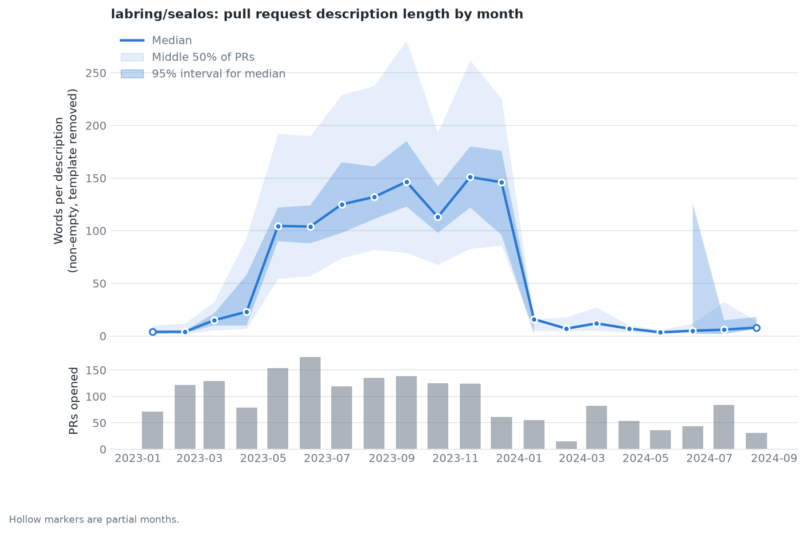
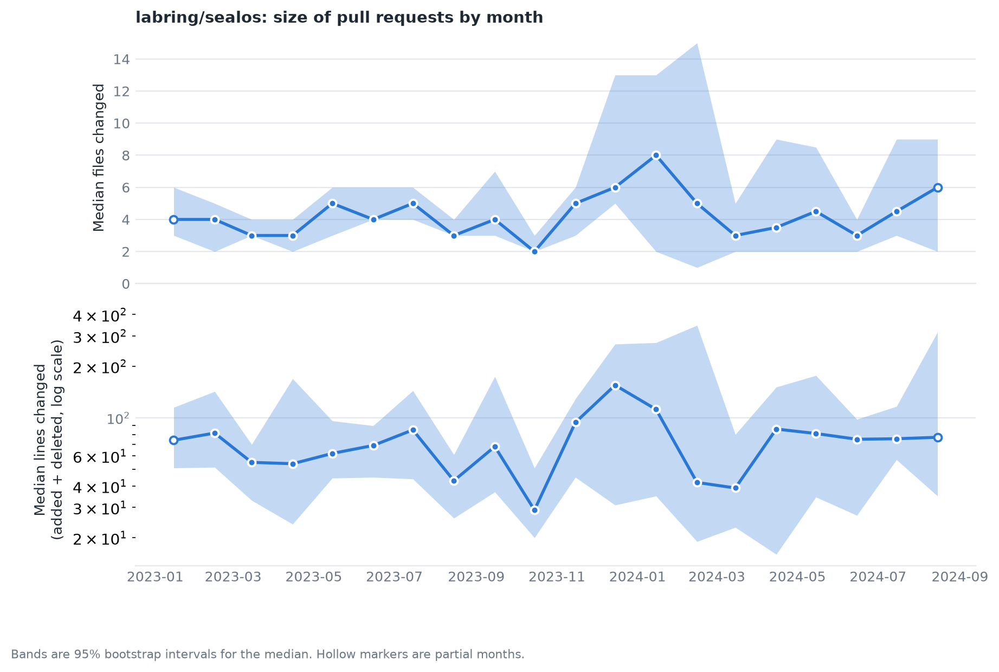
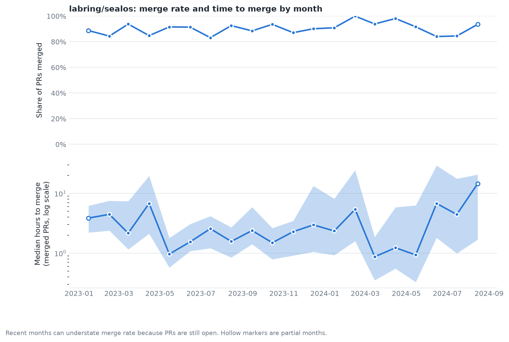
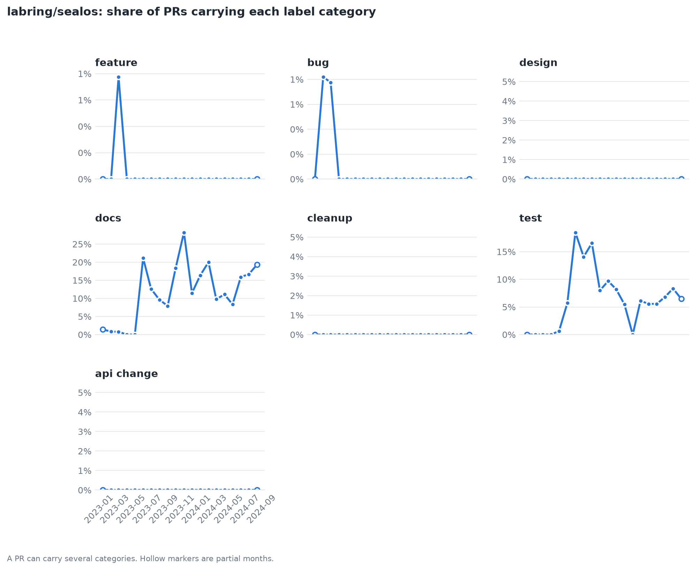
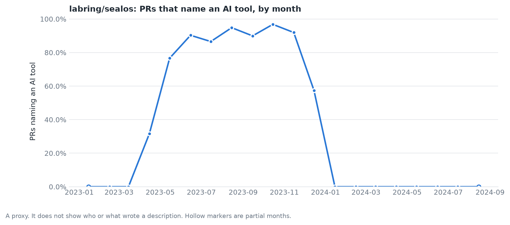
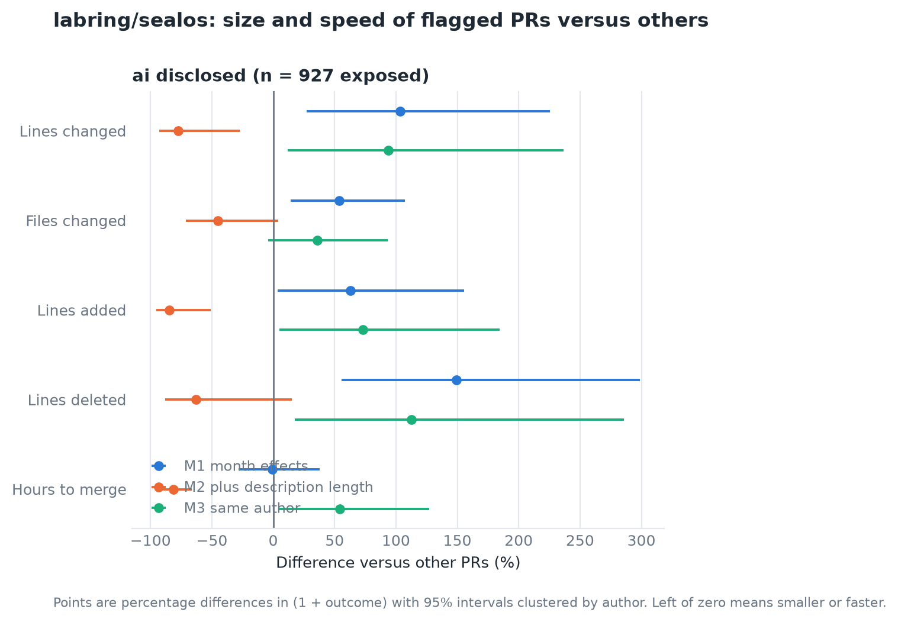

# Pull requests in labring/sealos: description length, size, speed and labels

Window 2023-01-09 to 2024-08-19 (UTC). Data fetched 2026-11-20. prwords 3.0.0, generated 2026-11-26. Method fixed in advance in `docs/ANALYSIS_PLAN.md`.

## 1. Data

- Repository primary language: Go
- Pull requests opened in the window: 1,961
- Removed as bot accounts: 127
- Analysed: 1,834 PRs from 86 authors
- Merged: 1,647 (89.8%). Closed without merging: 187 (10.2%). Still open: 0
- Follow-up: merge outcomes use a 30-day follow-up. PRs without enough follow-up: 0
- Empty descriptions after cleaning: 31.7%

## 2. Did the PR template change?

No template line appeared or disappeared with a share of 50% or more. Template text was detected monthly and removed before counting words.

Distinct template lines detected: 2.

## 3. First 28 days versus last 28 days

First window 2023-01-09 to 2023-02-05. Last window 2024-07-23 to 2024-08-19. Ratios are last median divided by first median. Bootstrap intervals, 2,000 resamples.

| Metric                                |   n first |   n last |   Median first |   Median last |   Ratio |   Ratio low |   Ratio high |       p |   Cliff's delta |
|:--------------------------------------|----------:|---------:|---------------:|--------------:|--------:|------------:|-------------:|--------:|----------------:|
| Description words (non-empty)         |        63 |        8 |           4    |          8    |    2    |        1.25 |         6    | 0.099   |            0.35 |
| Files changed                         |        93 |       45 |           4    |          6    |    1.5  |        0.5  |         2.33 | 0.28    |            0.11 |
| Lines added                           |        93 |       45 |          56    |         38    |    0.68 |        0.35 |         4.37 | 0.2     |            0.14 |
| Lines deleted                         |        93 |       45 |           8    |         23    |    2.88 |        0.77 |         6.71 | 0.036   |            0.22 |
| Net lines (added minus deleted)       |        93 |       45 |          22    |         17    |    0.77 |        0.24 |         4.66 | 0.46    |            0.08 |
| Lines changed (added plus deleted)    |        93 |       45 |          62    |         77    |    1.24 |        0.44 |         5.06 | 0.16    |            0.15 |
| Hours from open to merge (merged PRs) |        82 |       42 |           3.47 |          8.71 |    2.51 |        0.31 |         8.13 | 0.16    |            0.16 |
| Commits                               |        93 |       45 |           1    |          2    |    2    |        1    |         4    | 5.3e-06 |            0.42 |
| Comments                              |        93 |       45 |           1    |          1    |    1    |        1    |         2    | 1.5e-05 |            0.42 |
| Reviews                               |        93 |       45 |           1    |          1    |    1    |        1    |         1    | 0.64    |            0.04 |

| Measure                             |   n first |   n last | Share first   | Share last   |   Change (points) |      p |
|:------------------------------------|----------:|---------:|:--------------|:-------------|------------------:|-------:|
| Merged within follow-up period      |        93 |       45 | 87.1%         | 86.7%        |              -0.4 | 1      |
| Closed without merging              |        93 |       45 | 11.8%         | 6.7%         |              -5.2 | 0.55   |
| Opened as draft                     |        93 |       45 | 1.1%          | 0.0%         |              -1.1 | 1      |
| From outside contributors           |        93 |       45 | 33.3%         | 28.9%        |              -4.4 | 0.7    |
| Has a kind or type label            |        93 |       45 | 3.2%          | 15.6%        |              12.3 | 0.014  |
| Description text repeated elsewhere |        93 |       45 | 4.3%          | 0.0%         |              -4.3 | 0.3    |
| Names an AI tool (disclosure)       |        93 |       45 | 0.0%          | 0.0%         |               0   | 1      |
| Label category: feature             |        93 |       45 | 0.0%          | 0.0%         |               0   | 1      |
| Label category: bug                 |        93 |       45 | 0.0%          | 0.0%         |               0   | 1      |
| Label category: design              |        93 |       45 | 0.0%          | 0.0%         |               0   | 1      |
| Label category: docs                |        93 |       45 | 2.2%          | 15.6%        |              13.4 | 0.0056 |
| Label category: cleanup             |        93 |       45 | 0.0%          | 0.0%         |               0   | 1      |
| Label category: test                |        93 |       45 | 0.0%          | 8.9%         |               8.9 | 0.01   |
| Label category: api_change          |        93 |       45 | 0.0%          | 0.0%         |               0   | 1      |

## 4. Monthly trends

Theil-Sen slope per month and Kendall tau over full months only.

| metric                     |   months |   slope_per_month |   slope_ci_low |   slope_ci_high |     tau |       p |
|:---------------------------|---------:|------------------:|---------------:|----------------:|--------:|--------:|
| median_words               |       18 |            -1.133 |         -9.25  |           1.5   |  -0.21  |   0.225 |
| median_files_changed       |       18 |            -0     |         -0.077 |           0.2   |   0.091 |   0.615 |
| median_additions           |       18 |             0.214 |         -1.438 |           1.773 |   0.072 |   0.709 |
| median_deletions           |       18 |             0.25  |         -0.286 |           0.9   |   0.145 |   0.404 |
| median_churn               |       18 |             0.778 |         -2.3   |           3.25  |   0.098 |   0.601 |
| median_hours_to_merge      |       18 |            -0.003 |         -0.156 |           0.221 |  -0.033 |   0.881 |
| merge_rate                 |       18 |             0.002 |         -0.004 |           0.007 |   0.111 |   0.55  |
| share_outside_contributors |       18 |            -0.002 |         -0.008 |           0.003 |  -0.163 |   0.369 |
| share_ai_disclosed         |       18 |            -0     |         -0.079 |          -0     |  -0.247 |   0.18  |
| median_comments            |       18 |            -0     |         -0     |           0.091 |   0.105 |   0.589 |
| median_reviews             |       18 |            -0     |         -0     |          -0     | nan     | nan     |
| share_feature              |       18 |            -0     |         -0     |          -0     |  -0.294 |   0.148 |
| share_bug                  |       18 |            -0     |         -0     |          -0     |  -0.464 |   0.021 |
| share_design               |       18 |            -0     |         -0     |          -0     | nan     | nan     |
| share_docs                 |       18 |             0.007 |         -0.001 |           0.014 |   0.289 |   0.095 |
| share_cleanup              |       18 |            -0     |         -0     |          -0     | nan     | nan     |
| share_test                 |       18 |             0.002 |         -0.004 |           0.006 |   0.174 |   0.321 |
| share_api_change           |       18 |            -0     |         -0     |          -0     | nan     | nan     |

## 5. Labels

Share of PRs with a kind or type label: 11.1% overall. Label coverage by month is in `monthly_summary.csv` (`share_has_kind_label`).

| category            |   n_prs |   share |   median_words |   median_files |   median_churn |   merge_rate |   median_hours_to_merge |   share_ai_disclosed |
|:--------------------|--------:|--------:|---------------:|---------------:|---------------:|-------------:|------------------------:|---------------------:|
| feature             |       1 |   0.001 |          nan   |              4 |           59   |        1     |                  38.312 |                0     |
| bug                 |       2 |   0.001 |            1   |              4 |           32.5 |        1     |                  29.398 |                0     |
| design              |       0 |   0     |          nan   |            nan |          nan   |      nan     |                 nan     |              nan     |
| docs                |     200 |   0.109 |          118.5 |              6 |           66.5 |        0.91  |                   1.172 |                0.65  |
| cleanup             |       0 |   0     |          nan   |            nan |          nan   |      nan     |                 nan     |              nan     |
| test                |     127 |   0.069 |          223   |             27 |         1062   |        0.748 |                  23.129 |                0.732 |
| api_change          |       0 |   0     |          nan   |            nan |          nan   |      nan     |                 nan     |              nan     |
| (no category label) |    1508 |   0.822 |           84   |              3 |           51   |        0.908 |                   2.181 |                0.468 |

Cross-check against the repository's own size labels (coverage 86.5%, Spearman rho between size label and lines changed 0.98):

| size_label   |   n_prs |   median_churn |   p10_churn |   p90_churn |
|:-------------|--------:|---------------:|------------:|------------:|
| XS           |     365 |              4 |           1 |           8 |
| S            |     248 |             18 |          10 |          27 |
| M            |     308 |             56 |          35 |          87 |
| L            |     353 |            214 |         114 |         422 |
| XL           |     101 |            692 |         559 |         960 |
| XXL          |     211 |           3267 |        1189 |       15743 |

## 6. Are PRs with signs of AI involvement smaller or larger?

Authorship is not observable. The proxy is `ai_disclosed`, defined in the analysis plan: 927 PRs (50.55%). 50 disclosed PRs are listed in `ai_disclosure_samples.csv` for manual audit.

### ai_disclosed

**Verdict: larger.** Both the same-month and same-author intervals exclude zero and agree, and no supporting size outcome contradicts them.

Pattern: lines changed: larger; files changed: no clear difference; lines added: larger; lines deleted: larger; hours to merge: no clear difference.

Within-author permutation p-value, lines changed: 0.6852.

| Outcome        | Model                      |    n |   n exposed |   Median exposed |   Median others | Difference (95% CI)       |       p |   p (Holm) |
|:---------------|:---------------------------|-----:|------------:|-----------------:|----------------:|:--------------------------|--------:|-----------:|
| Lines changed  | M1 month effects           | 1834 |         927 |             64   |            63   | +103.3% (+27.0 to +225.4) | 0.0031  |    0.012   |
| Lines changed  | M2 plus description length | 1834 |         927 |             64   |            63   | -77.4% (-93.0 to -27.1)   | 0.013   |    0.039   |
| Lines changed  | M3 same author             | 1834 |         927 |             64   |            63   | +93.9% (+11.8 to +236.5)  | 0.018   |    0.074   |
| Files changed  | M1 month effects           | 1834 |         927 |              4   |             3   | +53.8% (+14.2 to +107.2)  | 0.0046  |    0.014   |
| Files changed  | M2 plus description length | 1834 |         927 |              4   |             3   | -45.0% (-71.0 to +4.2)    | 0.067   |    0.13    |
| Files changed  | M3 same author             | 1834 |         927 |              4   |             3   | +36.1% (-4.1 to +93.1)    | 0.084   |    0.084   |
| Lines added    | M1 month effects           | 1834 |         927 |             36   |            36   | +62.8% (+3.8 to +155.5)   | 0.034   |    0.068   |
| Lines added    | M2 plus description length | 1834 |         927 |             36   |            36   | -84.7% (-95.2 to -50.8)   | 0.0016  |    0.0065  |
| Lines added    | M3 same author             | 1834 |         927 |             36   |            36   | +73.0% (+5.2 to +184.5)   | 0.031   |    0.082   |
| Lines deleted  | M1 month effects           | 1834 |         927 |             13   |            11   | +149.4% (+55.9 to +299.0) | 0.00014 |    0.00069 |
| Lines deleted  | M2 plus description length | 1834 |         927 |             13   |            11   | -62.7% (-87.9 to +15.0)   | 0.086   |    0.13    |
| Lines deleted  | M3 same author             | 1834 |         927 |             13   |            11   | +112.8% (+17.4 to +285.9) | 0.013   |    0.064   |
| Hours to merge | M1 month effects           | 1647 |         842 |              1.8 |             2.8 | -0.6% (-28.3 to +37.9)    | 0.97    |    0.97    |
| Hours to merge | M2 plus description length | 1647 |         842 |              1.8 |             2.8 | -81.4% (-89.7 to -66.4)   | 2.4e-08 |    1.2e-07 |
| Hours to merge | M3 same author             | 1647 |         842 |              1.8 |             2.8 | +54.4% (+5.0 to +127.1)   | 0.027   |    0.082   |

### Robustness by tool (lines changed)

| tool        |   n exposed | Same month                | Same author              | call                | status   |
|:------------|------------:|:--------------------------|:-------------------------|:--------------------|:---------|
| unspecified |         838 | +84.2% (+14.0 to +197.6)  | +66.8% (+3.6 to +168.6)  | larger              | ok       |
| copilot     |          89 | +170.5% (-14.8 to +759.2) | +69.7% (-58.9 to +600.9) | no clear difference | ok       |

### File type check

Sample: 293 exposed and 118 unexposed PRs from the same months. 8 PRs with more than 100 files were excluded.

Share of changed lines by file type:

| group     |   n_prs | code   | tests   | docs   | config   | generated   | other   |   median_code_test_lines |
|:----------|--------:|:-------|:--------|:-------|:---------|:------------|:--------|-------------------------:|
| exposed   |     293 | 21.8%  | 1.4%    | 6.2%   | 5.5%     | 64.2%       | 0.8%    |                        8 |
| unexposed |     118 | 33.8%  | 4.6%    | 10.4%  | 24.2%    | 25.4%       | 1.7%    |                       11 |

Code and test lines only, same month: +6.2% (95% CI -49.2 to +121.8), p = 0.87. This is a robustness check and does not change the verdict.

## 7. Other checks

- Outside contributors: 31.0% of PRs overall.
- Top 10 authors opened 79.4% of PRs.
- PRs whose description text is repeated elsewhere (10 or more words): 0.8%.

## 8. Limitations

- Word count and size describe PRs, not who wrote them. Proxies for AI involvement are noisy and omit undisclosed use.
- Added and deleted lines include generated or vendored files unless the project avoids committing them.
- Disclosure mostly captures tools that add attribution by default, so it is tool-skewed.
- Template removal is heuristic. Check `template_audit.csv`.
- One repository cannot support general claims. See the plan for replication.
- Months at the edges of the window are partial and are excluded from trend tests.

