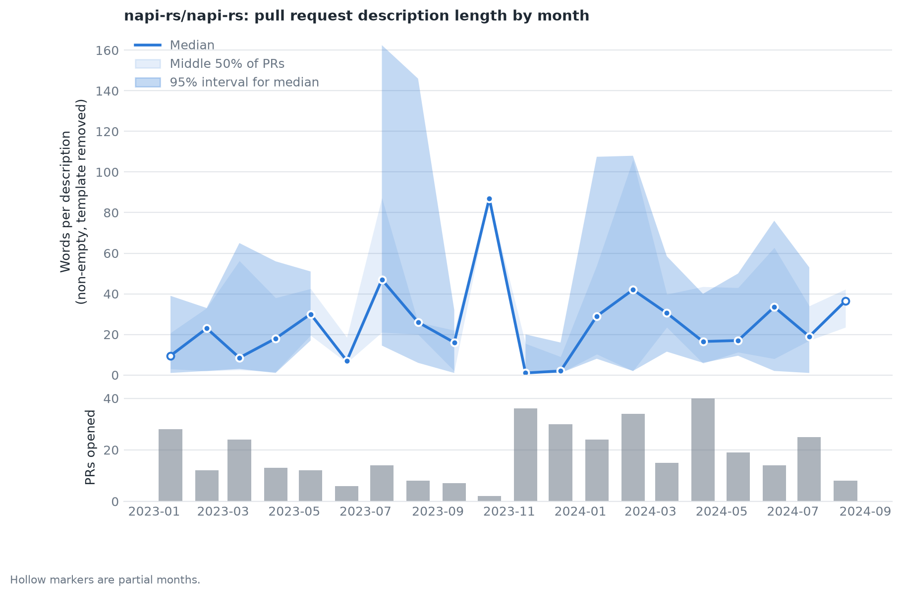
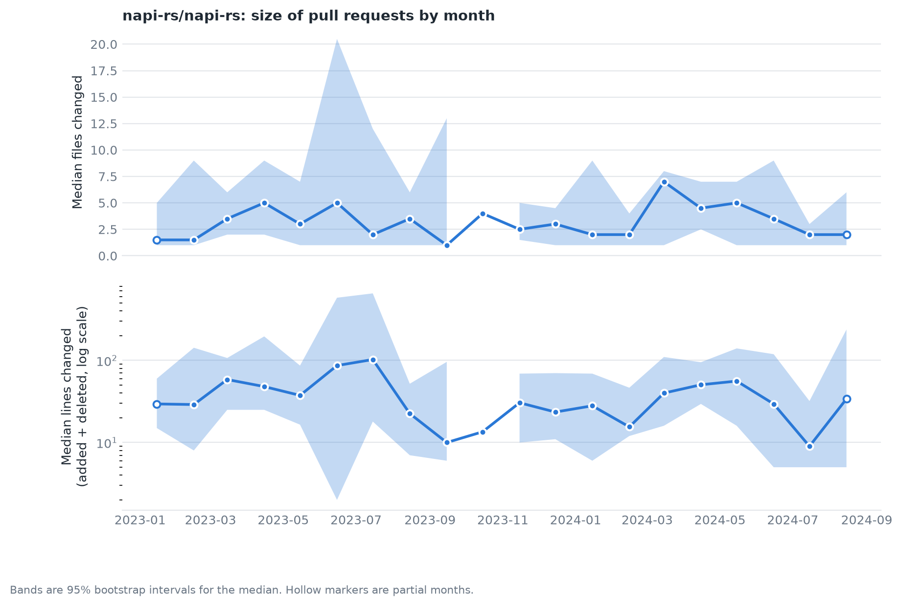
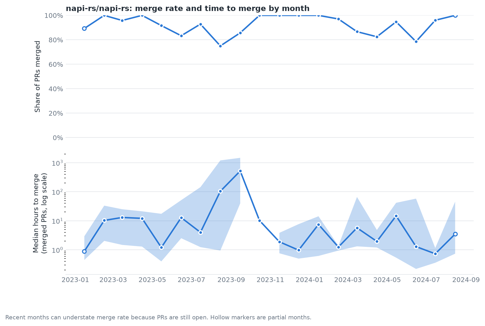
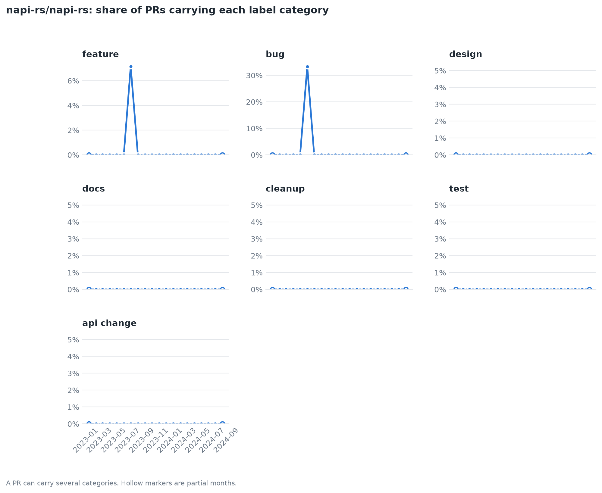
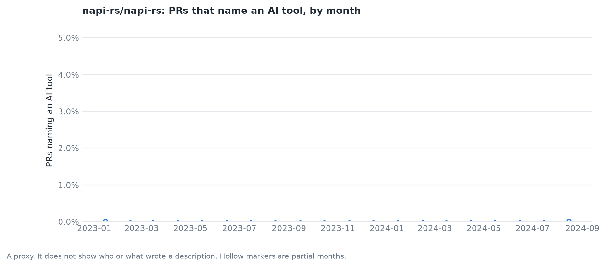

# Pull requests in napi-rs/napi-rs: description length, size, speed and labels

Window 2023-01-09 to 2024-08-19 (UTC). Data fetched 2026-11-20. prwords 3.0.0, generated 2026-11-26. Method fixed in advance in `docs/ANALYSIS_PLAN.md`.

## 1. Data

- Repository primary language: Rust
- Pull requests opened in the window: 516
- Removed as bot accounts: 145
- Analysed: 371 PRs from 68 authors
- Merged: 346 (93.3%). Closed without merging: 23 (6.2%). Still open: 2
- Follow-up: merge outcomes use a 30-day follow-up. PRs without enough follow-up: 0
- Empty descriptions after cleaning: 56.1%

## 2. Did the PR template change?

No template line appeared or disappeared with a share of 50% or more. Template text was detected monthly and removed before counting words.

Distinct template lines detected: 0.

## 3. First 28 days versus last 28 days

First window 2023-01-09 to 2023-02-05. Last window 2024-07-23 to 2024-08-19. Ratios are last median divided by first median. Bootstrap intervals, 2,000 resamples.

| Metric                                |   n first |   n last |   Median first |   Median last |   Ratio |   Ratio low |   Ratio high |       p |   Cliff's delta |
|:--------------------------------------|----------:|---------:|---------------:|--------------:|--------:|------------:|-------------:|--------:|----------------:|
| Description words (non-empty)         |        12 |        5 |           9.5  |         42    |    4.42 |        0.1  |        28.02 | 0.29    |            0.35 |
| Files changed                         |        31 |       12 |           2    |          1.5  |    0.75 |        0.25 |         3    | 0.57    |           -0.11 |
| Lines added                           |        31 |       12 |          27    |          7.5  |    0.28 |        0.04 |         2.77 | 0.24    |           -0.23 |
| Lines deleted                         |        31 |       12 |           5    |          2.5  |    0.5  |        0.13 |         5.71 | 0.6     |           -0.1  |
| Net lines (added minus deleted)       |        31 |       12 |          18    |          4.5  |    0.25 |        0    |         4.82 | 0.55    |           -0.12 |
| Lines changed (added plus deleted)    |        31 |       12 |          41    |         10    |    0.24 |        0.07 |         2.88 | 0.25    |           -0.23 |
| Hours from open to merge (merged PRs) |        28 |       12 |           0.91 |          1.44 |    1.58 |        0.31 |        11.37 | 0.51    |            0.14 |
| Commits                               |        31 |       12 |           1    |          1    |    1    |        1    |         1    | 0.84    |            0.03 |
| Comments                              |        31 |       12 |           0    |          1    |  nan    |      nan    |       nan    | 0.00087 |            0.49 |
| Reviews                               |        31 |       12 |           0    |          1    |  nan    |      nan    |       nan    | 8.4e-06 |            0.71 |

| Measure                             |   n first |   n last | Share first   | Share last   |   Change (points) |    p |
|:------------------------------------|----------:|---------:|:--------------|:-------------|------------------:|-----:|
| Merged within follow-up period      |        31 |       12 | 90.3%         | 100.0%       |               9.7 | 0.55 |
| Closed without merging              |        31 |       12 | 9.7%          | 0.0%         |              -9.7 | 0.55 |
| Opened as draft                     |        31 |       12 | 3.2%          | 0.0%         |              -3.2 | 1    |
| From outside contributors           |        31 |       12 | 25.8%         | 50.0%        |              24.2 | 0.16 |
| Has a kind or type label            |        31 |       12 | 0.0%          | 0.0%         |               0   | 1    |
| Description text repeated elsewhere |        31 |       12 | 0.0%          | 0.0%         |               0   | 1    |
| Names an AI tool (disclosure)       |        31 |       12 | 0.0%          | 0.0%         |               0   | 1    |
| Label category: feature             |        31 |       12 | 0.0%          | 0.0%         |               0   | 1    |
| Label category: bug                 |        31 |       12 | 0.0%          | 0.0%         |               0   | 1    |
| Label category: design              |        31 |       12 | 0.0%          | 0.0%         |               0   | 1    |
| Label category: docs                |        31 |       12 | 0.0%          | 0.0%         |               0   | 1    |
| Label category: cleanup             |        31 |       12 | 0.0%          | 0.0%         |               0   | 1    |
| Label category: test                |        31 |       12 | 0.0%          | 0.0%         |               0   | 1    |
| Label category: api_change          |        31 |       12 | 0.0%          | 0.0%         |               0   | 1    |

## 4. Monthly trends

Theil-Sen slope per month and Kendall tau over full months only.

| metric                     |   months |   slope_per_month |   slope_ci_low |   slope_ci_high |     tau |       p |
|:---------------------------|---------:|------------------:|---------------:|----------------:|--------:|--------:|
| median_words               |       18 |             0.5   |         -1.2   |           1.833 |   0.098 |   0.601 |
| median_files_changed       |       18 |            -0     |         -0.136 |           0.182 |   0.055 |   0.759 |
| median_additions           |       18 |            -0.679 |         -2.5   |           1     |  -0.19  |   0.293 |
| median_deletions           |       18 |            -0.25  |         -0.818 |           0.25  |  -0.174 |   0.322 |
| median_churn               |       18 |            -1.167 |         -3.5   |           1.536 |  -0.15  |   0.41  |
| median_hours_to_merge      |       18 |            -0.561 |         -1.068 |           0.011 |  -0.307 |   0.081 |
| merge_rate                 |       18 |            -0.002 |         -0.012 |           0.003 |  -0.165 |   0.353 |
| share_outside_contributors |       18 |             0.005 |         -0.025 |           0.03  |   0.079 |   0.649 |
| share_ai_disclosed         |       18 |            -0     |         -0     |          -0     | nan     | nan     |
| median_comments            |       18 |             0.045 |         -0     |           0.1   |   0.465 |   0.015 |
| median_reviews             |       18 |            -0     |         -0     |          -0     |   0.518 |   0.011 |
| share_feature              |       18 |            -0     |         -0     |          -0     |  -0.137 |   0.5   |
| share_bug                  |       18 |            -0     |         -0     |          -0     |  -0.176 |   0.386 |
| share_design               |       18 |            -0     |         -0     |          -0     | nan     | nan     |
| share_docs                 |       18 |            -0     |         -0     |          -0     | nan     | nan     |
| share_cleanup              |       18 |            -0     |         -0     |          -0     | nan     | nan     |
| share_test                 |       18 |            -0     |         -0     |          -0     | nan     | nan     |
| share_api_change           |       18 |            -0     |         -0     |          -0     | nan     | nan     |

## 5. Labels

Share of PRs with a kind or type label: 0.0% overall. Label coverage by month is in `monthly_summary.csv` (`share_has_kind_label`).

| category            |   n_prs |   share |   median_words |   median_files |   median_churn |   merge_rate |   median_hours_to_merge |   share_ai_disclosed |
|:--------------------|--------:|--------:|---------------:|---------------:|---------------:|-------------:|------------------------:|---------------------:|
| feature             |       1 |   0.003 |            229 |            8   |            149 |        1     |                 329.85  |                    0 |
| bug                 |       2 |   0.005 |              7 |           10.5 |            137 |        1     |                  41.843 |                    0 |
| design              |       0 |   0     |            nan |          nan   |            nan |      nan     |                 nan     |                  nan |
| docs                |       0 |   0     |            nan |          nan   |            nan |      nan     |                 nan     |                  nan |
| cleanup             |       0 |   0     |            nan |          nan   |            nan |      nan     |                 nan     |                  nan |
| test                |       0 |   0     |            nan |          nan   |            nan |      nan     |                 nan     |                  nan |
| api_change          |       0 |   0     |            nan |          nan   |            nan |      nan     |                 nan     |                  nan |
| (no category label) |     368 |   0.992 |             20 |            3   |             32 |        0.932 |                   1.913 |                    0 |

## 6. Are PRs with signs of AI involvement smaller or larger?

Authorship is not observable. The proxy is `ai_disclosed`, defined in the analysis plan: 0 PRs (0.00%). 0 disclosed PRs are listed in `ai_disclosure_samples.csv` for manual audit.

### ai_disclosed

**Verdict: not testable.** Too few exposed PRs.

Pattern: lines changed: not estimated; files changed: not estimated; lines added: not estimated; lines deleted: not estimated; hours to merge: not estimated.

Not estimated: fewer than 30 exposed PRs (exposed PRs: 0).

### Robustness by tool (lines changed)

No tool named in any disclosure.

### File type check

Not run. Use `--file-check N` to sample N exposed PRs and matching unexposed PRs.

## 7. Other checks

- Outside contributors: 34.5% of PRs overall.
- Top 10 authors opened 80.9% of PRs.
- PRs whose description text is repeated elsewhere (10 or more words): 0.5%.

## 8. Limitations

- Word count and size describe PRs, not who wrote them. Proxies for AI involvement are noisy and omit undisclosed use.
- Added and deleted lines include generated or vendored files unless the project avoids committing them.
- Disclosure mostly captures tools that add attribution by default, so it is tool-skewed.
- Template removal is heuristic. Check `template_audit.csv`.
- One repository cannot support general claims. See the plan for replication.
- Months at the edges of the window are partial and are excluded from trend tests.

