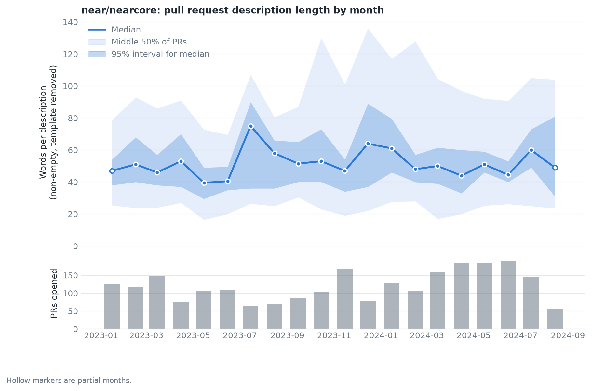
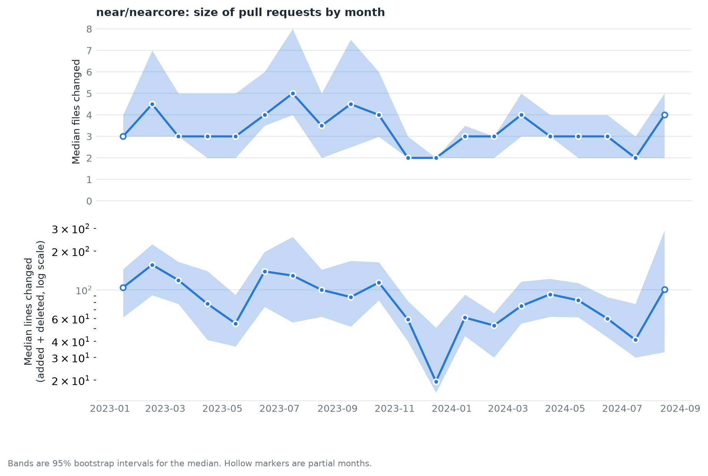
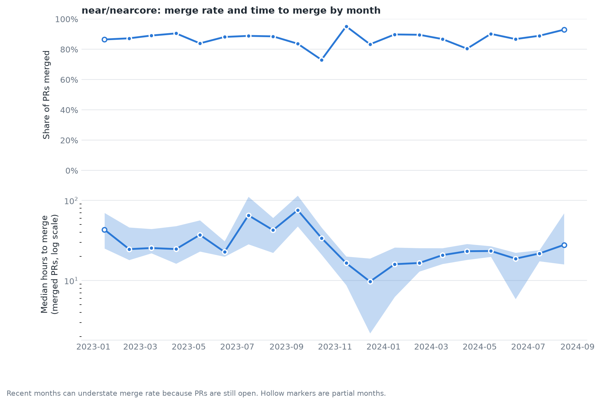
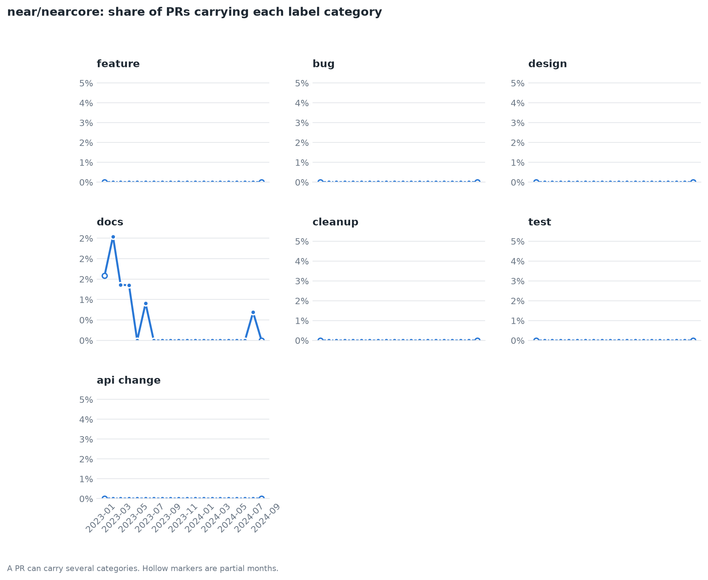
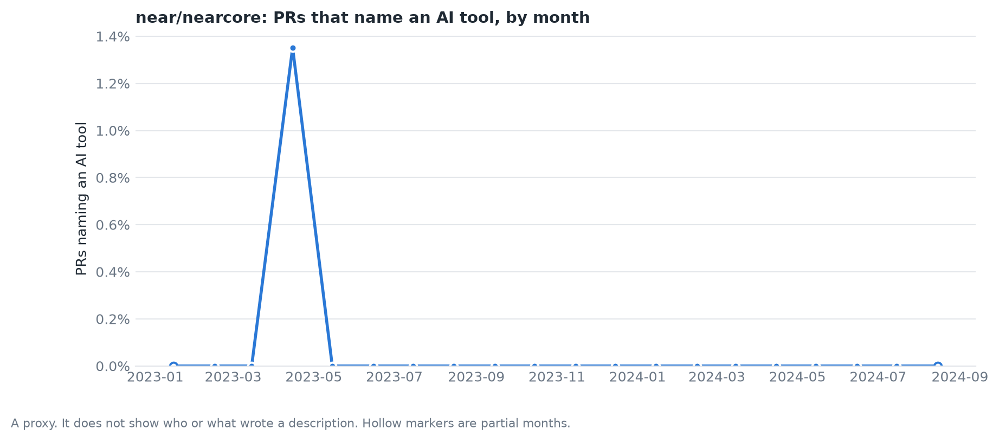

# Pull requests in near/nearcore: description length, size, speed and labels

Window 2023-01-09 to 2024-08-19 (UTC). Data fetched 2026-11-20. prwords 3.0.0, generated 2026-11-26. Method fixed in advance in `docs/ANALYSIS_PLAN.md`.

## 1. Data

- Repository primary language: Rust
- Pull requests opened in the window: 2,439
- Removed as bot accounts: 38
- Analysed: 2,401 PRs from 108 authors
- Merged: 2,094 (87.2%). Closed without merging: 301 (12.5%). Still open: 6
- Follow-up: merge outcomes use a 30-day follow-up. PRs without enough follow-up: 0
- Empty descriptions after cleaning: 12.8%

## 2. Did the PR template change?

No template line appeared or disappeared with a share of 50% or more. Template text was detected monthly and removed before counting words.

Distinct template lines detected: 0.

## 3. First 28 days versus last 28 days

First window 2023-01-09 to 2023-02-05. Last window 2024-07-23 to 2024-08-19. Ratios are last median divided by first median. Bootstrap intervals, 2,000 resamples.

| Metric                                |   n first |   n last |   Median first |   Median last |   Ratio |   Ratio low |   Ratio high |       p |   Cliff's delta |
|:--------------------------------------|----------:|---------:|---------------:|--------------:|--------:|------------:|-------------:|--------:|----------------:|
| Description words (non-empty)         |       118 |       82 |          45    |         51.5  |    1.14 |        0.92 |         1.98 | 0.051   |            0.16 |
| Files changed                         |       139 |       93 |           3    |          4    |    1.33 |        1    |         2    | 0.35    |            0.07 |
| Lines added                           |       139 |       93 |          67    |         45    |    0.67 |        0.31 |         1.8  | 0.77    |           -0.02 |
| Lines deleted                         |       139 |       93 |          15    |         19    |    1.27 |        0.68 |         3    | 0.35    |            0.07 |
| Net lines (added minus deleted)       |       139 |       93 |          16    |         15    |    0.94 |        0.19 |         3.43 | 0.7     |           -0.03 |
| Lines changed (added plus deleted)    |       139 |       93 |         104    |        101    |    0.97 |        0.45 |         3.1  | 0.71    |            0.03 |
| Hours from open to merge (merged PRs) |       119 |       83 |          43.16 |         24.91 |    0.58 |        0.36 |         1.39 | 0.15    |           -0.12 |
| Commits                               |       139 |       93 |           3    |          2    |    0.67 |        0.33 |         1.33 | 0.045   |           -0.15 |
| Comments                              |       139 |       93 |           0    |          1    |  nan    |      nan    |       nan    | 8.3e-09 |            0.42 |
| Reviews                               |       139 |       93 |           2    |          1    |    0.5  |        0.5  |         1    | 0.22    |           -0.09 |

| Measure                             |   n first |   n last | Share first   | Share last   |   Change (points) |    p |
|:------------------------------------|----------:|---------:|:--------------|:-------------|------------------:|-----:|
| Merged within follow-up period      |       139 |       93 | 82.7%         | 88.2%        |               5.4 | 0.35 |
| Closed without merging              |       139 |       93 | 14.4%         | 9.7%         |              -4.7 | 0.32 |
| Opened as draft                     |       139 |       93 | 8.6%          | 3.2%         |              -5.4 | 0.17 |
| From outside contributors           |       139 |       93 | 99.3%         | 100.0%       |               0.7 | 1    |
| Has a kind or type label            |       139 |       93 | 0.0%          | 0.0%         |               0   | 1    |
| Description text repeated elsewhere |       139 |       93 | 0.0%          | 0.0%         |               0   | 1    |
| Names an AI tool (disclosure)       |       139 |       93 | 0.0%          | 0.0%         |               0   | 1    |
| Label category: feature             |       139 |       93 | 0.0%          | 0.0%         |               0   | 1    |
| Label category: bug                 |       139 |       93 | 0.0%          | 0.0%         |               0   | 1    |
| Label category: design              |       139 |       93 | 0.0%          | 0.0%         |               0   | 1    |
| Label category: docs                |       139 |       93 | 2.2%          | 0.0%         |              -2.2 | 0.28 |
| Label category: cleanup             |       139 |       93 | 0.0%          | 0.0%         |               0   | 1    |
| Label category: test                |       139 |       93 | 0.0%          | 0.0%         |               0   | 1    |
| Label category: api_change          |       139 |       93 | 0.0%          | 0.0%         |               0   | 1    |

## 4. Monthly trends

Theil-Sen slope per month and Kendall tau over full months only.

| metric                     |   months |   slope_per_month |   slope_ci_low |   slope_ci_high |     tau |       p |
|:---------------------------|---------:|------------------:|---------------:|----------------:|--------:|--------:|
| median_words               |       18 |             0.125 |         -0.778 |           0.955 |   0.033 |   0.85  |
| median_files_changed       |       18 |            -0.062 |         -0.143 |          -0     |  -0.313 |   0.093 |
| median_additions           |       18 |            -2.167 |         -4.808 |          -0.125 |  -0.362 |   0.037 |
| median_deletions           |       18 |            -0.75  |         -1.182 |          -0.143 |  -0.433 |   0.012 |
| median_churn               |       18 |            -4.65  |         -7.333 |          -1     |  -0.425 |   0.014 |
| median_hours_to_merge      |       18 |            -0.474 |         -1.511 |           0.319 |  -0.255 |   0.152 |
| merge_rate                 |       18 |            -0     |         -0.004 |           0.002 |  -0.046 |   0.823 |
| share_outside_contributors |       18 |             0.001 |         -0.001 |           0.003 |   0.099 |   0.569 |
| share_ai_disclosed         |       18 |            -0     |         -0     |          -0     |  -0.255 |   0.21  |
| median_comments            |       18 |             0.067 |         -0     |           0.091 |   0.723 |   0     |
| median_reviews             |       18 |            -0     |         -0     |          -0     |  -0.133 |   0.512 |
| share_feature              |       18 |            -0     |         -0     |          -0     | nan     | nan     |
| share_bug                  |       18 |            -0     |         -0     |          -0     | nan     | nan     |
| share_design               |       18 |            -0     |         -0     |          -0     | nan     | nan     |
| share_docs                 |       18 |            -0     |         -0.001 |          -0     |  -0.439 |   0.023 |
| share_cleanup              |       18 |            -0     |         -0     |          -0     | nan     | nan     |
| share_test                 |       18 |            -0     |         -0     |          -0     | nan     | nan     |
| share_api_change           |       18 |            -0     |         -0     |          -0     | nan     | nan     |

## 5. Labels

Share of PRs with a kind or type label: 0.0% overall. Label coverage by month is in `monthly_summary.csv` (`share_has_kind_label`).

| category            |   n_prs |   share |   median_words |   median_files |   median_churn |   merge_rate |   median_hours_to_merge |   share_ai_disclosed |
|:--------------------|--------:|--------:|---------------:|---------------:|---------------:|-------------:|------------------------:|---------------------:|
| feature             |       0 |   0     |            nan |            nan |            nan |      nan     |                 nan     |                  nan |
| bug                 |       0 |   0     |            nan |            nan |            nan |      nan     |                 nan     |                  nan |
| design              |       0 |   0     |            nan |            nan |            nan |      nan     |                 nan     |                  nan |
| docs                |      10 |   0.004 |             16 |              1 |              7 |        0.9   |                   6.07  |                    0 |
| cleanup             |       0 |   0     |            nan |            nan |            nan |      nan     |                 nan     |                  nan |
| test                |       0 |   0     |            nan |            nan |            nan |      nan     |                 nan     |                  nan |
| api_change          |       0 |   0     |            nan |            nan |            nan |      nan     |                 nan     |                  nan |
| (no category label) |    2391 |   0.996 |             49 |              3 |             79 |        0.872 |                  22.736 |                    0 |

## 6. Are PRs with signs of AI involvement smaller or larger?

Authorship is not observable. The proxy is `ai_disclosed`, defined in the analysis plan: 1 PRs (0.04%). 1 disclosed PRs are listed in `ai_disclosure_samples.csv` for manual audit.

### ai_disclosed

**Verdict: not testable.** Too few exposed PRs.

Pattern: lines changed: not estimated; files changed: not estimated; lines added: not estimated; lines deleted: not estimated; hours to merge: not estimated.

Not estimated: fewer than 30 exposed PRs (exposed PRs: 1).

### Robustness by tool (lines changed)

| tool        |   n exposed | status                    |
|:------------|------------:|:--------------------------|
| unspecified |           1 | fewer than 30 exposed PRs |

### File type check

Not run. Use `--file-check N` to sample N exposed PRs and matching unexposed PRs.

## 7. Other checks

- Outside contributors: 96.7% of PRs overall.
- Top 10 authors opened 59.1% of PRs.
- PRs whose description text is repeated elsewhere (10 or more words): 0.8%.

## 8. Limitations

- Word count and size describe PRs, not who wrote them. Proxies for AI involvement are noisy and omit undisclosed use.
- Added and deleted lines include generated or vendored files unless the project avoids committing them.
- Disclosure mostly captures tools that add attribution by default, so it is tool-skewed.
- Template removal is heuristic. Check `template_audit.csv`.
- One repository cannot support general claims. See the plan for replication.
- Months at the edges of the window are partial and are excluded from trend tests.

