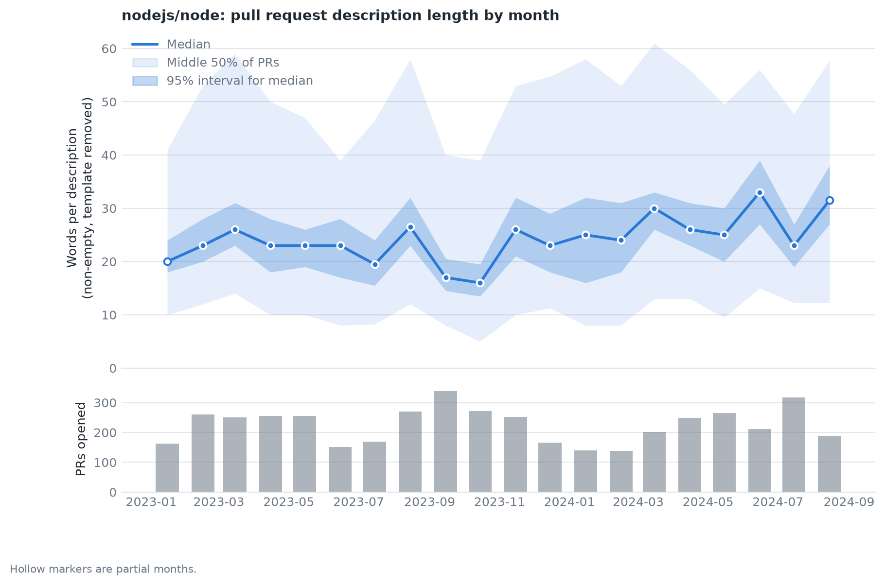
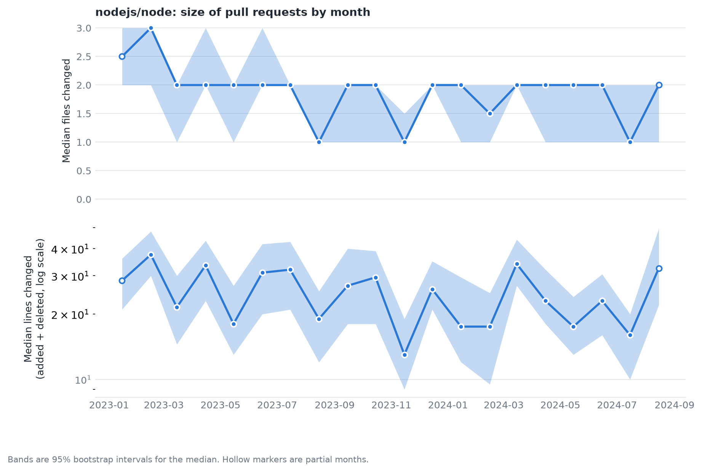
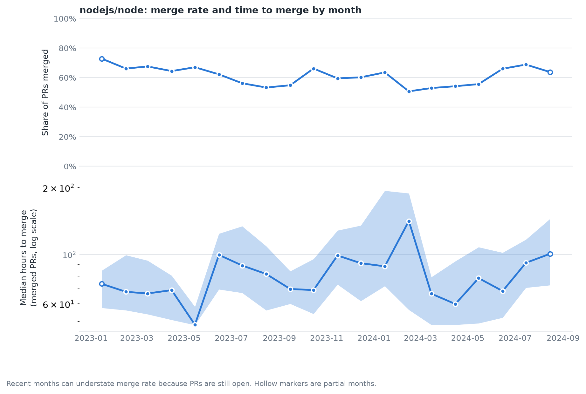
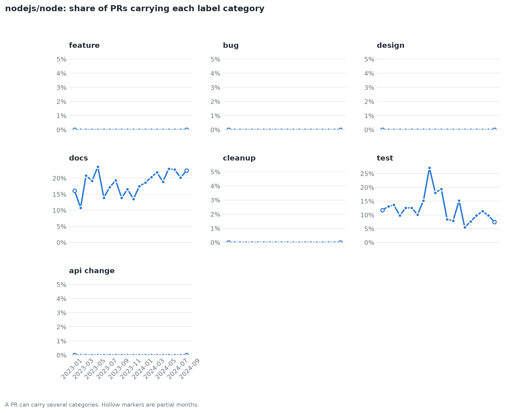
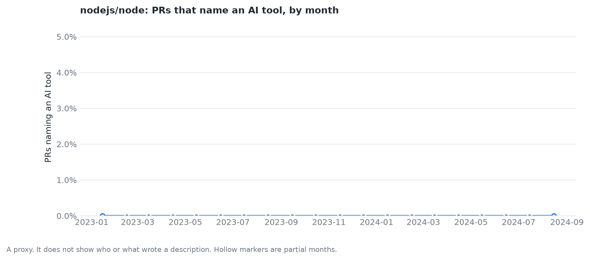

# Pull requests in nodejs/node: description length, size, speed and labels

Window 2023-01-09 to 2024-08-19 (UTC). Data fetched 2026-11-19. prwords 3.0.0, generated 2026-11-26. Method fixed in advance in `docs/ANALYSIS_PLAN.md`.

## 1. Data

- Repository primary language: JavaScript
- Pull requests opened in the window: 5,102
- Removed as bot accounts: 587
- Analysed: 4,515 PRs from 764 authors
- Merged: 2,772 (61.4%). Closed without merging: 1,730 (38.3%). Still open: 13
- Follow-up: merge outcomes use a 30-day follow-up. PRs without enough follow-up: 0
- Empty descriptions after cleaning: 10.7%

## 2. Did the PR template change?

No template line appeared or disappeared with a share of 50% or more. Template text was detected monthly and removed before counting words.

Distinct template lines detected: 1.

## 3. First 28 days versus last 28 days

First window 2023-01-09 to 2023-02-05. Last window 2024-07-23 to 2024-08-19. Ratios are last median divided by first median. Bootstrap intervals, 2,000 resamples.

| Metric                                |   n first |   n last |   Median first |   Median last |   Ratio |   Ratio low |   Ratio high |       p |   Cliff's delta |
|:--------------------------------------|----------:|---------:|---------------:|--------------:|--------:|------------:|-------------:|--------:|----------------:|
| Description words (non-empty)         |       173 |      255 |          21    |         29    |    1.38 |        1.05 |         1.65 | 0.13    |            0.09 |
| Files changed                         |       197 |      291 |           3    |          2    |    0.67 |        0.33 |         1    | 0.00014 |           -0.2  |
| Lines added                           |       197 |      291 |          17    |         15    |    0.88 |        0.56 |         1.43 | 0.12    |           -0.08 |
| Lines deleted                         |       197 |      291 |           6    |          4    |    0.67 |        0.38 |         1.33 | 0.18    |           -0.07 |
| Net lines (added minus deleted)       |       197 |      291 |           6    |          4    |    0.67 |        0.22 |         1.67 | 0.94    |            0    |
| Lines changed (added plus deleted)    |       197 |      291 |          31    |         22    |    0.71 |        0.53 |         1.08 | 0.03    |           -0.12 |
| Hours from open to merge (merged PRs) |       143 |      184 |          69.31 |        100.67 |    1.45 |        1.1  |         2.01 | 0.0062  |            0.18 |
| Commits                               |       197 |      291 |           1    |          1    |    1    |        1    |         1    | 0.3     |           -0.05 |
| Comments                              |       197 |      291 |           6    |          5    |    0.83 |        0.67 |         1.2  | 0.66    |           -0.02 |
| Reviews                               |       197 |      291 |           5    |          4    |    0.8  |        0.6  |         1    | 0.00022 |           -0.2  |

| Measure                             |   n first |   n last | Share first   | Share last   |   Change (points) |      p |
|:------------------------------------|----------:|---------:|:--------------|:-------------|------------------:|-------:|
| Merged within follow-up period      |       197 |      291 | 69.0%         | 54.6%        |             -14.4 | 0.0018 |
| Closed without merging              |       197 |      291 | 27.4%         | 35.4%        |               8   | 0.075  |
| Opened as draft                     |       197 |      291 | 0.0%          | 3.8%         |               3.8 | 0.0038 |
| From outside contributors           |       197 |      291 | 46.2%         | 49.8%        |               3.6 | 0.46   |
| Has a kind or type label            |       197 |      291 | 0.0%          | 0.0%         |               0   | 1      |
| Description text repeated elsewhere |       197 |      291 | 1.0%          | 2.1%         |               1   | 0.48   |
| Names an AI tool (disclosure)       |       197 |      291 | 0.0%          | 0.0%         |               0   | 1      |
| Label category: feature             |       197 |      291 | 0.0%          | 0.0%         |               0   | 1      |
| Label category: bug                 |       197 |      291 | 0.0%          | 0.0%         |               0   | 1      |
| Label category: design              |       197 |      291 | 0.0%          | 0.0%         |               0   | 1      |
| Label category: docs                |       197 |      291 | 14.7%         | 19.2%        |               4.5 | 0.22   |
| Label category: cleanup             |       197 |      291 | 0.0%          | 0.0%         |               0   | 1      |
| Label category: test                |       197 |      291 | 10.2%         | 9.6%         |              -0.5 | 0.88   |
| Label category: api_change          |       197 |      291 | 0.0%          | 0.0%         |               0   | 1      |

## 4. Monthly trends

Theil-Sen slope per month and Kendall tau over full months only.

| metric                     |   months |   slope_per_month |   slope_ci_low |   slope_ci_high |     tau |       p |
|:---------------------------|---------:|------------------:|---------------:|----------------:|--------:|--------:|
| median_words               |       18 |             0.167 |         -0     |           0.625 |   0.237 |   0.187 |
| median_files_changed       |       18 |            -0     |         -0     |          -0     |  -0.305 |   0.12  |
| median_additions           |       18 |            -0.429 |         -0.812 |           0.278 |  -0.191 |   0.271 |
| median_deletions           |       18 |            -0     |         -0.111 |          -0     |  -0.182 |   0.353 |
| median_churn               |       18 |            -0.75  |         -1.265 |          -0     |  -0.364 |   0.037 |
| median_hours_to_merge      |       18 |             0.438 |         -0.909 |           2.45  |   0.124 |   0.501 |
| merge_rate                 |       18 |            -0.004 |         -0.01  |           0.003 |  -0.203 |   0.26  |
| share_outside_contributors |       18 |            -0.001 |         -0.009 |           0.009 |  -0.007 |   1     |
| share_ai_disclosed         |       18 |            -0     |         -0     |          -0     | nan     | nan     |
| median_comments            |       18 |            -0     |         -0     |          -0     |  -0.191 |   0.332 |
| median_reviews             |       18 |            -0     |         -0     |          -0     |  -0.057 |   0.771 |
| share_feature              |       18 |            -0     |         -0     |          -0     | nan     | nan     |
| share_bug                  |       18 |            -0     |         -0     |          -0     | nan     | nan     |
| share_design               |       18 |            -0     |         -0     |          -0     | nan     | nan     |
| share_docs                 |       18 |             0.004 |         -0     |           0.007 |   0.294 |   0.096 |
| share_cleanup              |       18 |            -0     |         -0     |          -0     | nan     | nan     |
| share_test                 |       18 |            -0.002 |         -0.006 |           0.002 |  -0.229 |   0.201 |
| share_api_change           |       18 |            -0     |         -0     |          -0     | nan     | nan     |

## 5. Labels

Share of PRs with a kind or type label: 0.0% overall. Label coverage by month is in `monthly_summary.csv` (`share_has_kind_label`).

| category            |   n_prs |   share |   median_words |   median_files |   median_churn |   merge_rate |   median_hours_to_merge |   share_ai_disclosed |
|:--------------------|--------:|--------:|---------------:|---------------:|---------------:|-------------:|------------------------:|---------------------:|
| feature             |       0 |   0     |            nan |            nan |            nan |      nan     |                 nan     |                  nan |
| bug                 |       0 |   0     |            nan |            nan |            nan |      nan     |                 nan     |                  nan |
| design              |       0 |   0     |            nan |            nan |            nan |      nan     |                 nan     |                  nan |
| docs                |     832 |   0.184 |             20 |              1 |              6 |        0.703 |                  48.21  |                    0 |
| cleanup             |       0 |   0     |            nan |            nan |            nan |      nan     |                 nan     |                  nan |
| test                |     582 |   0.129 |             18 |              1 |             11 |        0.646 |                  60.567 |                    0 |
| api_change          |       0 |   0     |            nan |            nan |            nan |      nan     |                 nan     |                  nan |
| (no category label) |    3107 |   0.688 |             26 |              2 |             39 |        0.584 |                  95.716 |                    0 |

## 6. Are PRs with signs of AI involvement smaller or larger?

Authorship is not observable. The proxy is `ai_disclosed`, defined in the analysis plan: 0 PRs (0.00%). 0 disclosed PRs are listed in `ai_disclosure_samples.csv` for manual audit.

### ai_disclosed

**Verdict: not testable.** Too few exposed PRs.

Pattern: lines changed: not estimated; files changed: not estimated; lines added: not estimated; lines deleted: not estimated; hours to merge: not estimated.

Not estimated: fewer than 30 exposed PRs (exposed PRs: 0).

### Robustness by tool (lines changed)

No tool named in any disclosure.

### File type check

Not run. Use `--file-check N` to sample N exposed PRs and matching unexposed PRs.

## 7. Other checks

- Outside contributors: 42.4% of PRs overall.
- Top 10 authors opened 36.6% of PRs.
- PRs whose description text is repeated elsewhere (10 or more words): 1.7%.

## 8. Limitations

- Word count and size describe PRs, not who wrote them. Proxies for AI involvement are noisy and omit undisclosed use.
- Added and deleted lines include generated or vendored files unless the project avoids committing them.
- Disclosure mostly captures tools that add attribution by default, so it is tool-skewed.
- Template removal is heuristic. Check `template_audit.csv`.
- One repository cannot support general claims. See the plan for replication.
- Months at the edges of the window are partial and are excluded from trend tests.

