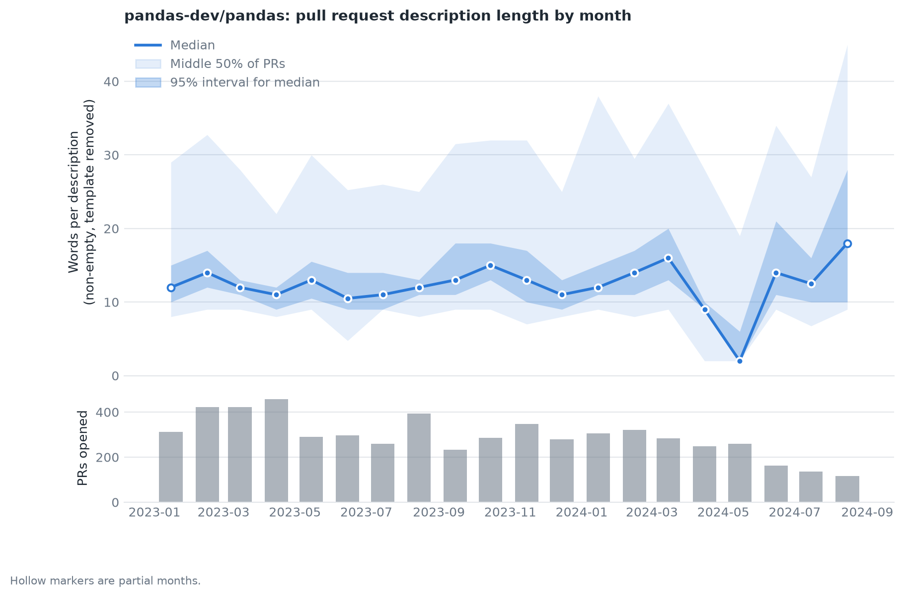
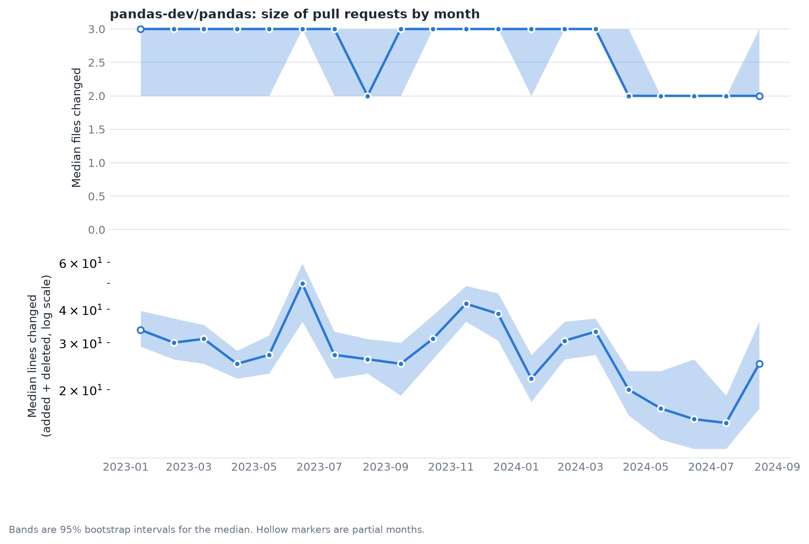
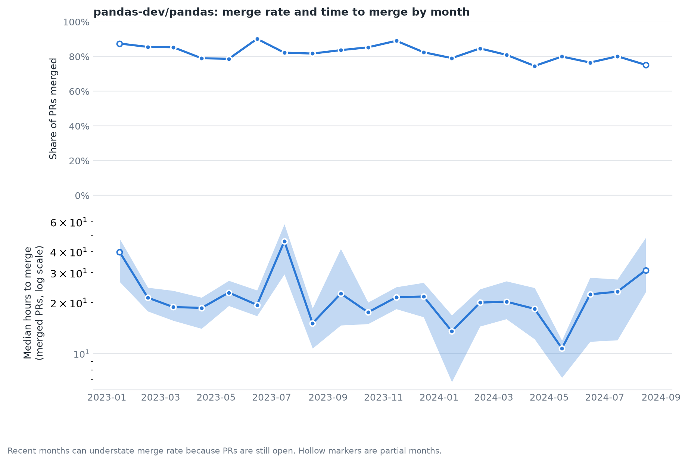
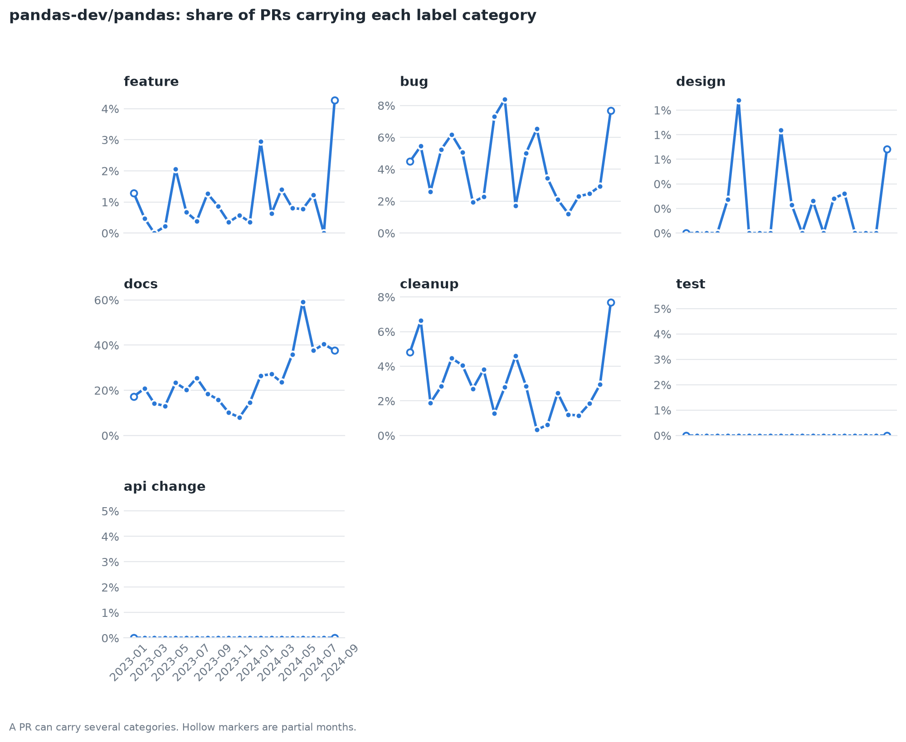
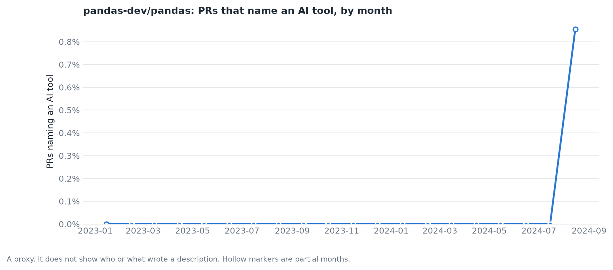

# Pull requests in pandas-dev/pandas: description length, size, speed and labels

Window 2023-01-09 to 2024-08-19 (UTC). Data fetched 2026-11-19. prwords 3.0.0, generated 2026-11-26. Method fixed in advance in `docs/ANALYSIS_PLAN.md`.

## 1. Data

- Repository primary language: Python
- Pull requests opened in the window: 5,879
- Removed as bot accounts: 44
- Analysed: 5,835 PRs from 924 authors
- Merged: 4,825 (82.7%). Closed without merging: 1,009 (17.3%). Still open: 1
- Follow-up: merge outcomes use a 30-day follow-up. PRs without enough follow-up: 0
- Empty descriptions after cleaning: 15.4%

## 2. Did the PR template change?

No template line appeared or disappeared with a share of 50% or more. Template text was detected monthly and removed before counting words.

Distinct template lines detected: 6.

## 3. First 28 days versus last 28 days

First window 2023-01-09 to 2023-02-05. Last window 2024-07-23 to 2024-08-19. Ratios are last median divided by first median. Bootstrap intervals, 2,000 resamples.

| Metric                                |   n first |   n last |   Median first |   Median last |   Ratio |   Ratio low |   Ratio high |       p |   Cliff's delta |
|:--------------------------------------|----------:|---------:|---------------:|--------------:|--------:|------------:|-------------:|--------:|----------------:|
| Description words (non-empty)         |       308 |      163 |          13    |         18    |    1.38 |        0.93 |         2.08 | 0.082   |            0.1  |
| Files changed                         |       375 |      167 |           3    |          2    |    0.67 |        0.67 |         1    | 0.7     |           -0.02 |
| Lines added                           |       375 |      167 |          23    |         17    |    0.74 |        0.61 |         0.95 | 0.15    |           -0.08 |
| Lines deleted                         |       375 |      167 |           7    |          3    |    0.43 |        0.29 |         0.67 | 0.0052  |           -0.15 |
| Net lines (added minus deleted)       |       375 |      167 |           7    |         10    |    1.43 |        0.83 |         4    | 0.2     |            0.07 |
| Lines changed (added plus deleted)    |       375 |      167 |          35    |         23    |    0.66 |        0.46 |         0.87 | 0.013   |           -0.13 |
| Hours from open to merge (merged PRs) |       324 |      131 |          29.24 |         23.74 |    0.81 |        0.52 |         1.15 | 0.13    |           -0.09 |
| Commits                               |       375 |      167 |           3    |          3    |    1    |        0.67 |         1.5  | 0.47    |            0.04 |
| Comments                              |       375 |      167 |           1    |          1    |    1    |        1    |         1    | 0.91    |           -0.01 |
| Reviews                               |       375 |      167 |           1    |          1    |    1    |        0.5  |         1    | 0.00093 |           -0.17 |

| Measure                             |   n first |   n last | Share first   | Share last   |   Change (points) |       p |
|:------------------------------------|----------:|---------:|:--------------|:-------------|------------------:|--------:|
| Merged within follow-up period      |       375 |      167 | 83.7%         | 75.4%        |              -8.3 | 0.032   |
| Closed without merging              |       375 |      167 | 13.6%         | 21.6%        |               8   | 0.023   |
| Opened as draft                     |       375 |      167 | 2.1%          | 4.8%         |               2.7 | 0.1     |
| From outside contributors           |       375 |      167 | 38.9%         | 66.5%        |              27.5 | 3.3e-09 |
| Has a kind or type label            |       375 |      167 | 0.0%          | 0.0%         |               0   | 1       |
| Description text repeated elsewhere |       375 |      167 | 21.1%         | 9.0%         |             -12.1 | 0.00052 |
| Names an AI tool (disclosure)       |       375 |      167 | 0.0%          | 0.6%         |               0.6 | 0.31    |
| Label category: feature             |       375 |      167 | 1.3%          | 3.0%         |               1.7 | 0.3     |
| Label category: bug                 |       375 |      167 | 4.0%          | 5.4%         |               1.4 | 0.5     |
| Label category: design              |       375 |      167 | 0.0%          | 0.6%         |               0.6 | 0.31    |
| Label category: docs                |       375 |      167 | 18.4%         | 39.5%        |              21.1 | 3.3e-07 |
| Label category: cleanup             |       375 |      167 | 5.6%          | 5.4%         |              -0.2 | 1       |
| Label category: test                |       375 |      167 | 0.0%          | 0.0%         |               0   | 1       |
| Label category: api_change          |       375 |      167 | 0.0%          | 0.0%         |               0   | 1       |

## 4. Monthly trends

Theil-Sen slope per month and Kendall tau over full months only.

| metric                     |   months |   slope_per_month |   slope_ci_low |   slope_ci_high |     tau |       p |
|:---------------------------|---------:|------------------:|---------------:|----------------:|--------:|--------:|
| median_words               |       18 |            -0     |         -0.25  |           0.214 |   0.034 |   0.848 |
| median_files_changed       |       18 |            -0     |         -0.062 |          -0     |  -0.511 |   0.012 |
| median_additions           |       18 |            -0.615 |         -0.944 |          -0.308 |  -0.45  |   0.011 |
| median_deletions           |       18 |            -0.214 |         -0.5   |          -0     |  -0.313 |   0.081 |
| median_churn               |       18 |            -0.857 |         -1.167 |          -0.045 |  -0.37  |   0.034 |
| median_hours_to_merge      |       18 |            -0.035 |         -0.526 |           0.27  |  -0.033 |   0.881 |
| merge_rate                 |       18 |            -0.004 |         -0.007 |           0     |  -0.32  |   0.068 |
| share_outside_contributors |       18 |             0.017 |          0.007 |           0.028 |   0.451 |   0.009 |
| share_ai_disclosed         |       18 |            -0     |         -0     |          -0     | nan     | nan     |
| median_comments            |       18 |            -0     |         -0     |          -0     | nan     | nan     |
| median_reviews             |       18 |            -0     |         -0     |          -0     | nan     | nan     |
| share_feature              |       18 |             0     |         -0     |           0.001 |   0.157 |   0.363 |
| share_bug                  |       18 |            -0.001 |         -0.003 |           0.001 |  -0.229 |   0.201 |
| share_design               |       18 |            -0     |         -0     |          -0     |   0.033 |   0.862 |
| share_docs                 |       18 |             0.012 |          0.004 |           0.025 |   0.451 |   0.009 |
| share_cleanup              |       18 |            -0.002 |         -0.003 |           0     |  -0.333 |   0.057 |
| share_test                 |       18 |            -0     |         -0     |          -0     | nan     | nan     |
| share_api_change           |       18 |            -0     |         -0     |          -0     | nan     | nan     |

## 5. Labels

Share of PRs with a kind or type label: 0.0% overall. Label coverage by month is in `monthly_summary.csv` (`share_has_kind_label`).

| category            |   n_prs |   share |   median_words |   median_files |   median_churn |   merge_rate |   median_hours_to_merge |   share_ai_disclosed |
|:--------------------|--------:|--------:|---------------:|---------------:|---------------:|-------------:|------------------------:|---------------------:|
| feature             |      53 |   0.009 |           18.5 |              4 |            104 |        0.736 |                 133.486 |                0     |
| bug                 |     243 |   0.042 |           15   |              3 |             30 |        0.815 |                  40.949 |                0     |
| design              |      13 |   0.002 |           24   |              7 |            153 |        0.615 |                 627.875 |                0     |
| docs                |    1302 |   0.223 |           10   |              2 |             12 |        0.939 |                  10.776 |                0.001 |
| cleanup             |     178 |   0.031 |           18   |              3 |             86 |        0.955 |                  23.894 |                0     |
| test                |       0 |   0     |          nan   |            nan |            nan |      nan     |                 nan     |              nan     |
| api_change          |       0 |   0     |          nan   |            nan |            nan |      nan     |                 nan     |              nan     |
| (no category label) |    4053 |   0.695 |           12   |              3 |             33 |        0.788 |                  22.416 |                0     |

## 6. Are PRs with signs of AI involvement smaller or larger?

Authorship is not observable. The proxy is `ai_disclosed`, defined in the analysis plan: 1 PRs (0.02%). 1 disclosed PRs are listed in `ai_disclosure_samples.csv` for manual audit.

### ai_disclosed

**Verdict: not testable.** Too few exposed PRs.

Pattern: lines changed: not estimated; files changed: not estimated; lines added: not estimated; lines deleted: not estimated; hours to merge: not estimated.

Not estimated: fewer than 30 exposed PRs (exposed PRs: 1).

### Robustness by tool (lines changed)

| tool        |   n exposed | status                    |
|:------------|------------:|:--------------------------|
| unspecified |           1 | fewer than 30 exposed PRs |

### File type check

Not run. Use `--file-check N` to sample N exposed PRs and matching unexposed PRs.

## 7. Other checks

- Outside contributors: 49.6% of PRs overall.
- Top 10 authors opened 56.9% of PRs.
- PRs whose description text is repeated elsewhere (10 or more words): 16.4%.

## 8. Limitations

- Word count and size describe PRs, not who wrote them. Proxies for AI involvement are noisy and omit undisclosed use.
- Added and deleted lines include generated or vendored files unless the project avoids committing them.
- Disclosure mostly captures tools that add attribution by default, so it is tool-skewed.
- Template removal is heuristic. Check `template_audit.csv`.
- One repository cannot support general claims. See the plan for replication.
- Months at the edges of the window are partial and are excluded from trend tests.

