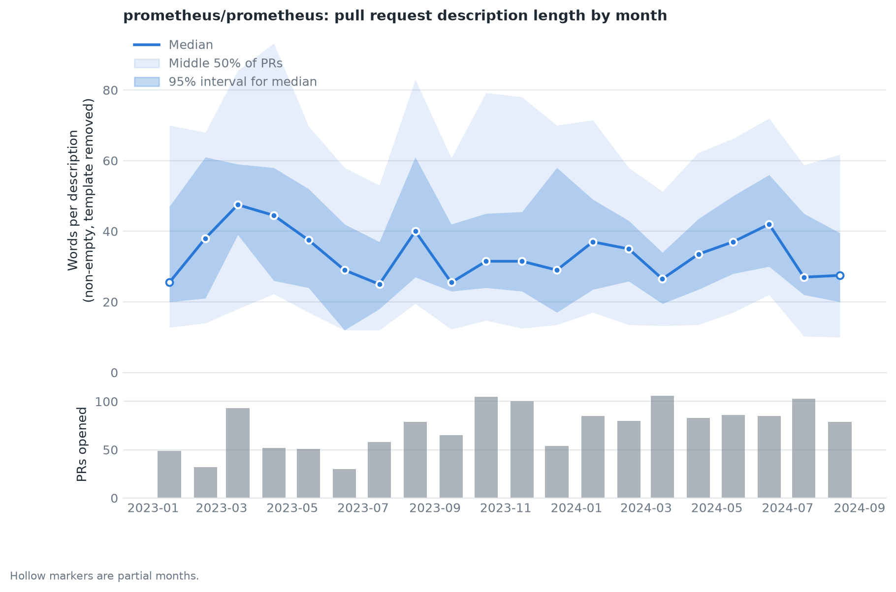
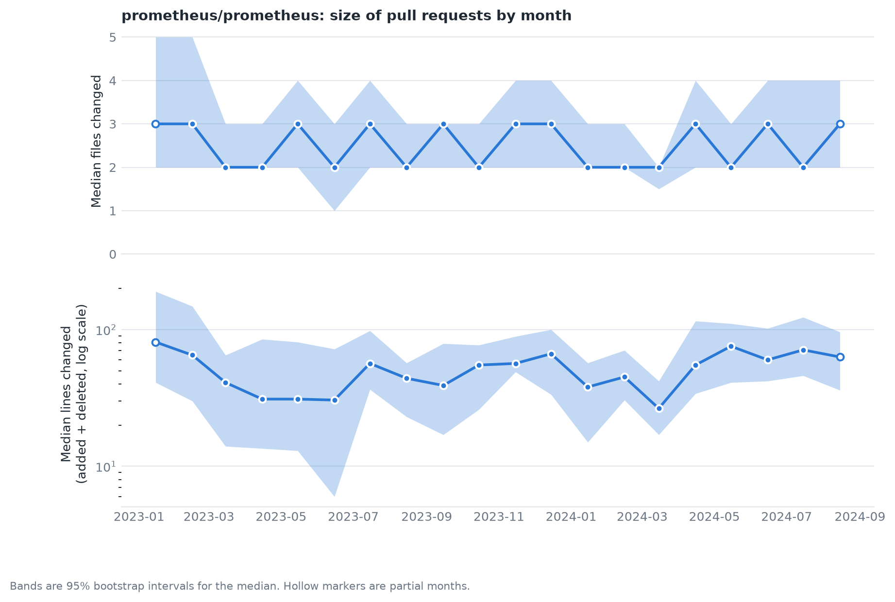
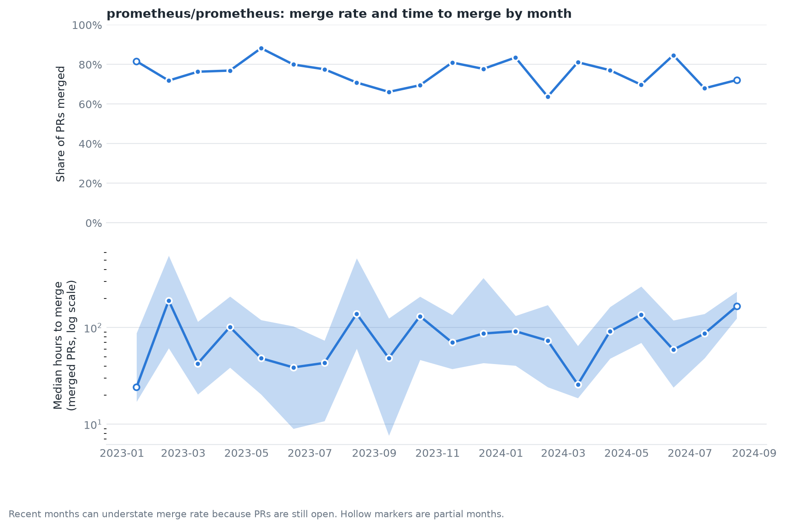
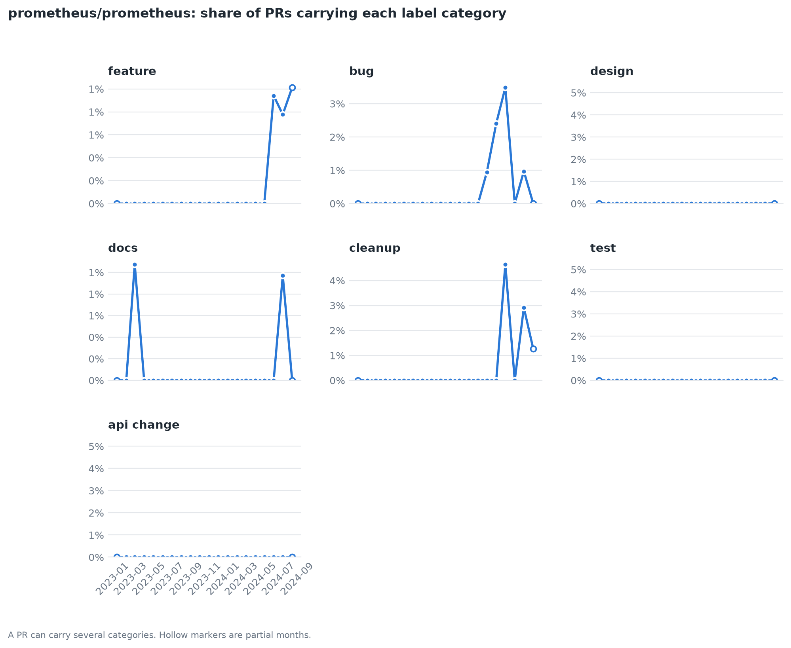
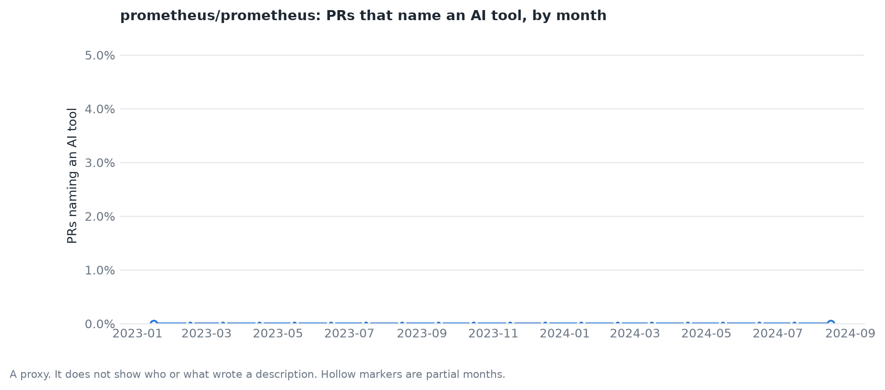

# Pull requests in prometheus/prometheus: description length, size, speed and labels

Window 2023-01-09 to 2024-08-19 (UTC). Data fetched 2026-11-19. prwords 3.0.0, generated 2026-11-26. Method fixed in advance in `docs/ANALYSIS_PLAN.md`.

## 1. Data

- Repository primary language: Go
- Pull requests opened in the window: 1,833
- Removed as bot accounts: 358
- Analysed: 1,475 PRs from 337 authors
- Merged: 1,114 (75.5%). Closed without merging: 353 (23.9%). Still open: 8
- Follow-up: merge outcomes use a 30-day follow-up. PRs without enough follow-up: 0
- Empty descriptions after cleaning: 10.6%

## 2. Did the PR template change?

No template line appeared or disappeared with a share of 50% or more. Template text was detected monthly and removed before counting words.

Distinct template lines detected: 0.

## 3. First 28 days versus last 28 days

First window 2023-01-09 to 2023-02-05. Last window 2024-07-23 to 2024-08-19. Ratios are last median divided by first median. Bootstrap intervals, 2,000 resamples.

| Metric                                |   n first |   n last |   Median first |   Median last |   Ratio |   Ratio low |   Ratio high |     p |   Cliff's delta |
|:--------------------------------------|----------:|---------:|---------------:|--------------:|--------:|------------:|-------------:|------:|----------------:|
| Description words (non-empty)         |        46 |       91 |          26    |         27    |    1.04 |        0.47 |         1.61 | 0.62  |           -0.05 |
| Files changed                         |        51 |      101 |           3    |          3    |    1    |        0.66 |         1.5  | 0.88  |           -0.01 |
| Lines added                           |        51 |      101 |          60    |         46    |    0.77 |        0.3  |         1.78 | 0.58  |           -0.06 |
| Lines deleted                         |        51 |      101 |          14    |         12    |    0.86 |        0.39 |         2.4  | 0.75  |           -0.03 |
| Net lines (added minus deleted)       |        51 |      101 |          13    |         22    |    1.69 |        0.25 |         7.35 | 0.76  |            0.03 |
| Lines changed (added plus deleted)    |        51 |      101 |          81    |         64    |    0.79 |        0.37 |         1.87 | 0.72  |           -0.04 |
| Hours from open to merge (merged PRs) |        42 |       74 |          25.33 |        158.44 |    6.26 |        1.39 |         9.61 | 0.013 |            0.28 |
| Commits                               |        51 |      101 |           2    |          1    |    0.5  |        0.5  |         2    | 0.34  |           -0.09 |
| Comments                              |        51 |      101 |           1    |          1    |    1    |        0    |         1    | 0.43  |           -0.08 |
| Reviews                               |        51 |      101 |           1    |          2    |    2    |        0.5  |         2    | 0.52  |            0.06 |

| Measure                             |   n first |   n last | Share first   | Share last   |   Change (points) |     p |
|:------------------------------------|----------:|---------:|:--------------|:-------------|------------------:|------:|
| Merged within follow-up period      |        51 |      101 | 72.5%         | 59.4%        |             -13.1 | 0.15  |
| Closed without merging              |        51 |      101 | 15.7%         | 24.8%        |               9.1 | 0.22  |
| Opened as draft                     |        51 |      101 | 2.0%          | 10.9%        |               8.9 | 0.061 |
| From outside contributors           |        51 |      101 | 60.8%         | 58.4%        |              -2.4 | 0.86  |
| Has a kind or type label            |        51 |      101 | 0.0%          | 5.9%         |               5.9 | 0.18  |
| Description text repeated elsewhere |        51 |      101 | 0.0%          | 2.0%         |               2   | 0.55  |
| Names an AI tool (disclosure)       |        51 |      101 | 0.0%          | 0.0%         |               0   | 1     |
| Label category: feature             |        51 |      101 | 0.0%          | 1.0%         |               1   | 1     |
| Label category: bug                 |        51 |      101 | 0.0%          | 0.0%         |               0   | 1     |
| Label category: design              |        51 |      101 | 0.0%          | 0.0%         |               0   | 1     |
| Label category: docs                |        51 |      101 | 0.0%          | 0.0%         |               0   | 1     |
| Label category: cleanup             |        51 |      101 | 0.0%          | 1.0%         |               1   | 1     |
| Label category: test                |        51 |      101 | 0.0%          | 0.0%         |               0   | 1     |
| Label category: api_change          |        51 |      101 | 0.0%          | 0.0%         |               0   | 1     |

## 4. Monthly trends

Theil-Sen slope per month and Kendall tau over full months only.

| metric                     |   months |   slope_per_month |   slope_ci_low |   slope_ci_high |     tau |       p |
|:---------------------------|---------:|------------------:|---------------:|----------------:|--------:|--------:|
| median_words               |       18 |            -0.321 |         -1.1   |           0.4   |  -0.172 |   0.324 |
| median_files_changed       |       18 |            -0     |         -0     |          -0     |  -0.072 |   0.722 |
| median_additions           |       18 |             0.889 |         -0.25  |           1.727 |   0.262 |   0.137 |
| median_deletions           |       18 |             0.536 |         -0     |           0.875 |   0.404 |   0.022 |
| median_churn               |       18 |             1.556 |         -0.25  |           2.833 |   0.29  |   0.095 |
| median_hours_to_merge      |       18 |             0.832 |         -4.472 |           4.304 |   0.046 |   0.823 |
| merge_rate                 |       18 |            -0.001 |         -0.009 |           0.006 |  -0.007 |   1     |
| share_outside_contributors |       18 |             0.001 |         -0.006 |           0.009 |   0.111 |   0.55  |
| share_ai_disclosed         |       18 |            -0     |         -0     |          -0     | nan     | nan     |
| median_comments            |       18 |            -0     |         -0     |          -0     |  -0.009 |   0.965 |
| median_reviews             |       18 |            -0     |         -0     |           0.067 |   0.592 |   0.004 |
| share_feature              |       18 |            -0     |         -0     |          -0     |   0.436 |   0.03  |
| share_bug                  |       18 |            -0     |         -0     |          -0     |   0.534 |   0.006 |
| share_design               |       18 |            -0     |         -0     |          -0     | nan     | nan     |
| share_docs                 |       18 |            -0     |         -0     |          -0     |   0.014 |   0.944 |
| share_cleanup              |       18 |            -0     |         -0     |          -0     |   0.408 |   0.042 |
| share_test                 |       18 |            -0     |         -0     |          -0     | nan     | nan     |
| share_api_change           |       18 |            -0     |         -0     |          -0     | nan     | nan     |

## 5. Labels

Share of PRs with a kind or type label: 6.8% overall. Label coverage by month is in `monthly_summary.csv` (`share_has_kind_label`).

| category            |   n_prs |   share |   median_words |   median_files |   median_churn |   merge_rate |   median_hours_to_merge |   share_ai_disclosed |
|:--------------------|--------:|--------:|---------------:|---------------:|---------------:|-------------:|------------------------:|---------------------:|
| feature             |       3 |   0.002 |          164   |           16   |         1014   |        0.667 |                1608.52  |                    0 |
| bug                 |       7 |   0.005 |           39   |            2   |           50   |        0.714 |                 677.426 |                    0 |
| design              |       0 |   0     |          nan   |          nan   |          nan   |      nan     |                 nan     |                  nan |
| docs                |       2 |   0.001 |           17.5 |            2.5 |           17.5 |        1     |                 141.653 |                    0 |
| cleanup             |       8 |   0.005 |           19   |            6   |           54   |        1     |                 114.688 |                    0 |
| test                |       0 |   0     |          nan   |          nan   |          nan   |      nan     |                 nan     |                  nan |
| api_change          |       0 |   0     |          nan   |          nan   |          nan   |      nan     |                 nan     |                  nan |
| (no category label) |    1455 |   0.986 |           33   |            2   |           50   |        0.754 |                  72.972 |                    0 |

## 6. Are PRs with signs of AI involvement smaller or larger?

Authorship is not observable. The proxy is `ai_disclosed`, defined in the analysis plan: 0 PRs (0.00%). 0 disclosed PRs are listed in `ai_disclosure_samples.csv` for manual audit.

### ai_disclosed

**Verdict: not testable.** Too few exposed PRs.

Pattern: lines changed: not estimated; files changed: not estimated; lines added: not estimated; lines deleted: not estimated; hours to merge: not estimated.

Not estimated: fewer than 30 exposed PRs (exposed PRs: 0).

### Robustness by tool (lines changed)

No tool named in any disclosure.

### File type check

Not run. Use `--file-check N` to sample N exposed PRs and matching unexposed PRs.

## 7. Other checks

- Outside contributors: 62.2% of PRs overall.
- Top 10 authors opened 41.3% of PRs.
- PRs whose description text is repeated elsewhere (10 or more words): 2.1%.

## 8. Limitations

- Word count and size describe PRs, not who wrote them. Proxies for AI involvement are noisy and omit undisclosed use.
- Added and deleted lines include generated or vendored files unless the project avoids committing them.
- Disclosure mostly captures tools that add attribution by default, so it is tool-skewed.
- Template removal is heuristic. Check `template_audit.csv`.
- One repository cannot support general claims. See the plan for replication.
- Months at the edges of the window are partial and are excluded from trend tests.

