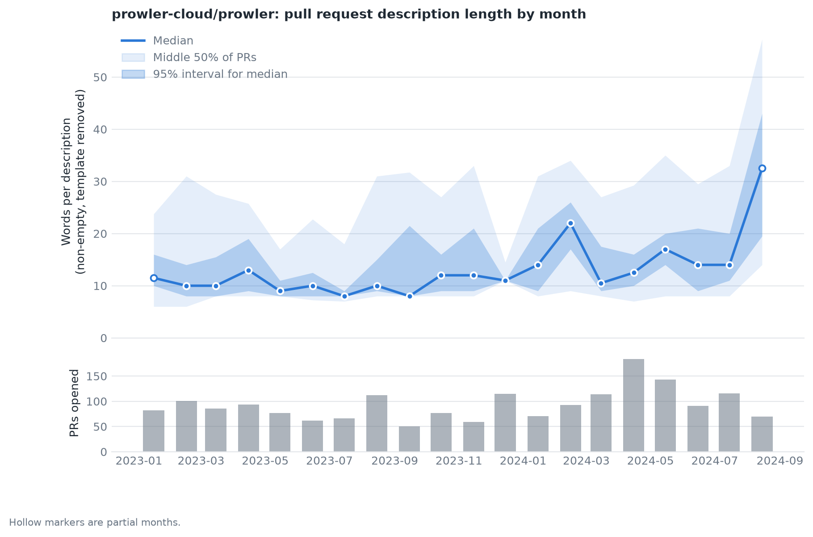
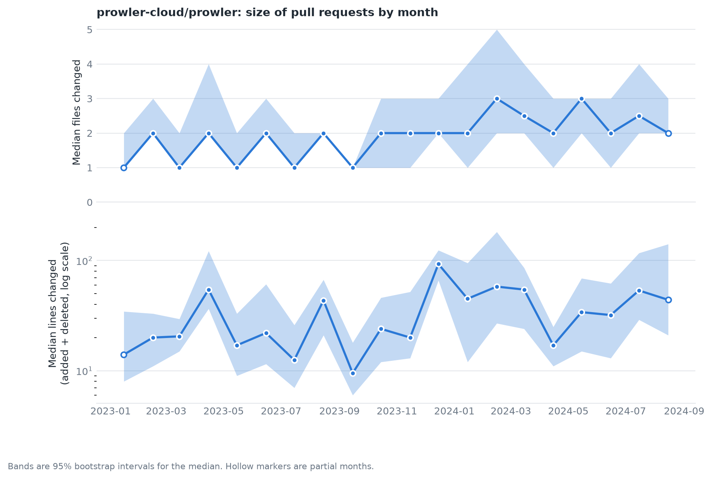
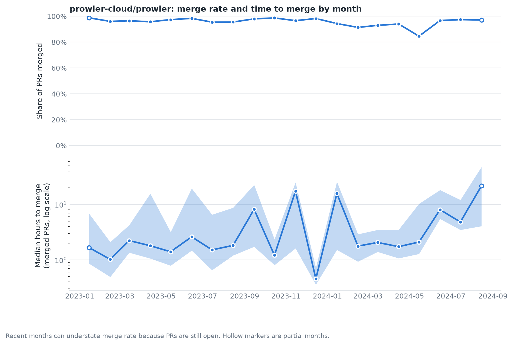
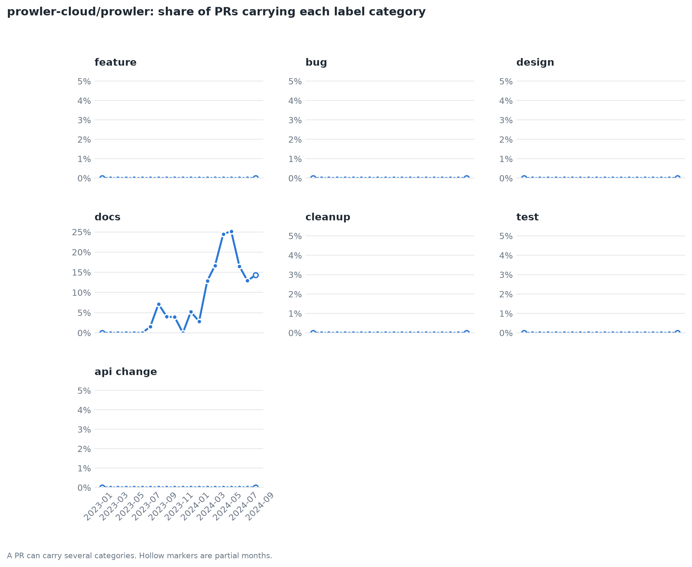
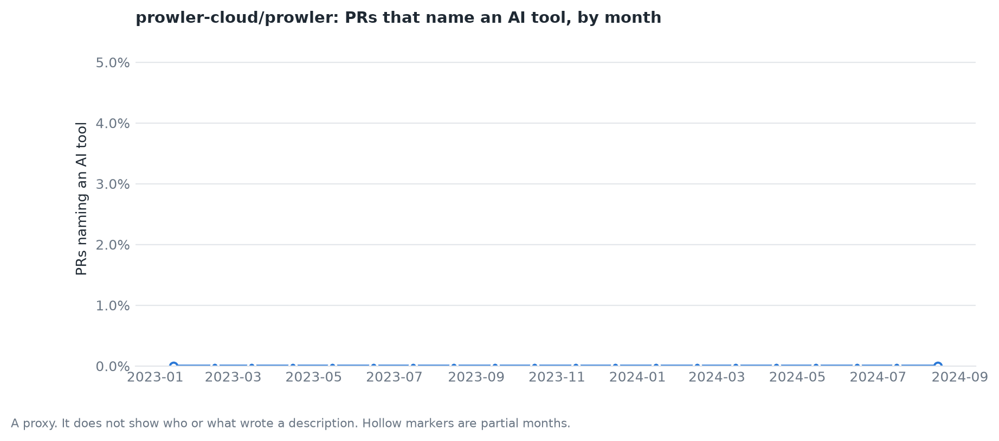

# Pull requests in prowler-cloud/prowler: description length, size, speed and labels

Window 2023-01-09 to 2024-08-19 (UTC). Data fetched 2026-11-20. prwords 3.0.0, generated 2026-11-26. Method fixed in advance in `docs/ANALYSIS_PLAN.md`.

## 1. Data

- Repository primary language: Python
- Pull requests opened in the window: 2,700
- Removed as bot accounts: 837
- Analysed: 1,863 PRs from 88 authors
- Merged: 1,773 (95.2%). Closed without merging: 90 (4.8%). Still open: 0
- Follow-up: merge outcomes use a 30-day follow-up. PRs without enough follow-up: 0
- Empty descriptions after cleaning: 0.0%

## 2. Did the PR template change?

Lines that appeared or disappeared across the window (full list in `template_audit.csv`):

| line                                                                                    | first_month   | last_month   |   months |   peak_share | change_event   |
|:----------------------------------------------------------------------------------------|:--------------|:-------------|---------:|-------------:|:---------------|
| ### context                                                                             | 2023-02       | 2024-08      |       10 |         0.61 | added          |
| ### checklist                                                                           | 2024-08       | 2024-08      |        1 |         0.76 | added          |
| review if code is being documented following this specification                         | 2024-08       | 2024-08      |        1 |         0.76 | added          |
| review if the code is being covered by tests.                                           | 2024-08       | 2024-08      |        1 |         0.76 | added          |
| if so, do we need to update permissions for the provider? please review this carefully. | 2024-08       | 2024-08      |        1 |         0.66 | added          |
| are there new checks included in this pr? yes / no                                      | 2024-08       | 2024-08      |        1 |         0.5  | added          |

Distinct template lines detected: 9.

## 3. First 28 days versus last 28 days

First window 2023-01-09 to 2023-02-05. Last window 2024-07-23 to 2024-08-19. Ratios are last median divided by first median. Bootstrap intervals, 2,000 resamples.

| Metric                                |   n first |   n last |   Median first |   Median last |   Ratio |   Ratio low |   Ratio high |       p |   Cliff's delta |
|:--------------------------------------|----------:|---------:|---------------:|--------------:|--------:|------------:|-------------:|--------:|----------------:|
| Description words (non-empty)         |        96 |      104 |          11    |         32    |    2.91 |        1.9  |         3.67 | 2e-07   |            0.43 |
| Files changed                         |        96 |      104 |           1    |          2    |    2    |        1    |         3.5  | 0.0023  |            0.24 |
| Lines added                           |        96 |      104 |           9    |         32    |    3.56 |        1.05 |        13.13 | 0.00097 |            0.27 |
| Lines deleted                         |        96 |      104 |           4    |          3    |    0.75 |        0.33 |         3.14 | 0.67    |           -0.03 |
| Net lines (added minus deleted)       |        96 |      104 |           1    |         18.5  |   18.5  |        1.63 |        61.79 | 0.0012  |            0.26 |
| Lines changed (added plus deleted)    |        96 |      104 |          14    |         62.5  |    4.46 |        1.19 |        10    | 0.0027  |            0.25 |
| Hours from open to merge (merged PRs) |        95 |      101 |           1.52 |         17.63 |   11.57 |        1.73 |        35.95 | 3e-05   |            0.35 |
| Commits                               |        96 |      104 |           1    |          2.5  |    2.5  |        1    |         3    | 0.0031  |            0.23 |
| Comments                              |        96 |      104 |           0    |          1    |  nan    |      nan    |       nan    | 2.6e-30 |            0.87 |
| Reviews                               |        96 |      104 |           1    |          2    |    2    |        1    |         2    | 4.9e-06 |            0.33 |

| Measure                             |   n first |   n last | Share first   | Share last   |   Change (points) |       p |
|:------------------------------------|----------:|---------:|:--------------|:-------------|------------------:|--------:|
| Merged within follow-up period      |        96 |      104 | 97.9%         | 96.2%        |              -1.8 | 0.68    |
| Closed without merging              |        96 |      104 | 1.0%          | 2.9%         |               1.8 | 0.62    |
| Opened as draft                     |        96 |      104 | 0.0%          | 1.0%         |               1   | 1       |
| From outside contributors           |        96 |      104 | 95.8%         | 71.2%        |             -24.7 | 2.5e-06 |
| Has a kind or type label            |        96 |      104 | 0.0%          | 0.0%         |               0   | 1       |
| Description text repeated elsewhere |        96 |      104 | 4.2%          | 12.5%        |               8.3 | 0.043   |
| Names an AI tool (disclosure)       |        96 |      104 | 0.0%          | 0.0%         |               0   | 1       |
| Label category: feature             |        96 |      104 | 0.0%          | 0.0%         |               0   | 1       |
| Label category: bug                 |        96 |      104 | 0.0%          | 0.0%         |               0   | 1       |
| Label category: design              |        96 |      104 | 0.0%          | 0.0%         |               0   | 1       |
| Label category: docs                |        96 |      104 | 0.0%          | 14.4%        |              14.4 | 4.2e-05 |
| Label category: cleanup             |        96 |      104 | 0.0%          | 0.0%         |               0   | 1       |
| Label category: test                |        96 |      104 | 0.0%          | 0.0%         |               0   | 1       |
| Label category: api_change          |        96 |      104 | 0.0%          | 0.0%         |               0   | 1       |

## 4. Monthly trends

Theil-Sen slope per month and Kendall tau over full months only.

| metric                     |   months |   slope_per_month |   slope_ci_low |   slope_ci_high |     tau |       p |
|:---------------------------|---------:|------------------:|---------------:|----------------:|--------:|--------:|
| median_words               |       18 |             0.308 |          0.071 |           0.571 |   0.488 |   0.006 |
| median_files_changed       |       18 |             0.045 |         -0     |           0.111 |   0.517 |   0.007 |
| median_additions           |       18 |             0.611 |         -0.3   |           1.7   |   0.238 |   0.172 |
| median_deletions           |       18 |            -0     |         -0.2   |           0.25  |   0.007 |   0.969 |
| median_churn               |       18 |             1     |         -0.5   |           3.278 |   0.238 |   0.172 |
| median_hours_to_merge      |       18 |             0.069 |         -0.038 |           0.389 |   0.229 |   0.201 |
| merge_rate                 |       18 |            -0.001 |         -0.004 |           0.001 |  -0.176 |   0.33  |
| share_outside_contributors |       18 |            -0.017 |         -0.026 |          -0     |  -0.399 |   0.025 |
| share_ai_disclosed         |       18 |            -0     |         -0     |          -0     | nan     | nan     |
| median_comments            |       18 |            -0     |         -0     |           0.083 |   0.686 |   0.001 |
| median_reviews             |       18 |            -0     |         -0     |          -0     | nan     | nan     |
| share_feature              |       18 |            -0     |         -0     |          -0     | nan     | nan     |
| share_bug                  |       18 |            -0     |         -0     |          -0     | nan     | nan     |
| share_design               |       18 |            -0     |         -0     |          -0     | nan     | nan     |
| share_docs                 |       18 |             0.01  |          0.006 |           0.017 |   0.688 |   0     |
| share_cleanup              |       18 |            -0     |         -0     |          -0     | nan     | nan     |
| share_test                 |       18 |            -0     |         -0     |          -0     | nan     | nan     |
| share_api_change           |       18 |            -0     |         -0     |          -0     | nan     | nan     |

## 5. Labels

Share of PRs with a kind or type label: 0.0% overall. Label coverage by month is in `monthly_summary.csv` (`share_has_kind_label`).

| category            |   n_prs |   share |   median_words |   median_files |   median_churn |   merge_rate |   median_hours_to_merge |   share_ai_disclosed |
|:--------------------|--------:|--------:|---------------:|---------------:|---------------:|-------------:|------------------------:|---------------------:|
| feature             |       0 |   0     |            nan |            nan |          nan   |      nan     |                 nan     |                  nan |
| bug                 |       0 |   0     |            nan |            nan |          nan   |      nan     |                 nan     |                  nan |
| design              |       0 |   0     |            nan |            nan |          nan   |      nan     |                 nan     |                  nan |
| docs                |     174 |   0.093 |             16 |              3 |           63.5 |        0.931 |                   8.633 |                    0 |
| cleanup             |       0 |   0     |            nan |            nan |          nan   |      nan     |                 nan     |                  nan |
| test                |       0 |   0     |            nan |            nan |          nan   |      nan     |                 nan     |                  nan |
| api_change          |       0 |   0     |            nan |            nan |          nan   |      nan     |                 nan     |                  nan |
| (no category label) |    1689 |   0.907 |             11 |              2 |           29   |        0.954 |                   2.031 |                    0 |

## 6. Are PRs with signs of AI involvement smaller or larger?

Authorship is not observable. The proxy is `ai_disclosed`, defined in the analysis plan: 0 PRs (0.00%). 0 disclosed PRs are listed in `ai_disclosure_samples.csv` for manual audit.

### ai_disclosed

**Verdict: not testable.** Too few exposed PRs.

Pattern: lines changed: not estimated; files changed: not estimated; lines added: not estimated; lines deleted: not estimated; hours to merge: not estimated.

Not estimated: fewer than 30 exposed PRs (exposed PRs: 0).

### Robustness by tool (lines changed)

No tool named in any disclosure.

### File type check

Not run. Use `--file-check N` to sample N exposed PRs and matching unexposed PRs.

## 7. Other checks

- Outside contributors: 86.4% of PRs overall.
- Top 10 authors opened 91.4% of PRs.
- PRs whose description text is repeated elsewhere (10 or more words): 18.5%.

## 8. Limitations

- Word count and size describe PRs, not who wrote them. Proxies for AI involvement are noisy and omit undisclosed use.
- Added and deleted lines include generated or vendored files unless the project avoids committing them.
- Disclosure mostly captures tools that add attribution by default, so it is tool-skewed.
- Template removal is heuristic. Check `template_audit.csv`.
- One repository cannot support general claims. See the plan for replication.
- Months at the edges of the window are partial and are excluded from trend tests.

