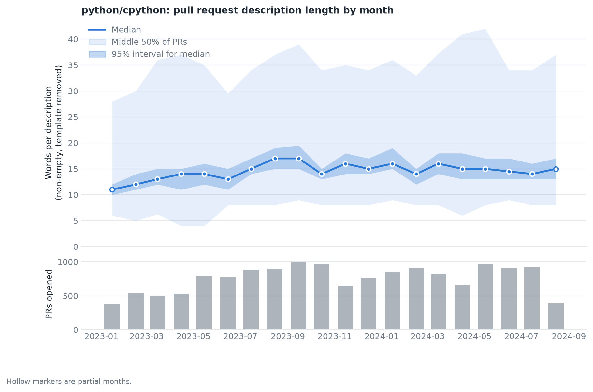
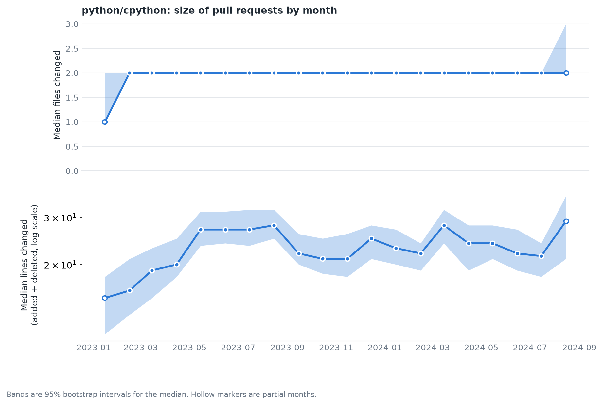
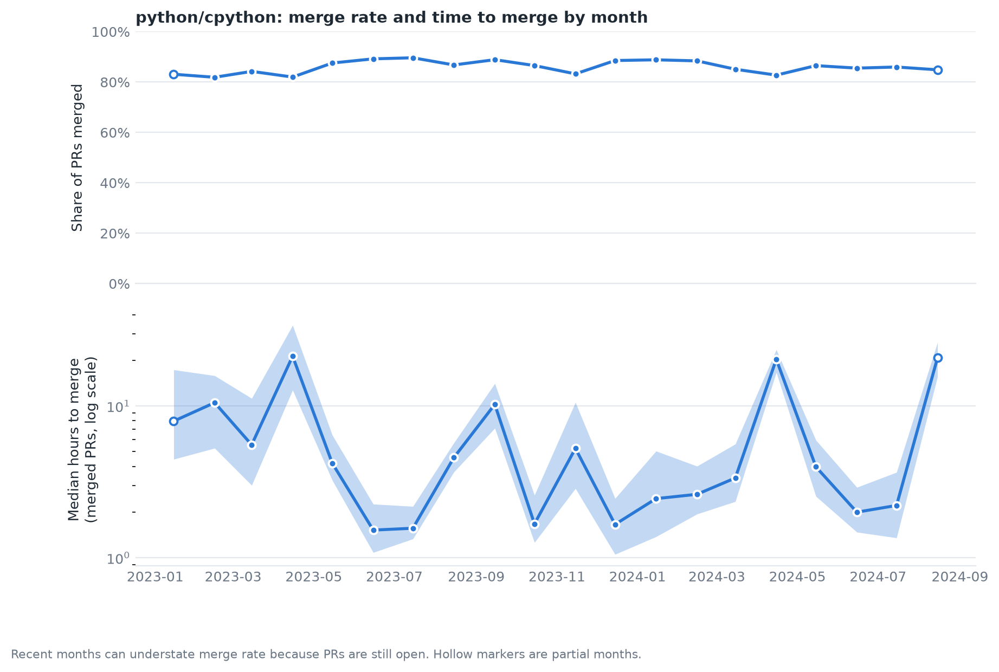
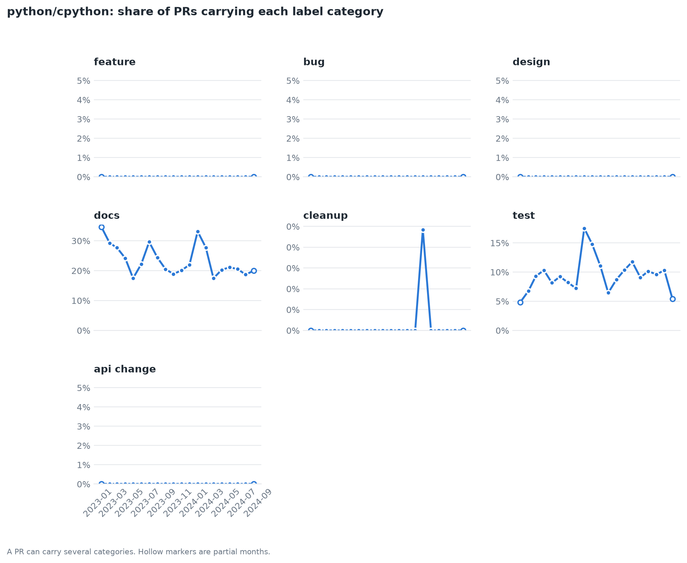
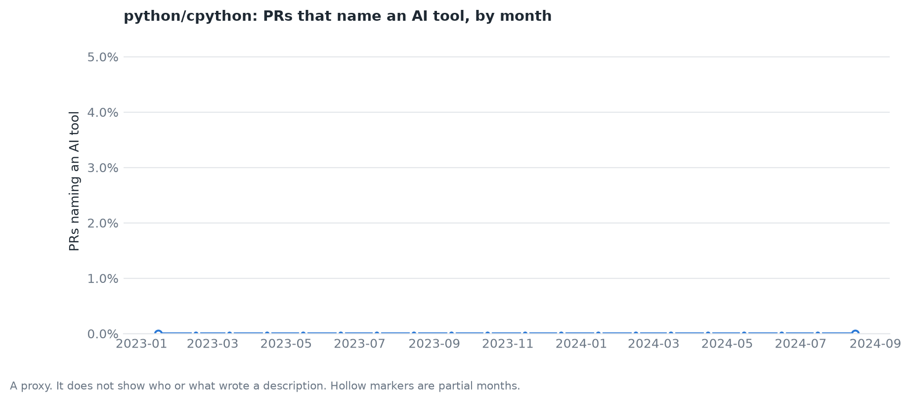

# Pull requests in python/cpython: description length, size, speed and labels

Window 2023-01-09 to 2024-08-19 (UTC). Data fetched 2026-11-20. prwords 3.0.0, generated 2026-11-26. Method fixed in advance in `docs/ANALYSIS_PLAN.md`.

## 1. Data

- Repository primary language: Python
- Pull requests opened in the window: 15,175
- Removed as bot accounts: 46
- Analysed: 15,129 PRs from 1,387 authors
- Merged: 13,074 (86.4%). Closed without merging: 1,849 (12.2%). Still open: 206
- Follow-up: merge outcomes use a 30-day follow-up. PRs without enough follow-up: 0
- Empty descriptions after cleaning: 3.0%

## 2. Did the PR template change?

No template line appeared or disappeared with a share of 50% or more. Template text was detected monthly and removed before counting words.

Distinct template lines detected: 3.

## 3. First 28 days versus last 28 days

First window 2023-01-09 to 2023-02-05. Last window 2024-07-23 to 2024-08-19. Ratios are last median divided by first median. Bootstrap intervals, 2,000 resamples.

| Metric                                |   n first |   n last |   Median first |   Median last |   Ratio |   Ratio low |   Ratio high |       p |   Cliff's delta |
|:--------------------------------------|----------:|---------:|---------------:|--------------:|--------:|------------:|-------------:|--------:|----------------:|
| Description words (non-empty)         |       426 |      648 |          11    |         14    |    1.27 |        1.17 |         1.55 | 0.00049 |            0.13 |
| Files changed                         |       439 |      667 |           2    |          2    |    1    |        1    |         3    | 9.8e-06 |            0.15 |
| Lines added                           |       439 |      667 |          10    |         20    |    2    |        1.45 |         2.8  | 0.00012 |            0.14 |
| Lines deleted                         |       439 |      667 |           3    |          5    |    1.67 |        1    |         2    | 0.017   |            0.08 |
| Net lines (added minus deleted)       |       439 |      667 |           2    |          8    |    4    |        1.67 |         5    | 0.00016 |            0.13 |
| Lines changed (added plus deleted)    |       439 |      667 |          16    |         31    |    1.94 |        1.36 |         2.83 | 0.00011 |            0.14 |
| Hours from open to merge (merged PRs) |       366 |      569 |           6.37 |         11.95 |    1.88 |        0.76 |         3.68 | 0.022   |            0.09 |
| Commits                               |       439 |      667 |           1    |          1    |    1    |        1    |         2    | 0.6     |            0.02 |
| Comments                              |       439 |      667 |           2    |          1    |    0.5  |        0.5  |         2    | 0.18    |           -0.05 |
| Reviews                               |       439 |      667 |           1    |          1    |    1    |        1    |         1    | 0.23    |            0.04 |

| Measure                             |   n first |   n last | Share first   | Share last   |   Change (points) |       p |
|:------------------------------------|----------:|---------:|:--------------|:-------------|------------------:|--------:|
| Merged within follow-up period      |       439 |      667 | 77.2%         | 77.5%        |               0.3 | 0.94    |
| Closed without merging              |       439 |      667 | 15.7%         | 12.6%        |              -3.1 | 0.15    |
| Opened as draft                     |       439 |      667 | 3.2%          | 2.2%         |              -0.9 | 0.34    |
| From outside contributors           |       439 |      667 | 63.6%         | 57.9%        |              -5.7 | 0.06    |
| Has a kind or type label            |       439 |      667 | 7.3%          | 4.5%         |              -2.8 | 0.061   |
| Description text repeated elsewhere |       439 |      667 | 23.9%         | 23.4%        |              -0.5 | 0.88    |
| Names an AI tool (disclosure)       |       439 |      667 | 0.0%          | 0.0%         |               0   | 1       |
| Label category: feature             |       439 |      667 | 0.0%          | 0.0%         |               0   | 1       |
| Label category: bug                 |       439 |      667 | 0.0%          | 0.0%         |               0   | 1       |
| Label category: design              |       439 |      667 | 0.0%          | 0.0%         |               0   | 1       |
| Label category: docs                |       439 |      667 | 35.3%         | 16.9%        |             -18.4 | 6.1e-12 |
| Label category: cleanup             |       439 |      667 | 0.0%          | 0.0%         |               0   | 1       |
| Label category: test                |       439 |      667 | 5.5%          | 7.5%         |               2   | 0.22    |
| Label category: api_change          |       439 |      667 | 0.0%          | 0.0%         |               0   | 1       |

## 4. Monthly trends

Theil-Sen slope per month and Kendall tau over full months only.

| metric                     |   months |   slope_per_month |   slope_ci_low |   slope_ci_high |     tau |       p |
|:---------------------------|---------:|------------------:|---------------:|----------------:|--------:|--------:|
| median_words               |       18 |             0.083 |         -0     |           0.222 |   0.239 |   0.188 |
| median_files_changed       |       18 |            -0     |         -0     |          -0     | nan     | nan     |
| median_additions           |       18 |             0.125 |         -0.143 |           0.3   |   0.194 |   0.28  |
| median_deletions           |       18 |            -0     |         -0.077 |           0.071 |   0.038 |   0.84  |
| median_churn               |       18 |             0.125 |         -0.3   |           0.385 |   0.135 |   0.445 |
| median_hours_to_merge      |       18 |            -0.155 |         -0.533 |           0.124 |  -0.163 |   0.369 |
| merge_rate                 |       18 |            -0     |         -0.002 |           0.003 |  -0.033 |   0.881 |
| share_outside_contributors |       18 |             0.002 |         -0.004 |           0.009 |   0.163 |   0.369 |
| share_ai_disclosed         |       18 |            -0     |         -0     |          -0     | nan     | nan     |
| median_comments            |       18 |            -0     |         -0.071 |          -0     |  -0.27  |   0.17  |
| median_reviews             |       18 |            -0     |         -0     |          -0     |  -0.114 |   0.574 |
| share_feature              |       18 |            -0     |         -0     |          -0     | nan     | nan     |
| share_bug                  |       18 |            -0     |         -0     |          -0     | nan     | nan     |
| share_design               |       18 |            -0     |         -0     |          -0     | nan     | nan     |
| share_docs                 |       18 |            -0.004 |         -0.007 |           0.001 |  -0.281 |   0.112 |
| share_cleanup              |       18 |            -0     |         -0     |          -0     |   0.176 |   0.386 |
| share_test                 |       18 |             0.001 |         -0.001 |           0.003 |   0.19  |   0.293 |
| share_api_change           |       18 |            -0     |         -0     |          -0     | nan     | nan     |

## 5. Labels

Share of PRs with a kind or type label: 4.4% overall. Label coverage by month is in `monthly_summary.csv` (`share_has_kind_label`).

| category            |   n_prs |   share |   median_words |   median_files |   median_churn |   merge_rate |   median_hours_to_merge |   share_ai_disclosed |
|:--------------------|--------:|--------:|---------------:|---------------:|---------------:|-------------:|------------------------:|---------------------:|
| feature             |       0 |   0     |            nan |            nan |            nan |      nan     |                 nan     |                  nan |
| bug                 |       0 |   0     |            nan |            nan |            nan |      nan     |                 nan     |                  nan |
| design              |       0 |   0     |            nan |            nan |            nan |      nan     |                 nan     |                  nan |
| docs                |    3492 |   0.231 |             12 |              1 |              9 |        0.919 |                   1.078 |                    0 |
| cleanup             |       1 |   0     |              2 |              1 |              5 |        0     |                 nan     |                    0 |
| test                |    1498 |   0.099 |             14 |              1 |             13 |        0.935 |                   2.054 |                    0 |
| api_change          |       0 |   0     |            nan |            nan |            nan |      nan     |                 nan     |                  nan |
| (no category label) |   10150 |   0.671 |             16 |              3 |             35 |        0.835 |                   7.582 |                    0 |

## 6. Are PRs with signs of AI involvement smaller or larger?

Authorship is not observable. The proxy is `ai_disclosed`, defined in the analysis plan: 0 PRs (0.00%). 0 disclosed PRs are listed in `ai_disclosure_samples.csv` for manual audit.

### ai_disclosed

**Verdict: not testable.** Too few exposed PRs.

Pattern: lines changed: not estimated; files changed: not estimated; lines added: not estimated; lines deleted: not estimated; hours to merge: not estimated.

Not estimated: fewer than 30 exposed PRs (exposed PRs: 0).

### Robustness by tool (lines changed)

No tool named in any disclosure.

### File type check

Not run. Use `--file-check N` to sample N exposed PRs and matching unexposed PRs.

## 7. Other checks

- Outside contributors: 58.0% of PRs overall.
- Top 10 authors opened 56.1% of PRs.
- PRs whose description text is repeated elsewhere (10 or more words): 21.0%.

## 8. Limitations

- Word count and size describe PRs, not who wrote them. Proxies for AI involvement are noisy and omit undisclosed use.
- Added and deleted lines include generated or vendored files unless the project avoids committing them.
- Disclosure mostly captures tools that add attribution by default, so it is tool-skewed.
- Template removal is heuristic. Check `template_audit.csv`.
- One repository cannot support general claims. See the plan for replication.
- Months at the edges of the window are partial and are excluded from trend tests.

