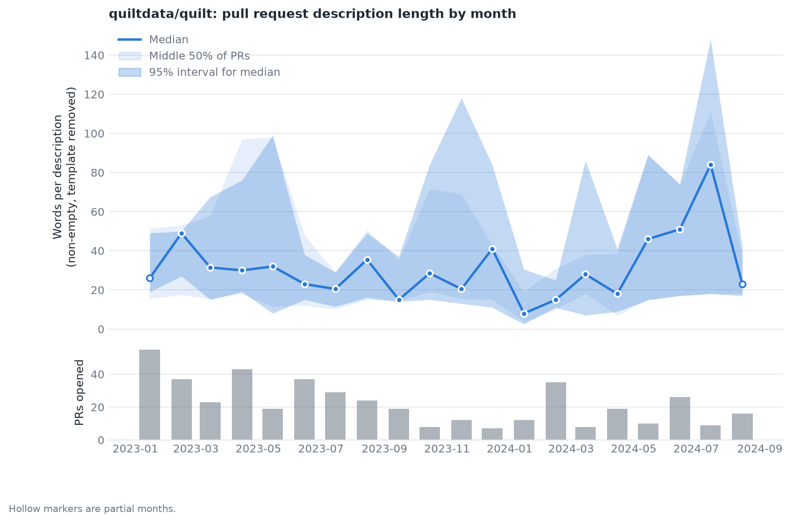
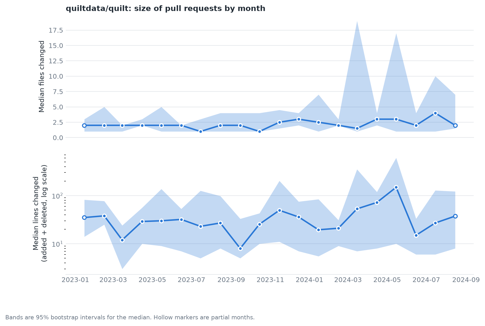
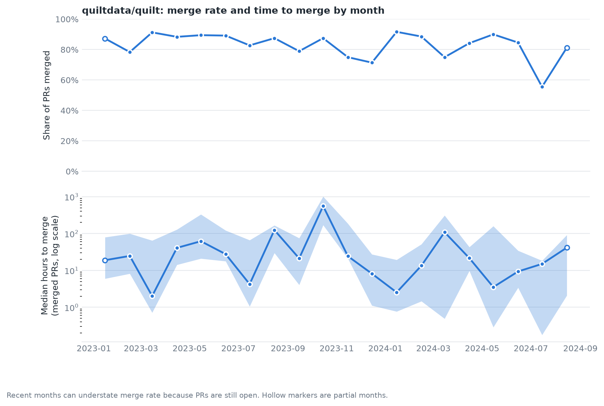
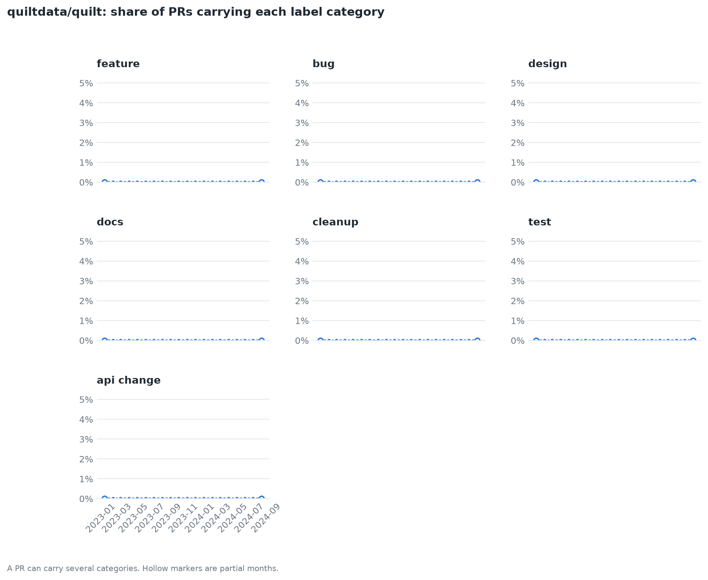
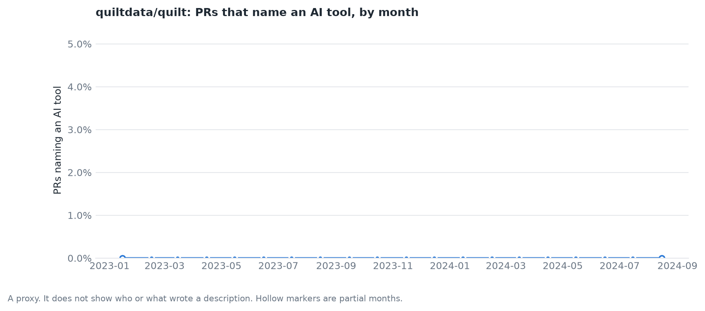

# Pull requests in quiltdata/quilt: description length, size, speed and labels

Window 2023-01-09 to 2024-08-19 (UTC). Data fetched 2026-11-20. prwords 3.0.0, generated 2026-11-26. Method fixed in advance in `docs/ANALYSIS_PLAN.md`.

## 1. Data

- Repository primary language: TypeScript
- Pull requests opened in the window: 849
- Removed as bot accounts: 401
- Analysed: 448 PRs from 9 authors
- Merged: 380 (84.8%). Closed without merging: 68 (15.2%). Still open: 0
- Follow-up: merge outcomes use a 30-day follow-up. PRs without enough follow-up: 0
- Empty descriptions after cleaning: 34.6%

## 2. Did the PR template change?

No template line appeared or disappeared with a share of 50% or more. Template text was detected monthly and removed before counting words.

Distinct template lines detected: 0.

## 3. First 28 days versus last 28 days

First window 2023-01-09 to 2023-02-05. Last window 2024-07-23 to 2024-08-19. Ratios are last median divided by first median. Bootstrap intervals, 2,000 resamples.

| Metric                                |   n first |   n last |   Median first |   Median last |   Ratio |   Ratio low |   Ratio high |    p |   Cliff's delta |
|:--------------------------------------|----------:|---------:|---------------:|--------------:|--------:|------------:|-------------:|-----:|----------------:|
| Description words (non-empty)         |        46 |       13 |          28.5  |         23    |    0.81 |        0.42 |         1.65 | 0.85 |           -0.04 |
| Files changed                         |        66 |       20 |           2    |          2.5  |    1.25 |        0.67 |         3.01 | 0.6  |            0.08 |
| Lines added                           |        66 |       20 |          28.5  |         25    |    0.88 |        0.19 |         3.81 | 0.92 |           -0.02 |
| Lines deleted                         |        66 |       20 |           6    |          2    |    0.33 |        0.1  |         2.33 | 0.25 |           -0.17 |
| Net lines (added minus deleted)       |        66 |       20 |           6.5  |         16.5  |    2.54 |        0.16 |        19.33 | 0.21 |            0.18 |
| Lines changed (added plus deleted)    |        66 |       20 |          37.5  |         32    |    0.85 |        0.19 |         2.52 | 0.72 |           -0.05 |
| Hours from open to merge (merged PRs) |        55 |       16 |          19.49 |         29.35 |    1.51 |        0.1  |         8.69 | 0.91 |           -0.02 |
| Commits                               |        66 |       20 |           5    |          3    |    0.6  |        0.36 |         1.33 | 0.25 |           -0.17 |
| Comments                              |        66 |       20 |           1    |          1.5  |    1.5  |        1    |         2    | 0.12 |            0.2  |
| Reviews                               |        66 |       20 |           1    |          1.5  |    1.5  |        0.5  |         3    | 0.98 |           -0    |

| Measure                             |   n first |   n last | Share first   | Share last   |   Change (points) |      p |
|:------------------------------------|----------:|---------:|:--------------|:-------------|------------------:|-------:|
| Merged within follow-up period      |        66 |       20 | 80.3%         | 75.0%        |              -5.3 | 0.75   |
| Closed without merging              |        66 |       20 | 16.7%         | 20.0%        |               3.3 | 0.74   |
| Opened as draft                     |        66 |       20 | 4.5%          | 15.0%        |              10.5 | 0.14   |
| From outside contributors           |        66 |       20 | 27.3%         | 0.0%         |             -27.3 | 0.0094 |
| Has a kind or type label            |        66 |       20 | 0.0%          | 0.0%         |               0   | 1      |
| Description text repeated elsewhere |        66 |       20 | 19.7%         | 20.0%        |               0.3 | 1      |
| Names an AI tool (disclosure)       |        66 |       20 | 0.0%          | 0.0%         |               0   | 1      |
| Label category: feature             |        66 |       20 | 0.0%          | 0.0%         |               0   | 1      |
| Label category: bug                 |        66 |       20 | 0.0%          | 0.0%         |               0   | 1      |
| Label category: design              |        66 |       20 | 0.0%          | 0.0%         |               0   | 1      |
| Label category: docs                |        66 |       20 | 0.0%          | 0.0%         |               0   | 1      |
| Label category: cleanup             |        66 |       20 | 0.0%          | 0.0%         |               0   | 1      |
| Label category: test                |        66 |       20 | 0.0%          | 0.0%         |               0   | 1      |
| Label category: api_change          |        66 |       20 | 0.0%          | 0.0%         |               0   | 1      |

## 4. Monthly trends

Theil-Sen slope per month and Kendall tau over full months only.

| metric                     |   months |   slope_per_month |   slope_ci_low |   slope_ci_high |     tau |       p |
|:---------------------------|---------:|------------------:|---------------:|----------------:|--------:|--------:|
| median_words               |       18 |             0.125 |         -1.5   |           2.059 |   0.02  |   0.909 |
| median_files_changed       |       18 |             0.056 |         -0     |           0.111 |   0.367 |   0.05  |
| median_additions           |       18 |             0.5   |         -0.792 |           2.833 |   0.105 |   0.544 |
| median_deletions           |       18 |             0.25  |         -0     |           0.556 |   0.374 |   0.035 |
| median_churn               |       18 |             0.857 |         -1     |           3.25  |   0.118 |   0.495 |
| median_hours_to_merge      |       18 |            -0.936 |         -3.351 |           0.978 |  -0.15  |   0.41  |
| merge_rate                 |       18 |            -0.004 |         -0.019 |           0.002 |  -0.217 |   0.211 |
| share_outside_contributors |       18 |            -0.01  |         -0.023 |          -0     |  -0.394 |   0.028 |
| share_ai_disclosed         |       18 |            -0     |         -0     |          -0     | nan     | nan     |
| median_comments            |       18 |            -0     |         -0     |          -0     |  -0.01  |   0.958 |
| median_reviews             |       18 |            -0     |         -0     |          -0     |  -0.059 |   0.759 |
| share_feature              |       18 |            -0     |         -0     |          -0     | nan     | nan     |
| share_bug                  |       18 |            -0     |         -0     |          -0     | nan     | nan     |
| share_design               |       18 |            -0     |         -0     |          -0     | nan     | nan     |
| share_docs                 |       18 |            -0     |         -0     |          -0     | nan     | nan     |
| share_cleanup              |       18 |            -0     |         -0     |          -0     | nan     | nan     |
| share_test                 |       18 |            -0     |         -0     |          -0     | nan     | nan     |
| share_api_change           |       18 |            -0     |         -0     |          -0     | nan     | nan     |

## 5. Labels

Share of PRs with a kind or type label: 0.0% overall. Label coverage by month is in `monthly_summary.csv` (`share_has_kind_label`).

| category            |   n_prs |   share |   median_words |   median_files |   median_churn |   merge_rate |   median_hours_to_merge |   share_ai_disclosed |
|:--------------------|--------:|--------:|---------------:|---------------:|---------------:|-------------:|------------------------:|---------------------:|
| feature             |       0 |       0 |            nan |            nan |          nan   |      nan     |                 nan     |                  nan |
| bug                 |       0 |       0 |            nan |            nan |          nan   |      nan     |                 nan     |                  nan |
| design              |       0 |       0 |            nan |            nan |          nan   |      nan     |                 nan     |                  nan |
| docs                |       0 |       0 |            nan |            nan |          nan   |      nan     |                 nan     |                  nan |
| cleanup             |       0 |       0 |            nan |            nan |          nan   |      nan     |                 nan     |                  nan |
| test                |       0 |       0 |            nan |            nan |          nan   |      nan     |                 nan     |                  nan |
| api_change          |       0 |       0 |            nan |            nan |          nan   |      nan     |                 nan     |                  nan |
| (no category label) |     448 |       1 |             26 |              2 |           26.5 |        0.848 |                  21.718 |                    0 |

## 6. Are PRs with signs of AI involvement smaller or larger?

Authorship is not observable. The proxy is `ai_disclosed`, defined in the analysis plan: 0 PRs (0.00%). 0 disclosed PRs are listed in `ai_disclosure_samples.csv` for manual audit.

### ai_disclosed

**Verdict: not testable.** Too few exposed PRs.

Pattern: lines changed: not estimated; files changed: not estimated; lines added: not estimated; lines deleted: not estimated; hours to merge: not estimated.

Not estimated: fewer than 30 exposed PRs (exposed PRs: 0).

### Robustness by tool (lines changed)

No tool named in any disclosure.

### File type check

Not run. Use `--file-check N` to sample N exposed PRs and matching unexposed PRs.

## 7. Other checks

- Outside contributors: 14.5% of PRs overall.
- Top 10 authors opened 100.0% of PRs.
- PRs whose description text is repeated elsewhere (10 or more words): 15.0%.

## 8. Limitations

- Word count and size describe PRs, not who wrote them. Proxies for AI involvement are noisy and omit undisclosed use.
- Added and deleted lines include generated or vendored files unless the project avoids committing them.
- Disclosure mostly captures tools that add attribution by default, so it is tool-skewed.
- Template removal is heuristic. Check `template_audit.csv`.
- One repository cannot support general claims. See the plan for replication.
- Months at the edges of the window are partial and are excluded from trend tests.

