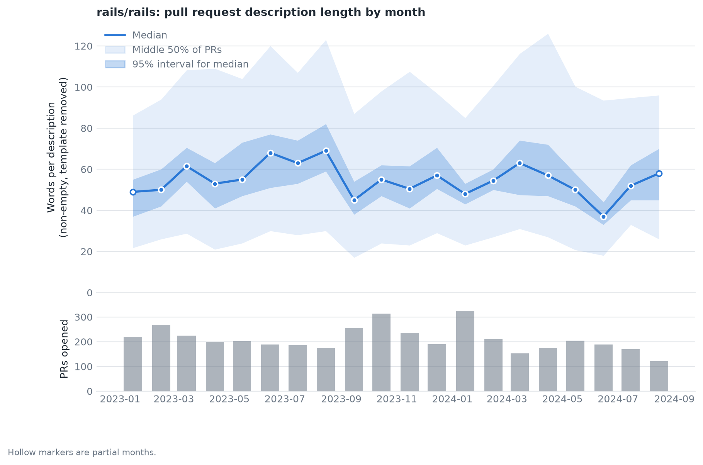
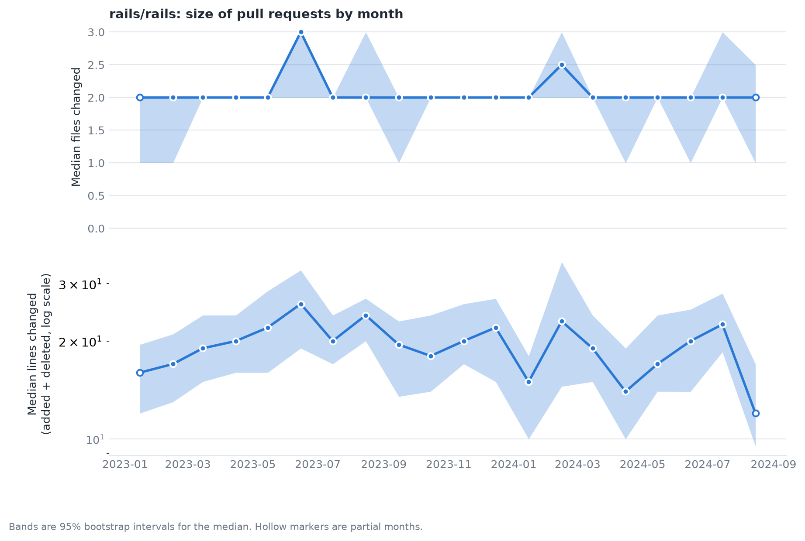
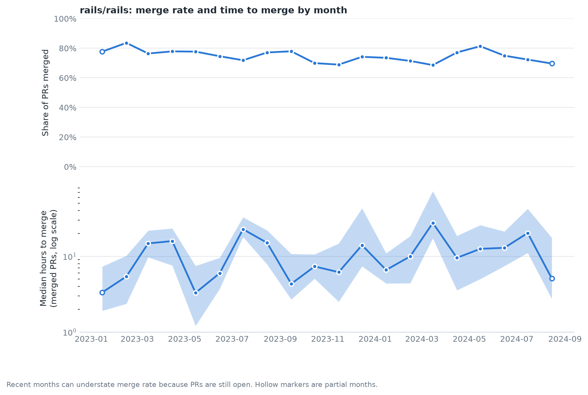
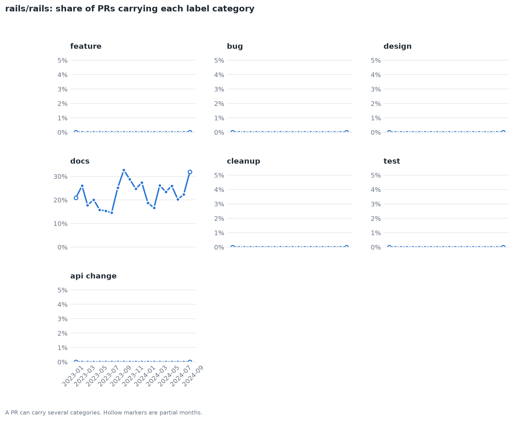
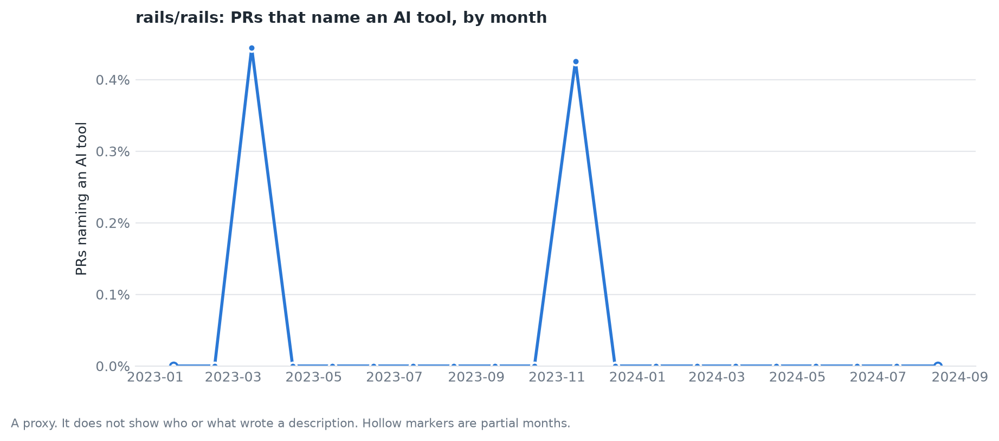

# Pull requests in rails/rails: description length, size, speed and labels

Window 2023-01-09 to 2024-08-19 (UTC). Data fetched 2026-11-19. prwords 3.0.0, generated 2026-11-26. Method fixed in advance in `docs/ANALYSIS_PLAN.md`.

## 1. Data

- Repository primary language: Ruby
- Pull requests opened in the window: 4,203
- Removed as bot accounts: 0
- Analysed: 4,203 PRs from 904 authors
- Merged: 3,153 (75.0%). Closed without merging: 782 (18.6%). Still open: 268
- Follow-up: merge outcomes use a 30-day follow-up. PRs without enough follow-up: 0
- Empty descriptions after cleaning: 2.1%

## 2. Did the PR template change?

Lines that appeared or disappeared across the window (full list in `template_audit.csv`):

| line                                                                                                     | first_month   | last_month   |   months |   peak_share | change_event   |
|:---------------------------------------------------------------------------------------------------------|:--------------|:-------------|---------:|-------------:|:---------------|
| this pull request is related to one change. changes that are unrelated should be opened in separate prs. | 2023-01       | 2024-03      |       15 |         0.66 | removed        |
| this pull request is related to one change. unrelated changes should be opened in separate prs.          | 2024-03       | 2024-08      |        6 |         0.59 | added          |

Distinct template lines detected: 10.

## 3. First 28 days versus last 28 days

First window 2023-01-09 to 2023-02-05. Last window 2024-07-23 to 2024-08-19. Ratios are last median divided by first median. Bootstrap intervals, 2,000 resamples.

| Metric                                |   n first |   n last |   Median first |   Median last |   Ratio |   Ratio low |   Ratio high |      p |   Cliff's delta |
|:--------------------------------------|----------:|---------:|---------------:|--------------:|--------:|------------:|-------------:|-------:|----------------:|
| Description words (non-empty)         |       254 |      177 |          47    |         58    |    1.23 |        0.92 |         1.61 | 0.094  |            0.09 |
| Files changed                         |       261 |      182 |           2    |          2    |    1    |        1    |         2    | 0.26   |            0.06 |
| Lines added                           |       261 |      182 |          11    |          8    |    0.73 |        0.57 |         1.38 | 0.72   |           -0.02 |
| Lines deleted                         |       261 |      182 |           2    |          3    |    1.5  |        0.67 |         2    | 0.21   |            0.07 |
| Net lines (added minus deleted)       |       261 |      182 |           4    |          3    |    0.75 |        0.33 |         2    | 0.23   |           -0.07 |
| Lines changed (added plus deleted)    |       261 |      182 |          16    |         14.5  |    0.91 |        0.68 |         1.45 | 0.95   |            0    |
| Hours from open to merge (merged PRs) |       207 |      136 |           4.65 |          6.64 |    1.43 |        0.48 |         4.52 | 0.35   |            0.06 |
| Commits                               |       261 |      182 |           1    |          1    |    1    |        1    |         1    | 0.4    |            0.03 |
| Comments                              |       261 |      182 |           1    |          1    |    1    |        1    |         1    | 0.4    |            0.04 |
| Reviews                               |       261 |      182 |           0    |          0    |  nan    |      nan    |       nan    | 0.0023 |            0.15 |

| Measure                             |   n first |   n last | Share first   | Share last   |   Change (points) |       p |
|:------------------------------------|----------:|---------:|:--------------|:-------------|------------------:|--------:|
| Merged within follow-up period      |       261 |      182 | 76.6%         | 74.2%        |              -2.5 | 0.58    |
| Closed without merging              |       261 |      182 | 14.9%         | 20.9%        |               5.9 | 0.13    |
| Opened as draft                     |       261 |      182 | 0.8%          | 1.1%         |               0.3 | 1       |
| From outside contributors           |       261 |      182 | 44.1%         | 64.3%        |              20.2 | 3.1e-05 |
| Has a kind or type label            |       261 |      182 | 0.0%          | 0.0%         |               0   | 1       |
| Description text repeated elsewhere |       261 |      182 | 0.8%          | 2.2%         |               1.4 | 0.23    |
| Names an AI tool (disclosure)       |       261 |      182 | 0.0%          | 0.0%         |               0   | 1       |
| Label category: feature             |       261 |      182 | 0.0%          | 0.0%         |               0   | 1       |
| Label category: bug                 |       261 |      182 | 0.0%          | 0.0%         |               0   | 1       |
| Label category: design              |       261 |      182 | 0.0%          | 0.0%         |               0   | 1       |
| Label category: docs                |       261 |      182 | 22.6%         | 26.9%        |               4.3 | 0.31    |
| Label category: cleanup             |       261 |      182 | 0.0%          | 0.0%         |               0   | 1       |
| Label category: test                |       261 |      182 | 0.0%          | 0.0%         |               0   | 1       |
| Label category: api_change          |       261 |      182 | 0.0%          | 0.0%         |               0   | 1       |

## 4. Monthly trends

Theil-Sen slope per month and Kendall tau over full months only.

| metric                     |   months |   slope_per_month |   slope_ci_low |   slope_ci_high |     tau |       p |
|:---------------------------|---------:|------------------:|---------------:|----------------:|--------:|--------:|
| median_words               |       18 |            -0.5   |         -1.35  |           0.375 |  -0.179 |   0.305 |
| median_files_changed       |       18 |            -0     |         -0     |          -0     |  -0.042 |   0.834 |
| median_additions           |       18 |            -0     |         -0.423 |           0.25  |  -0.04  |   0.819 |
| median_deletions           |       18 |            -0     |         -0     |           0.062 |   0.165 |   0.398 |
| median_churn               |       18 |            -0     |         -0.385 |           0.25  |  -0.054 |   0.76  |
| median_hours_to_merge      |       18 |             0.471 |         -0.211 |           0.966 |   0.242 |   0.175 |
| merge_rate                 |       18 |            -0.003 |         -0.007 |           0.001 |  -0.275 |   0.111 |
| share_outside_contributors |       18 |             0.008 |          0.001 |           0.014 |   0.425 |   0.014 |
| share_ai_disclosed         |       18 |            -0     |         -0     |          -0     |  -0.211 |   0.293 |
| median_comments            |       18 |            -0     |         -0     |          -0     |   0.098 |   0.63  |
| median_reviews             |       18 |            -0     |         -0     |          -0     |   0.059 |   0.772 |
| share_feature              |       18 |            -0     |         -0     |          -0     | nan     | nan     |
| share_bug                  |       18 |            -0     |         -0     |          -0     | nan     | nan     |
| share_design               |       18 |            -0     |         -0     |          -0     | nan     | nan     |
| share_docs                 |       18 |             0.001 |         -0.005 |           0.007 |   0.072 |   0.709 |
| share_cleanup              |       18 |            -0     |         -0     |          -0     | nan     | nan     |
| share_test                 |       18 |            -0     |         -0     |          -0     | nan     | nan     |
| share_api_change           |       18 |            -0     |         -0     |          -0     | nan     | nan     |

## 5. Labels

Share of PRs with a kind or type label: 0.0% overall. Label coverage by month is in `monthly_summary.csv` (`share_has_kind_label`).

| category            |   n_prs |   share |   median_words |   median_files |   median_churn |   merge_rate |   median_hours_to_merge |   share_ai_disclosed |
|:--------------------|--------:|--------:|---------------:|---------------:|---------------:|-------------:|------------------------:|---------------------:|
| feature             |       0 |   0     |            nan |            nan |            nan |      nan     |                 nan     |              nan     |
| bug                 |       0 |   0     |            nan |            nan |            nan |      nan     |                 nan     |              nan     |
| design              |       0 |   0     |            nan |            nan |            nan |      nan     |                 nan     |              nan     |
| docs                |     956 |   0.227 |             46 |              1 |             16 |        0.775 |                   6.925 |                0     |
| cleanup             |       0 |   0     |            nan |            nan |            nan |      nan     |                 nan     |              nan     |
| test                |       0 |   0     |            nan |            nan |            nan |      nan     |                 nan     |              nan     |
| api_change          |       0 |   0     |            nan |            nan |            nan |      nan     |                 nan     |              nan     |
| (no category label) |    3247 |   0.773 |             56 |              2 |             19 |        0.743 |                   9.835 |                0.001 |

## 6. Are PRs with signs of AI involvement smaller or larger?

Authorship is not observable. The proxy is `ai_disclosed`, defined in the analysis plan: 2 PRs (0.05%). 2 disclosed PRs are listed in `ai_disclosure_samples.csv` for manual audit.

### ai_disclosed

**Verdict: not testable.** Too few exposed PRs.

Pattern: lines changed: not estimated; files changed: not estimated; lines added: not estimated; lines deleted: not estimated; hours to merge: not estimated.

Not estimated: fewer than 30 exposed PRs (exposed PRs: 2).

### Robustness by tool (lines changed)

| tool    |   n exposed | status                    |
|:--------|------------:|:--------------------------|
| chatgpt |           2 | fewer than 30 exposed PRs |

### File type check

Not run. Use `--file-check N` to sample N exposed PRs and matching unexposed PRs.

## 7. Other checks

- Outside contributors: 58.9% of PRs overall.
- Top 10 authors opened 38.4% of PRs.
- PRs whose description text is repeated elsewhere (10 or more words): 2.4%.

## 8. Limitations

- Word count and size describe PRs, not who wrote them. Proxies for AI involvement are noisy and omit undisclosed use.
- Added and deleted lines include generated or vendored files unless the project avoids committing them.
- Disclosure mostly captures tools that add attribution by default, so it is tool-skewed.
- Template removal is heuristic. Check `template_audit.csv`.
- One repository cannot support general claims. See the plan for replication.
- Months at the edges of the window are partial and are excluded from trend tests.

