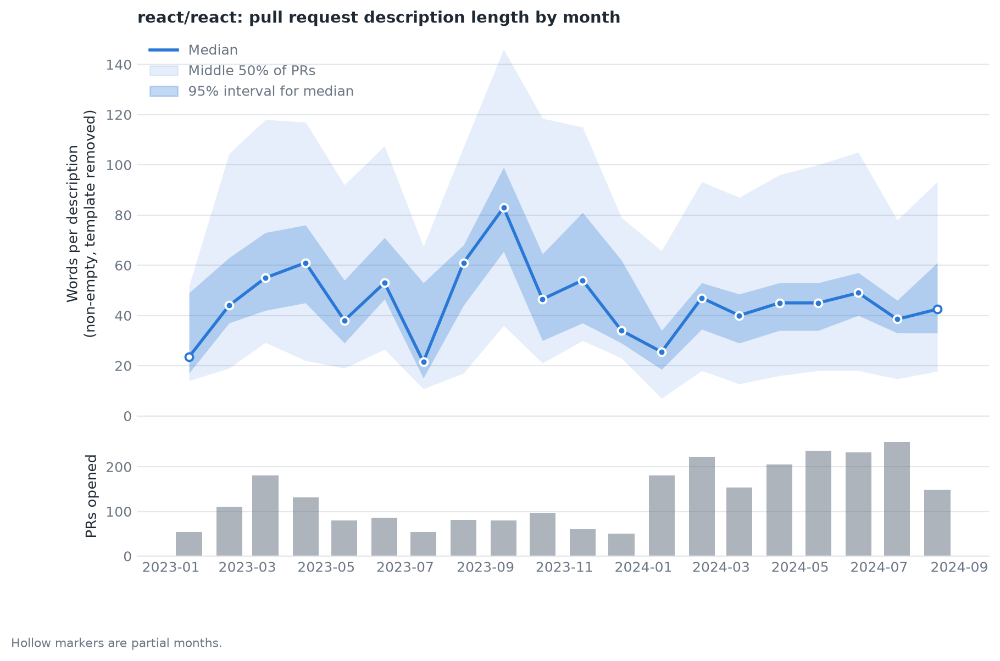
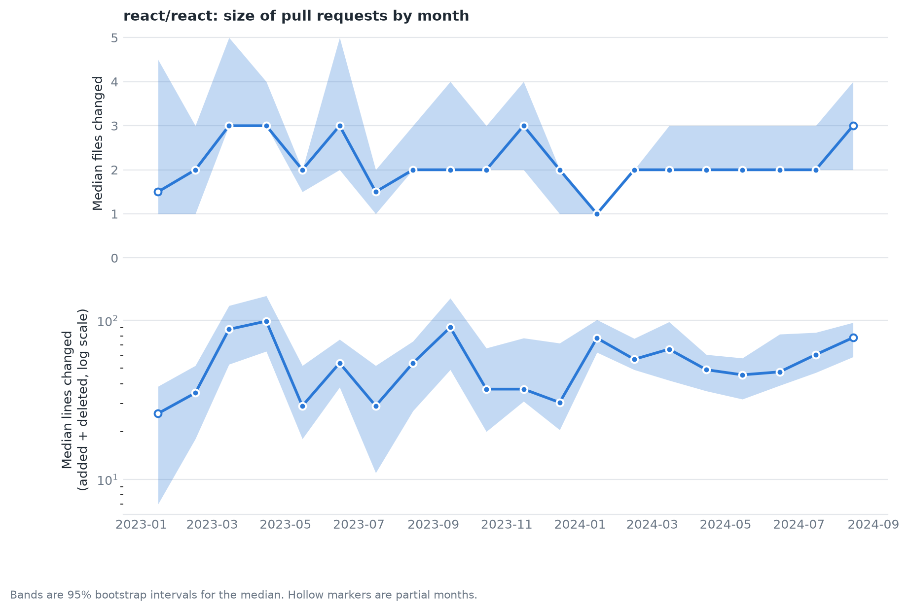
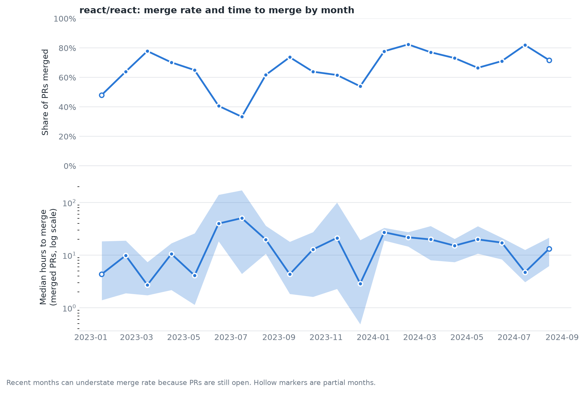
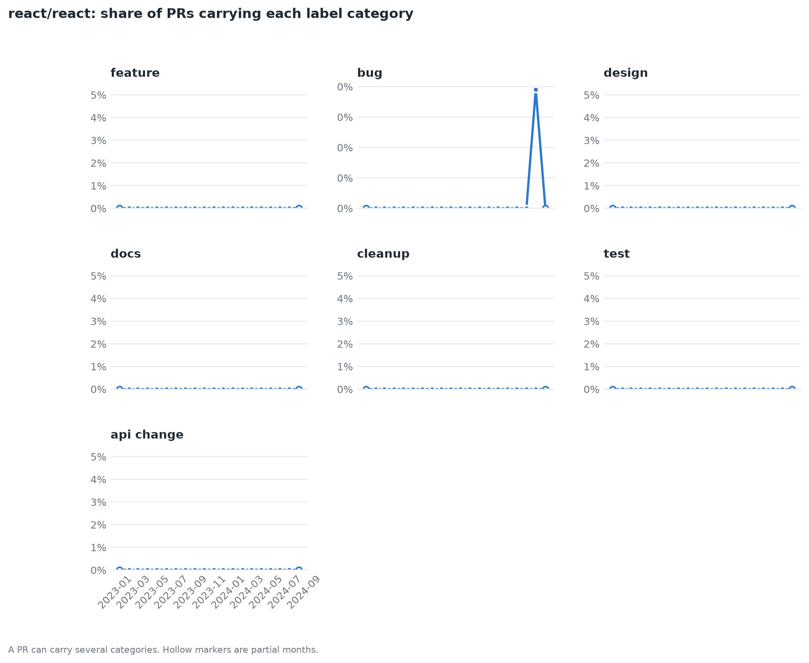
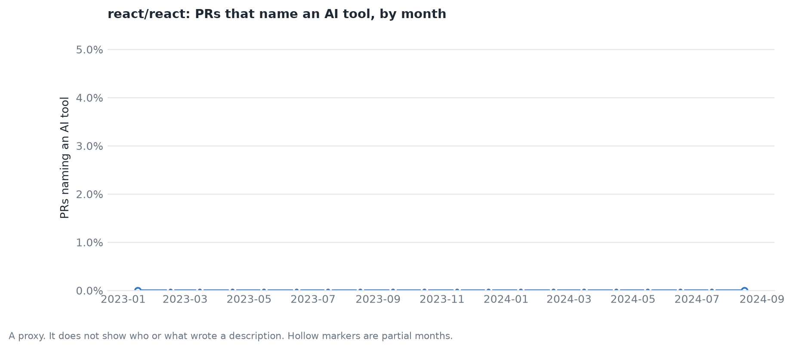

# Pull requests in react/react: description length, size, speed and labels

Window 2023-01-09 to 2024-08-19 (UTC). Data fetched 2026-11-19. prwords 3.0.0, generated 2026-11-26. Method fixed in advance in `docs/ANALYSIS_PLAN.md`.

## 1. Data

- Repository primary language: JavaScript
- Pull requests opened in the window: 2,841
- Removed as bot accounts: 143
- Analysed: 2,698 PRs from 523 authors
- Merged: 1,900 (70.4%). Closed without merging: 774 (28.7%). Still open: 24
- Follow-up: merge outcomes use a 30-day follow-up. PRs without enough follow-up: 0
- Empty descriptions after cleaning: 9.3%

## 2. Did the PR template change?

Lines that appeared or disappeared across the window (full list in `template_audit.csv`):

| line                                   | first_month   | last_month   |   months |   peak_share | change_event   |
|:---------------------------------------|:--------------|:-------------|---------:|-------------:|:---------------|
| stack from ghstack (oldest at bottom): | 2024-05       | 2024-08      |        4 |          0.5 | added          |

Distinct template lines detected: 3.

## 3. First 28 days versus last 28 days

First window 2023-01-09 to 2023-02-05. Last window 2024-07-23 to 2024-08-19. Ratios are last median divided by first median. Bootstrap intervals, 2,000 resamples.

| Metric                                |   n first |   n last |   Median first |   Median last |   Ratio |   Ratio low |   Ratio high |       p |   Cliff's delta |
|:--------------------------------------|----------:|---------:|---------------:|--------------:|--------:|------------:|-------------:|--------:|----------------:|
| Description words (non-empty)         |        56 |      239 |          24.5  |         44    |    1.8  |        0.92 |         2.42 | 0.021   |            0.2  |
| Files changed                         |        65 |      254 |           2    |          3    |    1.5  |        0.5  |         3    | 0.73    |            0.03 |
| Lines added                           |        65 |      254 |           7    |         52    |    7.43 |        2.43 |        20.17 | 0.0009  |            0.27 |
| Lines deleted                         |        65 |      254 |          13    |         11    |    0.85 |        0.4  |         1.83 | 0.41    |           -0.07 |
| Net lines (added minus deleted)       |        65 |      254 |           0    |         13.5  |  nan    |        3.74 |        23    | 7.6e-05 |            0.32 |
| Lines changed (added plus deleted)    |        65 |      254 |          34    |         85.5  |    2.51 |        1.75 |        10.11 | 0.019   |            0.19 |
| Hours from open to merge (merged PRs) |        34 |      200 |           5.58 |          9.72 |    1.74 |        0.28 |         5.37 | 0.54    |           -0.07 |
| Commits                               |        65 |      254 |           1    |          1    |    1    |        0.5  |         1    | 0.4     |           -0.06 |
| Comments                              |        65 |      254 |           1    |          2    |    2    |        1    |         2    | 0.012   |            0.19 |
| Reviews                               |        65 |      254 |           1    |          1    |    1    |        1    |         1    | 0.15    |            0.11 |

| Measure                             |   n first |   n last | Share first   | Share last   |   Change (points) |       p |
|:------------------------------------|----------:|---------:|:--------------|:-------------|------------------:|--------:|
| Merged within follow-up period      |        65 |      254 | 50.8%         | 75.2%        |              24.4 | 0.00023 |
| Closed without merging              |        65 |      254 | 46.2%         | 20.5%        |             -25.7 | 5.5e-05 |
| Opened as draft                     |        65 |      254 | 3.1%          | 3.5%         |               0.5 | 1       |
| From outside contributors           |        65 |      254 | 93.8%         | 58.3%        |             -35.6 | 4.8e-09 |
| Has a kind or type label            |        65 |      254 | 0.0%          | 0.0%         |               0   | 1       |
| Description text repeated elsewhere |        65 |      254 | 0.0%          | 2.8%         |               2.8 | 0.35    |
| Names an AI tool (disclosure)       |        65 |      254 | 0.0%          | 0.0%         |               0   | 1       |
| Label category: feature             |        65 |      254 | 0.0%          | 0.0%         |               0   | 1       |
| Label category: bug                 |        65 |      254 | 0.0%          | 0.0%         |               0   | 1       |
| Label category: design              |        65 |      254 | 0.0%          | 0.0%         |               0   | 1       |
| Label category: docs                |        65 |      254 | 0.0%          | 0.0%         |               0   | 1       |
| Label category: cleanup             |        65 |      254 | 0.0%          | 0.0%         |               0   | 1       |
| Label category: test                |        65 |      254 | 0.0%          | 0.0%         |               0   | 1       |
| Label category: api_change          |        65 |      254 | 0.0%          | 0.0%         |               0   | 1       |

## 4. Monthly trends

Theil-Sen slope per month and Kendall tau over full months only.

| metric                     |   months |   slope_per_month |   slope_ci_low |   slope_ci_high |     tau |       p |
|:---------------------------|---------:|------------------:|---------------:|----------------:|--------:|--------:|
| median_words               |       18 |            -0.714 |         -1.682 |           0.636 |  -0.164 |   0.343 |
| median_files_changed       |       18 |            -0     |         -0.062 |          -0     |  -0.261 |   0.184 |
| median_additions           |       18 |             0.333 |         -1.533 |           1.542 |   0.079 |   0.649 |
| median_deletions           |       18 |            -0.15  |         -0.929 |           0.5   |  -0.099 |   0.569 |
| median_churn               |       18 |             0.222 |         -2.95  |           1.833 |   0.04  |   0.82  |
| median_hours_to_merge      |       18 |             0.265 |         -1.236 |           1.235 |   0.124 |   0.501 |
| merge_rate                 |       18 |             0.007 |         -0.003 |           0.022 |   0.216 |   0.229 |
| share_outside_contributors |       18 |             0.002 |         -0.017 |           0.013 |   0.007 |   1     |
| share_ai_disclosed         |       18 |            -0     |         -0     |          -0     | nan     | nan     |
| median_comments            |       18 |            -0     |         -0     |           0.056 |   0.182 |   0.361 |
| median_reviews             |       18 |            -0     |         -0     |          -0     |   0.229 |   0.261 |
| share_feature              |       18 |            -0     |         -0     |          -0     | nan     | nan     |
| share_bug                  |       18 |            -0     |         -0     |          -0     |   0.333 |   0.101 |
| share_design               |       18 |            -0     |         -0     |          -0     | nan     | nan     |
| share_docs                 |       18 |            -0     |         -0     |          -0     | nan     | nan     |
| share_cleanup              |       18 |            -0     |         -0     |          -0     | nan     | nan     |
| share_test                 |       18 |            -0     |         -0     |          -0     | nan     | nan     |
| share_api_change           |       18 |            -0     |         -0     |          -0     | nan     | nan     |

## 5. Labels

Share of PRs with a kind or type label: 0.0% overall. Label coverage by month is in `monthly_summary.csv` (`share_has_kind_label`).

| category            |   n_prs |   share |   median_words |   median_files |   median_churn |   merge_rate |   median_hours_to_merge |   share_ai_disclosed |
|:--------------------|--------:|--------:|---------------:|---------------:|---------------:|-------------:|------------------------:|---------------------:|
| feature             |       0 |       0 |            nan |            nan |            nan |      nan     |                 nan     |                  nan |
| bug                 |       1 |       0 |             37 |              1 |             28 |        0     |                 nan     |                    0 |
| design              |       0 |       0 |            nan |            nan |            nan |      nan     |                 nan     |                  nan |
| docs                |       0 |       0 |            nan |            nan |            nan |      nan     |                 nan     |                  nan |
| cleanup             |       0 |       0 |            nan |            nan |            nan |      nan     |                 nan     |                  nan |
| test                |       0 |       0 |            nan |            nan |            nan |      nan     |                 nan     |                  nan |
| api_change          |       0 |       0 |            nan |            nan |            nan |      nan     |                 nan     |                  nan |
| (no category label) |    2697 |       1 |             46 |              2 |             56 |        0.704 |                  15.334 |                    0 |

## 6. Are PRs with signs of AI involvement smaller or larger?

Authorship is not observable. The proxy is `ai_disclosed`, defined in the analysis plan: 0 PRs (0.00%). 0 disclosed PRs are listed in `ai_disclosure_samples.csv` for manual audit.

### ai_disclosed

**Verdict: not testable.** Too few exposed PRs.

Pattern: lines changed: not estimated; files changed: not estimated; lines added: not estimated; lines deleted: not estimated; hours to merge: not estimated.

Not estimated: fewer than 30 exposed PRs (exposed PRs: 0).

### Robustness by tool (lines changed)

No tool named in any disclosure.

### File type check

Not run. Use `--file-check N` to sample N exposed PRs and matching unexposed PRs.

## 7. Other checks

- Outside contributors: 58.3% of PRs overall.
- Top 10 authors opened 62.3% of PRs.
- PRs whose description text is repeated elsewhere (10 or more words): 2.1%.

## 8. Limitations

- Word count and size describe PRs, not who wrote them. Proxies for AI involvement are noisy and omit undisclosed use.
- Added and deleted lines include generated or vendored files unless the project avoids committing them.
- Disclosure mostly captures tools that add attribution by default, so it is tool-skewed.
- Template removal is heuristic. Check `template_audit.csv`.
- One repository cannot support general claims. See the plan for replication.
- Months at the edges of the window are partial and are excluded from trend tests.

