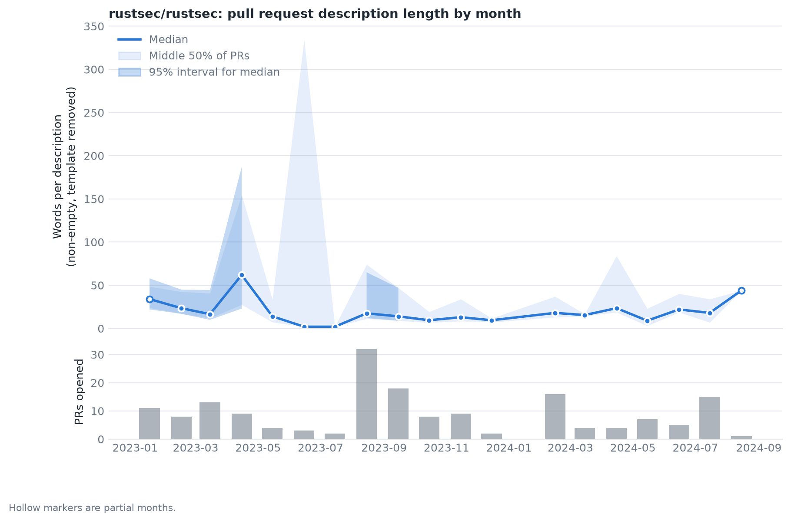
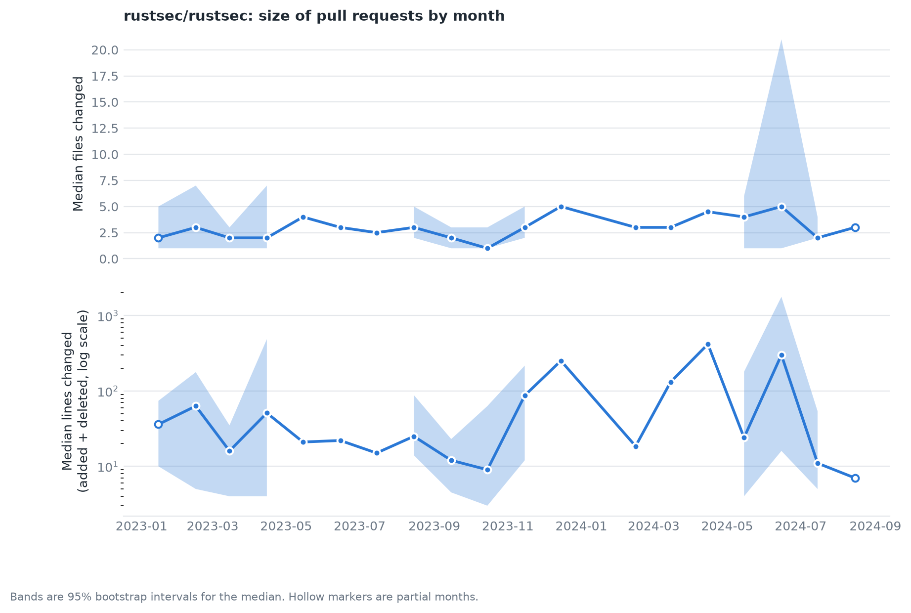
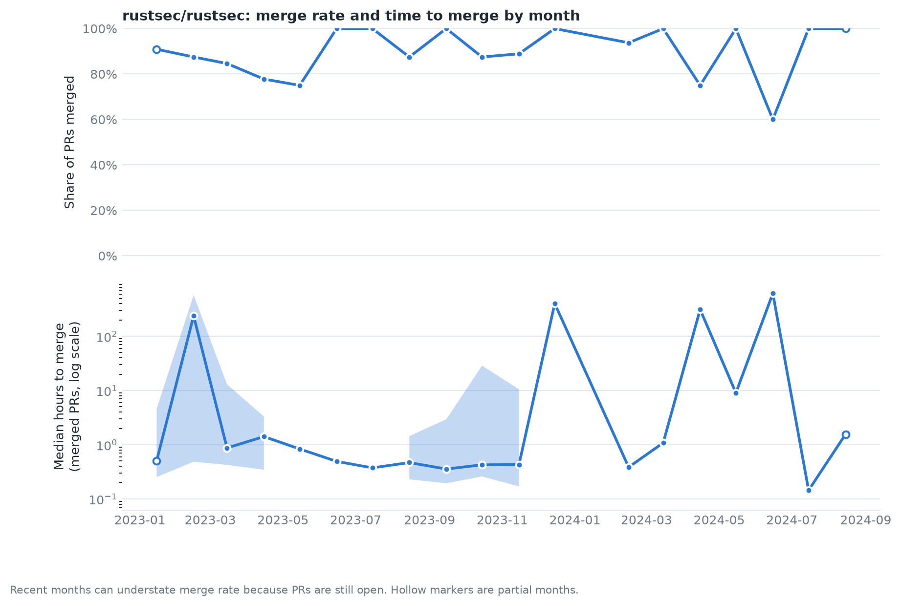
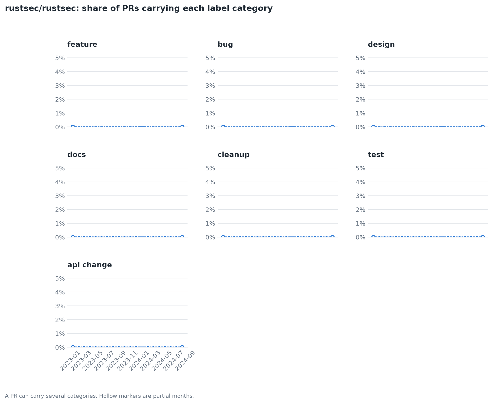
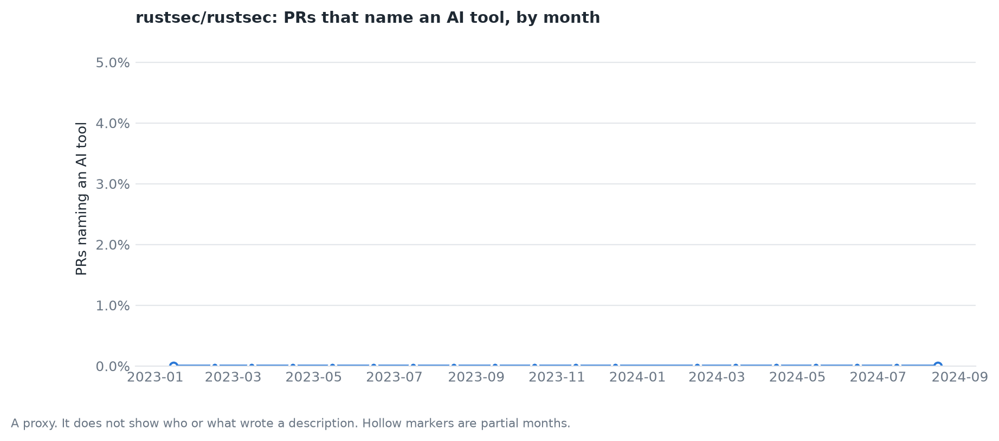

# Pull requests in rustsec/rustsec: description length, size, speed and labels

Window 2023-01-09 to 2024-08-19 (UTC). Data fetched 2026-11-20. prwords 3.0.0, generated 2026-11-26. Method fixed in advance in `docs/ANALYSIS_PLAN.md`.

## 1. Data

- Repository primary language: Rust
- Pull requests opened in the window: 358
- Removed as bot accounts: 187
- Analysed: 171 PRs from 34 authors
- Merged: 154 (90.1%). Closed without merging: 14 (8.2%). Still open: 3
- Follow-up: merge outcomes use a 30-day follow-up. PRs without enough follow-up: 0
- Empty descriptions after cleaning: 31.0%

## 2. Did the PR template change?

No template line appeared or disappeared with a share of 50% or more. Template text was detected monthly and removed before counting words.

Distinct template lines detected: 0.

## 3. First 28 days versus last 28 days

First window 2023-01-09 to 2023-02-05. Last window 2024-07-23 to 2024-08-19. Ratios are last median divided by first median. Bootstrap intervals, 2,000 resamples.

| Metric                                |   n first |   n last |   Median first |   Median last |   Ratio |   Ratio low |   Ratio high |     p |   Cliff's delta |
|:--------------------------------------|----------:|---------:|---------------:|--------------:|--------:|------------:|-------------:|------:|----------------:|
| Description words (non-empty)         |         7 |        7 |          34    |         30    |    0.88 |        0.18 |         2    | 0.61  |           -0.18 |
| Files changed                         |        11 |       15 |           2    |          2    |    1    |        0.4  |         3    | 0.85  |            0.05 |
| Lines added                           |        11 |       15 |          18    |          4    |    0.22 |        0.05 |         1    | 0.11  |           -0.38 |
| Lines deleted                         |        11 |       15 |           8    |          7    |    0.88 |        0.15 |         7    | 0.75  |           -0.08 |
| Net lines (added minus deleted)       |        11 |       15 |           8    |          0    |    0    |       -1    |         0    | 0.059 |           -0.44 |
| Lines changed (added plus deleted)    |        11 |       15 |          36    |          8    |    0.22 |        0.09 |         1.47 | 0.22  |           -0.29 |
| Hours from open to merge (merged PRs) |        10 |       15 |           0.51 |          0.14 |    0.28 |        0.02 |         0.88 | 0.016 |           -0.59 |
| Commits                               |        11 |       15 |           1    |          1    |    1    |        1    |         1    | 0.88  |            0.03 |
| Comments                              |        11 |       15 |           0    |          0    |  nan    |      nan    |       nan    | 0.67  |            0.08 |
| Reviews                               |        11 |       15 |           0    |          0    |  nan    |      nan    |       nan    | 0.71  |            0.05 |

| Measure                             |   n first |   n last | Share first   | Share last   |   Change (points) |    p |
|:------------------------------------|----------:|---------:|:--------------|:-------------|------------------:|-----:|
| Merged within follow-up period      |        11 |       15 | 90.9%         | 100.0%       |               9.1 | 0.42 |
| Closed without merging              |        11 |       15 | 9.1%          | 0.0%         |              -9.1 | 0.42 |
| Opened as draft                     |        11 |       15 | 0.0%          | 0.0%         |               0   | 1    |
| From outside contributors           |        11 |       15 | 0.0%          | 0.0%         |               0   | 1    |
| Has a kind or type label            |        11 |       15 | 0.0%          | 0.0%         |               0   | 1    |
| Description text repeated elsewhere |        11 |       15 | 0.0%          | 0.0%         |               0   | 1    |
| Names an AI tool (disclosure)       |        11 |       15 | 0.0%          | 0.0%         |               0   | 1    |
| Label category: feature             |        11 |       15 | 0.0%          | 0.0%         |               0   | 1    |
| Label category: bug                 |        11 |       15 | 0.0%          | 0.0%         |               0   | 1    |
| Label category: design              |        11 |       15 | 0.0%          | 0.0%         |               0   | 1    |
| Label category: docs                |        11 |       15 | 0.0%          | 0.0%         |               0   | 1    |
| Label category: cleanup             |        11 |       15 | 0.0%          | 0.0%         |               0   | 1    |
| Label category: test                |        11 |       15 | 0.0%          | 0.0%         |               0   | 1    |
| Label category: api_change          |        11 |       15 | 0.0%          | 0.0%         |               0   | 1    |

## 4. Monthly trends

Theil-Sen slope per month and Kendall tau over full months only.

| metric                     |   months |   slope_per_month |   slope_ci_low |   slope_ci_high |     tau |       p |
|:---------------------------|---------:|------------------:|---------------:|----------------:|--------:|--------:|
| median_words               |       17 |            -0     |         -1     |           1     |   0.022 |   0.901 |
| median_files_changed       |       17 |             0.087 |         -0     |           0.2   |   0.266 |   0.16  |
| median_additions           |       17 |             0.333 |         -1.25  |          11.4   |   0.096 |   0.592 |
| median_deletions           |       17 |             0.375 |         -0.091 |           1.5   |   0.266 |   0.145 |
| median_churn               |       17 |             1.417 |         -2     |          17.667 |   0.132 |   0.49  |
| median_hours_to_merge      |       17 |            -0.012 |         -0.067 |           0.961 |  -0.029 |   0.903 |
| merge_rate                 |       17 |            -0     |         -0.003 |           0.016 |   0.171 |   0.366 |
| share_outside_contributors |       17 |             0.003 |         -0.031 |           0.043 |   0.03  |   0.869 |
| share_ai_disclosed         |       17 |            -0     |         -0     |          -0     | nan     | nan     |
| median_comments            |       17 |            -0     |         -0.077 |           0.056 |  -0.077 |   0.691 |
| median_reviews             |       17 |            -0     |         -0.062 |           0.05  |  -0.034 |   0.861 |
| share_feature              |       17 |            -0     |         -0     |          -0     | nan     | nan     |
| share_bug                  |       17 |            -0     |         -0     |          -0     | nan     | nan     |
| share_design               |       17 |            -0     |         -0     |          -0     | nan     | nan     |
| share_docs                 |       17 |            -0     |         -0     |          -0     | nan     | nan     |
| share_cleanup              |       17 |            -0     |         -0     |          -0     | nan     | nan     |
| share_test                 |       17 |            -0     |         -0     |          -0     | nan     | nan     |
| share_api_change           |       17 |            -0     |         -0     |          -0     | nan     | nan     |

## 5. Labels

Share of PRs with a kind or type label: 0.0% overall. Label coverage by month is in `monthly_summary.csv` (`share_has_kind_label`).

| category            |   n_prs |   share |   median_words |   median_files |   median_churn |   merge_rate |   median_hours_to_merge |   share_ai_disclosed |
|:--------------------|--------:|--------:|---------------:|---------------:|---------------:|-------------:|------------------------:|---------------------:|
| feature             |       0 |       0 |            nan |            nan |            nan |      nan     |                 nan     |                  nan |
| bug                 |       0 |       0 |            nan |            nan |            nan |      nan     |                 nan     |                  nan |
| design              |       0 |       0 |            nan |            nan |            nan |      nan     |                 nan     |                  nan |
| docs                |       0 |       0 |            nan |            nan |            nan |      nan     |                 nan     |                  nan |
| cleanup             |       0 |       0 |            nan |            nan |            nan |      nan     |                 nan     |                  nan |
| test                |       0 |       0 |            nan |            nan |            nan |      nan     |                 nan     |                  nan |
| api_change          |       0 |       0 |            nan |            nan |            nan |      nan     |                 nan     |                  nan |
| (no category label) |     171 |       1 |             18 |              3 |             23 |        0.901 |                   0.496 |                    0 |

## 6. Are PRs with signs of AI involvement smaller or larger?

Authorship is not observable. The proxy is `ai_disclosed`, defined in the analysis plan: 0 PRs (0.00%). 0 disclosed PRs are listed in `ai_disclosure_samples.csv` for manual audit.

### ai_disclosed

**Verdict: not testable.** Too few exposed PRs.

Pattern: lines changed: not estimated; files changed: not estimated; lines added: not estimated; lines deleted: not estimated; hours to merge: not estimated.

Not estimated: fewer than 30 exposed PRs (exposed PRs: 0).

### Robustness by tool (lines changed)

No tool named in any disclosure.

### File type check

Not run. Use `--file-check N` to sample N exposed PRs and matching unexposed PRs.

## 7. Other checks

- Outside contributors: 26.9% of PRs overall.
- Top 10 authors opened 85.4% of PRs.
- PRs whose description text is repeated elsewhere (10 or more words): 0.0%.

## 8. Limitations

- Word count and size describe PRs, not who wrote them. Proxies for AI involvement are noisy and omit undisclosed use.
- Added and deleted lines include generated or vendored files unless the project avoids committing them.
- Disclosure mostly captures tools that add attribution by default, so it is tool-skewed.
- Template removal is heuristic. Check `template_audit.csv`.
- One repository cannot support general claims. See the plan for replication.
- Months at the edges of the window are partial and are excluded from trend tests.

