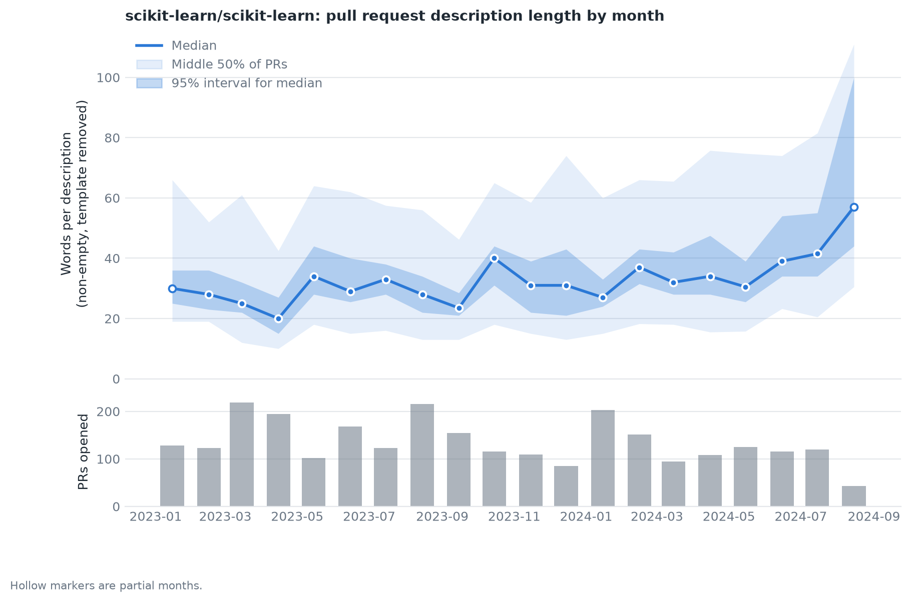
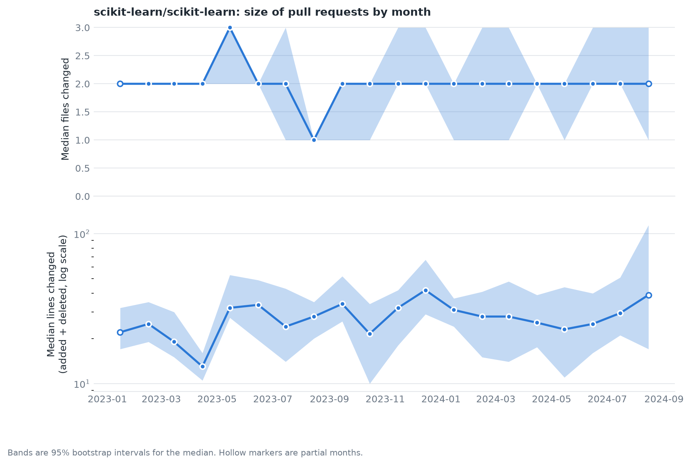
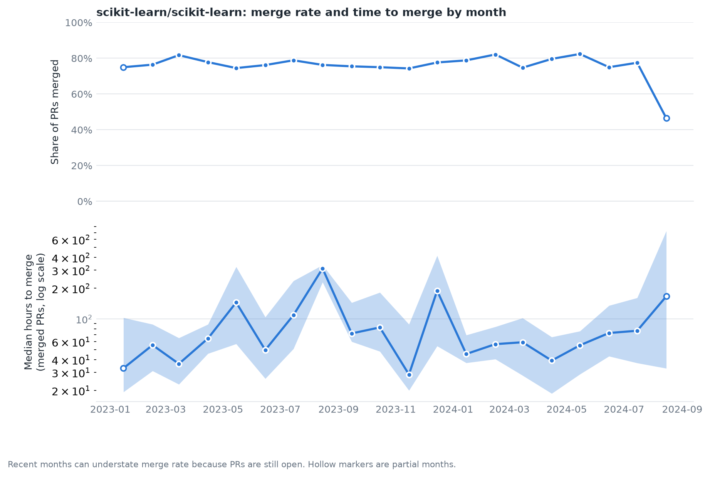
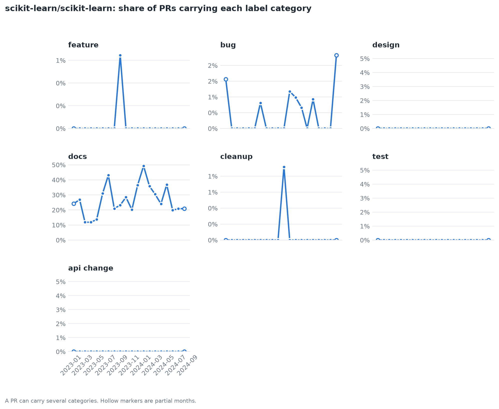
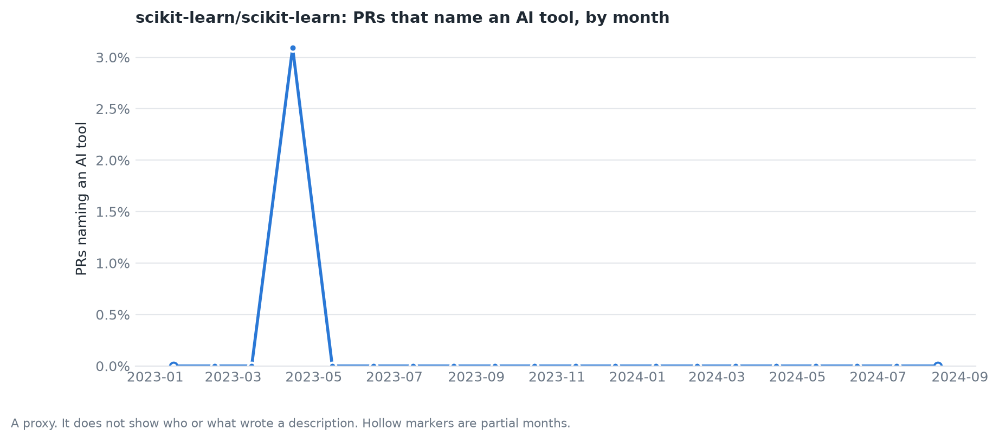

# Pull requests in scikit-learn/scikit-learn: description length, size, speed and labels

Window 2023-01-09 to 2024-08-19 (UTC). Data fetched 2026-11-19. prwords 3.0.0, generated 2026-11-26. Method fixed in advance in `docs/ANALYSIS_PLAN.md`.

## 1. Data

- Repository primary language: Python
- Pull requests opened in the window: 2,841
- Removed as bot accounts: 143
- Analysed: 2,698 PRs from 614 authors
- Merged: 2,080 (77.1%). Closed without merging: 532 (19.7%). Still open: 86
- Follow-up: merge outcomes use a 30-day follow-up. PRs without enough follow-up: 0
- Empty descriptions after cleaning: 4.2%

## 2. Did the PR template change?

No template line appeared or disappeared with a share of 50% or more. Template text was detected monthly and removed before counting words.

Distinct template lines detected: 5.

## 3. First 28 days versus last 28 days

First window 2023-01-09 to 2023-02-05. Last window 2024-07-23 to 2024-08-19. Ratios are last median divided by first median. Bootstrap intervals, 2,000 resamples.

| Metric                                |   n first |   n last |   Median first |   Median last |   Ratio |   Ratio low |   Ratio high |       p |   Cliff's delta |
|:--------------------------------------|----------:|---------:|---------------:|--------------:|--------:|------------:|-------------:|--------:|----------------:|
| Description words (non-empty)         |       135 |       66 |          29    |         52.5  |    1.81 |        1.23 |         2.52 | 0.00045 |            0.3  |
| Files changed                         |       138 |       67 |           2    |          2    |    1    |        0.5  |         2    | 0.89    |            0.01 |
| Lines added                           |       138 |       67 |          17    |         16    |    0.94 |        0.44 |         2.37 | 0.84    |            0.02 |
| Lines deleted                         |       138 |       67 |           4    |          9    |    2.25 |        0.75 |         4.25 | 0.17    |            0.12 |
| Net lines (added minus deleted)       |       138 |       67 |           7    |          4    |    0.57 |        0.27 |         1.56 | 0.7     |           -0.03 |
| Lines changed (added plus deleted)    |       138 |       67 |          22    |         28    |    1.27 |        0.63 |         2.52 | 0.47    |            0.06 |
| Hours from open to merge (merged PRs) |       104 |       37 |          39.26 |        135.88 |    3.46 |        0.63 |        11.06 | 0.056   |            0.21 |
| Commits                               |       138 |       67 |           3    |          3    |    1    |        0.57 |         1.67 | 0.93    |            0.01 |
| Comments                              |       138 |       67 |           1    |          2    |    2    |        1    |         3    | 0.0075  |            0.23 |
| Reviews                               |       138 |       67 |           2    |          1    |    0.5  |        0.33 |         1    | 0.0099  |           -0.22 |

| Measure                             |   n first |   n last | Share first   | Share last   |   Change (points) |      p |
|:------------------------------------|----------:|---------:|:--------------|:-------------|------------------:|-------:|
| Merged within follow-up period      |       138 |       67 | 67.4%         | 44.8%        |             -22.6 | 0.0024 |
| Closed without merging              |       138 |       67 | 21.0%         | 32.8%        |              11.8 | 0.085  |
| Opened as draft                     |       138 |       67 | 4.3%          | 7.5%         |               3.1 | 0.34   |
| From outside contributors           |       138 |       67 | 43.5%         | 58.2%        |              14.7 | 0.054  |
| Has a kind or type label            |       138 |       67 | 0.0%          | 0.0%         |               0   | 1      |
| Description text repeated elsewhere |       138 |       67 | 2.9%          | 6.0%         |               3.1 | 0.44   |
| Names an AI tool (disclosure)       |       138 |       67 | 0.0%          | 0.0%         |               0   | 1      |
| Label category: feature             |       138 |       67 | 0.0%          | 0.0%         |               0   | 1      |
| Label category: bug                 |       138 |       67 | 1.4%          | 1.5%         |               0   | 1      |
| Label category: design              |       138 |       67 | 0.0%          | 0.0%         |               0   | 1      |
| Label category: docs                |       138 |       67 | 26.8%         | 20.9%        |              -5.9 | 0.39   |
| Label category: cleanup             |       138 |       67 | 0.0%          | 0.0%         |               0   | 1      |
| Label category: test                |       138 |       67 | 0.0%          | 0.0%         |               0   | 1      |
| Label category: api_change          |       138 |       67 | 0.0%          | 0.0%         |               0   | 1      |

## 4. Monthly trends

Theil-Sen slope per month and Kendall tau over full months only.

| metric                     |   months |   slope_per_month |   slope_ci_low |   slope_ci_high |     tau |       p |
|:---------------------------|---------:|------------------:|---------------:|----------------:|--------:|--------:|
| median_words               |       18 |             0.688 |          0.167 |           1.143 |   0.409 |   0.019 |
| median_files_changed       |       18 |            -0     |         -0     |          -0     |  -0.07  |   0.726 |
| median_additions           |       18 |            -0     |         -0.55  |           0.5   |  -0.027 |   0.879 |
| median_deletions           |       18 |             0.083 |         -0.143 |           0.273 |   0.164 |   0.358 |
| median_churn               |       18 |             0.091 |         -0.556 |           0.778 |   0.053 |   0.761 |
| median_hours_to_merge      |       18 |             0.076 |         -4.694 |           3.39  |   0.007 |   1     |
| merge_rate                 |       18 |             0     |         -0.002 |           0.004 |   0.052 |   0.762 |
| share_outside_contributors |       18 |            -0.009 |         -0.017 |          -0.001 |  -0.373 |   0.032 |
| share_ai_disclosed         |       18 |            -0     |         -0     |          -0     |  -0.255 |   0.21  |
| median_comments            |       18 |             0.071 |         -0     |           0.125 |   0.496 |   0.011 |
| median_reviews             |       18 |            -0     |         -0     |          -0     | nan     | nan     |
| share_feature              |       18 |            -0     |         -0     |          -0     |  -0.059 |   0.772 |
| share_bug                  |       18 |            -0     |         -0     |          -0     |   0.159 |   0.411 |
| share_design               |       18 |            -0     |         -0     |          -0     | nan     | nan     |
| share_docs                 |       18 |             0.006 |         -0.004 |           0.018 |   0.19  |   0.293 |
| share_cleanup              |       18 |            -0     |         -0     |          -0     |   0.02  |   0.923 |
| share_test                 |       18 |            -0     |         -0     |          -0     | nan     | nan     |
| share_api_change           |       18 |            -0     |         -0     |          -0     | nan     | nan     |

## 5. Labels

Share of PRs with a kind or type label: 0.0% overall. Label coverage by month is in `monthly_summary.csv` (`share_has_kind_label`).

| category            |   n_prs |   share |   median_words |   median_files |   median_churn |   merge_rate |   median_hours_to_merge |   share_ai_disclosed |
|:--------------------|--------:|--------:|---------------:|---------------:|---------------:|-------------:|------------------------:|---------------------:|
| feature             |       1 |   0     |            567 |             14 |            792 |        1     |                4704.59  |                0     |
| bug                 |       9 |   0.003 |             85 |              3 |             30 |        1     |                  75.959 |                0     |
| design              |       0 |   0     |            nan |            nan |            nan |      nan     |                 nan     |              nan     |
| docs                |     711 |   0.264 |             25 |              1 |             13 |        0.878 |                  45.946 |                0     |
| cleanup             |       1 |   0     |             66 |              2 |            126 |        1     |                 181.422 |                0     |
| test                |       0 |   0     |            nan |            nan |            nan |      nan     |                 nan     |              nan     |
| api_change          |       0 |   0     |            nan |            nan |            nan |      nan     |                 nan     |              nan     |
| (no category label) |    1976 |   0.732 |             34 |              2 |             32 |        0.731 |                  72.38  |                0.003 |

## 6. Are PRs with signs of AI involvement smaller or larger?

Authorship is not observable. The proxy is `ai_disclosed`, defined in the analysis plan: 6 PRs (0.22%). 6 disclosed PRs are listed in `ai_disclosure_samples.csv` for manual audit.

### ai_disclosed

**Verdict: not testable.** Too few exposed PRs.

Pattern: lines changed: not estimated; files changed: not estimated; lines added: not estimated; lines deleted: not estimated; hours to merge: not estimated.

Not estimated: fewer than 30 exposed PRs (exposed PRs: 6).

### Robustness by tool (lines changed)

| tool        |   n exposed | status                    |
|:------------|------------:|:--------------------------|
| unspecified |           6 | fewer than 30 exposed PRs |

### File type check

Not run. Use `--file-check N` to sample N exposed PRs and matching unexposed PRs.

## 7. Other checks

- Outside contributors: 54.0% of PRs overall.
- Top 10 authors opened 44.7% of PRs.
- PRs whose description text is repeated elsewhere (10 or more words): 4.8%.

## 8. Limitations

- Word count and size describe PRs, not who wrote them. Proxies for AI involvement are noisy and omit undisclosed use.
- Added and deleted lines include generated or vendored files unless the project avoids committing them.
- Disclosure mostly captures tools that add attribution by default, so it is tool-skewed.
- Template removal is heuristic. Check `template_audit.csv`.
- One repository cannot support general claims. See the plan for replication.
- Months at the edges of the window are partial and are excluded from trend tests.

