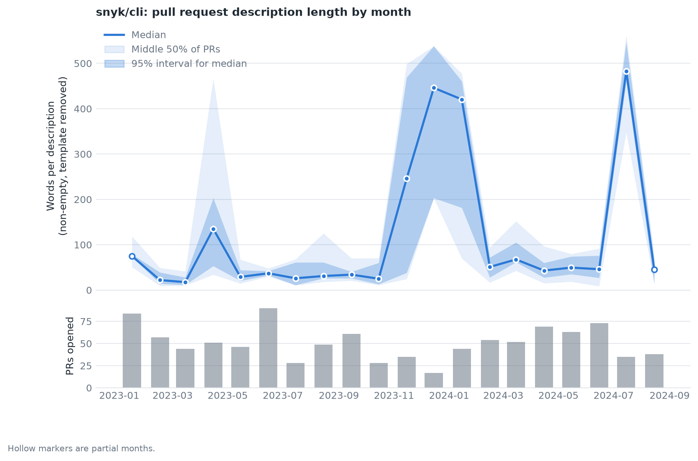
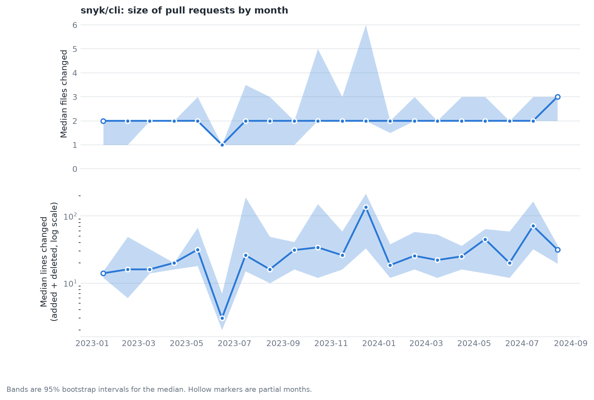
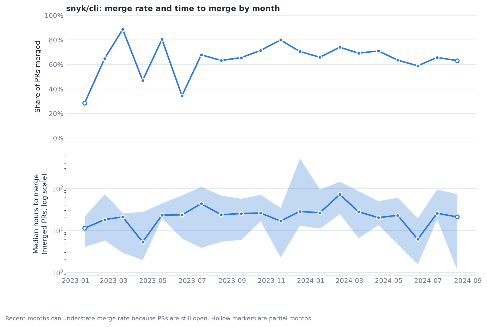
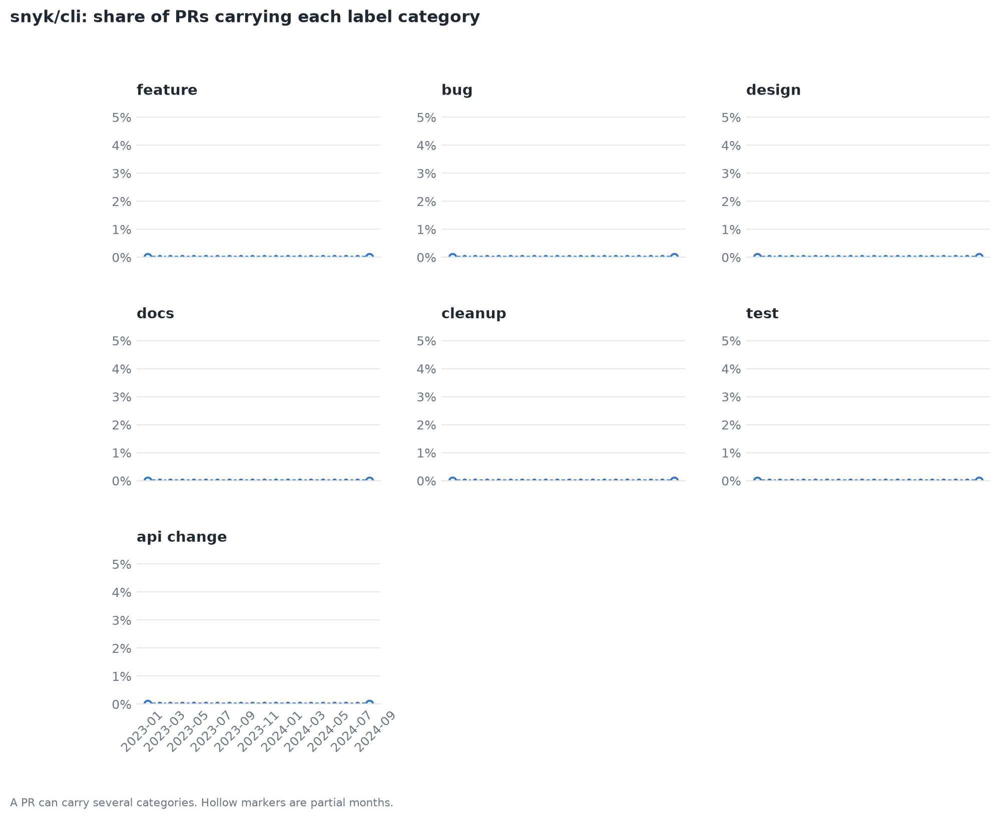
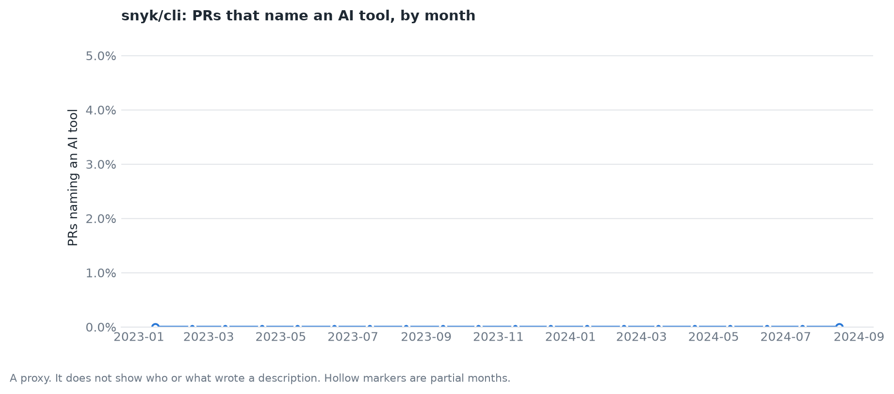

# Pull requests in snyk/cli: description length, size, speed and labels

Window 2023-01-09 to 2024-08-19 (UTC). Data fetched 2026-11-20. prwords 3.0.0, generated 2026-11-26. Method fixed in advance in `docs/ANALYSIS_PLAN.md`.

## 1. Data

- Repository primary language: TypeScript
- Pull requests opened in the window: 1,107
- Removed as bot accounts: 89
- Analysed: 1,018 PRs from 139 authors
- Merged: 626 (61.5%). Closed without merging: 392 (38.5%). Still open: 0
- Follow-up: merge outcomes use a 30-day follow-up. PRs without enough follow-up: 0
- Empty descriptions after cleaning: 6.2%

## 2. Did the PR template change?

Lines that appeared or disappeared across the window (full list in `template_audit.csv`):

| line                                                                                                                                   | first_month   | last_month   |   months |   peak_share | change_event   |
|:---------------------------------------------------------------------------------------------------------------------------------------|:--------------|:-------------|---------:|-------------:|:---------------|
| for more information:                                                                                                                  | 2023-01       | 2023-07      |        3 |         0.67 | removed        |
| 🧐 view latest project report                                                                                                           | 2023-01       | 2023-07      |        3 |         0.67 | removed        |
| #### changes included in this pr                                                                                                       | 2023-01       | 2023-07      |        3 |         0.6  | removed        |
| *learn how to fix vulnerabilities with free interactive lessons:**                                                                     | 2023-01       | 2023-07      |        3 |         0.6  | removed        |
| --                                                                                                                                     | 2023-01       | 2023-07      |        3 |         0.6  | removed        |
| 🛠 adjust project settings                                                                                                              | 2023-01       | 2023-07      |        3 |         0.6  | removed        |
| (*) note that the real score may have changed since the pr was raised.                                                                 | 2023-01       | 2023-07      |        3 |         0.57 | removed        |
| #### vulnerabilities that will be fixed                                                                                                | 2023-01       | 2023-07      |        3 |         0.55 | removed        |
| ##### with an upgrade:                                                                                                                 | 2023-01       | 2023-07      |        3 |         0.55 | removed        |
| *note:** *you are seeing this because you or someone else with access to this repository has authorized snyk to open fix prs.*         | 2023-01       | 2023-07      |        3 |         0.55 | removed        |
| -----------                                                                                                                            | 2023-01       | 2023-07      |        3 |         0.55 | removed        |
| :-------------------------:|-------------------------|:-------------------------|:-------------------------|:------------------------- | 2023-01       | 2023-07      |        3 |         0.55 | removed        |
| changes to the following files to upgrade the vulnerable dependencies to a fixed version:                                              | 2023-01       | 2023-07      |        3 |         0.55 | removed        |
| check the changes in this pr to ensure they won't cause issues with your project.                                                      | 2023-01       | 2023-07      |        3 |         0.55 | removed        |
| severity | priority score (*) | issue | breaking change | exploit maturity                                                             | 2023-01       | 2023-07      |        3 |         0.55 | removed        |
| 📚 read more about snyk's upgrade and patch logic                                                                                       | 2023-01       | 2023-07      |        3 |         0.55 | removed        |
| 🦉 regular expression denial of service (redos)                                                                                         | 2023-01       | 2023-07      |        3 |         0.55 | removed        |
| #### what does this pr do?                                                                                                             | 2023-02       | 2023-10      |        7 |         0.88 | added          |
| follows contributing rules                                                                                                             | 2023-02       | 2023-10      |        6 |         0.86 | added          |
| #### what are the relevant tickets?                                                                                                    | 2023-10       | 2023-10      |        1 |         0.51 | added          |
| ## what does this pr do?                                                                                                               | 2024-02       | 2024-08      |        6 |         0.93 | added          |
| **reviewer documentation**                                                                                                             | 2024-02       | 2024-08      |        6 |         0.9  | added          |
| **testing**                                                                                                                            | 2024-02       | 2024-08      |        6 |         0.9  | added          |
| **user facing documentation**                                                                                                          | 2024-02       | 2024-08      |        6 |         0.9  | added          |
| be accompanied by a detailed description of the changes                                                                                | 2024-02       | 2024-08      |        6 |         0.9  | added          |

Distinct template lines detected: 65.

## 3. First 28 days versus last 28 days

First window 2023-01-09 to 2023-02-05. Last window 2024-07-23 to 2024-08-19. Ratios are last median divided by first median. Bootstrap intervals, 2,000 resamples.

| Metric                                |   n first |   n last |   Median first |   Median last |   Ratio |   Ratio low |   Ratio high |       p |   Cliff's delta |
|:--------------------------------------|----------:|---------:|---------------:|--------------:|--------:|------------:|-------------:|--------:|----------------:|
| Description words (non-empty)         |        92 |       53 |          75    |         65    |    0.87 |        0.6  |         1.99 | 0.92    |            0.01 |
| Files changed                         |        92 |       53 |           2    |          3    |    1.5  |        1    |         3    | 4.6e-06 |            0.44 |
| Lines added                           |        92 |       53 |           7    |         20    |    2.86 |        2.5  |         5    | 1.8e-05 |            0.43 |
| Lines deleted                         |        92 |       53 |           6    |         12    |    2    |        1    |         4.8  | 0.0075  |            0.27 |
| Net lines (added minus deleted)       |        92 |       53 |           0    |          2    |  nan    |      nan    |       nan    | 0.0095  |            0.24 |
| Lines changed (added plus deleted)    |        92 |       53 |          14    |         36    |    2.57 |        2    |         5.07 | 2.3e-05 |            0.42 |
| Hours from open to merge (merged PRs) |        31 |       35 |          14.37 |         25.34 |    1.76 |        0.88 |        11.56 | 0.17    |            0.2  |
| Commits                               |        92 |       53 |           1    |          1    |    1    |        1    |         1    | 5.8e-07 |            0.32 |
| Comments                              |        92 |       53 |           1    |          0    |    0    |        0    |         0    | 1.2e-05 |           -0.41 |
| Reviews                               |        92 |       53 |           0    |          1    |  nan    |      nan    |       nan    | 0.0011  |            0.3  |

| Measure                             |   n first |   n last | Share first   | Share last   |   Change (points) |       p |
|:------------------------------------|----------:|---------:|:--------------|:-------------|------------------:|--------:|
| Merged within follow-up period      |        92 |       53 | 33.7%         | 66.0%        |              32.3 | 0.00025 |
| Closed without merging              |        92 |       53 | 66.3%         | 34.0%        |             -32.3 | 0.00025 |
| Opened as draft                     |        92 |       53 | 1.1%          | 7.5%         |               6.5 | 0.06    |
| From outside contributors           |        92 |       53 | 100.0%        | 96.2%        |              -3.8 | 0.13    |
| Has a kind or type label            |        92 |       53 | 0.0%          | 0.0%         |               0   | 1       |
| Description text repeated elsewhere |        92 |       53 | 4.3%          | 32.1%        |              27.7 | 9.5e-06 |
| Names an AI tool (disclosure)       |        92 |       53 | 0.0%          | 0.0%         |               0   | 1       |
| Label category: feature             |        92 |       53 | 0.0%          | 0.0%         |               0   | 1       |
| Label category: bug                 |        92 |       53 | 0.0%          | 0.0%         |               0   | 1       |
| Label category: design              |        92 |       53 | 0.0%          | 0.0%         |               0   | 1       |
| Label category: docs                |        92 |       53 | 0.0%          | 0.0%         |               0   | 1       |
| Label category: cleanup             |        92 |       53 | 0.0%          | 0.0%         |               0   | 1       |
| Label category: test                |        92 |       53 | 0.0%          | 0.0%         |               0   | 1       |
| Label category: api_change          |        92 |       53 | 0.0%          | 0.0%         |               0   | 1       |

## 4. Monthly trends

Theil-Sen slope per month and Kendall tau over full months only.

| metric                     |   months |   slope_per_month |   slope_ci_low |   slope_ci_high |     tau |       p |
|:---------------------------|---------:|------------------:|---------------:|----------------:|--------:|--------:|
| median_words               |       18 |             2.417 |          1.136 |           6.5   |   0.425 |   0.014 |
| median_files_changed       |       18 |            -0     |         -0     |          -0     |   0.176 |   0.386 |
| median_additions           |       18 |             0.6   |         -0     |           1.571 |   0.346 |   0.048 |
| median_deletions           |       18 |             0.05  |         -0.154 |           0.5   |   0.117 |   0.511 |
| median_churn               |       18 |             1.125 |         -0.071 |           2.571 |   0.306 |   0.08  |
| median_hours_to_merge      |       18 |             0.398 |         -0.334 |           0.909 |   0.203 |   0.26  |
| merge_rate                 |       18 |            -0.001 |         -0.014 |           0.009 |  -0.046 |   0.823 |
| share_outside_contributors |       18 |            -0     |         -0     |          -0     |  -0.308 |   0.111 |
| share_ai_disclosed         |       18 |            -0     |         -0     |          -0     | nan     | nan     |
| median_comments            |       18 |            -0     |         -0     |          -0     |  -0.152 |   0.454 |
| median_reviews             |       18 |            -0     |         -0     |          -0     |   0.314 |   0.122 |
| share_feature              |       18 |            -0     |         -0     |          -0     | nan     | nan     |
| share_bug                  |       18 |            -0     |         -0     |          -0     | nan     | nan     |
| share_design               |       18 |            -0     |         -0     |          -0     | nan     | nan     |
| share_docs                 |       18 |            -0     |         -0     |          -0     | nan     | nan     |
| share_cleanup              |       18 |            -0     |         -0     |          -0     | nan     | nan     |
| share_test                 |       18 |            -0     |         -0     |          -0     | nan     | nan     |
| share_api_change           |       18 |            -0     |         -0     |          -0     | nan     | nan     |

## 5. Labels

Share of PRs with a kind or type label: 0.0% overall. Label coverage by month is in `monthly_summary.csv` (`share_has_kind_label`).

| category            |   n_prs |   share |   median_words |   median_files |   median_churn |   merge_rate |   median_hours_to_merge |   share_ai_disclosed |
|:--------------------|--------:|--------:|---------------:|---------------:|---------------:|-------------:|------------------------:|---------------------:|
| feature             |       0 |       0 |            nan |            nan |            nan |      nan     |                  nan    |                  nan |
| bug                 |       0 |       0 |            nan |            nan |            nan |      nan     |                  nan    |                  nan |
| design              |       0 |       0 |            nan |            nan |            nan |      nan     |                  nan    |                  nan |
| docs                |       0 |       0 |            nan |            nan |            nan |      nan     |                  nan    |                  nan |
| cleanup             |       0 |       0 |            nan |            nan |            nan |      nan     |                  nan    |                  nan |
| test                |       0 |       0 |            nan |            nan |            nan |      nan     |                  nan    |                  nan |
| api_change          |       0 |       0 |            nan |            nan |            nan |      nan     |                  nan    |                  nan |
| (no category label) |    1018 |       1 |             47 |              2 |             19 |        0.615 |                   22.62 |                    0 |

## 6. Are PRs with signs of AI involvement smaller or larger?

Authorship is not observable. The proxy is `ai_disclosed`, defined in the analysis plan: 0 PRs (0.00%). 0 disclosed PRs are listed in `ai_disclosure_samples.csv` for manual audit.

### ai_disclosed

**Verdict: not testable.** Too few exposed PRs.

Pattern: lines changed: not estimated; files changed: not estimated; lines added: not estimated; lines deleted: not estimated; hours to merge: not estimated.

Not estimated: fewer than 30 exposed PRs (exposed PRs: 0).

### Robustness by tool (lines changed)

No tool named in any disclosure.

### File type check

Not run. Use `--file-check N` to sample N exposed PRs and matching unexposed PRs.

## 7. Other checks

- Outside contributors: 97.2% of PRs overall.
- Top 10 authors opened 55.8% of PRs.
- PRs whose description text is repeated elsewhere (10 or more words): 12.7%.

## 8. Limitations

- Word count and size describe PRs, not who wrote them. Proxies for AI involvement are noisy and omit undisclosed use.
- Added and deleted lines include generated or vendored files unless the project avoids committing them.
- Disclosure mostly captures tools that add attribution by default, so it is tool-skewed.
- Template removal is heuristic. Check `template_audit.csv`.
- One repository cannot support general claims. See the plan for replication.
- Months at the edges of the window are partial and are excluded from trend tests.

