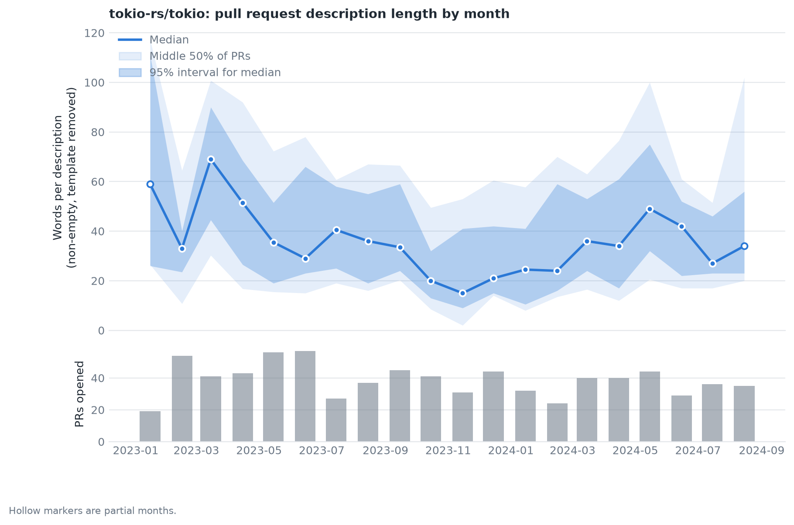
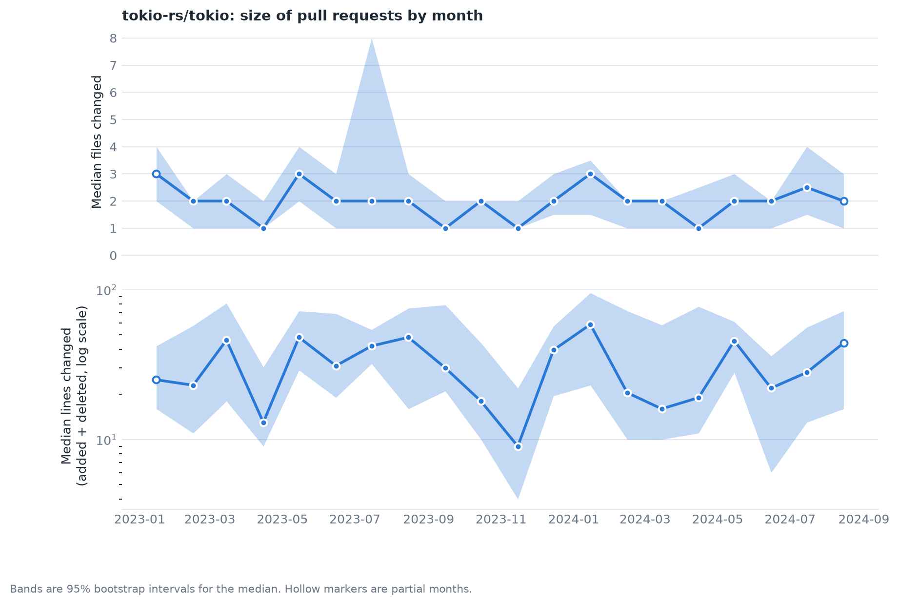
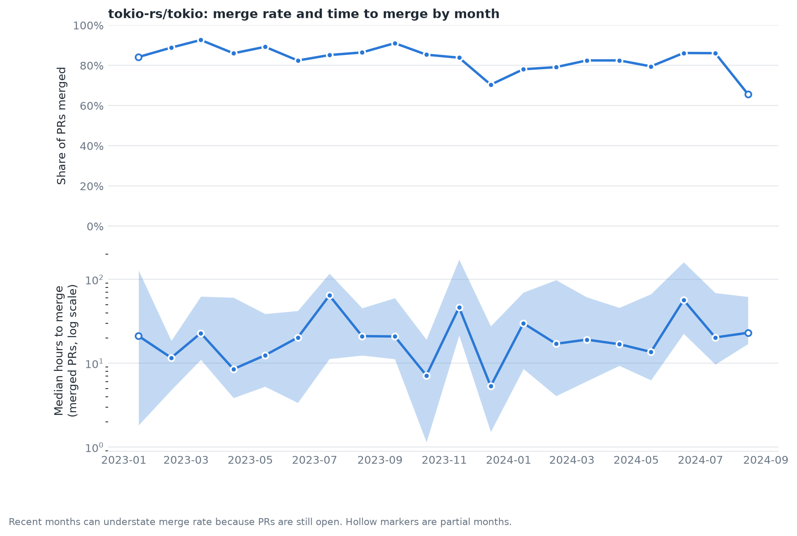
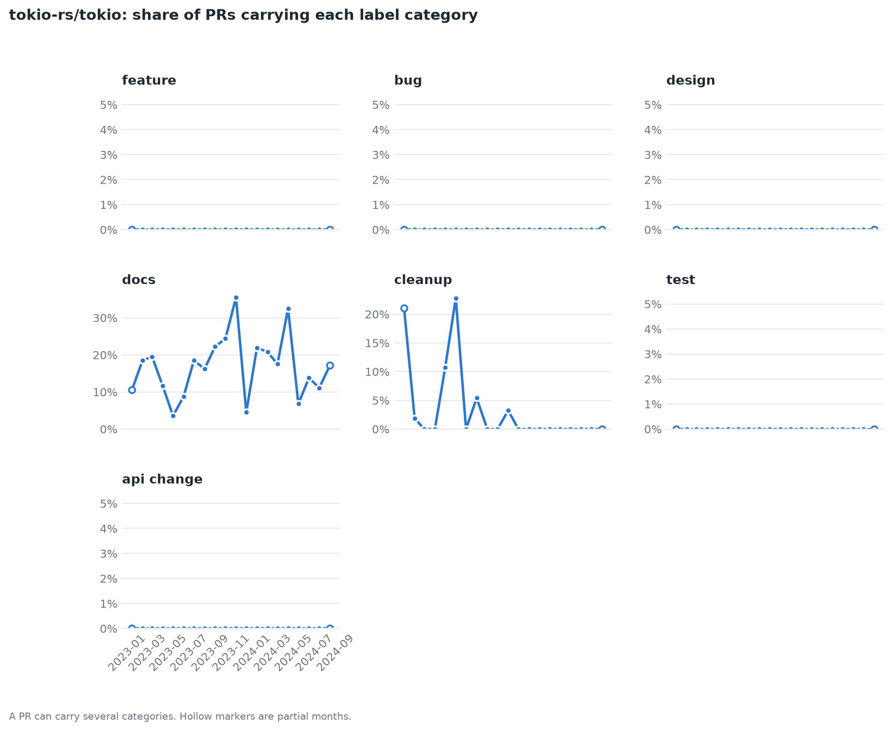
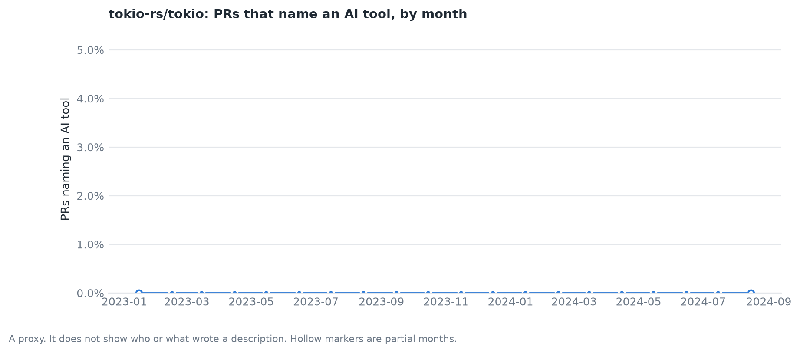

# Pull requests in tokio-rs/tokio: description length, size, speed and labels

Window 2023-01-09 to 2024-08-19 (UTC). Data fetched 2026-11-19. prwords 3.0.0, generated 2026-11-26. Method fixed in advance in `docs/ANALYSIS_PLAN.md`.

## 1. Data

- Repository primary language: Rust
- Pull requests opened in the window: 775
- Removed as bot accounts: 0
- Analysed: 775 PRs from 282 authors
- Merged: 648 (83.6%). Closed without merging: 112 (14.5%). Still open: 15
- Follow-up: merge outcomes use a 30-day follow-up. PRs without enough follow-up: 0
- Empty descriptions after cleaning: 3.4%

## 2. Did the PR template change?

No template line appeared or disappeared with a share of 50% or more. Template text was detected monthly and removed before counting words.

Distinct template lines detected: 2.

## 3. First 28 days versus last 28 days

First window 2023-01-09 to 2023-02-05. Last window 2024-07-23 to 2024-08-19. Ratios are last median divided by first median. Bootstrap intervals, 2,000 resamples.

| Metric                                |   n first |   n last |   Median first |   Median last |   Ratio |   Ratio low |   Ratio high |    p |   Cliff's delta |
|:--------------------------------------|----------:|---------:|---------------:|--------------:|--------:|------------:|-------------:|-----:|----------------:|
| Description words (non-empty)         |        17 |       51 |          55    |         30    |    0.55 |        0.27 |         1.42 | 0.3  |           -0.17 |
| Files changed                         |        20 |       51 |           3    |          2    |    0.67 |        0.33 |         1.5  | 0.29 |           -0.16 |
| Lines added                           |        20 |       51 |          19.5  |         28    |    1.44 |        0.54 |         3.52 | 0.47 |            0.11 |
| Lines deleted                         |        20 |       51 |           5    |          2    |    0.4  |        0.14 |         1    | 0.12 |           -0.24 |
| Net lines (added minus deleted)       |        20 |       51 |          11    |         19    |    1.73 |        0.44 |         4.64 | 0.48 |            0.11 |
| Lines changed (added plus deleted)    |        20 |       51 |          24.5  |         44    |    1.8  |        0.67 |         3.51 | 0.46 |            0.11 |
| Hours from open to merge (merged PRs) |        17 |       36 |          23.31 |         21.25 |    0.91 |        0.13 |        12.44 | 0.88 |           -0.03 |
| Commits                               |        20 |       51 |           2    |          2    |    1    |        0.4  |         3    | 0.84 |            0.03 |
| Comments                              |        20 |       51 |           0.5  |          0    |    0    |        0    |         2    | 0.7  |           -0.06 |
| Reviews                               |        20 |       51 |           1    |          1    |    1    |        1    |         2    | 0.17 |            0.2  |

| Measure                             |   n first |   n last | Share first   | Share last   |   Change (points) |     p |
|:------------------------------------|----------:|---------:|:--------------|:-------------|------------------:|------:|
| Merged within follow-up period      |        20 |       51 | 85.0%         | 66.7%        |             -18.3 | 0.15  |
| Closed without merging              |        20 |       51 | 15.0%         | 19.6%        |               4.6 | 0.75  |
| Opened as draft                     |        20 |       51 | 10.0%         | 3.9%         |              -6.1 | 0.31  |
| From outside contributors           |        20 |       51 | 55.0%         | 54.9%        |              -0.1 | 1     |
| Has a kind or type label            |        20 |       51 | 0.0%          | 0.0%         |               0   | 1     |
| Description text repeated elsewhere |        20 |       51 | 0.0%          | 3.9%         |               3.9 | 1     |
| Names an AI tool (disclosure)       |        20 |       51 | 0.0%          | 0.0%         |               0   | 1     |
| Label category: feature             |        20 |       51 | 0.0%          | 0.0%         |               0   | 1     |
| Label category: bug                 |        20 |       51 | 0.0%          | 0.0%         |               0   | 1     |
| Label category: design              |        20 |       51 | 0.0%          | 0.0%         |               0   | 1     |
| Label category: docs                |        20 |       51 | 10.0%         | 13.7%        |               3.7 | 1     |
| Label category: cleanup             |        20 |       51 | 20.0%         | 0.0%         |             -20   | 0.005 |
| Label category: test                |        20 |       51 | 0.0%          | 0.0%         |               0   | 1     |
| Label category: api_change          |        20 |       51 | 0.0%          | 0.0%         |               0   | 1     |

## 4. Monthly trends

Theil-Sen slope per month and Kendall tau over full months only.

| metric                     |   months |   slope_per_month |   slope_ci_low |   slope_ci_high |     tau |       p |
|:---------------------------|---------:|------------------:|---------------:|----------------:|--------:|--------:|
| median_words               |       18 |            -0.607 |         -2.25  |           0.778 |  -0.118 |   0.495 |
| median_files_changed       |       18 |            -0     |         -0     |          -0     |   0.076 |   0.694 |
| median_additions           |       18 |            -0.125 |         -1.071 |           0.8   |  -0.033 |   0.85  |
| median_deletions           |       18 |            -0     |         -0.231 |           0.125 |  -0.077 |   0.669 |
| median_churn               |       18 |            -0.286 |         -2     |           1.25  |  -0.105 |   0.544 |
| median_hours_to_merge      |       18 |             0.294 |         -0.6   |           1.669 |   0.072 |   0.709 |
| merge_rate                 |       18 |            -0.004 |         -0.008 |           0     |  -0.315 |   0.069 |
| share_outside_contributors |       18 |             0.005 |         -0.007 |           0.019 |   0.124 |   0.501 |
| share_ai_disclosed         |       18 |            -0     |         -0     |          -0     | nan     | nan     |
| median_comments            |       18 |            -0     |         -0     |          -0     |  -0.163 |   0.409 |
| median_reviews             |       18 |            -0     |         -0.059 |          -0     |  -0.457 |   0.022 |
| share_feature              |       18 |            -0     |         -0     |          -0     | nan     | nan     |
| share_bug                  |       18 |            -0     |         -0     |          -0     | nan     | nan     |
| share_design               |       18 |            -0     |         -0     |          -0     | nan     | nan     |
| share_docs                 |       18 |             0.001 |         -0.008 |           0.011 |   0.026 |   0.879 |
| share_cleanup              |       18 |            -0     |         -0.001 |          -0     |  -0.383 |   0.048 |
| share_test                 |       18 |            -0     |         -0     |          -0     | nan     | nan     |
| share_api_change           |       18 |            -0     |         -0     |          -0     | nan     | nan     |

## 5. Labels

Share of PRs with a kind or type label: 0.0% overall. Label coverage by month is in `monthly_summary.csv` (`share_has_kind_label`).

| category            |   n_prs |   share |   median_words |   median_files |   median_churn |   merge_rate |   median_hours_to_merge |   share_ai_disclosed |
|:--------------------|--------:|--------:|---------------:|---------------:|---------------:|-------------:|------------------------:|---------------------:|
| feature             |       0 |   0     |            nan |            nan |            nan |      nan     |                 nan     |                  nan |
| bug                 |       0 |   0     |            nan |            nan |            nan |      nan     |                 nan     |                  nan |
| design              |       0 |   0     |            nan |            nan |            nan |      nan     |                 nan     |                  nan |
| docs                |     125 |   0.161 |             17 |              1 |              7 |        0.936 |                  15.63  |                    0 |
| cleanup             |      27 |   0.035 |             28 |              4 |             46 |        1     |                   2.379 |                    0 |
| test                |       0 |   0     |            nan |            nan |            nan |      nan     |                 nan     |                  nan |
| api_change          |       0 |   0     |            nan |            nan |            nan |      nan     |                 nan     |                  nan |
| (no category label) |     623 |   0.804 |             40 |              2 |             37 |        0.809 |                  20.286 |                    0 |

## 6. Are PRs with signs of AI involvement smaller or larger?

Authorship is not observable. The proxy is `ai_disclosed`, defined in the analysis plan: 0 PRs (0.00%). 0 disclosed PRs are listed in `ai_disclosure_samples.csv` for manual audit.

### ai_disclosed

**Verdict: not testable.** Too few exposed PRs.

Pattern: lines changed: not estimated; files changed: not estimated; lines added: not estimated; lines deleted: not estimated; hours to merge: not estimated.

Not estimated: fewer than 30 exposed PRs (exposed PRs: 0).

### Robustness by tool (lines changed)

No tool named in any disclosure.

### File type check

Not run. Use `--file-check N` to sample N exposed PRs and matching unexposed PRs.

## 7. Other checks

- Outside contributors: 58.3% of PRs overall.
- Top 10 authors opened 46.3% of PRs.
- PRs whose description text is repeated elsewhere (10 or more words): 0.5%.

## 8. Limitations

- Word count and size describe PRs, not who wrote them. Proxies for AI involvement are noisy and omit undisclosed use.
- Added and deleted lines include generated or vendored files unless the project avoids committing them.
- Disclosure mostly captures tools that add attribution by default, so it is tool-skewed.
- Template removal is heuristic. Check `template_audit.csv`.
- One repository cannot support general claims. See the plan for replication.
- Months at the edges of the window are partial and are excluded from trend tests.

