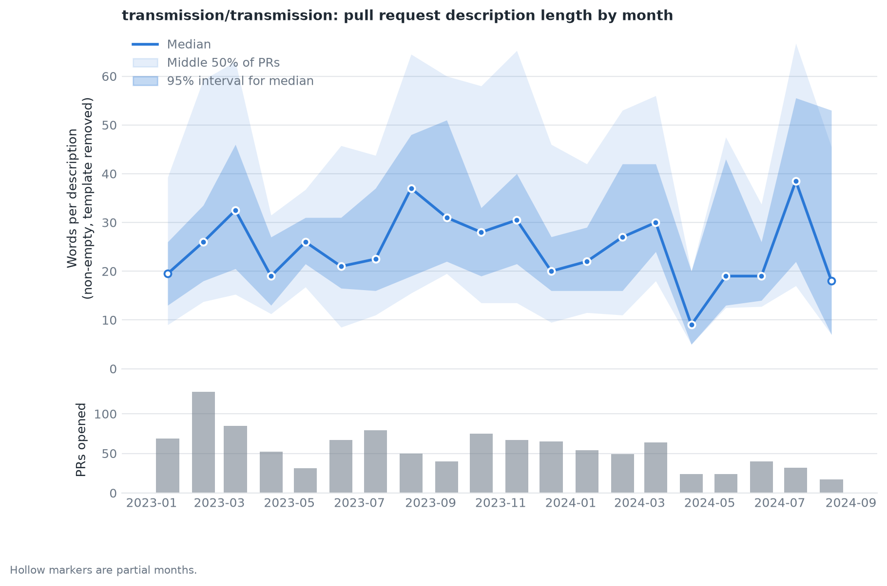
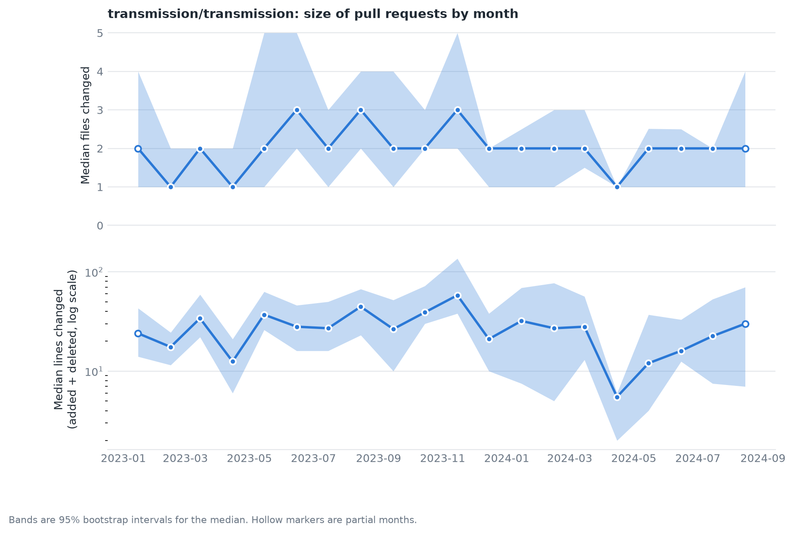
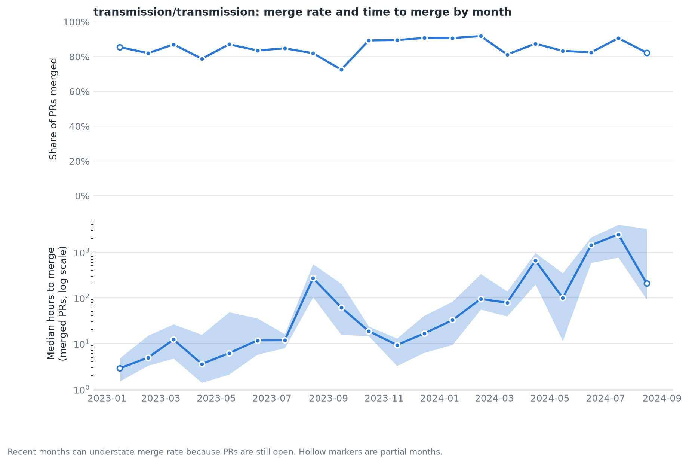
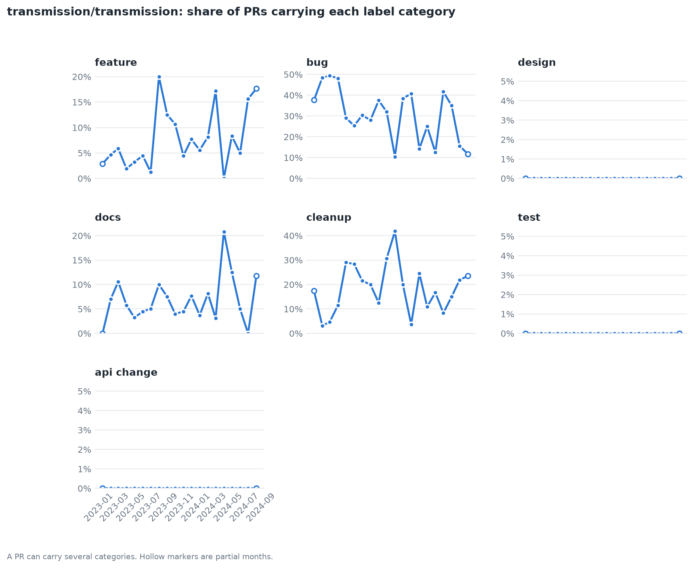
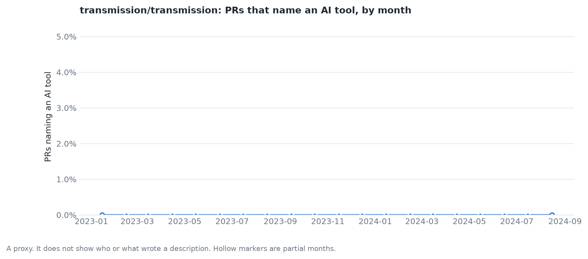

# Pull requests in transmission/transmission: description length, size, speed and labels

Window 2023-01-09 to 2024-08-19 (UTC). Data fetched 2026-11-20. prwords 3.0.0, generated 2026-11-26. Method fixed in advance in `docs/ANALYSIS_PLAN.md`.

## 1. Data

- Repository primary language: C++
- Pull requests opened in the window: 1,178
- Removed as bot accounts: 66
- Analysed: 1,112 PRs from 123 authors
- Merged: 948 (85.3%). Closed without merging: 142 (12.8%). Still open: 22
- Follow-up: merge outcomes use a 30-day follow-up. PRs without enough follow-up: 0
- Empty descriptions after cleaning: 10.3%

## 2. Did the PR template change?

No template line appeared or disappeared with a share of 50% or more. Template text was detected monthly and removed before counting words.

Distinct template lines detected: 0.

## 3. First 28 days versus last 28 days

First window 2023-01-09 to 2023-02-05. Last window 2024-07-23 to 2024-08-19. Ratios are last median divided by first median. Bootstrap intervals, 2,000 resamples.

| Metric                                |   n first |   n last |   Median first |   Median last |   Ratio |   Ratio low |   Ratio high |       p |   Cliff's delta |
|:--------------------------------------|----------:|---------:|---------------:|--------------:|--------:|------------:|-------------:|--------:|----------------:|
| Description words (non-empty)         |        67 |       27 |          20    |          26   |    1.3  |        0.65 |         2.56 | 0.54    |            0.08 |
| Files changed                         |        75 |       31 |           2    |           2   |    1    |        0.33 |         2    | 0.53    |           -0.07 |
| Lines added                           |        75 |       31 |          19    |          12   |    0.63 |        0.23 |         2.56 | 0.58    |           -0.07 |
| Lines deleted                         |        75 |       31 |           6    |           5   |    0.83 |        0.3  |         3.5  | 0.96    |           -0.01 |
| Net lines (added minus deleted)       |        75 |       31 |           1    |           1   |    1    |        0    |        11    | 0.89    |            0.02 |
| Lines changed (added plus deleted)    |        75 |       31 |          27    |          22   |    0.81 |        0.24 |         2.41 | 0.62    |           -0.06 |
| Hours from open to merge (merged PRs) |        65 |       26 |           2.86 |         502.1 |  175.32 |       70.09 |       899.37 | 1.3e-10 |            0.87 |
| Commits                               |        75 |       31 |           1    |           3   |    3    |        1    |         5    | 0.0076  |            0.31 |
| Comments                              |        75 |       31 |           0    |           1   |  nan    |        0    |         3    | 0.13    |            0.18 |
| Reviews                               |        75 |       31 |           0    |           2   |  nan    |      nan    |       nan    | 2.2e-07 |            0.61 |

| Measure                             |   n first |   n last | Share first   | Share last   |   Change (points) |       p |
|:------------------------------------|----------:|---------:|:--------------|:-------------|------------------:|--------:|
| Merged within follow-up period      |        75 |       31 | 86.7%         | 51.6%        |             -35.1 | 0.00027 |
| Closed without merging              |        75 |       31 | 12.0%         | 9.7%         |              -2.3 | 1       |
| Opened as draft                     |        75 |       31 | 1.3%          | 0.0%         |              -1.3 | 1       |
| From outside contributors           |        75 |       31 | 26.7%         | 32.3%        |               5.6 | 0.64    |
| Has a kind or type label            |        75 |       31 | 74.7%         | 74.2%        |              -0.5 | 1       |
| Description text repeated elsewhere |        75 |       31 | 0.0%          | 0.0%         |               0   | 1       |
| Names an AI tool (disclosure)       |        75 |       31 | 0.0%          | 0.0%         |               0   | 1       |
| Label category: feature             |        75 |       31 | 2.7%          | 19.4%        |              16.7 | 0.0075  |
| Label category: bug                 |        75 |       31 | 36.0%         | 12.9%        |             -23.1 | 0.019   |
| Label category: design              |        75 |       31 | 0.0%          | 0.0%         |               0   | 1       |
| Label category: docs                |        75 |       31 | 2.7%          | 6.5%         |               3.8 | 0.58    |
| Label category: cleanup             |        75 |       31 | 18.7%         | 22.6%        |               3.9 | 0.79    |
| Label category: test                |        75 |       31 | 0.0%          | 0.0%         |               0   | 1       |
| Label category: api_change          |        75 |       31 | 0.0%          | 0.0%         |               0   | 1       |

## 4. Monthly trends

Theil-Sen slope per month and Kendall tau over full months only.

| metric                     |   months |   slope_per_month |   slope_ci_low |   slope_ci_high |     tau |       p |
|:---------------------------|---------:|------------------:|---------------:|----------------:|--------:|--------:|
| median_words               |       18 |            -0.182 |         -0.964 |           0.735 |  -0.113 |   0.518 |
| median_files_changed       |       18 |            -0     |         -0     |          -0     |   0.027 |   0.891 |
| median_additions           |       18 |            -0.458 |         -1.214 |           0.308 |  -0.243 |   0.16  |
| median_deletions           |       18 |            -0.208 |         -0.778 |           0.25  |  -0.161 |   0.36  |
| median_churn               |       18 |            -0.719 |         -1.833 |           0.667 |  -0.204 |   0.24  |
| median_hours_to_merge      |       18 |             8.749 |          2.968 |          49.468 |   0.686 |   0     |
| merge_rate                 |       18 |             0.003 |         -0.001 |           0.008 |   0.229 |   0.201 |
| share_outside_contributors |       18 |             0.001 |         -0.012 |           0.013 |   0.039 |   0.82  |
| share_ai_disclosed         |       18 |            -0     |         -0     |          -0     | nan     | nan     |
| median_comments            |       18 |            -0     |         -0     |           0.1   |   0.272 |   0.152 |
| median_reviews             |       18 |             0     |         -0     |           0.143 |   0.6   |   0.002 |
| share_feature              |       18 |             0.003 |         -0.003 |           0.008 |   0.21  |   0.225 |
| share_bug                  |       18 |            -0.011 |         -0.023 |           0.004 |  -0.281 |   0.112 |
| share_design               |       18 |            -0     |         -0     |          -0     | nan     | nan     |
| share_docs                 |       18 |            -0.001 |         -0.004 |           0.004 |  -0.079 |   0.649 |
| share_cleanup              |       18 |             0.002 |         -0.011 |           0.013 |   0.039 |   0.82  |
| share_test                 |       18 |            -0     |         -0     |          -0     | nan     | nan     |
| share_api_change           |       18 |            -0     |         -0     |          -0     | nan     | nan     |

## 5. Labels

Share of PRs with a kind or type label: 79.5% overall. Label coverage by month is in `monthly_summary.csv` (`share_has_kind_label`).

| category            |   n_prs |   share |   median_words |   median_files |   median_churn |   merge_rate |   median_hours_to_merge |   share_ai_disclosed |
|:--------------------|--------:|--------:|---------------:|---------------:|---------------:|-------------:|------------------------:|---------------------:|
| feature             |      80 |   0.072 |             40 |              4 |           77.5 |        0.762 |                 458.699 |                    0 |
| bug                 |     369 |   0.332 |             20 |              1 |           14   |        0.957 |                  15.851 |                    0 |
| design              |       0 |   0     |            nan |            nan |          nan   |      nan     |                 nan     |                  nan |
| docs                |      68 |   0.061 |             19 |              1 |            5   |        0.926 |                  48.928 |                    0 |
| cleanup             |     194 |   0.174 |             29 |              5 |          139.5 |        0.948 |                  18.409 |                    0 |
| test                |       0 |   0     |            nan |            nan |          nan   |      nan     |                 nan     |                  nan |
| api_change          |       0 |   0     |            nan |            nan |          nan   |      nan     |                 nan     |                  nan |
| (no category label) |     416 |   0.374 |             28 |              2 |           23   |        0.726 |                  24.351 |                    0 |

## 6. Are PRs with signs of AI involvement smaller or larger?

Authorship is not observable. The proxy is `ai_disclosed`, defined in the analysis plan: 0 PRs (0.00%). 0 disclosed PRs are listed in `ai_disclosure_samples.csv` for manual audit.

### ai_disclosed

**Verdict: not testable.** Too few exposed PRs.

Pattern: lines changed: not estimated; files changed: not estimated; lines added: not estimated; lines deleted: not estimated; hours to merge: not estimated.

Not estimated: fewer than 30 exposed PRs (exposed PRs: 0).

### Robustness by tool (lines changed)

No tool named in any disclosure.

### File type check

Not run. Use `--file-check N` to sample N exposed PRs and matching unexposed PRs.

## 7. Other checks

- Outside contributors: 24.7% of PRs overall.
- Top 10 authors opened 82.2% of PRs.
- PRs whose description text is repeated elsewhere (10 or more words): 0.5%.

## 8. Limitations

- Word count and size describe PRs, not who wrote them. Proxies for AI involvement are noisy and omit undisclosed use.
- Added and deleted lines include generated or vendored files unless the project avoids committing them.
- Disclosure mostly captures tools that add attribution by default, so it is tool-skewed.
- Template removal is heuristic. Check `template_audit.csv`.
- One repository cannot support general claims. See the plan for replication.
- Months at the edges of the window are partial and are excluded from trend tests.

