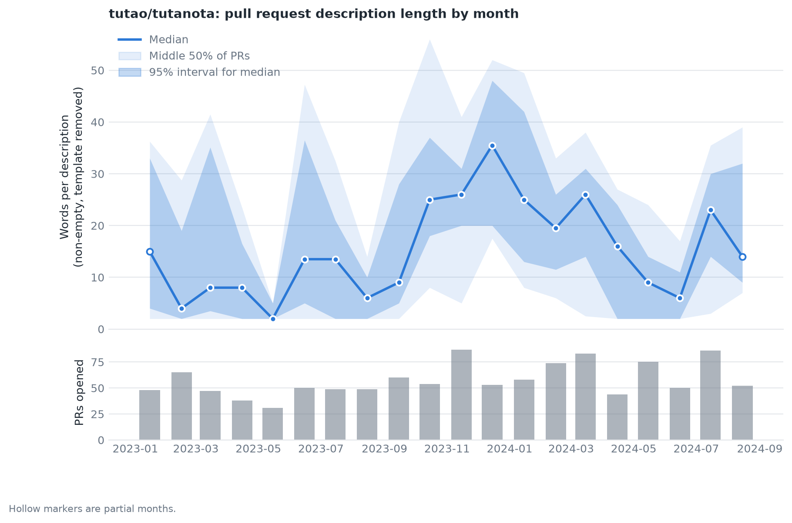
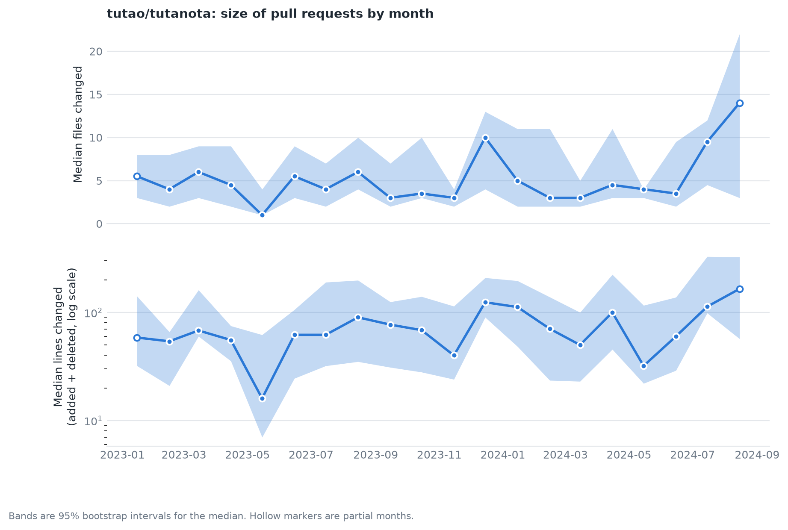
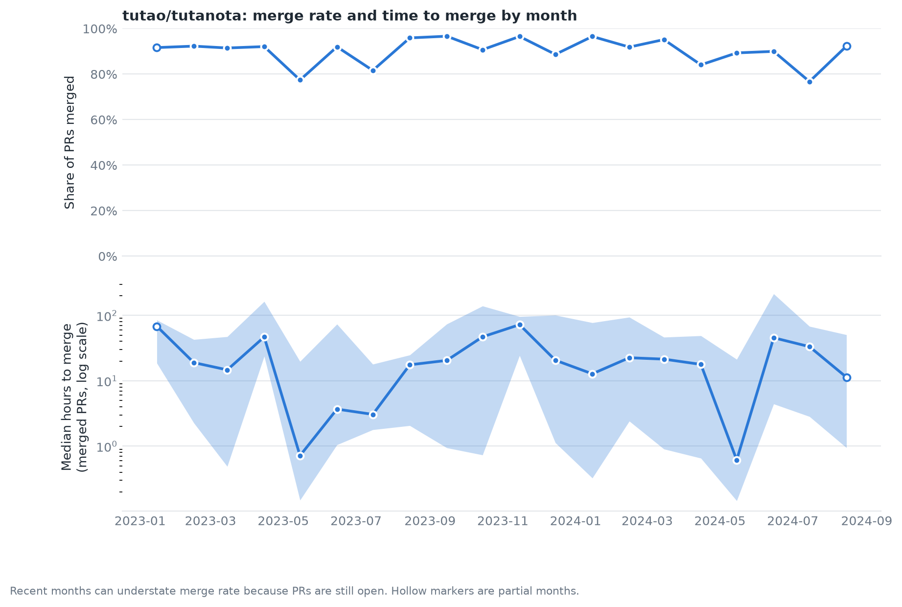
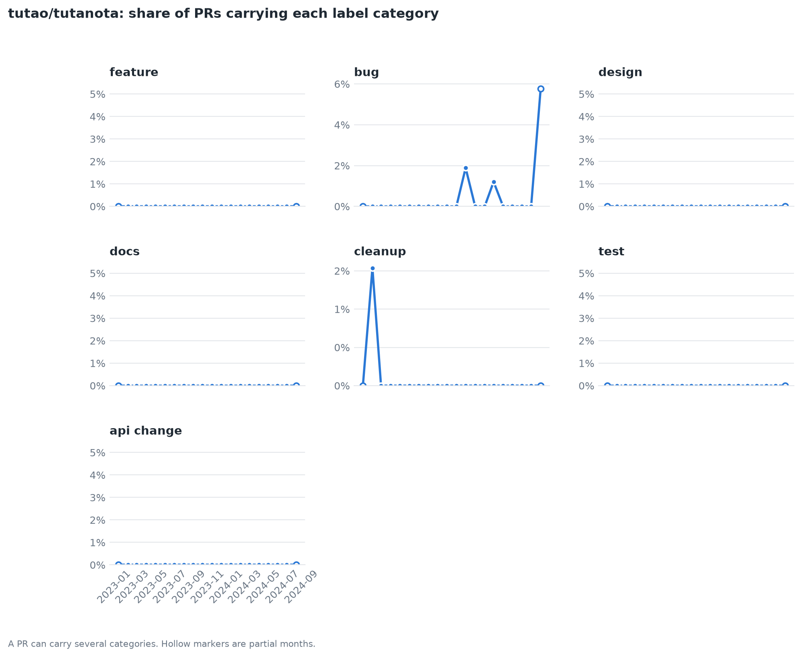
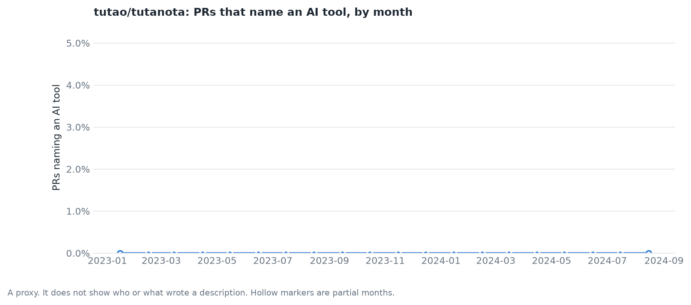

# Pull requests in tutao/tutanota: description length, size, speed and labels

Window 2023-01-09 to 2024-08-19 (UTC). Data fetched 2026-11-20. prwords 3.0.0, generated 2026-11-26. Method fixed in advance in `docs/ANALYSIS_PLAN.md`.

## 1. Data

- Repository primary language: TypeScript
- Pull requests opened in the window: 1,153
- Removed as bot accounts: 0
- Analysed: 1,153 PRs from 39 authors
- Merged: 1,043 (90.5%). Closed without merging: 107 (9.3%). Still open: 3
- Follow-up: merge outcomes use a 30-day follow-up. PRs without enough follow-up: 0
- Empty descriptions after cleaning: 32.0%

## 2. Did the PR template change?

No template line appeared or disappeared with a share of 50% or more. Template text was detected monthly and removed before counting words.

Distinct template lines detected: 0.

## 3. First 28 days versus last 28 days

First window 2023-01-09 to 2023-02-05. Last window 2024-07-23 to 2024-08-19. Ratios are last median divided by first median. Bootstrap intervals, 2,000 resamples.

| Metric                                |   n first |   n last |   Median first |   Median last |   Ratio |   Ratio low |   Ratio high |     p |   Cliff's delta |
|:--------------------------------------|----------:|---------:|---------------:|--------------:|--------:|------------:|-------------:|------:|----------------:|
| Description words (non-empty)         |        45 |       57 |          12    |         23    |    1.92 |        0.64 |         6.25 | 0.25  |            0.13 |
| Files changed                         |        53 |       90 |           6    |          6    |    1    |        0.43 |         3.88 | 0.41  |            0.08 |
| Lines added                           |        53 |       90 |          31    |         70    |    2.26 |        0.85 |         5.2  | 0.42  |            0.08 |
| Lines deleted                         |        53 |       90 |          32    |         39    |    1.22 |        0.5  |         4.14 | 0.6   |            0.05 |
| Net lines (added minus deleted)       |        53 |       90 |           3    |          3    |    1    |        0.13 |         4.5  | 0.36  |            0.09 |
| Lines changed (added plus deleted)    |        53 |       90 |          60    |        118    |    1.97 |        0.54 |         4.53 | 0.49  |            0.07 |
| Hours from open to merge (merged PRs) |        49 |       79 |          50.44 |          3.65 |    0.07 |        0.03 |         0.96 | 0.035 |           -0.22 |
| Commits                               |        53 |       90 |           1    |          1    |    1    |        0.5  |         2    | 0.6   |            0.05 |
| Comments                              |        53 |       90 |           0    |          0    |  nan    |      nan    |       nan    | 0.65  |           -0.03 |
| Reviews                               |        53 |       90 |           1    |          0    |    0    |        0    |         1    | 0.63  |           -0.05 |

| Measure                             |   n first |   n last | Share first   | Share last   |   Change (points) |    p |
|:------------------------------------|----------:|---------:|:--------------|:-------------|------------------:|-----:|
| Merged within follow-up period      |        53 |       90 | 90.6%         | 87.8%        |              -2.8 | 0.79 |
| Closed without merging              |        53 |       90 | 7.5%          | 12.2%        |               4.7 | 0.57 |
| Opened as draft                     |        53 |       90 | 0.0%          | 0.0%         |               0   | 1    |
| From outside contributors           |        53 |       90 | 100.0%        | 100.0%       |               0   | 1    |
| Has a kind or type label            |        53 |       90 | 0.0%          | 0.0%         |               0   | 1    |
| Description text repeated elsewhere |        53 |       90 | 0.0%          | 4.4%         |               4.4 | 0.3  |
| Names an AI tool (disclosure)       |        53 |       90 | 0.0%          | 0.0%         |               0   | 1    |
| Label category: feature             |        53 |       90 | 0.0%          | 0.0%         |               0   | 1    |
| Label category: bug                 |        53 |       90 | 0.0%          | 3.3%         |               3.3 | 0.3  |
| Label category: design              |        53 |       90 | 0.0%          | 0.0%         |               0   | 1    |
| Label category: docs                |        53 |       90 | 0.0%          | 0.0%         |               0   | 1    |
| Label category: cleanup             |        53 |       90 | 0.0%          | 0.0%         |               0   | 1    |
| Label category: test                |        53 |       90 | 0.0%          | 0.0%         |               0   | 1    |
| Label category: api_change          |        53 |       90 | 0.0%          | 0.0%         |               0   | 1    |

## 4. Monthly trends

Theil-Sen slope per month and Kendall tau over full months only.

| metric                     |   months |   slope_per_month |   slope_ci_low |   slope_ci_high |     tau |       p |
|:---------------------------|---------:|------------------:|---------------:|----------------:|--------:|--------:|
| median_words               |       18 |             0.857 |         -0     |           1.833 |   0.327 |   0.062 |
| median_files_changed       |       18 |            -0     |         -0.15  |           0.25  |  -0.02  |   0.909 |
| median_additions           |       18 |             1.562 |         -0.633 |           3.5   |   0.211 |   0.224 |
| median_deletions           |       18 |             0.167 |         -1.25  |           2     |   0.066 |   0.704 |
| median_churn               |       18 |             1.625 |         -1.467 |           4.25  |   0.21  |   0.225 |
| median_hours_to_merge      |       18 |             0.659 |         -0.703 |           2.325 |   0.19  |   0.293 |
| merge_rate                 |       18 |            -0.001 |         -0.007 |           0.004 |  -0.17  |   0.324 |
| share_outside_contributors |       18 |            -0     |         -0     |          -0     | nan     | nan     |
| share_ai_disclosed         |       18 |            -0     |         -0     |          -0     | nan     | nan     |
| median_comments            |       18 |            -0     |         -0     |          -0     | nan     | nan     |
| median_reviews             |       18 |            -0     |         -0     |          -0     |   0.028 |   0.89  |
| share_feature              |       18 |            -0     |         -0     |          -0     | nan     | nan     |
| share_bug                  |       18 |            -0     |         -0     |          -0     |   0.155 |   0.441 |
| share_design               |       18 |            -0     |         -0     |          -0     | nan     | nan     |
| share_docs                 |       18 |            -0     |         -0     |          -0     | nan     | nan     |
| share_cleanup              |       18 |            -0     |         -0     |          -0     |  -0.333 |   0.101 |
| share_test                 |       18 |            -0     |         -0     |          -0     | nan     | nan     |
| share_api_change           |       18 |            -0     |         -0     |          -0     | nan     | nan     |

## 5. Labels

Share of PRs with a kind or type label: 0.0% overall. Label coverage by month is in `monthly_summary.csv` (`share_has_kind_label`).

| category            |   n_prs |   share |   median_words |   median_files |   median_churn |   merge_rate |   median_hours_to_merge |   share_ai_disclosed |
|:--------------------|--------:|--------:|---------------:|---------------:|---------------:|-------------:|------------------------:|---------------------:|
| feature             |       0 |   0     |            nan |            nan |            nan |      nan     |                 nan     |                  nan |
| bug                 |       5 |   0.004 |             32 |              2 |             56 |        1     |                   3.612 |                    0 |
| design              |       0 |   0     |            nan |            nan |            nan |      nan     |                 nan     |                  nan |
| docs                |       0 |   0     |            nan |            nan |            nan |      nan     |                 nan     |                  nan |
| cleanup             |       1 |   0.001 |             24 |              1 |             18 |        1     |                  71.755 |                    0 |
| test                |       0 |   0     |            nan |            nan |            nan |      nan     |                 nan     |                  nan |
| api_change          |       0 |   0     |            nan |            nan |            nan |      nan     |                 nan     |                  nan |
| (no category label) |    1147 |   0.995 |             15 |              4 |             66 |        0.904 |                  21.212 |                    0 |

## 6. Are PRs with signs of AI involvement smaller or larger?

Authorship is not observable. The proxy is `ai_disclosed`, defined in the analysis plan: 0 PRs (0.00%). 0 disclosed PRs are listed in `ai_disclosure_samples.csv` for manual audit.

### ai_disclosed

**Verdict: not testable.** Too few exposed PRs.

Pattern: lines changed: not estimated; files changed: not estimated; lines added: not estimated; lines deleted: not estimated; hours to merge: not estimated.

Not estimated: fewer than 30 exposed PRs (exposed PRs: 0).

### Robustness by tool (lines changed)

No tool named in any disclosure.

### File type check

Not run. Use `--file-check N` to sample N exposed PRs and matching unexposed PRs.

## 7. Other checks

- Outside contributors: 100.0% of PRs overall.
- Top 10 authors opened 86.9% of PRs.
- PRs whose description text is repeated elsewhere (10 or more words): 0.7%.

## 8. Limitations

- Word count and size describe PRs, not who wrote them. Proxies for AI involvement are noisy and omit undisclosed use.
- Added and deleted lines include generated or vendored files unless the project avoids committing them.
- Disclosure mostly captures tools that add attribution by default, so it is tool-skewed.
- Template removal is heuristic. Check `template_audit.csv`.
- One repository cannot support general claims. See the plan for replication.
- Months at the edges of the window are partial and are excluded from trend tests.

