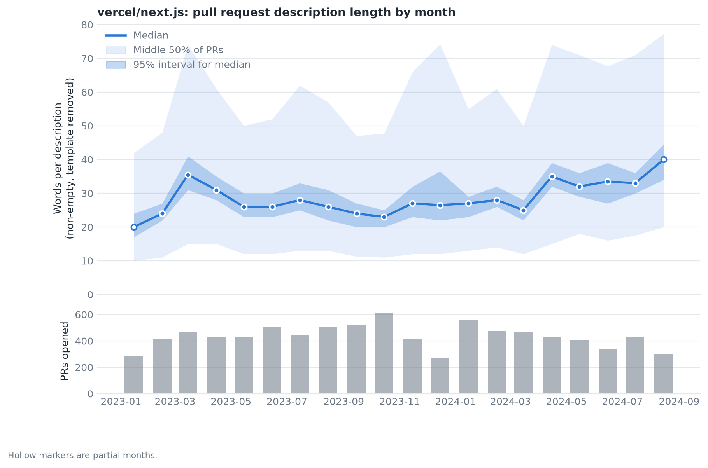
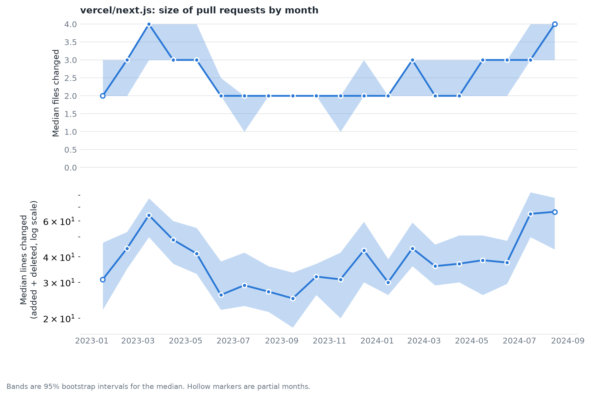
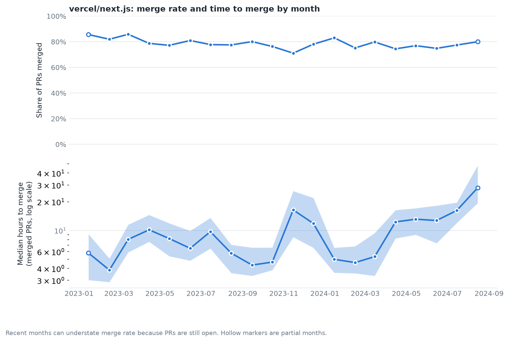
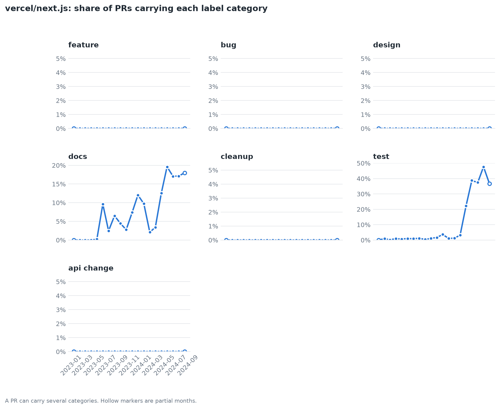
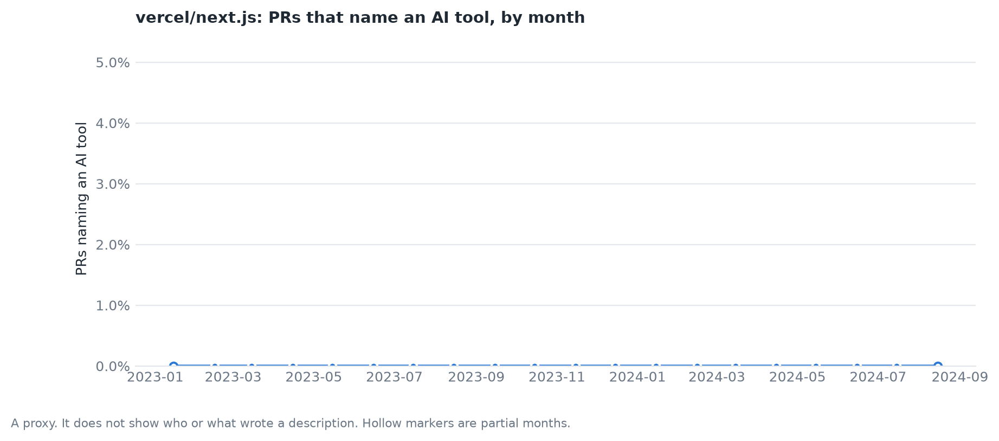

# Pull requests in vercel/next.js: description length, size, speed and labels

Window 2023-01-09 to 2024-08-19 (UTC). Data fetched 2026-11-19. prwords 3.0.0, generated 2026-11-26. Method fixed in advance in `docs/ANALYSIS_PLAN.md`.

## 1. Data

- Repository primary language: JavaScript
- Pull requests opened in the window: 9,218
- Removed as bot accounts: 512
- Analysed: 8,706 PRs from 1,712 authors
- Merged: 6,847 (78.6%). Closed without merging: 1,715 (19.7%). Still open: 144
- Follow-up: merge outcomes use a 30-day follow-up. PRs without enough follow-up: 0
- Empty descriptions after cleaning: 7.2%

## 2. Did the PR template change?

Lines that appeared or disappeared across the window (full list in `template_audit.csv`):

| line                                                                                                                                   | first_month   | last_month   |   months |   peak_share | change_event   |
|:---------------------------------------------------------------------------------------------------------------------------------------|:--------------|:-------------|---------:|-------------:|:---------------|
| errors have a helpful link attached, see `contributing.md`                                                                             | 2023-01       | 2023-02      |        2 |         0.63 | removed        |
| related issues linked using `fixes #number`                                                                                            | 2023-01       | 2023-02      |        2 |         0.63 | removed        |
| ## bug                                                                                                                                 | 2023-01       | 2023-02      |        2 |         0.62 | removed        |
| integration tests added                                                                                                                | 2023-01       | 2023-02      |        2 |         0.61 | removed        |
| ## documentation / examples                                                                                                            | 2023-01       | 2023-02      |        2 |         0.57 | removed        |
| the "examples guidelines" are followed from our contributing doc                                                                       | 2023-01       | 2023-02      |        2 |         0.57 | removed        |
| make sure the linting passes by running `pnpm build && pnpm lint`                                                                      | 2023-01       | 2023-02      |        2 |         0.56 | removed        |
| ## feature                                                                                                                             | 2023-01       | 2023-02      |        2 |         0.53 | removed        |
| documentation added                                                                                                                    | 2023-01       | 2023-02      |        2 |         0.53 | removed        |
| e2e tests added                                                                                                                        | 2023-01       | 2023-02      |        2 |         0.53 | removed        |
| implements an existing feature request or rfc. make sure the feature request has been accepted for implementation before opening a pr. | 2023-01       | 2023-02      |        2 |         0.53 | removed        |
| telemetry added. in case of a feature if it's used or not.                                                                             | 2023-01       | 2023-02      |        2 |         0.53 | removed        |

Distinct template lines detected: 14.

## 3. First 28 days versus last 28 days

First window 2023-01-09 to 2023-02-05. Last window 2024-07-23 to 2024-08-19. Ratios are last median divided by first median. Bootstrap intervals, 2,000 resamples.

| Metric                                |   n first |   n last |   Median first |   Median last |   Ratio |   Ratio low |   Ratio high |       p |   Cliff's delta |
|:--------------------------------------|----------:|---------:|---------------:|--------------:|--------:|------------:|-------------:|--------:|----------------:|
| Description words (non-empty)         |       279 |      404 |          23    |          37.5 |    1.63 |        1.42 |         2.11 | 1e-11   |            0.31 |
| Files changed                         |       317 |      436 |           2    |           4   |    2    |        1    |         2    | 0.00033 |            0.15 |
| Lines added                           |       317 |      436 |          21    |          42.5 |    2.02 |        1.1  |         2.63 | 0.024   |            0.1  |
| Lines deleted                         |       317 |      436 |           5    |          13   |    2.6  |        1.42 |         4.5  | 0.001   |            0.14 |
| Net lines (added minus deleted)       |       317 |      436 |           7    |           8   |    1.14 |        0.58 |         2.38 | 0.98    |           -0    |
| Lines changed (added plus deleted)    |       317 |      436 |          34    |          70.5 |    2.07 |        1.13 |         3.02 | 0.0079  |            0.11 |
| Hours from open to merge (merged PRs) |       273 |      338 |           6.19 |          25.6 |    4.13 |        2.38 |         9.29 | 2.4e-07 |            0.24 |
| Commits                               |       317 |      436 |           2    |           2   |    1    |        0.67 |         1    | 0.019   |           -0.1  |
| Comments                              |       317 |      436 |           1    |           3   |    3    |        3    |         3    | 6.5e-31 |            0.48 |
| Reviews                               |       317 |      436 |           1    |           1   |    1    |        1    |         1    | 0.1     |            0.07 |

| Measure                             |   n first |   n last | Share first   | Share last   |   Change (points) |       p |
|:------------------------------------|----------:|---------:|:--------------|:-------------|------------------:|--------:|
| Merged within follow-up period      |       317 |      436 | 84.5%         | 73.6%        |             -10.9 | 0.00034 |
| Closed without merging              |       317 |      436 | 13.6%         | 18.3%        |               4.8 | 0.09    |
| Opened as draft                     |       317 |      436 | 3.8%          | 9.4%         |               5.6 | 0.0035  |
| From outside contributors           |       317 |      436 | 67.8%         | 53.9%        |             -13.9 | 0.00012 |
| Has a kind or type label            |       317 |      436 | 58.0%         | 47.5%        |             -10.6 | 0.005   |
| Description text repeated elsewhere |       317 |      436 | 11.7%         | 1.6%         |             -10.1 | 5.1e-09 |
| Names an AI tool (disclosure)       |       317 |      436 | 0.0%          | 0.0%         |               0   | 1       |
| Label category: feature             |       317 |      436 | 0.0%          | 0.0%         |               0   | 1       |
| Label category: bug                 |       317 |      436 | 0.0%          | 0.0%         |               0   | 1       |
| Label category: design              |       317 |      436 | 0.0%          | 0.0%         |               0   | 1       |
| Label category: docs                |       317 |      436 | 0.0%          | 17.7%        |              17.7 | 2.8e-20 |
| Label category: cleanup             |       317 |      436 | 0.0%          | 0.0%         |               0   | 1       |
| Label category: test                |       317 |      436 | 0.3%          | 38.3%        |              38   | 1.4e-45 |
| Label category: api_change          |       317 |      436 | 0.0%          | 0.0%         |               0   | 1       |

## 4. Monthly trends

Theil-Sen slope per month and Kendall tau over full months only.

| metric                     |   months |   slope_per_month |   slope_ci_low |   slope_ci_high |     tau |       p |
|:---------------------------|---------:|------------------:|---------------:|----------------:|--------:|--------:|
| median_words               |       18 |             0.273 |         -0.125 |           0.667 |   0.26  |   0.138 |
| median_files_changed       |       18 |            -0     |         -0     |          -0     |  -0.078 |   0.695 |
| median_additions           |       18 |            -0.125 |         -1     |           0.6   |  -0.047 |   0.79  |
| median_deletions           |       18 |             0.125 |         -0.111 |           0.4   |   0.199 |   0.266 |
| median_churn               |       18 |             0.5   |         -0.958 |           1.25  |   0.079 |   0.649 |
| median_hours_to_merge      |       18 |             0.311 |         -0.131 |           0.711 |   0.294 |   0.096 |
| merge_rate                 |       18 |            -0.003 |         -0.006 |          -0     |  -0.386 |   0.026 |
| share_outside_contributors |       18 |             0.004 |         -0.003 |           0.012 |   0.203 |   0.26  |
| share_ai_disclosed         |       18 |            -0     |         -0     |          -0     | nan     | nan     |
| median_comments            |       18 |            -0     |         -0     |           0.083 |   0.613 |   0.002 |
| median_reviews             |       18 |            -0     |         -0     |          -0     |  -0.114 |   0.574 |
| share_feature              |       18 |            -0     |         -0     |          -0     | nan     | nan     |
| share_bug                  |       18 |            -0     |         -0     |          -0     | nan     | nan     |
| share_design               |       18 |            -0     |         -0     |          -0     | nan     | nan     |
| share_docs                 |       18 |             0.01  |          0.005 |           0.013 |   0.66  |   0     |
| share_cleanup              |       18 |            -0     |         -0     |          -0     | nan     | nan     |
| share_test                 |       18 |             0.004 |          0.001 |           0.026 |   0.712 |   0     |
| share_api_change           |       18 |            -0     |         -0     |          -0     | nan     | nan     |

## 5. Labels

Share of PRs with a kind or type label: 56.7% overall. Label coverage by month is in `monthly_summary.csv` (`share_has_kind_label`).

| category            |   n_prs |   share |   median_words |   median_files |   median_churn |   merge_rate |   median_hours_to_merge |   share_ai_disclosed |
|:--------------------|--------:|--------:|---------------:|---------------:|---------------:|-------------:|------------------------:|---------------------:|
| feature             |       0 |   0     |            nan |            nan |          nan   |      nan     |                 nan     |                  nan |
| bug                 |       0 |   0     |            nan |            nan |          nan   |      nan     |                 nan     |                  nan |
| design              |       0 |   0     |            nan |            nan |          nan   |      nan     |                 nan     |                  nan |
| docs                |     596 |   0.068 |             26 |              1 |           12.5 |        0.79  |                  10.973 |                    0 |
| cleanup             |       0 |   0     |            nan |            nan |          nan   |      nan     |                 nan     |                  nan |
| test                |     772 |   0.089 |             49 |              6 |          101   |        0.728 |                  19.777 |                    0 |
| api_change          |       0 |   0     |            nan |            nan |          nan   |      nan     |                 nan     |                  nan |
| (no category label) |    7421 |   0.852 |             27 |              2 |           35   |        0.79  |                   6.788 |                    0 |

## 6. Are PRs with signs of AI involvement smaller or larger?

Authorship is not observable. The proxy is `ai_disclosed`, defined in the analysis plan: 0 PRs (0.00%). 0 disclosed PRs are listed in `ai_disclosure_samples.csv` for manual audit.

### ai_disclosed

**Verdict: not testable.** Too few exposed PRs.

Pattern: lines changed: not estimated; files changed: not estimated; lines added: not estimated; lines deleted: not estimated; hours to merge: not estimated.

Not estimated: fewer than 30 exposed PRs (exposed PRs: 0).

### Robustness by tool (lines changed)

No tool named in any disclosure.

### File type check

Not run. Use `--file-check N` to sample N exposed PRs and matching unexposed PRs.

## 7. Other checks

- Outside contributors: 71.7% of PRs overall.
- Top 10 authors opened 46.1% of PRs.
- PRs whose description text is repeated elsewhere (10 or more words): 1.5%.

## 8. Limitations

- Word count and size describe PRs, not who wrote them. Proxies for AI involvement are noisy and omit undisclosed use.
- Added and deleted lines include generated or vendored files unless the project avoids committing them.
- Disclosure mostly captures tools that add attribution by default, so it is tool-skewed.
- Template removal is heuristic. Check `template_audit.csv`.
- One repository cannot support general claims. See the plan for replication.
- Months at the edges of the window are partial and are excluded from trend tests.

