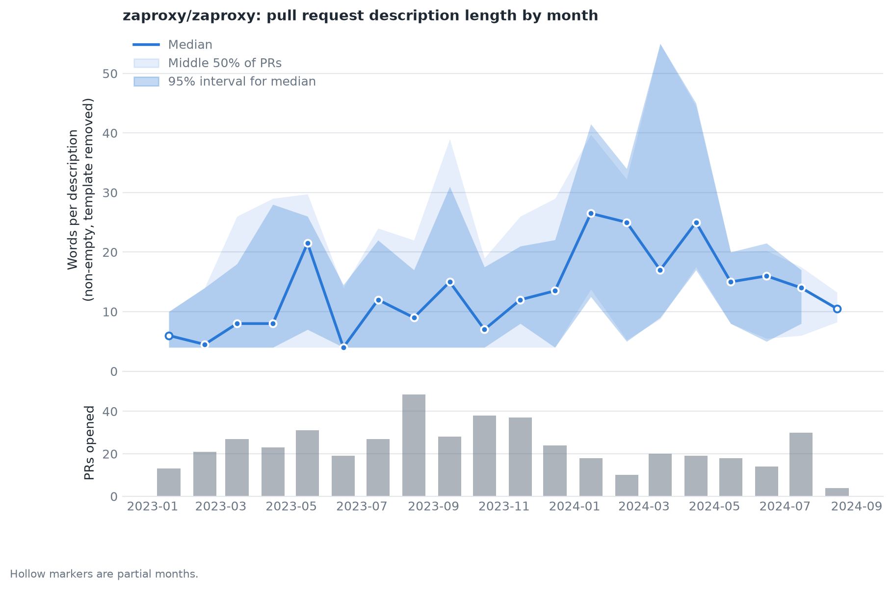
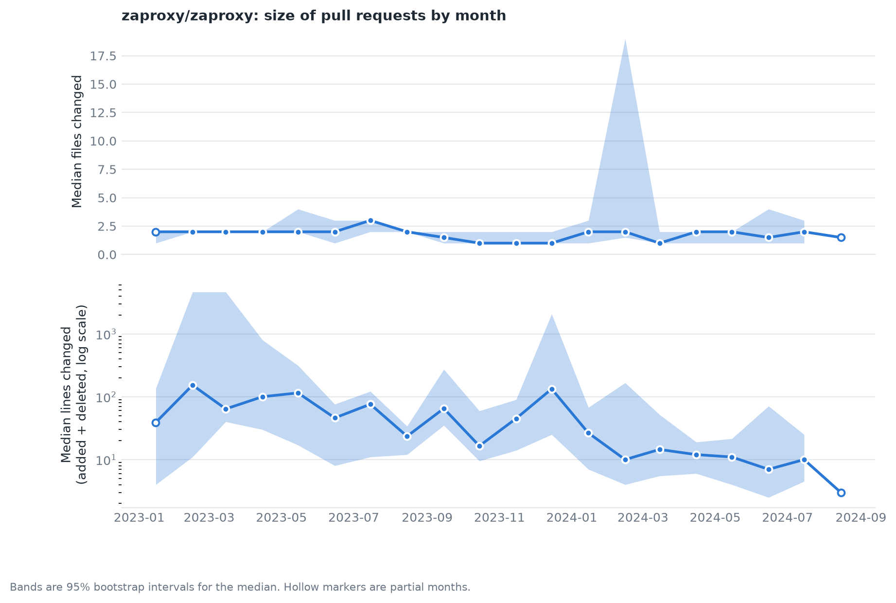
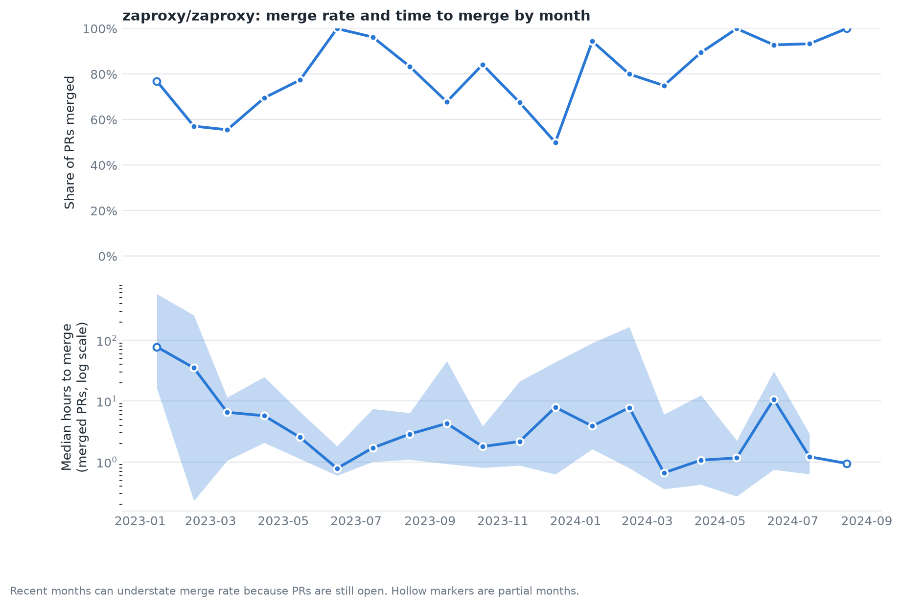
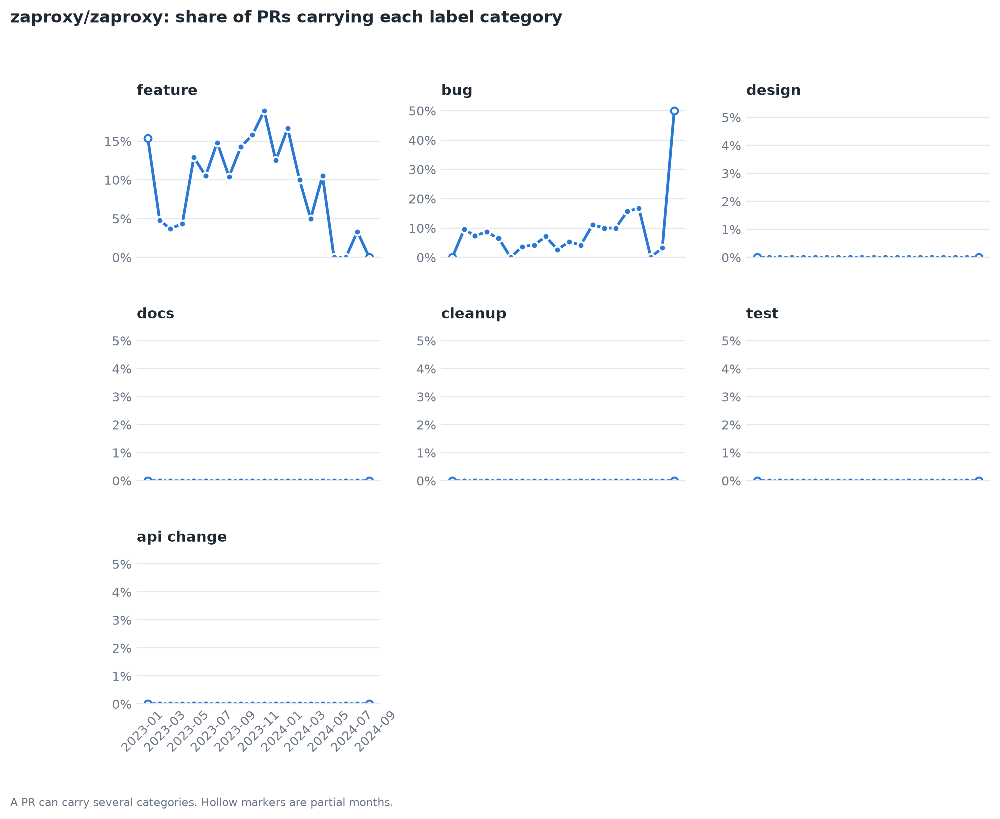
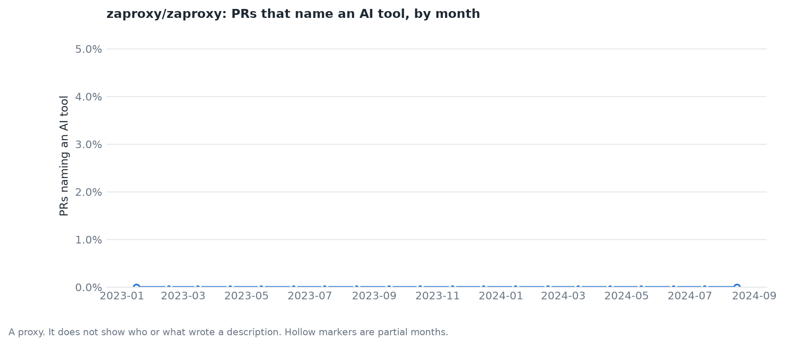

# Pull requests in zaproxy/zaproxy: description length, size, speed and labels

Window 2023-01-09 to 2024-08-19 (UTC). Data fetched 2026-11-20. prwords 3.0.0, generated 2026-11-26. Method fixed in advance in `docs/ANALYSIS_PLAN.md`.

## 1. Data

- Repository primary language: Java
- Pull requests opened in the window: 469
- Removed as bot accounts: 0
- Analysed: 469 PRs from 49 authors
- Merged: 370 (78.9%). Closed without merging: 87 (18.6%). Still open: 12
- Follow-up: merge outcomes use a 30-day follow-up. PRs without enough follow-up: 0
- Empty descriptions after cleaning: 12.2%

## 2. Did the PR template change?

No template line appeared or disappeared with a share of 50% or more. Template text was detected monthly and removed before counting words.

Distinct template lines detected: 0.

## 3. First 28 days versus last 28 days

First window 2023-01-09 to 2023-02-05. Last window 2024-07-23 to 2024-08-19. Ratios are last median divided by first median. Bootstrap intervals, 2,000 resamples.

| Metric                                |   n first |   n last |   Median first |   Median last |   Ratio |   Ratio low |   Ratio high |       p |   Cliff's delta |
|:--------------------------------------|----------:|---------:|---------------:|--------------:|--------:|------------:|-------------:|--------:|----------------:|
| Description words (non-empty)         |        17 |       13 |           8    |          9    |    1.12 |        0.6  |         3    | 0.43    |            0.18 |
| Files changed                         |        17 |       16 |           2    |          1.5  |    0.75 |        0.5  |         2    | 0.41    |           -0.16 |
| Lines added                           |        17 |       16 |          32    |          4.5  |    0.14 |        0.02 |         1.43 | 0.051   |           -0.4  |
| Lines deleted                         |        17 |       16 |           2    |          1    |    0.5  |        0.05 |         0.5  | 0.64    |           -0.1  |
| Net lines (added minus deleted)       |        17 |       16 |           4    |          3.5  |    0.88 |        0    |         6    | 0.33    |           -0.2  |
| Lines changed (added plus deleted)    |        17 |       16 |          46    |          6.5  |    0.14 |        0.03 |         1.11 | 0.06    |           -0.39 |
| Hours from open to merge (merged PRs) |        13 |       15 |          95.39 |          0.59 |    0.01 |        0    |         0.03 | 0.00013 |           -0.86 |
| Commits                               |        17 |       16 |           1    |          1    |    1    |        1    |         1    | 0.97    |            0.01 |
| Comments                              |        17 |       16 |           2    |          1    |    0.5  |        0    |         1    | 0.0014  |           -0.6  |
| Reviews                               |        17 |       16 |           2    |          2    |    1    |        0.5  |         1    | 0.2     |           -0.22 |

| Measure                             |   n first |   n last | Share first   | Share last   |   Change (points) |     p |
|:------------------------------------|----------:|---------:|:--------------|:-------------|------------------:|------:|
| Merged within follow-up period      |        17 |       16 | 64.7%         | 93.8%        |              29   | 0.085 |
| Closed without merging              |        17 |       16 | 17.6%         | 6.2%         |             -11.4 | 0.6   |
| Opened as draft                     |        17 |       16 | 0.0%          | 0.0%         |               0   | 1     |
| From outside contributors           |        17 |       16 | 41.2%         | 6.2%         |             -34.9 | 0.039 |
| Has a kind or type label            |        17 |       16 | 88.2%         | 87.5%        |              -0.7 | 1     |
| Description text repeated elsewhere |        17 |       16 | 0.0%          | 0.0%         |               0   | 1     |
| Names an AI tool (disclosure)       |        17 |       16 | 0.0%          | 0.0%         |               0   | 1     |
| Label category: feature             |        17 |       16 | 11.8%         | 0.0%         |             -11.8 | 0.48  |
| Label category: bug                 |        17 |       16 | 0.0%          | 12.5%        |              12.5 | 0.23  |
| Label category: design              |        17 |       16 | 0.0%          | 0.0%         |               0   | 1     |
| Label category: docs                |        17 |       16 | 0.0%          | 0.0%         |               0   | 1     |
| Label category: cleanup             |        17 |       16 | 0.0%          | 0.0%         |               0   | 1     |
| Label category: test                |        17 |       16 | 0.0%          | 0.0%         |               0   | 1     |
| Label category: api_change          |        17 |       16 | 0.0%          | 0.0%         |               0   | 1     |

## 4. Monthly trends

Theil-Sen slope per month and Kendall tau over full months only.

| metric                     |   months |   slope_per_month |   slope_ci_low |   slope_ci_high |     tau |       p |
|:---------------------------|---------:|------------------:|---------------:|----------------:|--------:|--------:|
| median_words               |       18 |             0.688 |          0.25  |           1.333 |   0.444 |   0.011 |
| median_files_changed       |       18 |            -0     |         -0.042 |          -0     |  -0.212 |   0.274 |
| median_additions           |       18 |            -4.062 |         -6.222 |          -1.5   |  -0.704 |   0     |
| median_deletions           |       18 |            -0.167 |         -0.5   |           0.059 |  -0.223 |   0.207 |
| median_churn               |       18 |            -6     |         -8.308 |          -2.75  |  -0.669 |   0     |
| median_hours_to_merge      |       18 |            -0.133 |         -0.46  |           0.154 |  -0.19  |   0.293 |
| merge_rate                 |       18 |             0.015 |         -0.002 |           0.027 |   0.302 |   0.081 |
| share_outside_contributors |       18 |            -0.017 |         -0.026 |          -0.012 |  -0.595 |   0     |
| share_ai_disclosed         |       18 |            -0     |         -0     |          -0     | nan     | nan     |
| median_comments            |       18 |            -0     |         -0     |          -0     |  -0.063 |   0.748 |
| median_reviews             |       18 |            -0     |         -0     |          -0     | nan     | nan     |
| share_feature              |       18 |            -0.002 |         -0.009 |           0.006 |  -0.112 |   0.519 |
| share_bug                  |       18 |             0.001 |         -0.004 |           0.008 |   0.079 |   0.649 |
| share_design               |       18 |            -0     |         -0     |          -0     | nan     | nan     |
| share_docs                 |       18 |            -0     |         -0     |          -0     | nan     | nan     |
| share_cleanup              |       18 |            -0     |         -0     |          -0     | nan     | nan     |
| share_test                 |       18 |            -0     |         -0     |          -0     | nan     | nan     |
| share_api_change           |       18 |            -0     |         -0     |          -0     | nan     | nan     |

## 5. Labels

Share of PRs with a kind or type label: 81.9% overall. Label coverage by month is in `monthly_summary.csv` (`share_has_kind_label`).

| category            |   n_prs |   share |   median_words |   median_files |   median_churn |   merge_rate |   median_hours_to_merge |   share_ai_disclosed |
|:--------------------|--------:|--------:|---------------:|---------------:|---------------:|-------------:|------------------------:|---------------------:|
| feature             |      48 |   0.102 |           21   |              2 |             48 |        0.938 |                  15.428 |                    0 |
| bug                 |      31 |   0.066 |           31.5 |              2 |             17 |        1     |                   1.646 |                    0 |
| design              |       0 |   0     |          nan   |            nan |            nan |      nan     |                 nan     |                  nan |
| docs                |       0 |   0     |          nan   |            nan |            nan |      nan     |                 nan     |                  nan |
| cleanup             |       0 |   0     |          nan   |            nan |            nan |      nan     |                 nan     |                  nan |
| test                |       0 |   0     |          nan   |            nan |            nan |      nan     |                 nan     |                  nan |
| api_change          |       0 |   0     |          nan   |            nan |            nan |      nan     |                 nan     |                  nan |
| (no category label) |     390 |   0.832 |            9   |              2 |             29 |        0.754 |                   1.729 |                    0 |

## 6. Are PRs with signs of AI involvement smaller or larger?

Authorship is not observable. The proxy is `ai_disclosed`, defined in the analysis plan: 0 PRs (0.00%). 0 disclosed PRs are listed in `ai_disclosure_samples.csv` for manual audit.

### ai_disclosed

**Verdict: not testable.** Too few exposed PRs.

Pattern: lines changed: not estimated; files changed: not estimated; lines added: not estimated; lines deleted: not estimated; hours to merge: not estimated.

Not estimated: fewer than 30 exposed PRs (exposed PRs: 0).

### Robustness by tool (lines changed)

No tool named in any disclosure.

### File type check

Not run. Use `--file-check N` to sample N exposed PRs and matching unexposed PRs.

## 7. Other checks

- Outside contributors: 35.2% of PRs overall.
- Top 10 authors opened 90.2% of PRs.
- PRs whose description text is repeated elsewhere (10 or more words): 0.0%.

## 8. Limitations

- Word count and size describe PRs, not who wrote them. Proxies for AI involvement are noisy and omit undisclosed use.
- Added and deleted lines include generated or vendored files unless the project avoids committing them.
- Disclosure mostly captures tools that add attribution by default, so it is tool-skewed.
- Template removal is heuristic. Check `template_audit.csv`.
- One repository cannot support general claims. See the plan for replication.
- Months at the edges of the window are partial and are excluded from trend tests.

